
**x64dbg로 실행 흐름을 따라가며 문자열을 찾고 패치하는 실습**을 진행했다. hello.exe와 Loop 문제를 통해 중단점, 덤프 창, 조건부 점프를 직접 확인했다.

## 1. 디버거란?

정의

- 디버거는 프로그램의 실행을 제어하며 내부 동작을 관찰하고 분석할 수 있게 해주는 도구이다.

특징

1. 실행 흐름 제어 : 프로그램을 한 줄씩 실행하거나, 특정 지점에서 멈추게 할 수 있다.

2. 중단점 : 어느 주소에서 멈추는 명령을 지정할 수 있음

3. RAM, CPU 실시간으로 변동하는 것을 확인하고 값을 수정하여 프로그램 흐름을 바꿀 수 있음

4. 디스어셈블리 : 실행 파일의 기계어를 사람이 읽을 수 있는 어셈블리 코드로 변환해서 보여준다.

디버거의 장단점

장점

- 소스 코드 없이도 프로그램의 내부 동작을 정확히 파악 가능
- 메모리, 레지스터 값을 실시간으로 보고 수정 가능(조작도 가능)
- 취약점 발생 시점을 명확하게 포착할 수 있음
- 정적 분석으로는 보이지 않는 복호화된 문자열 등을 볼 수 있음

단점

- 어셈블리어, OS구조, 메모리 구조에 대한 사전 지식이 필요
- 큰 프로그램의 경우 한 줄씩 따라가는 건 시간이 많이 소요됨
- 상용 소프트웨어나 악성코드는 디버거를 탐지하면 동작을 멈추거나 다르게 행동

### x64dbg 단축키 / 명령어

| 단축키 | 기능 | 사용처 |
| --- | --- | --- |
| <strong>F9</strong> | Run | 다음 BP까지 실행 |
| <strong>F8</strong> | Step Over | 한 줄 실행 (call은 건너뜀) |
| <strong>F7</strong> | Step Into | 한 줄 실행 (call 내부로 진입) |
| <strong>Ctrl+F9</strong> | Execute till return | 함수 끝(ret)까지 한 번에 실행 |
| <strong>F2</strong> | Breakpoint | 현재 줄에 BP 설정/해제 |

| 단축키 | 기능 | 언제 쓰는지 |
| --- | --- | --- |
| <strong>Ctrl+G</strong> | Go to | 특정 주소/함수로 점프 |
| <strong>Enter</strong> | Follow | call/jmp 목적지로 따라가기 |
| <strong>\\</strong>\* | Return | 따라간 위치에서 원래 자리로 |

## 2. hello.exe의 main 함수와 출력 문자열 찾기

먼저 Hello.exe 파일을 다운 받고 x64 dbg에서 실행하게 되면 이러한 초기 화면이 나타난다.

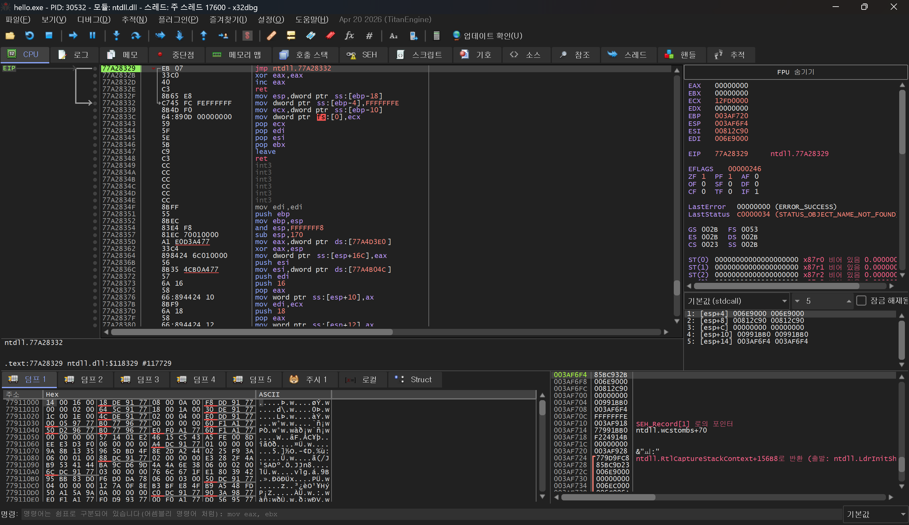

이 시작화면에서 우리는 Main함수를 먼저 찾아야 한다.

이 부분은 생각보다 간단한데 EntryPoint를 먼저 찾으면 된다.

- EntryPoint?
  - 엔트리 포인트는 운영체제가 프로그램을 실행할 때 가장 먼저 실행하는 코드의 주소이다.
  - main함수보다도 먼저 작동되며 EntryPoint 에서 시작해서 한참 동안 컴파일러가 자동으로 추가한 준비 작업을 거친 후에야 우리가 작성한 main()에 도달한다.

엔트리 포인트를 찾는 방법은 F9(Run)를 사용하다 보면 나오게 된다.

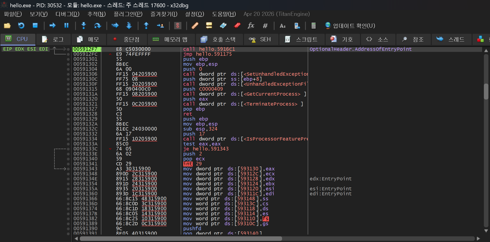

약 6번 정도 F9를 작동하니 왼쪽 위에 모듈이 hello.exe로 변경 된 것을 확인 할 수 있고

call hello.5916c1옆에 OptionalHeader.AddressOfEntryPoint라고 여기가 엔트리 포인트라고 명시가 되어 있는 문장이 존재한다.

이렇게 엔트리 포인트를 찾았으면 문자열 참조를 통해 Hello world! 가 저장되어있는 주소가 어디인지 찾아볼 것이다.

화면에서 우클릭 → 다음을 찾기 → 현재 모듈 → 문자열 찾기 클릭

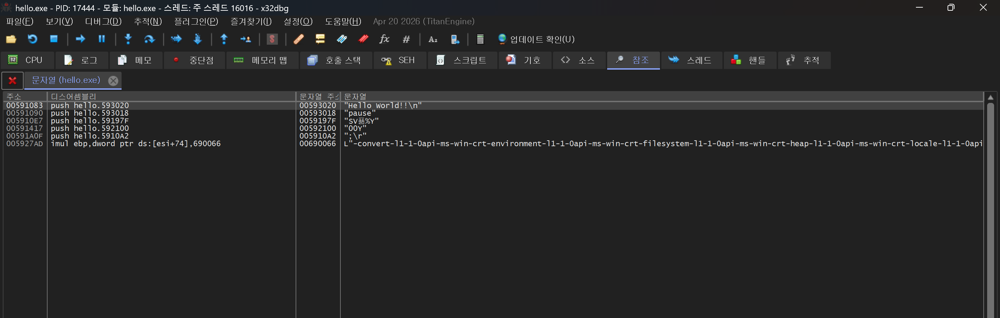

그러면 이러한 화면이 나오게 되는데 첫 번째에 잘 보면 <br />주소 : 00591083 / 디스어셈블리 : push hello.593020 <br />문자열 주소 : 00593020 / 문자열 : Hello world! \\n라고 작성 되어 있는데 이 부분을 더블클릭해서 들어가게 되면

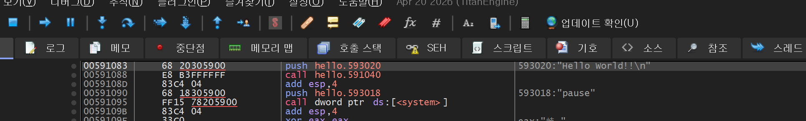

00591083 주소로 점프하여 해당 주소를 보여준다.

## 3. 출력 문자열 패치

이 부분에서 조금 고민이 많았다.

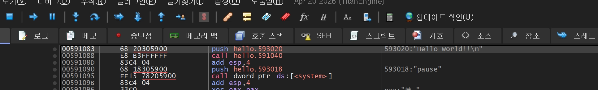

이 화면에서 단순히 오른 쪽에 있는 값을 바꿔주는건가? 생각을 하였지만 주석을 바꿔주는거였고, 실제 값을 어떻게 바꾸는지 몰라 난해한 방향으로 들어가기도 하였다.

계속 찾아본 끝에 덤프 창에서 ASCII 값을 바꿔주면 바뀐다는 말을 듣고 실행에 옮기게 되었다.

먼저 다시 Hello world! 문장으로 이동하기 위해 맨 아래 명령어 창에다가 <code>dump 00593020</code> 명령어를 사용하여 빠르게 이동해준다.

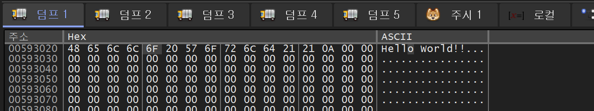

명령어를 실행하면 위의 화면처럼 나타나게 된다. 여기서 아무런 Hex 값을 더블클릭 하게 되면 이러한 화면이 나타난다.

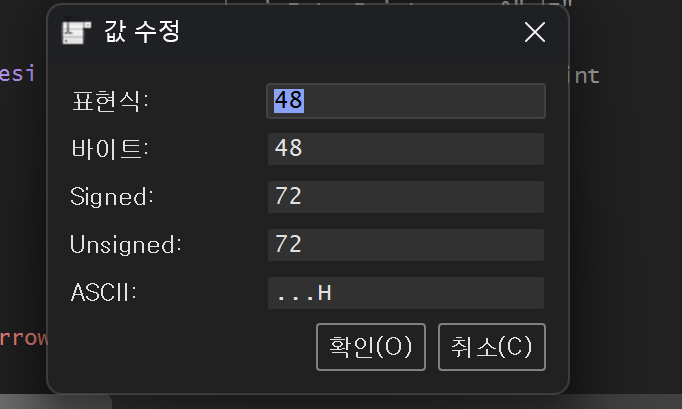

Hello만 남기고 나머지 ascii코드들을 무작위로 넣어 주었다.

값을 변경한 뒤 ctrl+p 단축키를 입력하여 패치 창으로 들어간 다음 파일 패치를 누르고 저장한다. (hello2.exe로 저장함)

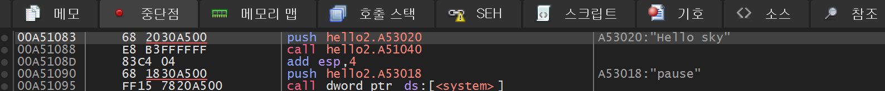

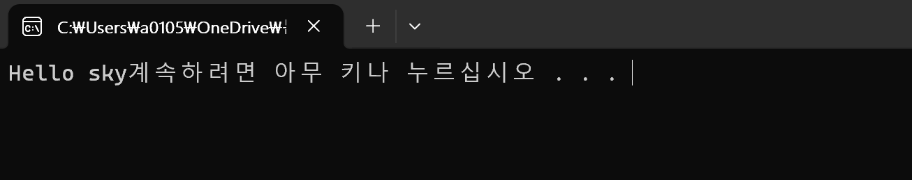

값을 바꾼 후 패치된 파일을 열어 실행 하였더니 값이 바뀐 것을 확인 할 수 있다.

## 4. Loop 문제 풀이

처음에 파일을 연 후 일단 F9를 눌러 엔트리 포인트를 찾아준다.

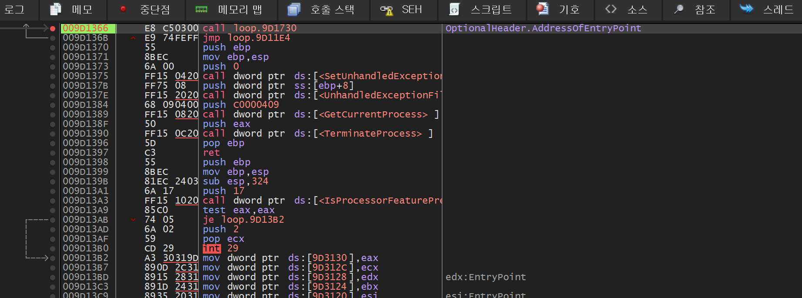

엔트리 포인트를 찾은 후 문자열 찾기를 눌러서 목록들을 확인한다.

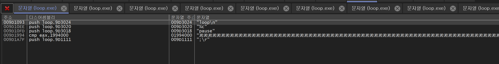

그러면 아래 사진처럼 loop \\n이 출력되는 문장을 찾았다! 클릭하게 된다.

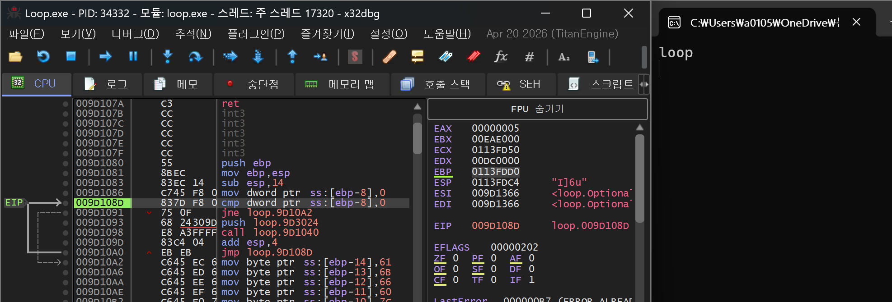

실제로 loop가 돌아가는 열을 F8을 눌러 한 줄씩 실행하면 계속 돌아오는 것을 볼 수 있다.

```asm
009D1086 | C745 F8 0000 | mov dword ptr ss:[ebp-8],0              |
009D108D | 837D F8 00   | cmp dword ptr ss:[ebp-8],0              |
009D1091 | 75 0F        | jne loop.9D10A2                         |
009D1093 | 68 24309D00  | push loop.9D3024                        | 9D3024:"loop\n"
009D1098 | E8 A3FFFFFF  | call loop.9D1040                        |
009D109D | 83C4 04      | add esp,4                               |
009D10A0 | EB EB        | jmp loop.9D108D                         |
```

어셈블리 명령어를 해석 해보면 다음과 같아진다.

```asm
mov dword ptr ss:[ebp-8],0 ;ebp-8 위치에 0을 mov명령어로 저장한다.
cmp dword ptr ss:[ebp-8],0 ;cmp 조건 비교문을 사용하여 ebp-8과 0을 비교한다
jne loop.9D10A2 ;jne 조건부 점프 명령어를 사용하여 값이 다르면 점프하고 아니면 내려간다.
push loop.9D3024 ;1oop \n 문자열 주소를 푸시한다.
call loop.9D1040 ;call명령어로 호출하여 loop문을 실질적으로 화면에 나타내는 명령어이다
add esp,4 ;esp에 4를 추가한다
jmp loop.9D108D ;무조건 점프 명령어로 다시 맨 위 mov문으로 돌아온다
```

이제 다 해석 하였으니 어떻게 해야 이 무한 루프 문을 빠져나와 flag를 찾느냐가 관건이다.

다 해본 결과 총 3가지 방법으로 무한 루프를 뚫고 들어갈 수있다.

1. jmp 명령어 삭제 방법
   - 아래 사진을 보면 jmp 명령어로 cmp 명령어가 있는 주소를 가리키는 주소로 무조건 이동하게 된다

   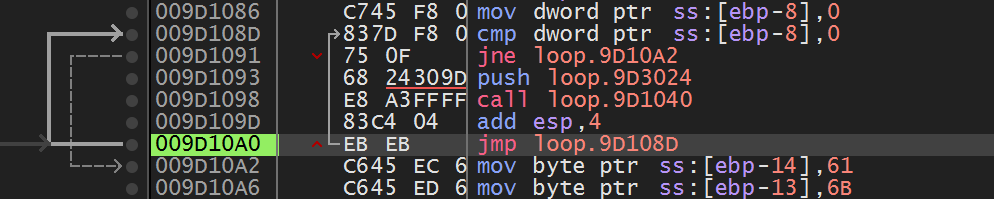

   - 그러므로 아래 jmp명령어를 삭제하게 되면 자연스럽게 무한 루프를 빠져나올 수 있다.
   - 명령어를 지우는 방법은 스페이스바를 누른 후 지운 후 nop를 사용하고 잔존 바이트를 NOP로 채우기를 클릭한 다음 확인을 누르면 된다.

   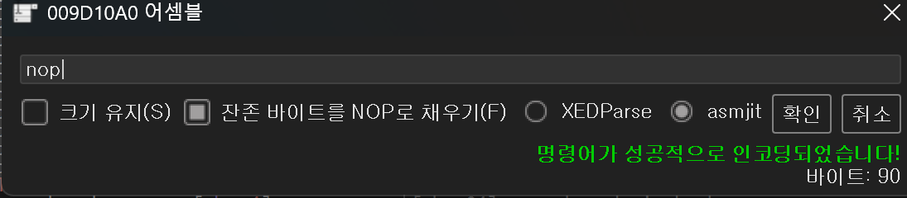
2. cmp 명령어 변환 방법
   - mov 명령어를 통해 ebp-8 위치에 0을 넣은 후 cmp로 똑같이 조건을 본 후 jne로 이동을 하는데 cmp 연산에 수정하여 cmp dword ptr ss:\[ebp-8\],1을 바꾸면 무한루프문을 빠져나올 수 있다.

   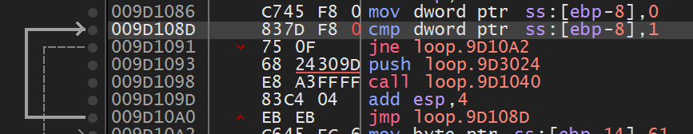
3. jne 명령어 jmp로 변환
   - 방법 2번과 약간 비슷한 원리긴 한데 2번은 cmp 명령문의 조건을 바꿔 다르게 연산 하였다면 3번은 jne 조건 연산문을 jmp로 무조건적으로 바꿔준다.

   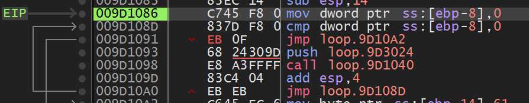

### 느낀 점

어셈블리 명령어를 직접 분석하고 사용해 보니, 1·2주차에 정리한 내용을 아직 충분히 익히지 못했다는 느낌이 들었다. 특히 Jxx 명령어를 구분하고 풀이 방향을 정하는 부분이 어려웠다.

Loop 문제는 선배님의 도움을 받아 해결했다. 앞으로는 분기 직전의 값과 플래그를 직접 확인하면서 명령어를 익혀야겠다고 느꼈다.

