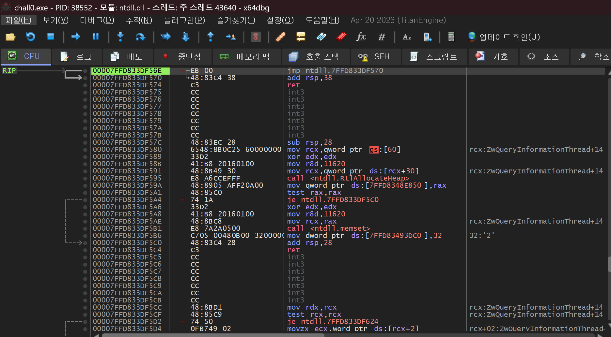
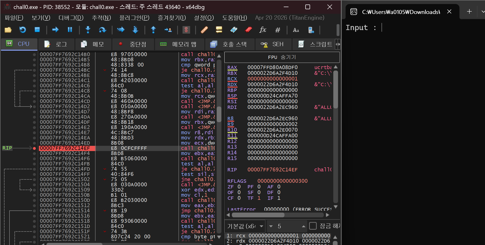
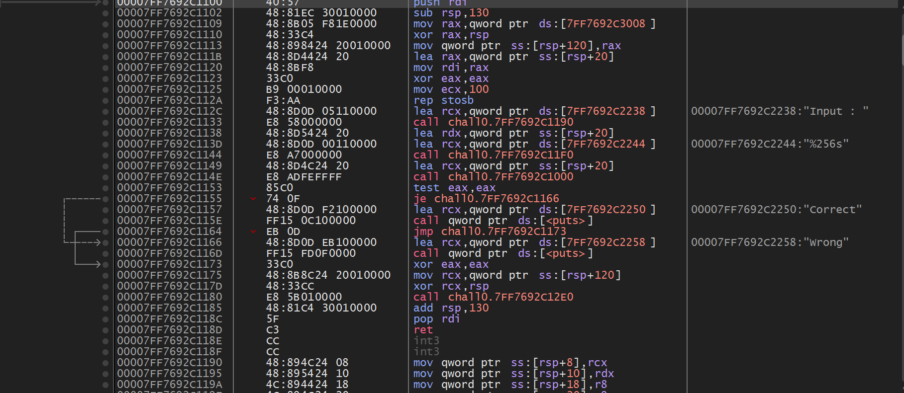
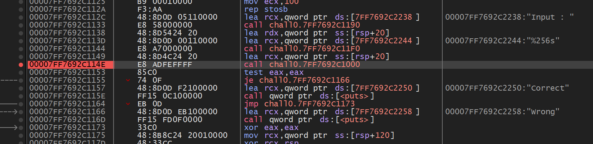
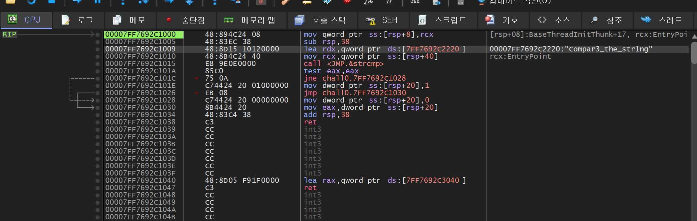


> <strong>플랫폼:</strong> [dreamhack.io](http://dreamhack.io) · <strong>카테고리:</strong> 리버싱 · <strong>난이도:</strong> Basic

> x64dbg로 입력값 검증 로직을 분석해 correct를 출력하는 문자열 탐색

---

문제 주소 : [https://dreamhack.io/wargame/challenges/14](https://dreamhack.io/wargame/challenges/14)

## 문제 설명

<strong>이 문제는 사용자에게 문자열 입력을 받아 정해진 방법으로 입력값을 검증하여 correct 또는 wrong을 출력하는 프로그램이 주어집니다.</strong>

<strong>해당 바이너리를 분석하여 correct를 출력하는 입력값을 찾으세요!</strong>

<strong>획득한 입력값은 <code>DH{}</code> 포맷에 넣어서 인증해주세요.</strong>

<strong>예시) 입력 값이 <code>Apple_Banana</code>일 경우 flag는 <code>DH{Apple_Banana}</code></strong>

## 문제 풀이

먼저 처음에 들어오면 이러한 화면이 뜨게 되는데 F9를 눌러서 main을 찾아준다

F9를 누르다보면 왼쪽위 모듈이 chall0.exe로 바뀌는데 여기서 F8로 한 줄씩 실행하여 main을 찾아내게 된다.(찾은 후 bp를 걸어줌)

메인을 더블클릭해서 들어오면 중요해 보이는 문장들이 보인다.

Input : 값이 실제로 실행되는 주소와 조건들이 몇가지 보이는데 가장 중요한 부분은 input과 256글자 제한 등도 좋지만 그 바로 아래인 조건을 검사하는 call 명령어 문장이다.

bp를 건 후 안으로 들어가보면 아래와 같은 사진처럼 나오게 된다.

여기 오른쪽에 flag가 써져있다.

정답 : DH\{compar3\_the\_string\}

