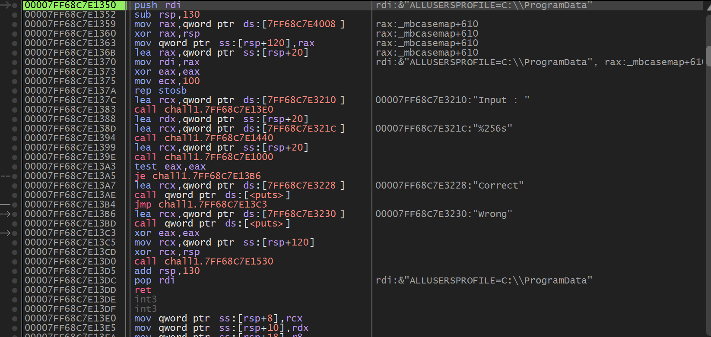
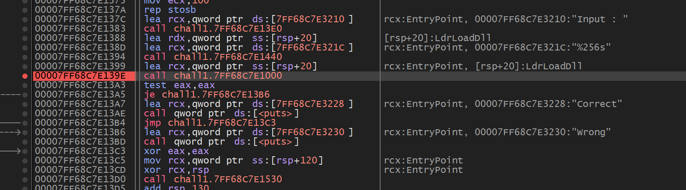
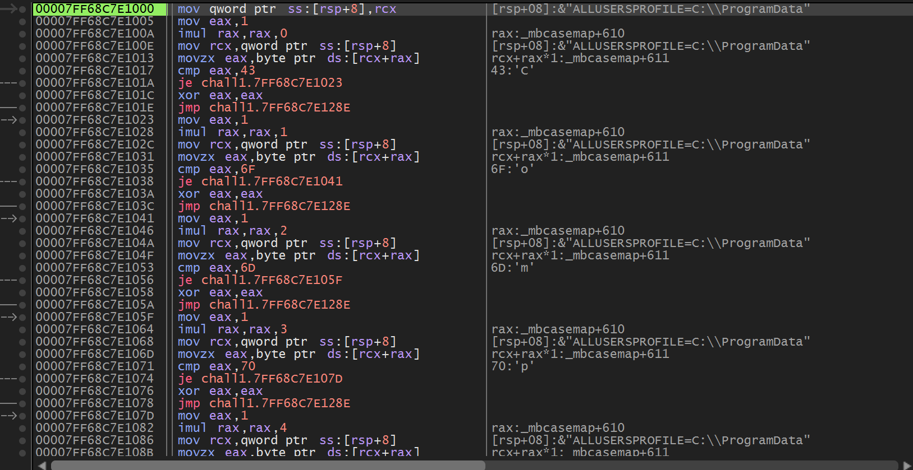


> <strong>플랫폼:</strong> [dreamhack.io](http://dreamhack.io) · <strong>카테고리:</strong> 리버싱 · <strong>난이도:</strong> Basic

> 검증 함수 내부에서 문자별 비교 로직 분석 → correct 출력 입력값 조합

---

문제 주소 : [https://dreamhack.io/wargame/challenges/15](https://dreamhack.io/wargame/challenges/15)

## 문제 설명

<strong>이 문제는 사용자에게 문자열 입력을 받아 정해진 방법으로 입력값을 검증하여 correct 또는 wrong을 출력하는 프로그램이 주어집니다.</strong>

<strong>해당 바이너리를 분석하여 correct를 출력하는 입력값을 알아내세요.</strong>

<strong>획득한 입력값은 <code>DH{}</code> 포맷에 넣어서 인증해주세요.</strong>

<strong>예시) 입력 값이 <code>Apple_Banana</code>일 경우 flag는 <code>DH{Apple_Banana}</code></strong>

## 문제 풀이

처음에 들어와서 #0번과 같이 main을 찾아서 bp를 걸어준다.

이렇게 main을 찾아주면 input : / 문자 검증 / 조건 검색하는 문장이 나오게 된다.

우리가 봐야하는건 #0과 같이 조건 검색인 call 명령어이다.

이렇게 조건 검색하는 call명령어를 찾아 bp를 걸어 멈추게 한 뒤 F7을 눌러 call명령어 안으로 들어간다.

들어가게 되면 위 사진과 같이 명령어들이 나오게 되는데 오른쪽에 Comp…..라고 되어 있는걸 아래로 스크롤을 넘기며 조합해주면  <code>Compar3_the_ch4ract3r</code> 라는 단어가 나오고 형식에 맞춰 만들면 정답이 나오게 된다.

flag : DH\{Compar3\_the\_ch4ract3r\}

