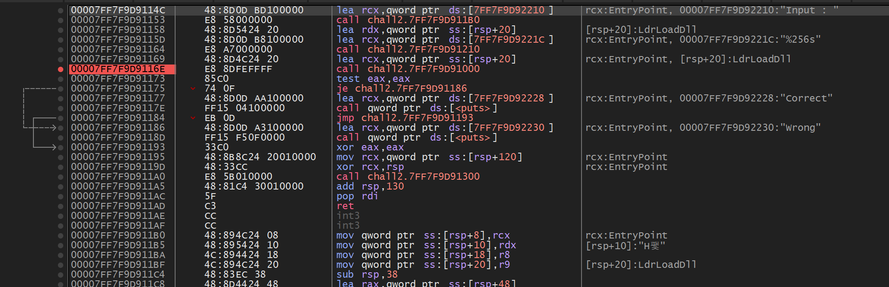
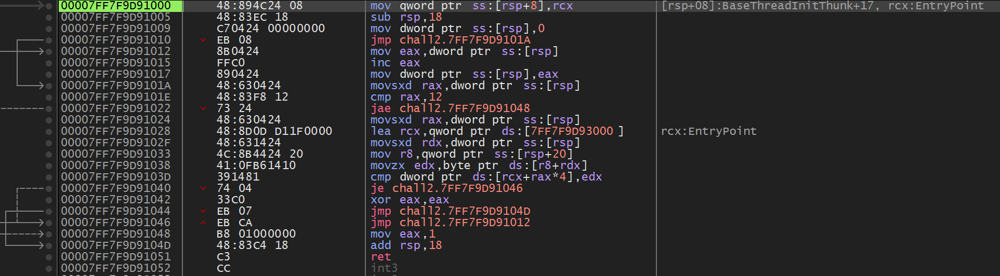
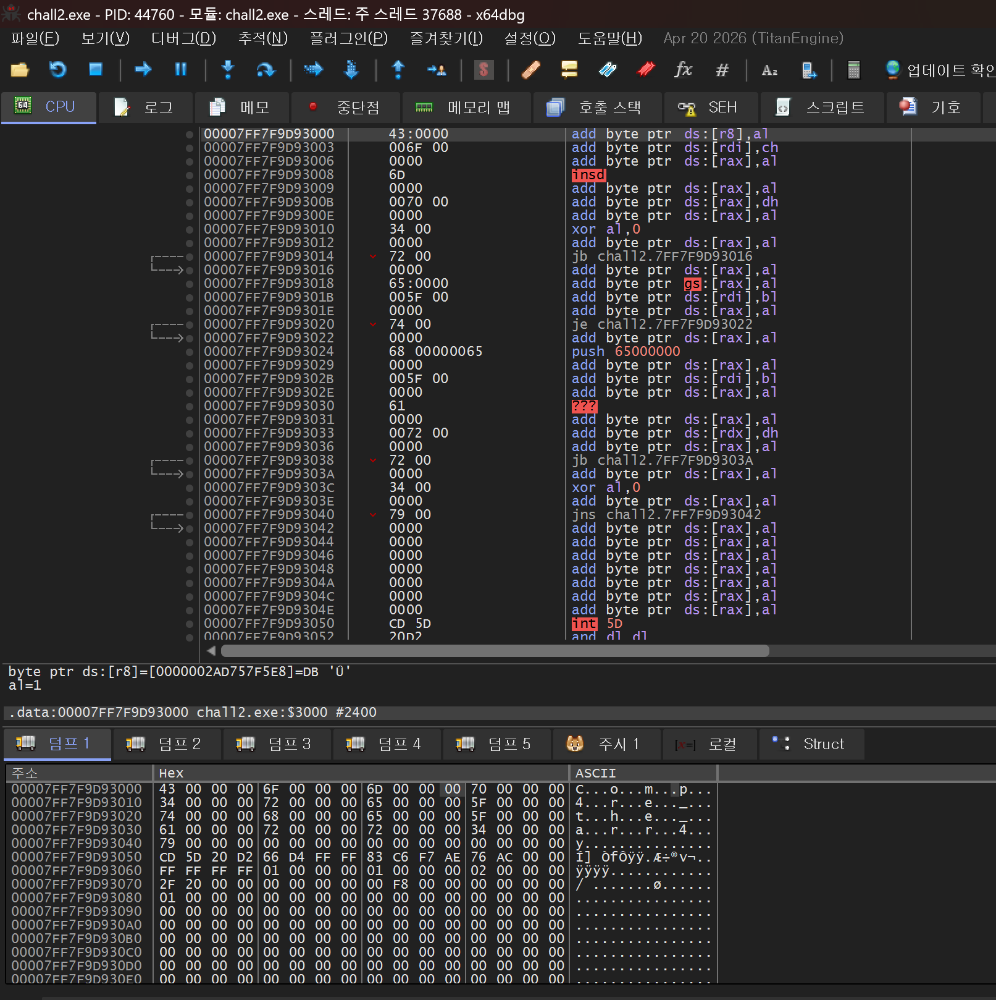


> <strong>플랫폼:</strong> [dreamhack.io](http://dreamhack.io) · <strong>카테고리:</strong> 리버싱 · <strong>난이도:</strong> Basic

> 배열 비교 로직 분석 — 메모리 덤프에서 정답 주소 추적하여 입력값 탐색

---

문제 주소 : [http://dreamhack.io/wargame/challenges/16](http://dreamhack.io/wargame/challenges/16)

## 문제 설명

<strong>이 문제는 사용자에게 문자열 입력을 받아 정해진 방법으로 입력값을 검증하여 correct 또는 wrong을 출력하는 프로그램이 주어집니다.</strong>

<strong>해당 바이너리를 분석하여 correct를 출력하는 입력값을 찾으세요!</strong>

<strong>획득한 입력값은 <code>DH{}</code> 포맷에 넣어서 인증해주세요.</strong>

<strong>예시) 입력 값이 <code>Apple_Banana</code>일 경우 flag는 <code>DH{Apple_Banana}</code></strong>

## 문제 풀이

먼저 엔트리 포인트로 들어가서 문자열 참조를 하여 input 하고 입력값을 주는 곳을 찾는다



찾은 후 문자들을 보면 Input: 으로 값을 받는 call문을 출력하고

문자열 256글자 이상 입력하지 못하게 한뒤, 조건을 검사하여 correct 또는, wrong이라는 문자가 나오게 검사하는 문장이다.

256글자 입력 이후 조건을 검사하는 call문을 찾아서 bp를 건 후 F7로 call 함수 내부로 진입한다.



명령어를 해석하면 중요하게 봐야 할 부분은 cmp 명령어부터 이다.

```asm
cmp rax, 12i와 18을 비교 (정답 길이 체크)
jae 0x1048i ≥ 18 이면 루프 탈출 → 성공
movsxd rax, [rsp]rax = i (인덱스 로드)
lea rcx, [0x7FF7F9D93000]rcx = 정답 시작 주소
```

0x7FF7F9D93000 주소에 우리가 원하는 Input 값이 존재하기 때문에 주소를 따라간다.



따라오면 이러한 창이 뜨게 되고 덤프 창을 잘 보면 flag가 들어있다

flag : DH\{Comp4re\_the\_arr4y\}

