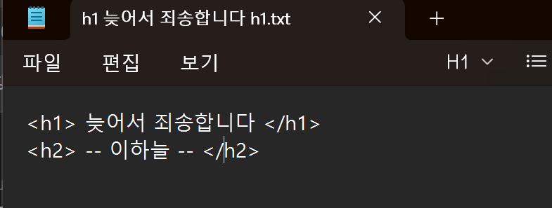


> <strong>학습 주제:</strong> 브라우저↔서버 관계 · HTTP 요청/응답 구조(Method/Status/Header/Body) · URL 구조 · GET vs POST 비교 · Cookie / Session 차이 · HTML / CSS / JS 역할

---

## 브라우저와 서버

웹 브라우저란?

- 웹 서버에서 쌍방향 통신하는 HTML 문서나 파일과 연동하고 출력하는 응용 소프트웨어이다.
- ex) 크롬, 인터넷 익스플로러, 사파리 등등…

웹 서버란?

- 인터넷을 통해 웹 서비스를 제공하는 컴퓨터의 하드웨어 또는 소프트웨어를 의미한다
- 예: Nginx, Apache HTTP Server처럼 HTTP 요청을 처리하는 서버 소프트웨어

왜 이 둘을 항상 같이 설명될까??

- 이 둘을 양방향으로 서로 소통하고 사용자에게 결과를 내놓게 된다.

관계성

- 브라우저와 서버는 서로 요청과 응답의 구조로 소통하게 된다. 브라우저가 사용자의 명령을 기반하여 요청을 보내고, 웹 서버는 브라우저의 요청을 처리하여 결과를 반환해주는 방식이다. 

## HTTP 요청과 응답

HTTP란? HTTP(Hyper Text Transfer Protocol)

- 웹에서 데이터를 주고받기 위한 통신 규칙(프로토콜) -브라우저와 서버가 서로 대화하는 방법
  - 특징 -요청 / 응답 구조 -TCP/ IP 기반 -웹 통신의 기본 규칙

HTTP 요청과 응답 HTTP 구조 HTTP -request(요청) -response (응답) 1.HTTP Request(요청) 구조 1.Start Line 2.Headers 3.Body

1 Start Line 1.HTTP Method 2.Request Target 3.HTTP Version 1-1 HTTP Method 종류

- get (데이터 조회) 특징 \*서버 데이터 가져오기 \*body 거의 사용 나함
- post (데이터 제출) 특징 \*서버 상태 변화 가능 \*회원가입/로그인 등에 사용
- put (전체 수정) 특징 \*서버의 기존 데이터를 요청 데이터로 교체
- patch (부분 수정) 특징 \*데이터 일부만 수정
- delete (데이터 삭제)
- HEAD (헤더 정보만 요청) 특징 body 없음

사용 이유) 파일 크기 확인, 서버 상태 확인, 수정 시간 확인

- OPTIONS (서버가 지원하는 통신 방식 확인)
- TRACE (요청이 서버까지 어떻게 전달됐는지 테스트) ex) loop-back 테스트

과정 1.클라이언트가 TRACE요청 2.중간 서버들을 지나감 3.목적 서버 도착 4.서버가 받은 요청 그대로 다시 반환 5.비교 확인

- connect 클라이언트와 서버 사이 터널 연결

1-2 Request Target 요청을 보낼 주소

1-3 HTTP Version HTTP 버전 표시 이유 : 버전에 따라 기능이나 구조가 달라질수가 있기 때문에

Headers 역할 : 추가 정보 영역 종류 -general headers -request headers -entity headers

주요 Header

- Host (접속하려는 서버 주소)
- User-Agent(브라우저 정보)
- Referer (직전에 방문한 페이지 주소)
- Accept (클라이언트가 받을 수 있는 데이터 종류) ex) 이미지, 오디오, 어플리케이션
- If-Modified-Since (특정 시간 이후 수정됐는지 확인) 만약 수정이 안됨 304 Not Modified가 뜸 수정되면 새 body 전송
- Authorization(인증 토큰 전달) 로그인 인증 등에 사용
- Origin (요청이 시작된 주소) 다르면 CORS 문제 발생가능
- Cookie (쿠키 정보 저장) key-value 형태로 저장이 됨

Body 역할 : 실제 데이터 영역 ex) 로그인 정보, 회원가입 정보, 폼 데이터

POST 요청에서 자주 사용

2.HTTP Response(응답) 구조

1. Status Line
2. Headers
3. Body

2-1 states Line 구성

1. HTTP Version
2. Status Code
3. Status Text

2-2 Headers request의 headers와 동일함 차이점은 서로 사용하는 용어가 다름

2-3 Body response의 body와 일반적으로 동일함 특징 -모든 response가 body가 있지는 않음 -데이터를 전송할 필요가 없을경우에는 body가 비어있음

## URL 구조

URL 구조 ex) [https://google.com:443/search?q=test#section1](https://google.com/search?q=test#section1)

1. Protocol (Scheome) -> 통신 방식 ex) http, https
2. Host -> 도메인 주소 ex) [google.com](http://google.com) \*도메인이란 : IP 주소를 사람이 읽기 쉽게 만든 이름
3. Port -> 프로그램 구분 번호 ex) :443 IP = 건물 주소 Port = 방 번호
4. Path -> 사이트 내부 경로 ex) /search
5. Query String -> 추가 데이터 전달 ex) ?q=test q -> key test -> value

6.Fragment -> 페이지 내부 위치 ex) #section1

Origin(출처) 구성 : Protocol, Host, Port ex) [https://google.com:443](https://google.com/)

## GET / POST

### GET

1. 개념 : GET 메서드는 특정 리소스의 표시를 요청합니다. GET을 사용하는 요청은 오직 데이터를 받기만 합니다. GET ex) 식당에 들어가서 벽에 붙은 메뉴판을 보는 것과 같다. 행동: 메뉴판 읽기 결과: 메뉴 정보를 얻음. 하지만 메뉴판에 적힌 가격을 마음대로 고치거나 메뉴 를 새로 추가할 수 없는 것
2. 핵심 특징

- 오직 서버에 있는 정보를 가져오기 위해 사용
- 서버 상태 변경을 요청하지 않는 것이 GET의 의미이며, 서버 구현도 이를 지켜야 한다.
- 주소창 노출 :　우리가 브라우저 주소창에 URL을 치고 엔터를 누르는 행위 자체가 GET 요청. 검색창에 검색어를 입력했을 때 주소 뒤에 ?q=검색어 처럼 데이 터가 붙어서 보이는 것도 GET 방식의 특징.
- 참고 : HTTP 명세(규칙)에서는 GET 요청에 데이터를 담아 보내면 안 된다라고 딱 잘라 말하지는 않음. 하지만 실무에서는 하지 말라고 권장

### POST

1. 개념 : POST 메서드는 특정 리소스에 엔티티를 제출할 때 쓰입니다. 이는 종종 서버의 상태의 변화나 부작용을 일으킵니다. / 엔티티 : 서버로 전송하는 실제 데이터 포도같은.. 느낌..? 포도알 하나하나 : 실제 데이터 포도송이 전체를 묶는 이름 : 엔티티

- GET 방식과 달리 데이터 전송을 기반으로 한 메서드 GET 방식은 URL에 데이터를 붙여서 보내는 반면, POST방식은 URL에 붙여서 보내지 않 고 BODY에다가 데이터를 넣어서 보낸다.

### GET과 POST 비교

| 구분 | GET | POST |
| --- | --- | --- |
| 목적 | 리소스 조회 | 데이터를 제출하여 처리 요청 |
| 데이터 전달 | 보통 URL의 쿼리 문자열 | 보통 요청 본문 |
| 공유 | URL을 북마크하거나 공유하기 쉬움 | 본문까지 URL만으로 재현할 수 없음 |
| 상태 변경 | 상태 변경을 요청하지 않는 안전한 메서드 | 상태가 변경될 수 있음 |
| 크기 제한 | URL 길이에 대한 구현별 제한 | 서버·애플리케이션 설정에 따른 제한 |

**POST의 본문에 넣었다고 데이터가 암호화되는 것은 아니다.** 전송 구간 보호에는 HTTPS가 필요하다. 요청 메서드와 인증·인가 검증도 별도로 구분해야 한다. [MDN POST 문서](https://developer.mozilla.org/en-US/docs/Web/HTTP/Reference/Methods/POST)

4. 알아두면 좋은 점

- POST도 완전히 안전한건 아님 누가 HTTP Body를 가로채서 열어보면 내용물 다 보임 이 HTTP Body 자체를 암호화 해서 자물쇠를 채우는 기술? >> HTTPS(자물쇠표시)

HTTP에서 안전한 메서드 >> 서버 상태 변경을 요청하지 않는 메서드 멱등성 >> 동일한 요청을 한 번 보내는 것과 여러 번 연속으로 보내는 것이 같은 효과를 지니고, 서버의 상태도 동일하게 남을 때 신선도 정보 : 캐시 유효 기간(유통기간 붙어 있어야 꺼내 먹을 수 있음)

## Cookie / Session

### 쿠키(Cookie)

- 서버가 브라우저에게 보관하고 있다가 나중에 요청을 보낼때 다시 가져오는 작은 데이터 조각이다. 클라이언트(브라우저)에 저장된다.
- 쿠키는 Key와 Value로 이뤄진 일종의 단위로, 서버가 클라이언트에게 쿠키를 발급하면, 클라이언트는 서버에 요청을 보낼 때마다 쿠키를 같이 전송한다.
- 서버는 클라이언트의 요청에 포함된 쿠키를 확인하여서 클라이언트를 구분하게 된다.

역할

1. 사용자가 누구인지 식별
2. 사용자 설정, 선호기억(ex 다크 모드, 언어 설정 등)
3. 로그인 상태 유지 보조
4. 방문 기록, 광고 추적 등

### 세션(Session)

- 세션은 인증 정보를 서버에 저장하고 해당 데이터에 접근할 수 있는 키를 만들어서 클라이언트에 전달하는 방식으로 작동한다

- 위에 설명한 키를 일반적으로 Session ID라고 한다.

- 브라우저는 해당 키를 쿠키에 저장하고 이후에 HTTP 요청을 보낼 때 사용한다.

### 공통점과 차이점

공통점

1. 둘 다 HTTP의 무상태성을 보완하기 위해 등장
2. 둘 다 사용시 식별과 상태 유지가 목적

차이점

| 구분 | 쿠키 | 세션 |
| --- | --- | --- |
| <strong>저장 위치</strong> | 클라이언트(브라우저) | 서버 |
| <strong>저장 데이터</strong> | 실제 데이터 | 세션 ID만 클라이언트, 데이터는 서버 |
| <strong>주의점</strong> | 사용자가 값을 확인·수정할 수 있으므로 신뢰하면 안 됨 | 세션 ID가 탈취되면 도용될 수 있으므로 보호 필요 |
| <strong>만료</strong> | 쿠키 속성과 브라우저 정책에 따름 | 서버의 만료·로그아웃 정책에 따름 |

## HTML / JavaScript 기초

### HTML - 뼈대

HTML은 HyperText Markup Language의 약자로 마크업 언어이다.

- 마크업 언어 : 문서의 형식이나 데이터의 구조를 명시하기 위한 규칙들을 정의한 컴퓨터 언어의 일종  HTML은 태그( \<> )라는 것으로 구성이되는데, 이 태그 안에 명령어를 넣어 명시를 해주는 역할을 가진다.

실습을 해보는 것은 간단하다. 웹 사이트나 VScode 등으로 할 수도 있지만 가장 간단하게 메모장에다가 작성 해보겠습니다.

이렇게 메모장에  \<> 안에 자신이 넣고 싶은 명령어로 작성을 하고 명령어가 끝나는 부분은 /표시를 하여 끝난다고 명시를 해줍니다.

그리고 확장명이 메모장은 txt로 저장이 되는데 .html로 저장한 후 들어가보면

이렇게 간단하게 학습 해볼 수 있습니다.

특징

- 마크업 언어라는 점
- 정적의 특징을 보인다는 점(한 번 작성하면 스스로 변하지 않음)
- 계층 구조적 형식을 가진다는 점(큰 박스 안에 작은 박스가 들어가는 중첩 구조를 가진다)
- 모든 브라우저가 기본적으로 이해한다는 특징을 가지고 있다.

### CSS - 디자인

CSS는 HTML로 만든 문자 구조를 꾸며주는 언어이다.

위 HTML에 소개할 때 허전해 보이는 HTML문장을 CSS에 연결하여 예쁘게 꾸며줄 수 있다.

특징

- 스타일 시트 언어의 형태를 가진다
  - 스타일 시트 :  어떤 요소를 어떻게 꾸밀지 정해놓은 모음집이라고 생각하면 편하다.
- HTML과 분리 되어 있어 따로 관리할 수 있다(유지보수가 편해짐)
- 케스케이딩 형태를 띄게 된다.
  - 스타일이 여러 곳에서 정의된다고 가정하면, 우선순위 규칙에 따라 합쳐져서 적용되는 계단식 구조를 가진다.
- 오버라이딩의 특징을 가진다
  - 동일한 CSS 속성에 대해 다른 값이 설정될 경우, 우선순위가 높은 스타일이 적용된다.
  - 우선 순위 기준(어디에 작성되어 있는가, 얼마나 구체적으로 명시하고 지목했는가, 누가 나중에 적혔는가에 대한 작성 순서)를 판단하여 우선순위를 결정하게 된다

### JS - 웹의 동작

JavaScript는 웹페이지에 동작 부분을 담당한다. HTML로 뼈대를 구성하고, CSS로 디자인을 만들어준뒤, JS로 여러 기능들을 만들어서 동작한다고 생각하면 된다.

ex) 버튼을 클릭 하였을 때, 반응하고, 데이터를 계산하고, 화면에 실시간으로 값을 보여주는 일 들을 담당한다고 생각하면 편하다.

특징

- 프로그래밍 언어이기 때문에 변수, 조건, 반복 같은 요소들을 가지고 있다.
- 동적의 특징을 가져서 페이지를 새로고침 하지 않아도 실시간으로 내용을 바꿀 수 있다.
- 인터프리터 언어로 미리 컴파일하지 않아도 브라우저가 한 줄씩 읽으며 실행된다.
  - 인터프리터 : 한 줄씩 코드가 실행
  - 컴파일러 : 한 번에 기계어로 번역하여 실행

### HTML, CSS, JS의 차이점

| 구분 | HTML | CSS | JS |
| --- | --- | --- | --- |
| 언어 종류 | 마크업 언어 | 스타일 시트 언어 | 프로그래밍 언어 |
| 역할 | 구조 | 디자인 | 동작 |
| 정적 / 동적 | 정적 | 정적 | 동적 |

### HTML, CSS, JS의 연결점

이 세개의 언어는 하나의 웹 페이지를 만들기 위한 협업과 같은 관계를 가진다.

<strong>HTML이 기준점</strong>

CSS와 JS는 모두 HTML을 기반으로 작동하게 된다.

- CSS는 HTML에 작성된 태그를 보고 스타일 하는 일을 한다.

- JS는 HTML에 작성된 요소를 보고 구조를 읽고 조작하게 된다.

그리고 브라우저는 세개의 언어를 한 번에 처리해서 보여주는게 아닌 하나씩 실행하여서 사용자에게 보여주게 된다.

1. HTML을 읽고 페이지의 구조를 만든다
2. CSS를 적용하여 HTML의 화면을 꾸미고 다듬는다
3. JS를 실행하여 페이지에 동작을 부여하게 된다.

### 궁금증

1. 왜 이렇게 HTML, CSS, JS 같이 3개의 언어로 나뉘게 되었을까? 하나로 처리하면 안되나??

- 왜 그러는지 한 마디로 설명하면 유지보수성이 높다는 점 때문이다.

- 내용 → HTML, 디자인 → CSS, 동작 → JS가 담당하는 구조로서 내용을 바꾸고 싶으면 HTML 수정, 디자인을 바꾸고 싶으면 CSS, 동작을 바꾸고 싶으면 JS를 변경하면 되지만,

- 하나의 언어로 모두 연결되어 있으면 코드 전체를 바꾸어야 한다는 불상사가 생기기 때문에 나눠서 유지보수성을 높히고 있다.

2. 꼭 HTML, CSS, JS여야한 할까? 다른 언어로 대체할 수 있을까?완전히 대체할 수 있는 언어는 사실상 없다. 하지만 부분적으로 대체하거나, 변형해서 쓰는 기술들은 많이 있다.
   - 왜 어려운가!
     - 브라우저는 일단 HTML, CSS, JS만 이해하기 때문이다.  브라우저는 일종의 실행 환경인데, 이 환경 안에서 동작하도록 만들어진 언어가 HTML, CSS, JS기 때문이다.
   - 그럼 아예 못하나??
     - 다른 언어로 짠 다음, 결과적으로 HTML·CSS·JS로 변환하면 된다.
     - ex) Pug, HAML 같은 언어는 HTML보다 더 짧고 깔끔하게 쓸 수 있어요. 하지만 결국 HTML로 변환되어 브라우저에 전달 ex) Markdown도 비슷해요. 우리가 노션이나 깃허브에서 쓰는 그 마크다운인데, 결국 HTML로 바뀌어 화면에 나오게 된다.  \* 최근에는 웹 어셈블리(C, C++, Rust, Go 같은 언어로 짠 코드를 브라우저에서 직접 실행할 수 있게 해주는 기술) 라는 기술이 나와 JS에 대한 어느정도 기술이 대체가 가능하다고 하지만 완전하지는 않다고 한다.

