
**정적·동적 링크와 엔디언**을 정리한 뒤 Crackme 1, 3을 풀었다. 프로그램이 어떤 값을 검사하는지 찾아보고, 비교 결과와 키 파일 조건을 확인한 과정을 기록했다.

## 동적 링크와 정적 링크

### 링크(Link)란?

프로그램을 빌드할 때, 내가 짠 코드와 외부에서 가져다 쓰는 라이브러리 코드를 하나로 <strong>연결하는 과정</strong>

### 정적 링크(Static Link)

- 컴파일, 링크 단계에서 라이브러리 코드를 실행파일 안에 통째로 복사해 넣는 방식
- 빌드가 끝나면 실행 파일 하나로 모든 것이 자족적

### 동적 링크(Dynamic Link)

- 실행 파일에 라이브러리 코드를 넣지 않고 참조 정보만 남겨둔다
- 프로그램이 실행되는 순간 OS의 로더가 해당 라이브러리를 메모리에 올려서 연결
  - OS 로더 : 실행파일을 디스크에서 메모리로 올려 실행할 수 있는 상태로 준비 해주는 프로그램

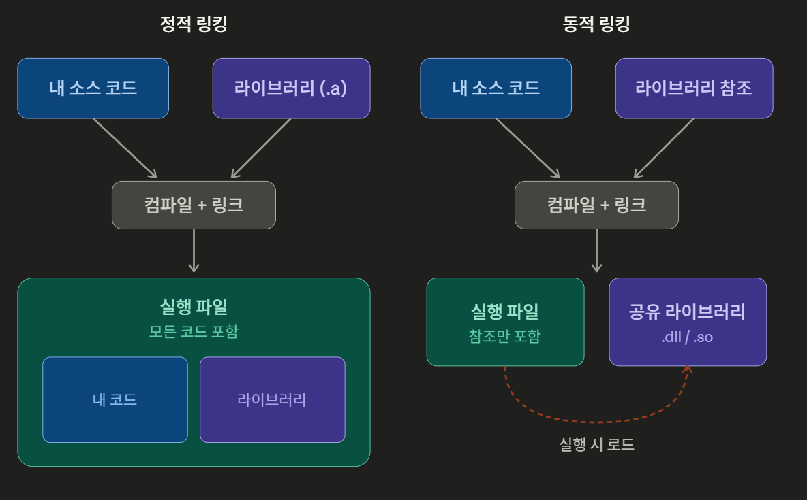

*클로드가 만들어준 그림*

### 특징과 장단점

| 구분 | 정적 링크 | 동적 링크 |
| --- | --- | --- |
| 장점 | 외부 의존성 없음<br />배포가 단순함<br />실행 속도가 빠름<br />버전 안정성 보장 | 실행 파일 크기 작음<br />메모리 공유 가능<br />라이브러리 업데이트 쉬움<br />디스크 공간 절약 |
| 단점 | 실행 파일 크기 큼<br />메모리 중복 적재<br />수정 시 전체 재빌드<br />디스크 공간 낭비 | 버전 충돌(DLL Hell)<br />외부 파일 의존성<br />런타임 로딩 오버헤드<br />배포 복잡도 증가 |

- DLL Hell : 시스템에 해당 라이브러리가 없거나 버전이 달라 실행이 안 되는 경우

### 차이점

1. 연결 시점

   - 정적 링크 : 컴파일, 링크 단계에서 연결이 끝나고 실행 파일이 만들어지는 순간 결합이 완료됨
   - 동적 링크 : 어디서 함수를 가져올지 정보만 기록하고 실제 연결은 OS 로더가 해준다.

2. 라이브러리 코드 위치

   - 정적 링크 : 라이브러리 코드가 실행 파일 안에 같이 들어있음

   - 동적 링크 : 실행 파일과 라이브러리가 별도 파일로 분리

3. 파일 크기와 디스크 사용

   - 정적 : 라이브러리 코드가 다 포함되니까 실행 파일이 크다.
   - 동적 : 실행 파일이 가볍고 모든 프로그램 공유

4. 메모리 사용

   - 정적 : 빌드된 프로그램 100개를 동시 실행하면 라이브러리 코드가 메모리에 100번이 따로 올라가게 된다
   - 동적 : OS가 한 번만 메모리에 올리고 여러 프로세스가 서로 공유함(메모리 효율 좋음)

5. 외부 의존성

   - 정적 : 빌드된 프로그램은 자신 외에 필요한게 없음<br />(다른 컴퓨터에 복사되고 그냥 돌아감)
   - 동적 : 빌드된 프로그램은 시스템에 해당 라이브러리가 설치되어야 함<br />(없으면 에러로 실행 안됨)

### 리버싱에서의 관점

정적링크된 바이너리를 IDA, Ghidra로 열면, 라이브러리 함수들이 내가 짠 코드와 섞여서 이름 없는 함수로 보임(FLIRT사용)<br />동적 링크된 바이너리는 IAT나 PLT에 외부 함수 이름이 그대로 남아 있음(함수가 한 눈에 보임)

## 리틀 엔디언, 빅엔디언

### 엔디언(Endian)이란?

- 여러 바이트로 이루어진 데이터를 메모리에 저장할 때, 어느 바이트를 낮은 주소에 둘 것인가를 정하는 방식이다.(2바이트 이상인 경우에만 의미 있음)
- MSB(가장 큰 자리 수) / LSB(가장 작은 자리 수) : <code>0x12345678</code>이라는 4바이트 정수에서 <code>0x12</code>가 MSB, <code>0x78</code>이 LSB

### 빅 엔디언

- MSB를 낮은 주소에 저장( 왼쪽 → 오른쪽)

### 리틀 엔디언

- LSB를 낮은 주소에 저장(오른쪽 → 왼쪽)

### 특징과 장단점

| 구분 | 리틀 엔디언 | 빅 엔디언 |
| --- | --- | --- |
| 장점 | x86/x64 기본 방식<br />형변환 시 주소 그대로 사용<br />산술 연산 처리 효율적<br />하위 비트부터 계산 가능 | 사람이 읽기 자연스러움<br />네트워크 표준<br />비교 연산 직관적<br />디버깅 시 가독성 좋음 |
| 단점 | 사람이 직관적이지 않음<br />네트워크 전송 시 변환 필요<br />디버깅 시 가독성 떨어짐 | x86 계열에서 변환 비용<br />형변환 시 추가 작업 필요<br />일반 PC에서 거의 안 씀<br />산술 연산 비효율적 |

### 헷갈리기 쉬운점

1. 엔디언은 바이트 단위로만 뒤집힘<br />(비트 순서는 절대 뒤집히지 않음)
2. 문자열은 엔디언의 영향을 거의 받지 않음<br />(ASCII 문자는 1바이트씩 저장되니까 순서 문제 X)
3. 네트워크 통신에서 항상 빅 엔디언을 씀
4. 리버싱에서 hex dump를 읽을 때 x86 메모리 덤프에서 <br /><code>78 56 34 12</code> 라는 <code>4바이트</code>가 보이면 실제 정수 값은 <code>0x12345678</code>이다

## Crackme

처음에 문제 파일을 다운로드 받는데 윈도우 방화벽이 계속 파일을 지워서 방화벽을 끈 후에 진행 하였다.

### Crackme 1

문제 파일을 디버거에 드래그 해서 연 후 빠르게 엔트리 포인트로 이동해준다.

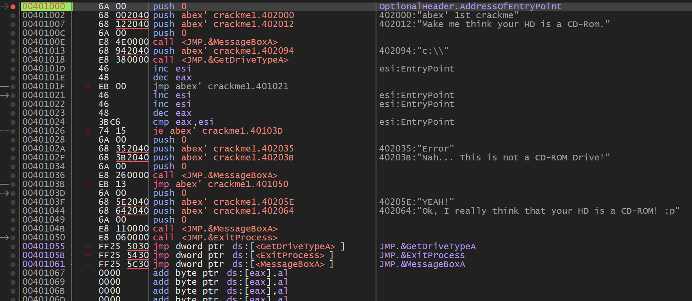

엔트리 포인트 아래에 무슨 이상한 글 들이 적혀있는걸 확인할 수 있다.

화면의 안내 문구를 번역해 보면

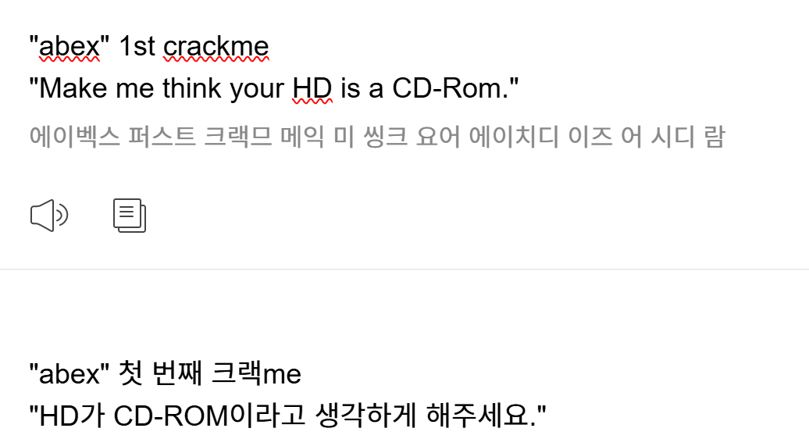

대충 문제가 flag를 찾는 문제가 아닌 HD가 CD-ROM이라고 생각하게 판단시켜 실행하라는 문제이다.

먼저 분석부터 진행 해준다.<br />엔트리 포인트에서 F9를 한 번 더 눌러주면 아래와 같은 화면이 나오게 된다.

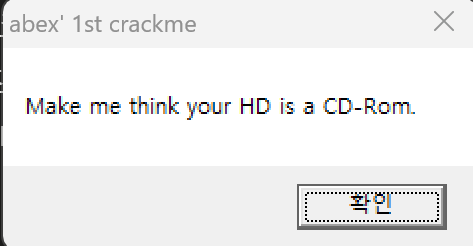

이제 여기서 CD-ROM으로 속여서 확인을 눌러야 한다고 짐작하게 되었다.

자. 이제 코드를 분석해보자.

```asm
0040100E | E8 4E000000  | call <JMP.&MessageBoxA>                 |
00401013 | 68 94204000  | push abex' crackme1.402094              | 402094:"c:\\"
00401018 | E8 38000000  | call <JMP.&GetDriveTypeA>               |
0040101D | 46           | inc esi                                 | esi:EntryPoint
0040101E | 48           | dec eax                                 |
0040101F | EB 00        | jmp abex' crackme1.401021               |
00401021 | 46           | inc esi                                 | esi:EntryPoint
00401022 | 46           | inc esi                                 | esi:EntryPoint
00401023 | 48           | dec eax                                 |
00401024 | 3BC6         | cmp eax,esi                             | esi:EntryPoint
00401026 | 74 15        | je abex' crackme1.40103D                |
```

이 문장에서 중요하게 봐야하는 부분은 0x0040100E번인 메시지창 출력 부분이랑 그 이후 문장들이다.

그리고 중요하게 봐야하는 부분들 중에서 가장 중요하게 봐야하는 부분은 cmp 조건 부분이다

```asm
00401024 | 3BC6         | cmp eax,esi ;eax랑 esi를 비교한다
00401026 | 74 15        | je abex' crackme1.40103D ;같으면 아래 주소로 점프하게 된다(성공 문장)
```

위에 적은 해석과 같이 eax와 esi의 값을 같게 만들어야 je 조건 점프문이 실행하여 성공하게 된다

#### 해결법 1

처음에 찾은 방법은 아주 간단하다. cmp로 조건을 검사해서 둘이 값이 같으면 넘어가는 방식이여서 결과적으로는 eax랑 esi값을 같게 만들어주면 된다.

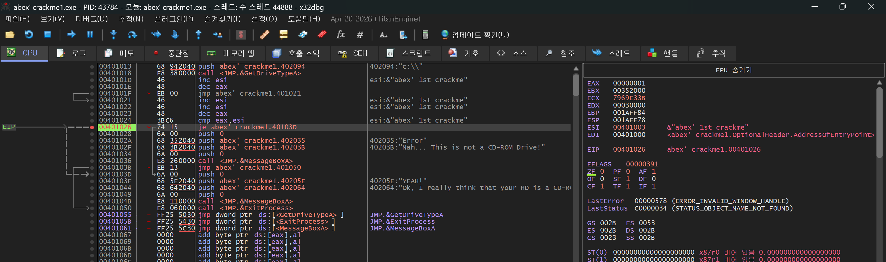

지금 사진은 je문 넘어가기 직전의 모습이다. <br />여기서 EAX는 00000001을 가리키고 ESI는 00401003을 가리킨다.

EAX를 수정해서 ESI와 같은 값으로 만들면

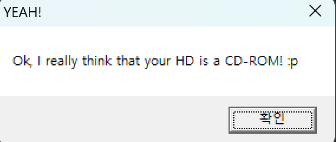

이러한 화면이 뜨면서 성공하게 된다.

#### 해결법 2

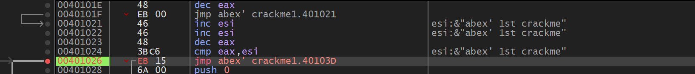

해결법 2도 간단하다. cmp가 비교를 보는 문장이고 je가 같은 값을 가지게 되서 점프하는거라면 jmp로 무조건 점프를 만들거나 jne로 서로 값이 다를 때 점프하게 만들면 된다,

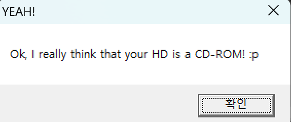

#### 해결법 3

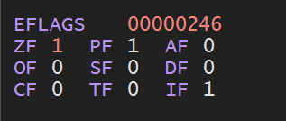

3번째도 간단하다. CMP 실행이 끝난 뒤, JE를 실행하기 전에 ZF를 1로 바꾼다. CMP보다 먼저 바꾸면 CMP가 플래그를 다시 갱신하므로 변경 시점이 중요하다.

<strong>ZF(Zero Flag)?</strong>

- 전에 배운 내용이지만 간단하게 다시 설명하고 지나가겠다.

- 직전 연산 결과가 0인지 알려주는 1비트 flag이다.<br />ZF = 1 : 직전 연산 결과가 0이라는 뜻이다. (두 값이 같음)<br />ZF = 0 : 직전 연산 결과가 0이 아님(두 값이 다르다는 뜻)

이래서 ZF가 1로 설정을 바꿔주면 전에 cmp 연산이 어떻든 같은 값을 가지게 되었다고 판단하고 je 조건문 점프가 작동하게 된다.

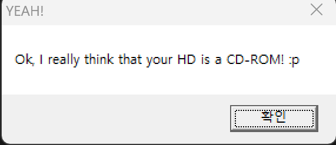

### Crackme 3

이 문제는 keyfile(키파일) 방식의 crackme로, 특정 파일이 존재하고 정확한 크기여야 정품으로 인증되는 구조이다.

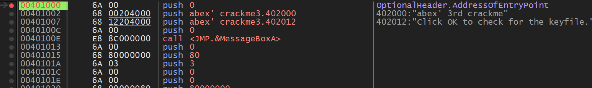

위 사진과 같이 엔트리 포인트에 도착을 한 후 구조를 살펴보면

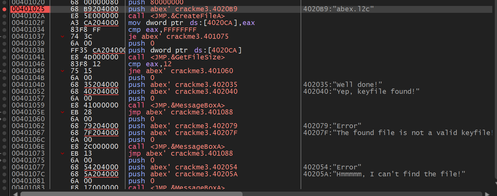

첫 번째 Call로 KeyFile이 존재하는지 확인하고 두 번째 Call로 FileSize까지 확인을 한 후 맞으면 well done!이라는 메시지 창이 뜨게 되는 구조이다.

먼저 우리는 파일 명을 알아야 하는데 여기 옆에 친절하게 파일 명까지 주석으로 적혀있다

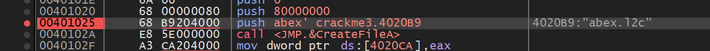

push하고 4020B9 주소로 실제로 이동하게 되면 파일 명이 노출 된다. <br />파일 명 : abex.l2c

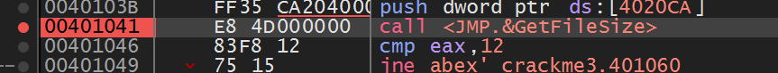

파일 명을 확인 하였으면 이제 파일 크기를 찾아야 하는데 여기 cmp eax, 12라고 되어있다

그러면 진짜 파일 크기도 알아낼 수 있다<br />파일 크기 : 18바이트(0x12)

### 키 파일을 생성

키 파일을 생성하기 위해서 crackme3번 파일이 위치한 장소로 이동을 한다.

그 후 메모장을 하나 만든 후 이름을 abex.l2c라는 파일을 만든다.

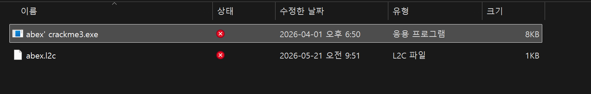

그 후 파일 안에 18byte 정도의 글자를 아무거나 입력을 해주면

이렇게 파일이 생성 되고 그냥 creckme3.exe를 실행하게 되면

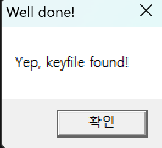

위와 같이 키 파일을 찾았다는 메시지 창이 나오게 된다.

