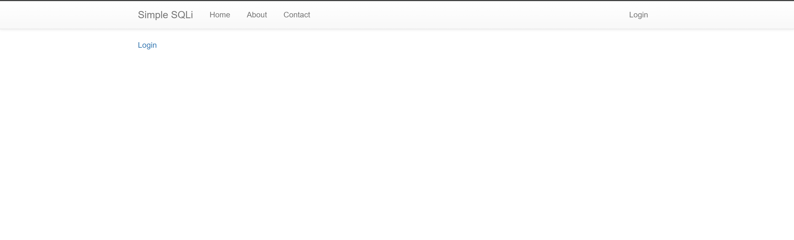
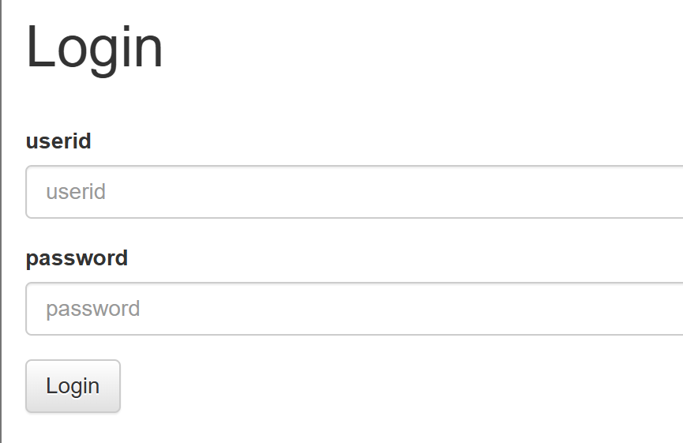
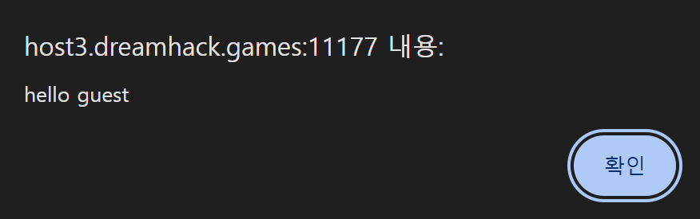
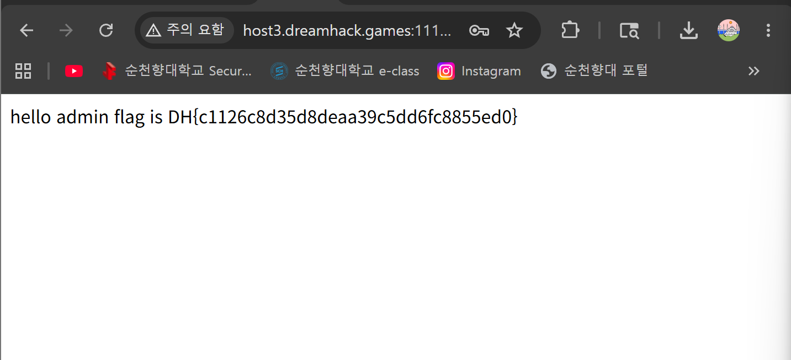


> <strong>플랫폼:</strong> [dreamhack.io](http://dreamhack.io) · <strong>카테고리:</strong> 웹 · <strong>난이도:</strong> Easy

> SQL Injection으로 admin 계정 로그인 우회 — <code>admin"--</code> 페이로드로 비밀번호 검증 무력화

---

문제 링크 : [https://dreamhack.io/wargame/challenges/24](https://dreamhack.io/wargame/challenges/24)

## 문제 설명

<strong>로그인 서비스입니다.</strong>

<strong>SQL INJECTION 취약점을 통해 플래그를 획득하세요. 플래그는 flag.txt, FLAG 변수에 있습니다.</strong>

## 문제 해설

vm을 열고 웹 사이트에 들어가게 되면 아래와 같은 화면이 뜨게 된다.



그리고 다운로드 파일을 다운받아 .py 파일을 열어보면 파이썬 코드들이 보이는데 로그인 문제니까 로그인 페이지에 진입을 하게 된다.



들어가면 위와 같이 userid / password를 입력하는 창이 나오게 된다. guest 계정과 admin 계정이 있다고 가정 한 후 처음으로는 userid / password 모두 guest를 사용하여 로그인을 눌러 보았다



그러면 위와 같이 창이 나오며 환영해주는 문자가 나오게 된다. 하지만 flag를 찾으려면 admin 계정에 로그인을 성공해야 해서 py파일을 자세히 찾아보았다.

```py
@app.route('/login', methods=['GET', 'POST'])
def login():
    if request.method == 'GET':
        return render_template('login.html')
    else:
        userid = request.form.get('userid')
        userpassword = request.form.get('userpassword')
        res = query_db(f'select * from users where userid="{userid}" and userpassword="{userpassword}"')
        if res:
            userid = res[0]
            if userid == 'admin':
                return f'hello {userid} flag is {FLAG}'
            return f'<script>alert("hello {userid}");history.go(-1);</script>'
        return '<script>alert("wrong");history.go(-1);</script>'
```

코드 전체 줄이 꽤 되는데 우리가 중요한 부분은 login 부분만 제대로 보면 된다.

코드를 조금 해석 해보면 GET으로 입력을 하게 되면 바로 login.html로 넘어가지만 문제는 POST방식으로 로그인을 하면 생기는 else 문이다.

```py
else:
        userid = request.form.get('userid')
        userpassword = request.form.get('userpassword')
        res = query_db(f'select * from users where userid="{userid}" and userpassword="{userpassword}"')
```

여기서 res부분이 중요한데 쿼리 데이터베이스에 userid를 우리가 치는 대로 검사를 하는 sql 쿼리 문이다.

```py
if res:
            userid = res[0]
            if userid == 'admin':
                return f'hello {userid} flag is {FLAG}'
```

그리고 res 에서 userid가 admin이면 flag가 보여지는 문제였던 것이다.

sqli문장에서 userid가 admin이여야 하니 admin"을 적어주고 우리는 password를 모르니 뒤에 조건을 보지 않고 무조건 참으로 만들어줘야 하기 때문에 뒤에 —를 붙여서 sqli 문장을 만들어준다

<code>admin"--</code> 라는 문장이 완성이 되었으니 userid에 넣어주고 비밀번호는 아무렇게나 넣어준 후 login 버튼을 클릭하면

```asm
-- 를 붙히는 이유는 뒤에 문장들을 주석처리 해준다 라는 뜻을 가지고 있다.
```



이렇게 화면이 바뀌며 flag가 화면에 나오게 된다.

flag : DH\{c1126c8d35d8deaa39c5dd6fc8855ed0\}

