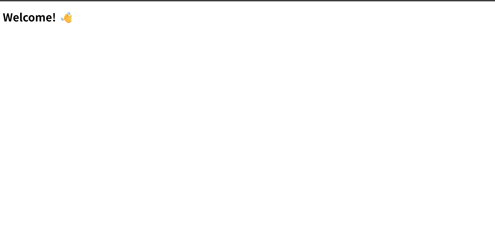
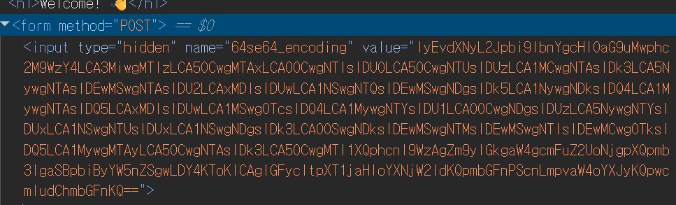


> <strong>플랫폼:</strong> [dreamhack.io](http://dreamhack.io) · <strong>카테고리:</strong> 웹 · <strong>난이도:</strong> Easy

> HTML 소스 내 Base64 인코딩값 발견 → 디코딩으로 플래그 획득

---

문제 링크 : [https://dreamhack.io/wargame/challenges/872](https://dreamhack.io/wargame/challenges/872)

## 문제 설명

### <strong>Description</strong>

<strong>"Welcome! 👋"을 출력하는 html 페이지입니다.</strong>

<strong>소스 코드를 확인하여 문제를 풀고 플래그를 획득하세요.</strong>

<strong>플래그 형식은 DH\{...\} 입니다.</strong>

## 문제 풀이

다운로드 파일을 받은 후 html 링크를 들어가면

이러한 화면이 나오게 된다. html코드를 보기 위해 F12를 눌러서 확인 해보니

64디코딩이라는 말과 함께 값에 인코딩된 문자들이 나오게 된다.

하나하나 하기 힘드니 복사를 한 뒤에 인코딩, 디코딩 사이트에 들어가서 디코딩을 맡긴다.

그러면 아스키 코드들이 나오게 되고 이것을 문자로 치환하면 flag가 나오게 된다.

flag : DH\{be046b7522aa2e28f276e0c910521f23a0587005a8377370a11e5e4dc15fb2ab\}

