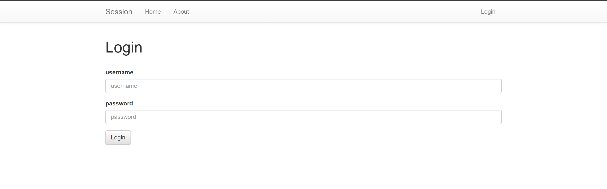
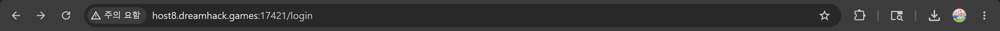
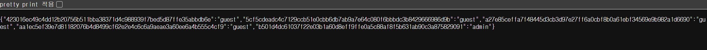
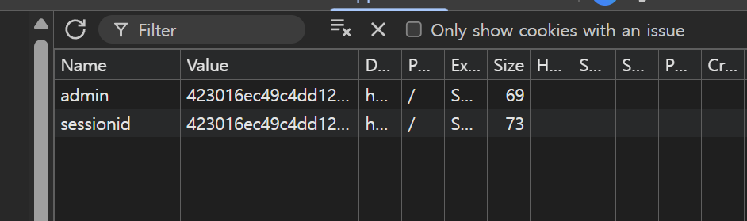
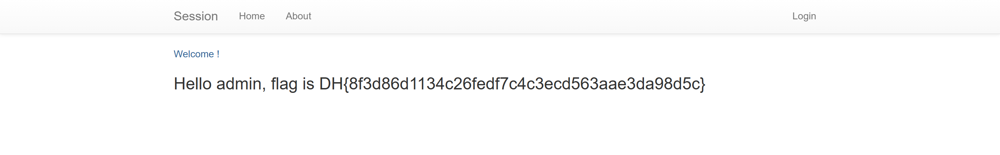


> <strong>플랫폼:</strong> [dreamhack.io](http://dreamhack.io) · <strong>카테고리:</strong> 웹 · <strong>난이도:</strong> Easy

> /admin 경로 노출로 세션 목록 획득 → admin 세션값 쿠키에 주입하여 플래그 확인

---

문제 주소 : [https://dreamhack.io/wargame/challenges/409](https://dreamhack.io/wargame/challenges/409)

## 문제 설명

<strong>쿠키와 세션으로 인증 상태를 관리하는 간단한 로그인 서비스입니다.</strong>

<strong>admin 계정으로 로그인에 성공하면 플래그를 획득할 수 있습니다.</strong>

<strong>플래그 형식은 DH\{...\} 입니다.</strong>

## 문제 풀이

vm을 만들고 사이트에 들어가면 아래와 같은 로그인 화면이 나오게 된다.



우리는 admin 계정으로 로그인을 해야 하기 때문에 세션 값을 알아야 할 필요가 있다.



문제 링크를 보니 /login 으로 페이지가 되어있어 혹시나 하고 /admin으로 링크를 바꾸니



이러한 세션 값들을 보게 해주는 페이지가 노출 되었다.

```basic
{"423016ec49c4dd12b20756b511bba38371d4c988939f7bed5d87ffe35abbdb6e":"guest"
"5cf5cdeadc4c7129ccb51e0cbb6db7ab9a7e64c080f6bbbdc3b8429666986d9b":"guest"
"a27e85ceffa7f48445d3cb3d97e27ff6a0cbf8b0a61ebf34569e9b982a1d6690":"guest"
"aa1ec5ef39e7d81182076b4d8499cf62e2e4c6c6a9aeae3a60ee6a4b555c4cf9":"guest"
"b501d4dc61037f22e03b1a60d8eff9ffe0a5c88af8f5b631ab90c3a875829091":"admin"}
```

잘 안 보일 까봐 복붙을 하여 가져오게 되었다.

여기서 보면 admin의 세션값을 볼 수 있다. 이 세션 값을 복사 한 후에 다시 로그인 창으로 돌아와



개발자 도구에 어플리케이션 부분 쿠키 부분에서 Value 부분을 둘 다 admin 세션 값으로 변경 한 후

새로고침을 하면



이렇게 admin 계정으로 로그인 되면서 flag가 나오게 된다.

flag : <strong>DH\{8f3d86d1134c26fedf7c4c3ecd563aae3da98d5c\}</strong>

