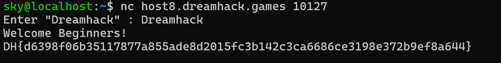


> <strong>플랫폼:</strong> [dreamhack.io](http://dreamhack.io) · <strong>카테고리:</strong> 시스템 · <strong>난이도:</strong> Beginner

> WSL로 nc 접속 후 "Dreamhack" 입력으로 플래그 획득 — 시스템 해킹 입문용

---

문제 링크 : [https://dreamhack.io/wargame/challenges/812](https://dreamhack.io/wargame/challenges/812)

## 문제 설명

<strong>Wargame 실습을 위한 문제입니다. "Dreamhack"을 입력하여 플래그를 획득하세요!</strong>

<strong>플래그의 형식은 DH\{...\} 입니다.</strong>

## 문제 풀이

nc로 들어가야 해서 먼저 wsl을 킨 후 드림핵에 나와 있는 링크를 따라 들어가준다.

<strong>시스템해킹 문제: nc host8.dreamhack.games 10127</strong>

그러면 Dreamhack이라는 문장을 입력하라고 나오는데 그대로 입력을 하게 되면 flag가 나오게 된다.

flag : DH\{d6398f06b35117877a855ade8d2015fc3b142c3ca6686ce3198e372b9ef8a644\}

