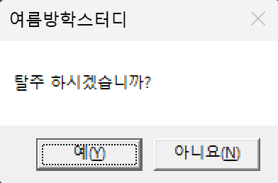
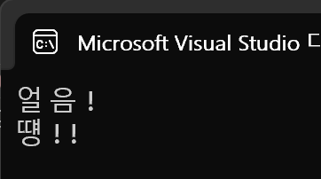
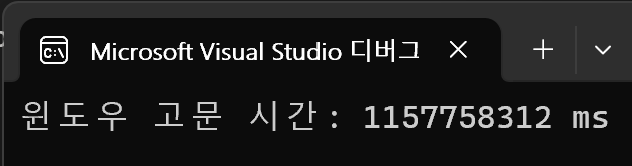
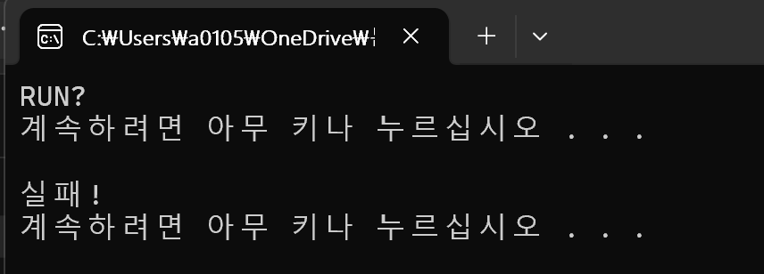
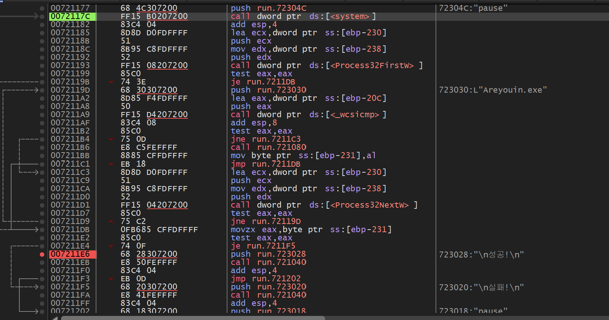
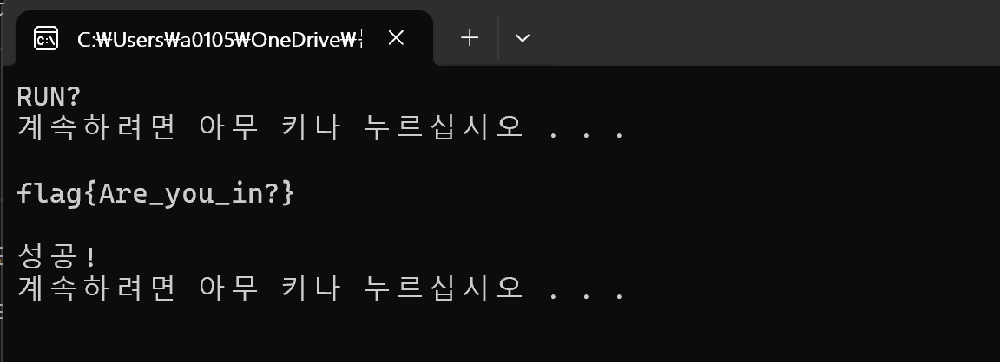


**MessageBoxA, Sleep, GetTickCount**의 인자와 반환값을 살펴보고 코드로 사용해 보았다. 이어서 Run 문제의 프로세스 이름 검사 흐름을 분석했다.

## 1. Windows API의 인자와 반환값
### API란?

API는 응용 프로그램에서 사용할 수 있도록, 운영 체제나 프로그래밍 언어가 제공하는 기능을 제어할 수 있게 만든 인터페이스를 뜻한다.

(남이 미리 만들어 둔 기능을 내가 호출하여서 쓸 수 있게 정해 놓은 방식)

### 인자값과 반환값

인자값 : 내가 무엇을 넣어야 하는가?를 나타낸다.

반환값 : 내가 무엇을 받았는가?를 나타낸다.

### 조사한 API 함수 3개

1. <strong>MessageBox (user32.dll)</strong>

   API 역할 : 메시지 박스를 띄우고 버튼을 받는다.

   인자 값, 반환 값 설명

```c
1. hWnd — 부모 창 핸들
이 박스가 어느 창에 소속될지를 결정한다.
0(NULL)을 넣으면 → 소속 창 없는 독립 박스, 화면 아무 데나 뜸
어떤 창의 핸들을 넣으면 → 그 창에 묶여서 뜸

2. lpText — 본문 문자열
박스 가운데에 표시될 글자의 주소를 넣는다. 글자 자체가 아니라 글자가 저장된 메모리 주소를 넘긴다.

3. lpCaption — 제목 문자열
박스 맨 위 제목 표시줄에 뜰 글자의 주소를 넣는다. 역할은 2번과 같고(주소 넘기기), 위치만 제목줄이라는 차이를 가진다.

4. uType — 버튼, 아이콘 종류
박스에 어떤 버튼을 달고 어떤 아이콘을 띄울지 정하는 자리. 이 인자가 반환값으로 나올 수 있는 후보 범위를 정한다 (값 자체를 결정하는 건 사용자의 클릭).
```

   | uType 값 | 버튼 | 가능한 반환값 |
   | --- | --- | --- |
   | <code>MB_OK</code> (0) | 확인 | 1 |
   | <code>MB_OKCANCEL</code> (1) | 확인·취소 | 1, 2 |
   | <code>MB_YESNO</code> (4) | 예·아니오 | 6, 7 |
   | <code>MB_ABORTRETRYIGNORE</code> (2) | 중단·재시도·무시 | 3, 4, 5 |

   정리

   <strong>인자 = 내가 넣는 값</strong>(4개), <strong>반환값 = 함수가 돌려주는 값</strong>(eax, 누른 버튼 숫자)

2. <strong>Sleep (kernel32.dll)</strong><br />API 역할 : 프로그램을 잠시 멈추는 API이다.

   <strong>어떨 때에 사용할까?</strong><br />- 시간 간격이 필요할 때<br />- 무한 반복문에서 CPU를 100% 다 사용하지 않고 쉬게 할 때<br />- 어떤 작업이 끝나고 잠깐 텀을 줄 때

   <strong>특징</strong><br />- Sleep API의 최대 특징은 반환값이 없다는 점이다.<br />   MessageBox는 예/아니요 와 같은 숫자를 받아서 돌려줬지만,<br />   Sleep은 그냥 정해진 시간만큼 멈췄다가 다시 시작하는 개념이여서 반환값이 존재하지 않는다.

   인자 값, 반환 값

```c
1. dwMilliseconds
몇 밀리초 동안 멈출지 넣는 인자 값이다. (1000을 넣으면 1초, 2000을 넣으면 2초)

이 인자값은 MessageBox의 lpText와는 다르게 주소에서 불러오는게 아닌 숫자 값을 그대로 넣는다.
```

   <strong>주소와 값을 구분해서 전달하는 이유</strong>

   질문 : 왜 주소를 부르는 것과 값을 그대로 넣는 것이 구분될까? 주소를 불러서 값을 불러오는 것과 값을 그대로 넣는 것 이 2개의 행동은 모두 값을 넣기 위한 행동으로 결과가 겹쳐지잖아. 어째서 이런 것을 구분해 놓은 거야?

   <strong>인자 칸에는 크기가 정해져있다. </strong>32비트면 4바이트, 64비트면 8바이트 처럼 크기가 고정되어 있다.

   하지만 인자 칸 크기보다 더 큰 데이터를 불러오기 위해서는 주소를 넣어서 데이터를 전달하는 방법을 사용한다.

3. <strong>GetTickCount (kernel32.dll)</strong>

   역할 : <strong>컴퓨터가 켜진 뒤로 시간이 얼마나 지났는지</strong>를 알려주는 함수다.

   시스템이 시작된 이후 경과한 밀리초 수를 가져온다.

   어떤 역할에 쓰이나?

   - 보통 두 번 불러서 빼는 식으로 쓰인다.
     - ex) 작업 전 시간 찍기 → 작업 완료 후 시간 찍기 = 작업에 걸린 시간 계산

   특징

   - 인자 값이 존재하지 않는다. 추가 정보가 필요 없이 현재 값(시간)을 가져오기만 하면 됨. (딱히 건넬 것이 없다.)

```c
반환 값
DWORD(부팅 후 경과 밀리초)
반환값은 시스템이 시작된 이후 경과한 밀리초 수다.(eax에 그대로 담겨짐)
******
경과 시간이 DWORD 값으로 저장되서 시스템을 약 50일 정도 켜두면 시간이 0으로 초기화된다
(DWORD의 용량인 4BYTE가 넘기 때문)
그래서 더 오해 재야하면 GetTickCount64 라는 API함수를 사용해야한다.
(이친구는 8BYTE이다)
```

전체 비교

|  | MessageBoxA | Sleep | <strong>GetTickCount</strong> |
| --- | --- | --- | --- |
| 인자 개수 | 4개 | 1개 | <strong>0개</strong> |
| 반환 값 | int (누른 버튼) | void (없음) | <strong>DWORD (경과 시간)</strong> |
| eax | 검사함(분기) | 안 씀 | <strong>저장함(시간 보관)</strong> |
## 2. API 사용 예제

<strong>2-1. MessageBoxA</strong>

```c
#include <windows.h>
#include <stdio.h>

int main(void)
{
    int study = MessageBoxA(
        NULL,            // 1번 hWnd: 부모 창 없음
        "탈주 하시겠습니까?",    // 2번 lpText: 본문
        "여름방학스터디",           // 3번 lpCaption: 제목
        MB_YESNO         // 4번 uType: 예/아니오 버튼
    );

    printf("반환값: %d\n", study);

    return 0;
}
*************
참고 부분
1. #include <windows.h>의 역할
-  Windows 운영체제용 응용 프로그램을 개발할 때 필요한 핵심 헤더 파일이다.
   윈도우 관리, 파일 및 메모리 제어, 시스템 정보/제어, 데이터 타입 등이 특징이다.
2. MB_YESNO가 아닌 다른 방법
-  나는 MB_YESNO(4)로 여기에 넣어서 예, 아니요를 누르게 하였지만 그냥 숫자로 4를 넣는 등의 행동도 정상적으로 작동 된다.

3. 순서를 바꾸는 것과 하나를 빼먹어도 정상 작동이 되는가?
- 순서를 바꾸는 것은 가능할지 몰라도 하나를 빼먹는다면 컴파일 오류가 된다. 컴파일을 할 때 MessageBoxA의 인자값은 왜 4개가 필요한데
  왜 3개밖에 넣지 않았지? 하면서 오류를 일으키고 작동되지 않기 때문이다.
```

| uType 값 | 버튼 | 가능한 반환값 |
| --- | --- | --- |
| <code>MB_OK</code> (0) | 확인 | 1 |
| <code>MB_OKCANCEL</code> (1) | 확인·취소 | 1, 2 |
| <code>MB_YESNO</code> (4) | 예, 아니요 | 6, 7 |
| <code>MB_ABORTRETRYIGNORE</code> (2) | 중단·재시도·무시 | 3, 4, 5 |

이 반환값 표를 보면서 이해하면 되는데



이렇게 메시지 박스를 만들고 예를 누르면 반환값이 6,<br />아니요를 누르면 반환값이 7이 나온다.

<strong>2-2. Sleep</strong>

```c
#include <windows.h>
#include <stdio.h>

int main(void)
{
    printf("얼음!\n");

    Sleep(2000);          //2초 멈춤

    printf("떙!!\n");

    return 0;
}
***********************
참고 부분
이 코드는 간단하게 Sleep이 작동하는지 확인하기 위해 printf문으로 출력을 하여 확인하는 코드이다.
똑같이 #include <windows.h> 헤더파일을 사용해야하며, 인자값이 하나밖에 없고 반환값이 존재하지 않아 되게 간단한 코드이다.

아까 Sleep의 특징과 같이 주소를 불러오는 것이 아닌 값을 그대로 넣는 것이기 때문에 2000/2초를 직접적으로 넣어주는 모습이다.

if : 이 함수도 똑같이 DWORD(4BYTE)를 사용하는 방식이다. 그러면 많은 숫자를 이용하여서 4BYTE를 넘긴다면 이것도 주소를 불러와야할까??

결과 : 아니다. 값만 입력하면 가능하다. 4BYTE를 넘기는 많은 숫자를 입력하면 아예 실행이 되지 않고 빌드 오류가 뜬다.

```



*오타는 귀엽게 봐주세요..\^\^*

코드를 실행하면 이렇게 얼음! 이 처음에 적히고 2초 뒤에 떙!! 이 나오는 모습을 볼 수 있다.

<strong>2-3. GetTickCount</strong>

```c
#include <windows.h>
#include <stdio.h>

int main(void)
{
    DWORD win_time = GetTickCount();      // 인자 없이 호출, 반환값을 win_time에 저장

    printf("부팅 후 경과 시간: %lu ms\n", win_time);

    return 0;
}
************************
참고 부분
자신의 컴퓨터(윈도우)가 어느정도 작동이 되고 있는지 확인하는 코드이다.

GetTickCount 특징 답게 ()안에 인자값이 없는 모습을 볼 수 있다.

%lu 형식 지정자는 부호 없는 4바이트 정수로 나타내라는 뜻을 가지고 있다.
```



코드를 실행하면 이렇게 정보가 나오게 된다.

(대략… 13일 9시간 정도 윈도우를 고문 시켰다는 귀중한 정보를 알 수 있다)

## 3. Run 문제 풀이

파일을 다운로드 받고 먼저 exe 파일을 실행해보면



이렇게 아무 키나 누르라고 한다. 하지만 키를 누르면 실패가 뜨면서 프로그램이 종료된다.

이것을 x32dbg에 넣어보았다.

F9로 엔트리 포인트를 찾고 문자열 참조를 사용하여 RUN을 출력하는 부분을 찾았다.



그리고 조금만 내려가면 핵심 로직을 볼 수 있다.

성공과 실패를 띄우는 부분을 자세히 보면

```c
007211E2 | 85C0                     | test eax,eax                            |
007211E4 | 74 0F                    | je run.7211F5                           |
007211E6 | 68 28307200              | push run.723028                         | 723028:"\n성공!\n"
007211EB | E8 50FEFFFF              | call run.721040                         |
007211F0 | 83C4 04                  | add esp,4                               |
007211F3 | EB 0D                    | jmp run.721202                          |
007211F5 | 68 20307200              | push run.723020                         | 723020:"\n실패!\n"
007211FA | E8 41FEFFFF              | call run.721040                         |
007211FF | 83C4 04                  | add esp,4                               |
00721202 | 68 18307200              | push run.723018                         | 723018:"pause"
```

test명령어로 eax가 0인지 판별을 하게 된다. 그리고 그 다음줄인 점프 조건 명령어인 je로 eax가 0으로 판별이 났기 때문에 성공을 건너 뛰고 실패를 출력하는 방식이다.

반대로 생각하면 결과적으로 EAX가 0이 아닌 다른 숫자이면 je가 작동하지 않고 다음 줄로 넘어가서 성공이 뜨는 것이다.

EAX가 0이 되는 부분을 쫒아서 위로 올라가보면

```c
0072119D | 68 30307200              | push run.723030                         | 723030:L"Areyouin.exe"
007211A2 | 8D85 F4FDFFFF            | lea eax,dword ptr ss:[ebp-20C]          |
007211A8 | 50                       | push eax                                |
007211A9 | FF15 D4207200            | call dword ptr ds:[<_wcsicmp>]          |
007211AF | 83C4 08                  | add esp,8                               |
007211B2 | 85C0                     | test eax,eax                            |
007211B4 | 75 0D                    | jne run.7211C3                          |
007211B6 | E8 C5FEFFFF              | call run.721080                         |
007211BB | 8885 CFFDFFFF            | mov byte ptr ss:[ebp-231],al            |
007211C1 | EB 18                    | jmp run.7211DB                          |
007211C3 | 8D8D D0FDFFFF            | lea ecx,dword ptr ss:[ebp-230]          |
007211C9 | 51                       | push ecx                                |
007211CA | 8B95 C8FDFFFF            | mov edx,dword ptr ss:[ebp-238]          |
007211D0 | 52                       | push edx                                |
007211D1 | FF15 04207200            | call dword ptr ds:[<Process32NextW>]    |
007211D7 | 85C0                     | test eax,eax                            |
007211D9 | 75 C2                    | jne run.72119D                          |
```

이 부분은 처음에 무한루프 부분인줄 알고 크게 신경쓰지 않았지만, 자세히 보니 힌트가 있었다.

문장 오른 쪽에 723030:L"Areyouin.exe" 이렇게 적혀있다. 이 문자를 보면 Areyouin.exe 파일을 내가 만들어서 켜놓은 뒤 실행을 하면  jne run.72119D 이 부분에서 살아남고 루프를 탈출하여 갈 수 있었다.

결과적으로 핵심 목적은 특정 이름의 프로세스를 실행시키는 중인가?? 라는 것을 검사하는 것이다.

그리고 위 루프를 더 정확히 읽어보면, 핵심은 <code>_wcsicmp</code> 호출의 <strong>두 인자</strong>다.

```c
0072119D | push run.723030          | 723030:L"Areyouin.exe"   ← (비교 대상)
007211A2 | lea eax,[ebp-20C]        |                          ← (현재 프로세스 이름 검)
007211A8 | push eax                 |
007211A9 | call ds:[<_wcsicmp>]     |
```

그리고 내가 켜놓은 Areyouin.exe를 확인하면 \_wcsicmp가 0을 반환하여, jne 조건문 점프 명령어가 작동하지 않고 넘어가서 flag를 띄워주고 성공이라는 메시지를 띄워주게 된다.

한 번 직접 powershell에서 Areyouin.exe이름의 프로세스를 만들고 실행을 한 후 결과를 지켜보겠다.


이렇게 exe 파일을 만들고 실행한 상태로 입력을 하면



flag\{Are\_you\_in\} 이라는 flag와 함께 성공 메시지가 나오며 클리어가 된다.

