
**CodeEngn Basic 18번**의 문자열 비교 로직을 분석하고, Windows API를 사용하는 간단한 워게임도 직접 만들어 보았다. 분석 화면과 제작 코드를 함께 정리했다.

## 1. CodeEngn Basic 18번 풀이

문제 : Name이 CodeEngn일때 Serial은 무엇인가?

---

 문제 파일을 다운로드 받고 처음 실행을 해보면

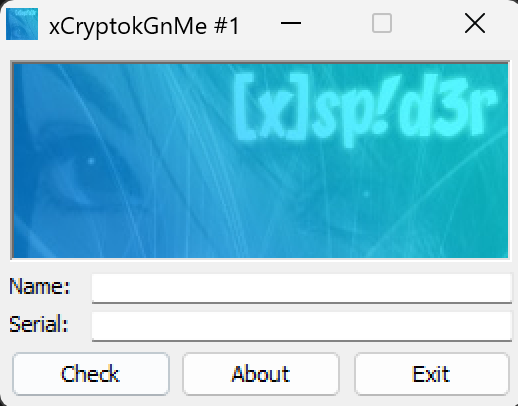

이렇게 로그인 창이 뜨게 된다.

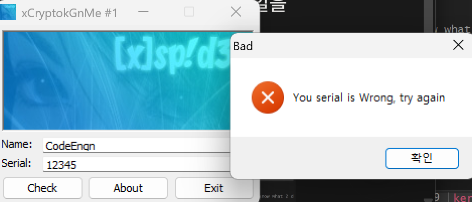

(비밀번호가 틀렸다고 하는 모습)

Name은 CodeEngn으로 알려져 있지만 Serial은 우리가 찾아야 하기 때문에 x32dbg로 파일을 넣어 찾아 보았다.

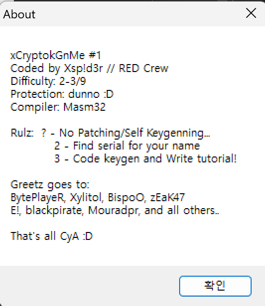

about을 눌러보면 문제의 정보를 좀 더 자세히 알려준다

```bash
xCryptokGnMe #1

제작: Xsp!d3r // RED Crew

난이도: 2-3/9

보호 기법: 모르겠음 :D (dunno)

컴파일러: Masm32
규칙(Rulz):

1 — 패치 / 자기 자신 키젠 금지 (No Patching/Self Keygenning)
2 — 너의 이름에 맞는 시리얼 찾기 (Find serial for your name)
3 — 키젠 코딩하고 튜토리얼 작성하기 (Code keygen and Write tutorial!)
```

이제 exe 파일을 디버거에 넣고 확인 해보자

엔트리 포인트를 찾아 들어가 보았더니 이렇게 실패 / 성공 로직이 있는 문장을 찾을 수 있었다.

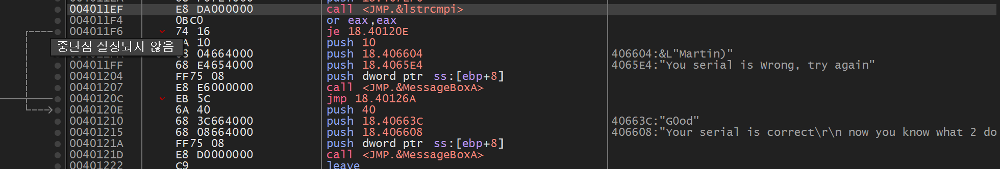

우리가 여기에서 주의깊게 봐야하는 부분은 call \<JMP.&lstrcmpi> 문장이다.

여기서 우리는 API lstrcmpiA를 알아야 한다.

lstrcmpiA의 역할 : 두 개의 문자를 대소문자 상관 없이 비교하는 함수이다.

그리고 비교하는 문장은 \<JMP.&lstrcmpi>윗 부분에 들어있다.

먼저 여기에 bp를 건 후 다시 실행을 해보겠다.

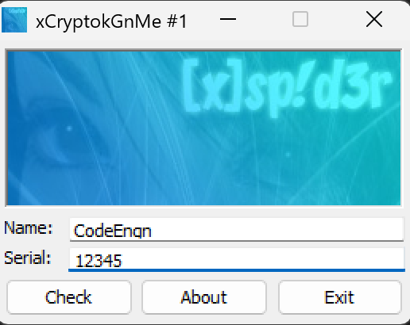

이렇게 작성을 한 후 Chack를 눌러주면 bp 지점에 다시 돌아오게 되는데

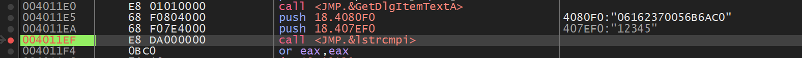

이 윗부분을 살펴보면<br />내가 넣은 값 : 12345<br />설정 되어있는 값 : 06162370056B6AC0 이 서로 비교되며 로직이 수행되는 것을 볼 수 있다.

그러면 비밀번호를 다시 12345가 아닌 설정 되어 있는 값(06162370056B6AC0)으로 넣어보겠다.

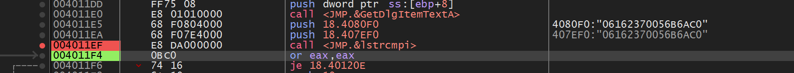

이렇게 서로 똑같은 값을 비교하여 수행되고 eax 값끼리 비교를 하게 된다.

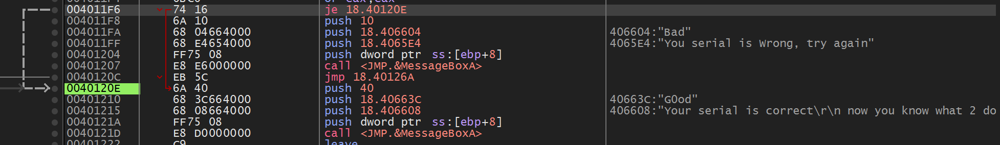

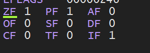

eax가 0이기 때문에 ZF가 1로 올라가서 Je가 점프를 하게 되어 실패를 건너뛰고 G0od으로 바로 이동되는 모습을 확인할 수 있다.

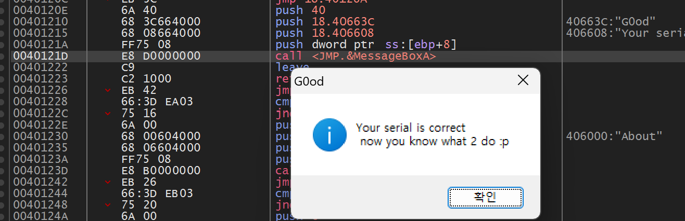

계속 넘어가면 이렇게 메시지 박스가 출력되며 문제가 해결된다.

## 2. 직접 만든 워게임 분석

문제 설명 : 알맞은 비밀번호를 입력하세요 / 형식 : SKY\{flag\}

먼저 문제인 문제.exe를 열어보면 비밀번호를 입력하라고 나온다.

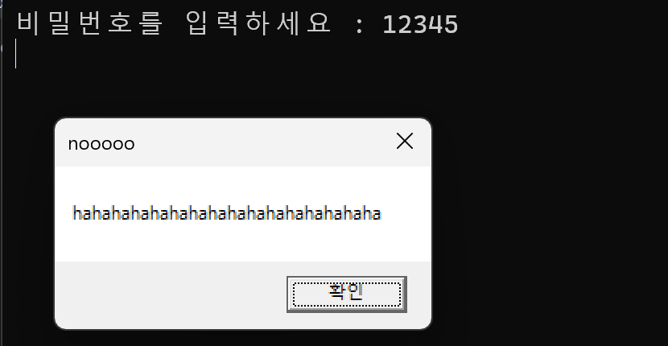

비밀번호를 입력하면 틀렸다는 뜻(noooo)가 출력이 되는 구조이다.

x64dbg로 들어가서 확인해보자

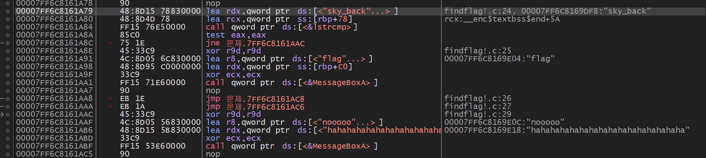

엔트리 포인트를 찾고 빠르게 main을 들어가보니 핵심적인 부분들이 많이 나오게 되었다.

비밀번호 구분 짓는 데이터와 그 답에 따라 상황에 맞게 메시지 박스를 띄워주는 나타나게 된다.

```asm
00007FF6C8161A7 | 48:8D15 78830000    | lea rdx,qword ptr ds:[<"sky_back"...>]         | findflag!.c:24, 00007FF6C8169DF8:"sky_back"
00007FF6C8161A8 | 48:8D4D 78          | lea rcx,qword ptr ss:[rbp+78]                  | rcx:__enc$textbss$end+5A
00007FF6C8161A8 | FF15 76E50000       | call qword ptr ds:[<&lstrcmp>]                 |
00007FF6C8161A8 | 85C0                | test eax,eax                                   |
00007FF6C8161A8 | 75 1E               | jne 문제.7FF6C8161AAC                            |
```

이 문장이 비밀번호 검사하는 부분인데 이번에도 가장 중요한 부분은 \<&lstrcmp> api이다.

이번 제작 코드의 <code>lstrcmpA</code>는 **대소문자를 구분**한다. 앞의 CodeEngn 문제에서 사용한 <code>lstrcmpiA</code>는 대소문자를 구분하지 않으므로 두 함수를 구분해야 한다. [Microsoft 문서](https://learn.microsoft.com/en-us/windows/win32/api/winbase/nf-winbase-lstrcmpa)

그리고 그 결과에 따라 eax 값을 올려주고 test는 eax가 0인지 판별하여 ZF를 설정해준 후,<br />jne 조건 점프문이 성공, 실패 부분으로 점프하거나 다음줄로 넘어가며 flag 도출을 결정 짓게 된다.

그리고 가장 결정적인 부분은 \<&lstrcmp>가 검사하는 비밀번호가 노출되어 있는 점이였다.<br />그러면 자연스럽게 비밀번호는 sky\_back이 되겠다.

<code>call qword ptr ds:[&lt;&amp;lstrcmp&gt;] </code>이 부분에 bp를 설정 한 후 다시 실행을 해보겠다.

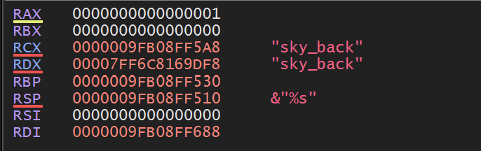

이렇게 둘이 같은 모습을 볼 수 있고

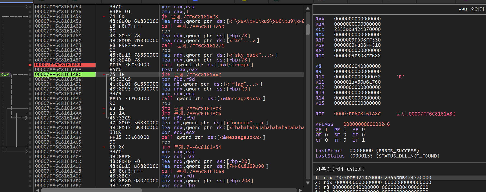

test에서는 eax가 0이 되어서 ZF값을 1로 올려주게 된다.

문자열이 같으면 반환값 EAX는 0이고, TEST가 ZF를 1로 설정한다. 따라서 JNE가 실행되지 않고 다음 성공 처리로 이어진다.

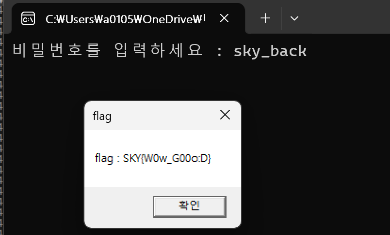
---
### 문제 제작

의도 : API를 2개 이상 사용하는 것이니 간단하게 5주차에 배웠던 내용 중 하나인 <strong>MessageBox와 위 </strong>CodeEngn 18번에서 핵심적인 API였던<strong> </strong><code>lstrcmpA</code>를 사용하기로 하였다.

flag를 문자열 참조로 하여 평문으로 남기면 안되기 때문에 키 값을 0x37로 주어서 인코딩을 진행 하여 flag인 SKY\{W0w\_G00o:D)가 노출되지 않게 하였고, 처음 만들어 보는 것이기에 간단하게 진행하였다.<br />(나중에 실력을 쌓은 뒤 어려운 문제도 따로 프로젝트로 만들어보려고 한다.)

### C 코드

```c
#define _CRT_SECURE_NO_WARNINGS
#include <windows.h>
#include <stdio.h>

int main() {
    //인코딩
    unsigned char encoding[] = {
    0x51, 0x5b, 0x56, 0x50, 0x17, 0x0d, 0x17, 0x64, 0x7c, 0x6e, 0x4c,
    0x60, 0x07, 0x40, 0x68, 0x70, 0x07, 0x07, 0x58, 0x0d, 0x73, 0x4a
    };
    int len = sizeof(encoding);
    char key = 0x37;
    char pass[32];
    //디코딩
    char flag[64];
    for (int i = 0; i < len; i++)
        flag[i] = encoding[i] ^ key;
    flag[len] = '\0';

    while (1) {
        printf("비밀번호를 입력하세요 : ");
        scanf("%s", pass);

        if (lstrcmpA(pass, "sky_back") == 0) {
            MessageBoxA(NULL, flag, "flag", MB_OK);
            break;
        }
        else {
            MessageBoxA(NULL, "hahahahahahahahahahahahahahahaha", "nooooo", MB_OK);
        }
    }

    return 0;
}
```

