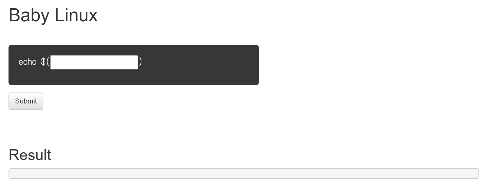
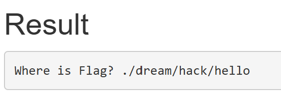
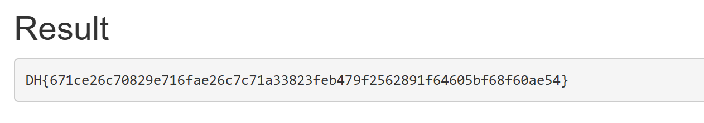


<strong>리눅스 명령어를 실행하는 웹 서비스가 작동하고 있습니다.</strong>

<strong>해당 웹 서비스의 코드가 첨부파일로 주어집니다.</strong>

<strong>flag.txt 파일을 찾아 출력하여 플래그를 획득하세요!</strong>

<strong>플래그 형식은 DH\{...\} 입니다.</strong>

---

VM을 만들어 사이트에 들어가면 아래 사진처럼 linux의 명령어가 그대로 작동되는 프로그램이 있다.



먼저 ls 명령어를 눌러 파일을 확인 하였더니 hint.txt 파일이 있는 것을 볼 수 있었다.

hint.txt의 내용을 보기 위해 cat hint.txt를 사용하여 확인을 하였다.



그러자 .dream/hack/hello라는 주소가 나오게 되었다.

이 서비스는 요청마다 명령을 별도로 실행하므로, 이전 요청에서 바꾼 작업 디렉터리가 유지된다고 가정하면 안 된다. 파일 경로를 한 명령에 포함하여 확인했다.

그리고 첨부된 python 코드를 확인하면

```bash
if 'flag' in cmd:
            return render_template('index.html', result='No!')
```

이렇게 직접적으로 flag를 검색하면 no라고 답이 나오게 프로그램이 설정되어 있는 것을 볼 수 있었다.

그러면 <code>cat .dream/hack/hello/f*ag.txt</code> 명령어로

와일드카드(\*)를 활용하여 명령어에 flag라는 문자열이 아니여도 접근할 수 있었다.



명령어를 입력하면 이렇게 flag가 나오는 모습을 볼 수 있다.

flag : DH\{671ce26c70829e716fae26c7c71a33823feb479f2562891f64605bf68f60ae54\}

