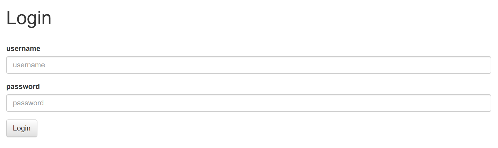
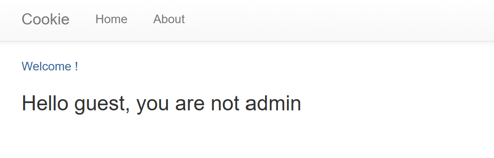
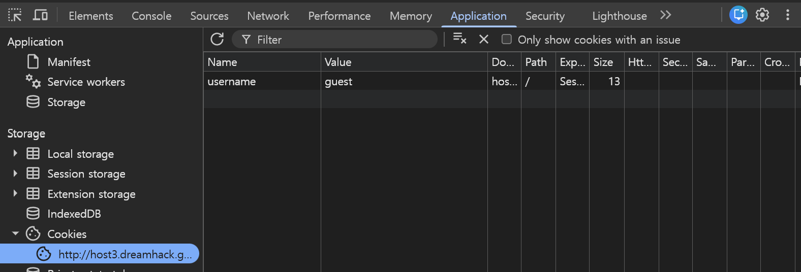
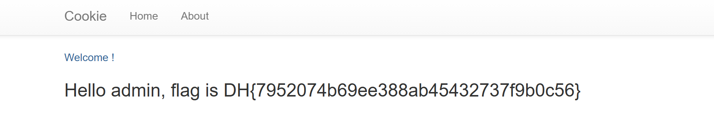


<strong>문제 설명</strong>

<strong>쿠키로 인증 상태를 관리하는 간단한 로그인 서비스입니다.<br />admin 계정으로 로그인에 성공하면 플래그를 획득할 수 있습니다.<br />플래그 형식은 DH\{...\} 입니다.</strong>

---

문제 사이트에 들어간 뒤 로그인 창을 누르면 id 입력 창과 password 입력 창이 보인다.



여기서 <code>app.py</code> 코드를 보면 로그인 정보가 나오는데

```py
users = {
    'guest': 'guest',
    'admin': FLAG
}
```

guest 계정과 admin 계정이 존재하는 것을 확인 할 수 있다.

먼저 guest 계정으로 로그인 해보자



guest 계정으로 로그인 시 당신은 admin이 아니라고 뜬다.



여기서 개발자도구 Application 탭으로 들어가서 guest 쿠키 값 Value를 admin으로 변경하면 된다.

그리고 F5로 새로고침을 하면 정상적으로 admin에 로그인 하게 된다.



flag : <strong>DH\{7952074b69ee388ab45432737f9b0c56\}</strong>

