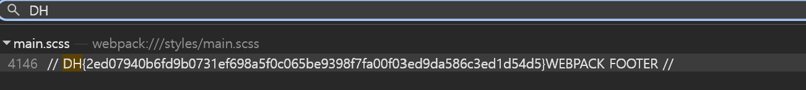


[https://dreamhack.io/wargame/challenges/267](https://dreamhack.io/wargame/challenges/267)

<strong>문제 설명</strong>

<strong>개발자 도구의 Sources 탭 기능을 활용해 플래그를 찾아보세요. 플래그 형식은 DH\{...\} 입니다.</strong>

---

문제를 다운로드 받은 뒤 project.html 파일에 들어가준다.

들어가서 개발자 도구(F12)를 누르고 문제 설명에 맞게 Sources 탭에 들어간 뒤

Ctrl + Shift + F 를 활용하여 파일 전체에서 찾는 창을 열어준다.

여기에서 DH를 검색하면 코드 사이에 숨겨진 flag가 나타난다.

flag 위치 : webpack:// → styles → main.scss

flag : DH\{2ed07940b6fd9b0731ef698a5f0c065be9398f7fa00f03ed9da586c3ed1d54d5\}


