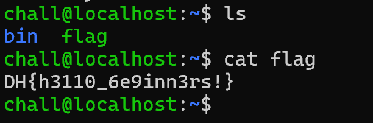


<strong>SSH 실습을 위한 문제입니다. 문제 서버에 SSH로 접속하세요!</strong>

<strong>플래그의 형식은 DH\{...\} 입니다.</strong>

```bash
ssh with
id: chall
password: dhbgssh

```

---

이 문제는 간단하게 ssh안에 들어간 후 flag를 찾으면 되는 문제이다.

<code>ssh chall@host3.dreamhack.games -p 18020 </code>명령어를 사용해서

chall계정으로 들어가준다.

chall계정으로 들어가서 ls로 파일 목록을 보니 flag파일이 존재 하였고

내용을 보기 위해 cat flag 명령어를 사용해서 flag를 찾을 수 있었다



flag : DH\{h3110\_6e9inn3rs!\}

