
실행 파일이 어떻게 구성되는지 이해하기 위해 **PE 헤더, 섹션, RVA와 RAW, DLL의 IAT·EAT**를 공부했다. notepad.exe에서 값을 확인한 뒤 Signature 문제에 적용했다.

## PE 파일 구조

PE(Portable Executable)파일 : 윈도우 실행파일이라고도 부르며, 윈도우OS에서 사용되는 실행파일 형식

<strong><strong>왜 PE 파일을 공부해야 하는가?</strong></strong>

PE 파일 구조는 파일이 실행되기 위한 모든 정보를 확인 할 수 있기 때문이다.

### <strong>1.1 PE파일 종류</strong>

1\) 실행 계열 : EXE, SCR

2\) 라이브러리 계열 : DLL, OCX, CPL, DRV

3\) 드라이버 계열 : SYS

4\) 오브젝트 파일 계열 : OBJ(COFF 형식)

### 1.2 PE 파일 구조

PE 파일을 크게 PE Header, PE Body로 나뉜다.

PE Header : 파일의 앞부분을 담당하여 이 파일이 어떤 파일인지, 어디서 실행을 하고 각 섹션으로 메모리 어디에 배치할지가 적혀있는 부분이다.(구조체 형식으로 저장)

PE Body : 실제 코드, 데이터, 리소스가 담겨 있고 섹션 단위로 담겨 있다.

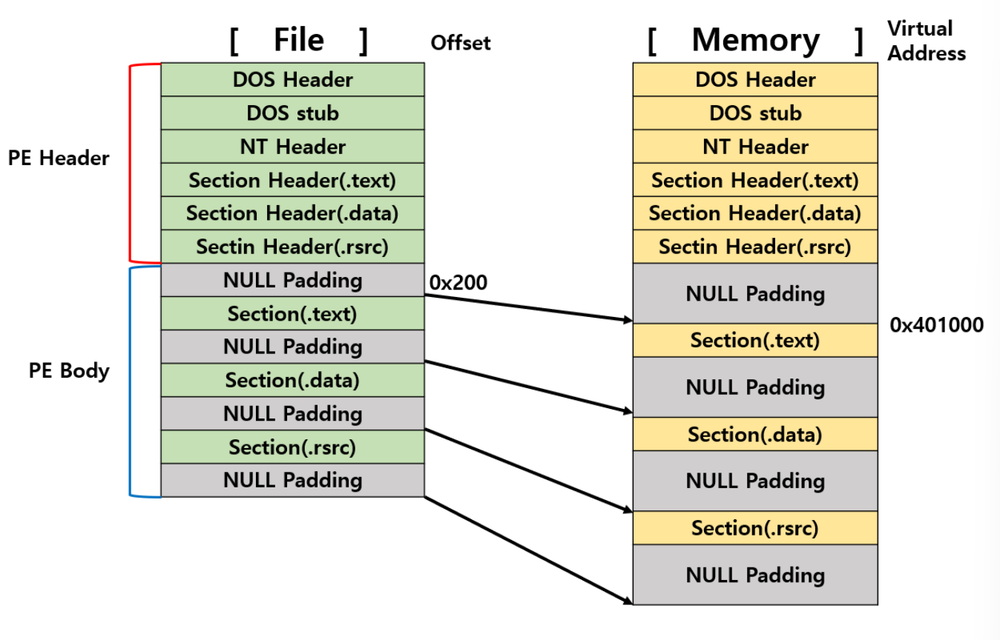

<strong>NULL이 있는 이유</strong>

사진을 보면 헤더의 끝 부분과 각 섹션 끝에 NULL Padding이 존재하는 모습을 볼 수 있다.

결과적으로 말하면 최소 기본단위를 사용하기 위해 NULL 값이 필요하다.

<strong>최소 기본단위 : 컴퓨터에서 파일, 메모리 등을 처리할 때 효율을 높이기 위한 개념</strong>

파일 / 메모리에서 섹션의 시작 위치는 각각 최소 기본단위의 배수에 해당하는 위치여야하고, 빈공간은 NULL로 채움

한 마디로 NULL은 앞 섹션에서 남는 부분을 채워주는 역할을 한다.

꼭 NULL을 넣는 이유는 NULL로 채워 처리 단위에 맞게 정렬하면 메모리 관리가 효율적이고, 단위별로 정확하게 분류할 수 있기 때문이다.

PE Header 구조

- Dos Header

  Dos 파일에 대한 하위 호환성을 고려해서 만들었다.

  구조체 : IMAGE\_DOS\_HEADER

  1)<code>e_magic</code> : PE 파일을 나타내는 첫 2바이트이다. MZ라고 표식이 되어 있으며, 이게 없으면 PE파일로 해당 파일을 인식하지 않는다.

  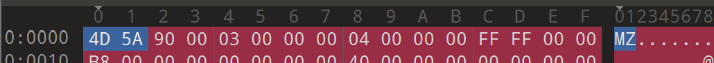

  2)<code>e_lfanew</code> : NT Header가 시작되는 위치의 옵셋을 뜻하며 e\_lfanew값이 가리키는 위치에 NT Header 구조체가 존재한다.(0x3C의 자리 고정)

  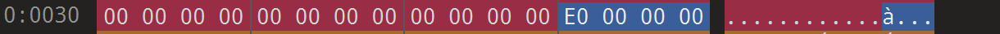
- Dos stub

  DOS 환경에서 실행되는 코드를 가진 영역이며 일종의 옵션으로 DOS Stub이 없어도 파일 실행에 문제가 없다.

  코드와 데이터의 혼합이며 DOS 환경에서 실행하면 문자열을 출력하고 종료한다.

  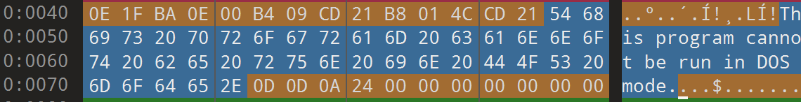

  This is program connot be run in DOS mode라고 나옴

  <strong>하위 호환성 때문에 필요할 때도 있다</strong>

- NT Header

  구조체 : IMAGE\_NT\_HEADERS

  <code>e_lfanew</code>가 가리키는 위치에 존재하며, 프로그램 실행에 <strong>필요한 핵심 정보</strong>를 담고 있는 영역

  NT Header에는 파일 실행에 필요한 정보가 저장됨

  1)<code>Signature PE</code> : 파일임을 나타낸다. PE\\0\\0(50 45 00 00)으로 고정 되어 있음

  

  2)<code>File Header </code>: 파일의 개략적인 속성 정보를 담음

  - <code>Machine</code> : 실행 대상 CPU 종류
    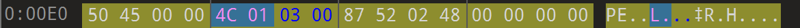
  - <code>NumberOfSections</code> : 섹션의 개수(0보다 커야함) 사진에서는 3이라고 적혀있음

  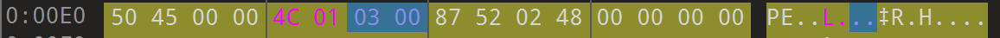

  0이라면 데이터가 담을 곳이 없다는 뜻이니 실행이 안되고 에러가 뜸)

  - <code>TimeDateStamp</code> : COFF Header에 저장되는 타임스탬프 값이다. 일반적으로 링크 시각과 관련된 값으로 볼 수 있지만 0으로 설정되거나 수정될 수 있으므로 실제 빌드 시각의 절대적인 증거로 단정하면 안 된다. 실행 흐름 자체에는 직접적인 영향을 주지 않는다.
    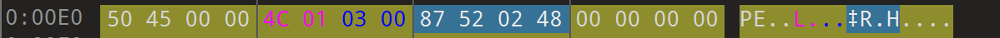
  - <code>SizeOfOptionalHeader</code> : 바로 뒤에 오는 Optional Header의 크기
    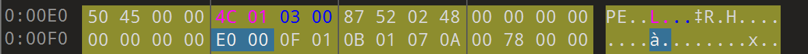
  - <code>Characteristics</code> : 파일 속성 플래그 (실행파일인지 DLL인지 등을 비트 플래그로 표시)
    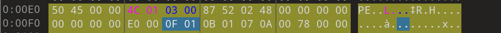

    <strong>exe</strong> : <code>0x0002</code> 켜짐 + <code>0x2000</code>(DLL 비트) <strong>꺼짐</strong>

    <strong>dll</strong> : <code>0x0002</code> 켜짐 + <code>0x2000</code>(DLL 비트) <strong>켜짐</strong>

  3)<code>Optional Header</code>: 파일 실행에 필수적인 핵심 정보를 담는 영역(없으면 로딩 불가)

  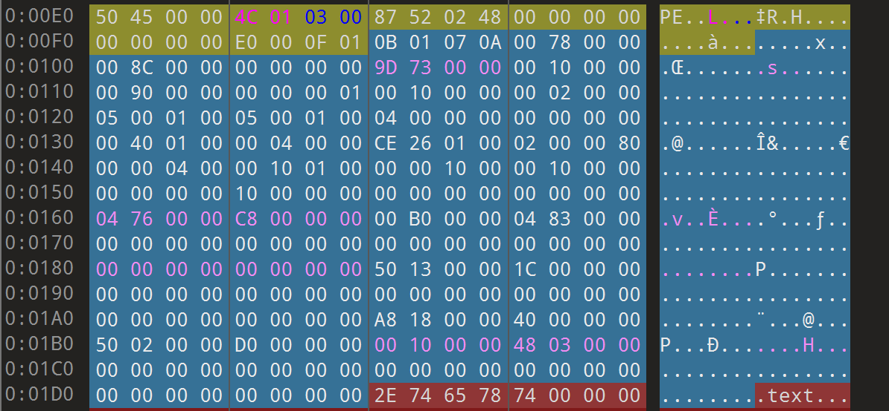

  - <strong>Magic</strong> : PE가 32비트(0x10B)인지 64비트(0x20B)인지 알려주는 역할

    <strong>맨 첫 번째 2바이트</strong>

    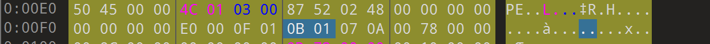
  - <strong> AddressOfEntryPoint</strong> : 파일이 메모리에 매핑된 후 코드 시작 주소이며 ImageBase값에 이 값을 더해 코드 시작 지점을 설정(즉, Entry Point의 RVA를 가짐)
    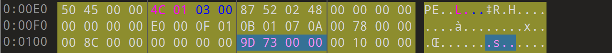

    <strong>코드 실행이 시작되는 지점이다. </strong>

  - <strong>ImageBase</strong> : PE 파일이 메모리에 로딩되기를 원하는 기준 주소(Preferred Image Base)이다. RVA를 VA로 계산할 때 기준점으로 사용한다. 과거 32비트 PE에서 EXE <code>0x400000</code>, DLL <code>0x10000000</code>과 같은 값이 흔히 사용되었지만 고정값은 아니며 파일마다 다를 수 있다.
    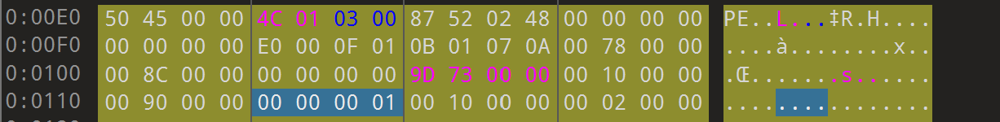
  - <strong> SectionAlignment, FileAlignment</strong> : 메모리/파일에서 섹션의 최소단위를 나타내며 각 섹션은 반드시 Alignment의 배수여야 한다. (NULL 패딩 개념이랑 같음)
    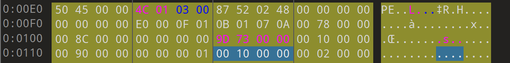

    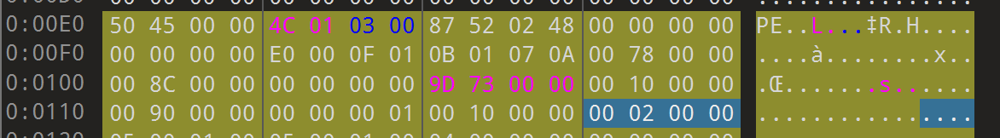
  - <strong>SizeOfImage</strong> : 메모리에 로딩될 때 가상 메모리에서 PE Image가 차지하는 크기
    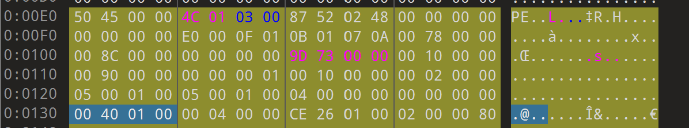
  - <strong>SizeOfHeaders</strong> : PE Header의 전체 크기(FileAlignment의 배수여야 한다.)
    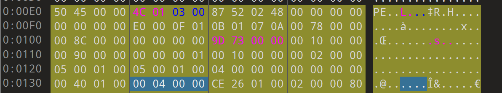
  - <strong>Subsystem</strong> : 동작 환경을 어떻게 할지 정의한 값

    로더가 이걸 보고 콘솔 창을 띄울지, GUI 기반으로 실행할지 결정

    - <code>0x1</code> = Native
    - <code>0x2</code> = GUI
    - <code>0x3</code> = CUI

    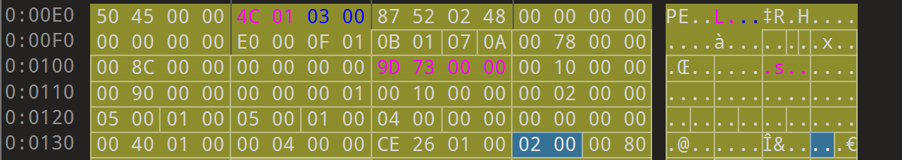
  - <strong>NumberOfRvaAndSize</strong> : DataDirectory 배열의 원소 개수를 나타내는 값(거의 항상 16)

    일반적인 PE에서는 16개가 사용되지만, 실제 파싱에서는 <code>NumberOfRvaAndSize</code>와 헤더 크기를 확인해야 한다. [PE 형식 문서](https://learn.microsoft.com/en-us/windows/win32/debug/pe-format)

    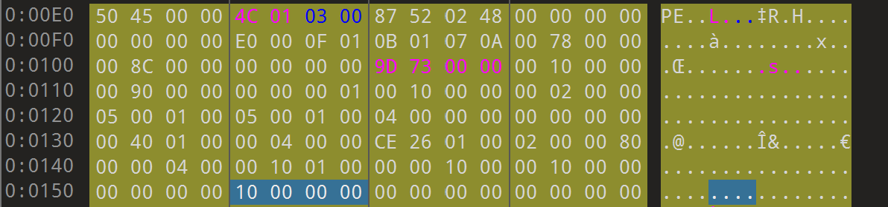
  - <strong>DataDirectory</strong> : <strong>IMAGE\_DATA\_DIRECTORY</strong>구조체의 배열로 PE안의 중요 구조체들이 어디 있는지 색인해 둔 목차 같은 개념
    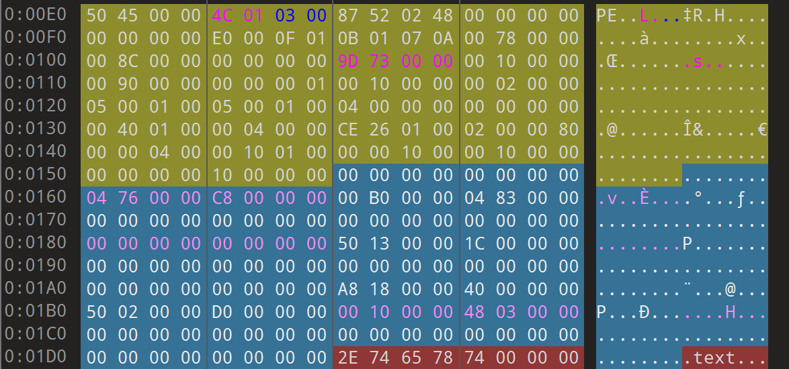
- Section Header

  각 Section의 헤더들이 존재하며 Section들은 메타 데이터를 저장하고 메모리에 로드 될 때 필요한 정보를 포함하고 있다.

  (Image\_Section\_Header라는 구조체를 가지고 있다.

  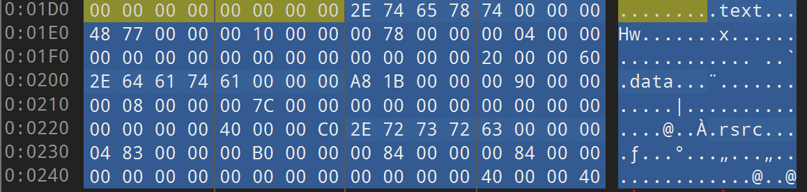

  - VirtualSize : 메모리에서 섹션의 크기 나타냄
    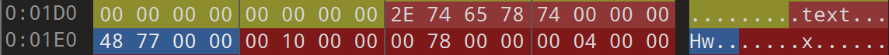
  - VirtualAddress : 메모리에서 섹션의 시작 주소(RVA)
    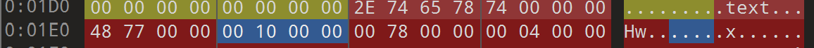
  - SizeOfRawData : 파일에서 섹션의 크기
    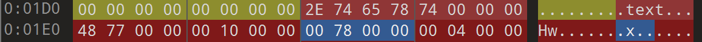
  - PointerToRawData : 파일에서 섹션의 Offset 담당
    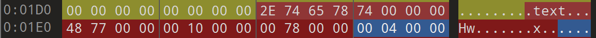
  - Characteristics : 섹션의 속성, Bit OR연산 담당
    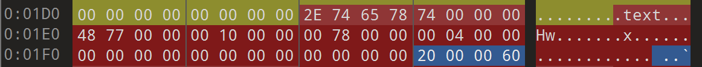
- Section Header 심화

  PE 파일은 코드와 데이터를 Section 단위로 나누어 저장하며, 각 Section의 위치와 크기, 속성은 IMAGE\_SECTION\_HEADER에 기록된다.

  - Name : Section 이름 (.text, .data, .rsrc 등)
  - VirtualSize : 메모리에 매핑됐을 때 Section이 사용하는 크기
  - VirtualAddress : 메모리상 Section 시작 RVA
  - SizeOfRawData : 파일에 저장된 Section 데이터 크기
  - PointerToRawData : 파일상 Section 시작 Offset
  - Characteristics : Code/Data 여부와 Read/Write/Execute 속성을 나타내는 비트 플래그

  즉 VirtualAddress는 메모리 관점, PointerToRawData는 파일 관점의 Section 시작 위치이다. 이 차이가 RVA to RAW 변환과 직접 연결된다.

  #### notepad.exe에서 직접 확인

  직접 Hex Editor로 확인한 notepad.exe는 NumberOfSections = 3이며 Section은 .text, .data, .rsrc이다.

  - .text : RVA 0x1000, RAW 0x400
  - .data : RVA 0x9000, RAW 0x7C00
  - .rsrc : RVA 0xB000, RAW 0x8400

  또한 Offset 0x00에서 4D 5A(MZ), Offset 0x3C의 e\_lfanew = 0xE0, Offset 0xE0에서 50 45 00 00(PE\\\\0\\\\0)을 직접 확인하였다. 따라서 e\_lfanew가 실제 NT Header 위치를 가리킨다는 것을 파일 바이트로 검증할 수 있다.

- Section 유형
  - .text : 프로그램 실행 코드를 담고 있는 섹션
    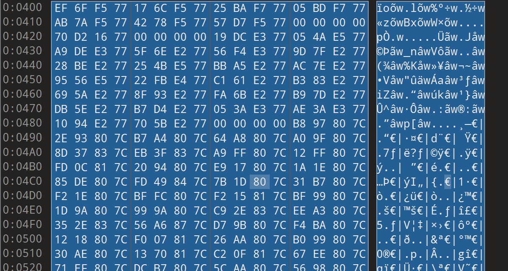

    엄청 길다(일부분)

  - .data : 읽고 쓰기가 가능한 데이터 섹션
    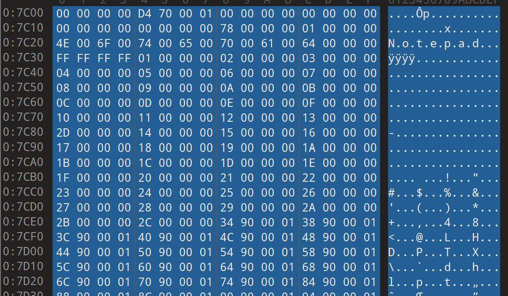

    엄청 길다(일부분)

  - .rsrc : 리소스 관련 데이터를 담고 있는 섹션 ex) 아이콘, 커서 등
    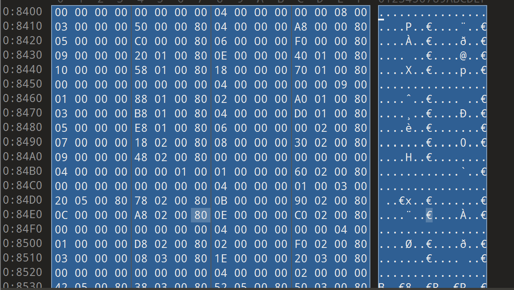

    엄청 길다(일부분)

## RVA와 VA

RVA : PE 파일 안의 위치를 표현하는 방식 중 하나이다.

<strong>비교</strong>

2-1 OFFset(파일 오프셋) : 파일의 맨 앞부터 몇 바이트 떨어졌는지를 나타내는 값. (HEX 에디터로 파일을 열었을 때 왼쪽에 보이는 주소이다)

2-2 VA(Virtual Address, 가상주소) : 프로세스의 가상 주소 공간에서 사용하는 주소이다. 물리 RAM의 실제 주소가 아니라 OS가 프로세스에 제공하는 가상 주소이다.

<strong>가상 주소 : 프로그램이 보는 주소, 실제 램의 물리적 위치가 아닌 OS가 프로그램마다 만들어주는 가짜 주소 공간)</strong> 절대 주소 : 그 자체로 위치가 딱 정해지는 완성된 주소

2-3 RVA(Relative Virtual Address, 상대 가상 주소) : ImageBase를 기준으로 봤을 때 상대적인 메모리 위치이다.

<strong>상대 가상 주소 : 어떤 기준점에서 얼마나 떨어졌는지만 나타내는 값 (기준을 넣어줘야 완성됨)</strong> VA = ImageBase + RVA 값이다. \*\*

왜 RVA를 쓰지??

- 굳이 실제 주소(VA)를 넣으면 되는데 왜 상대값을 넣어야 할까??

  이유 : ImageBase가 바뀔 수도 있기 때문이다.

  VA를 넣었을 때 ImageBase가 바뀐다면 주소를 전부 다 고쳐야 하지만, RVA로 설정하면 그럴 필요가 없기 때문이다.

#### RVA를 사용하는 이유 정리

RVA는 ImageBase를 제외한 상대 위치이므로 ImageBase가 달라져도 동일한 구조 내부의 상대 위치를 표현할 수 있다.

예를 들어 RVA가 <code>0x1000</code>일 때,

- ImageBase가 <code>0x400000</code>이면 VA는 <code>0x401000</code>
- 실제 Load Base가 <code>0x500000</code>이면 VA는 <code>0x501000</code>

VA는 달라지지만 RVA <code>0x1000</code>은 그대로 유지된다. 따라서 PE 내부의 구조와 Directory 위치를 표현하기에 RVA가 적합하다.

<strong>관계식 : <code>VA = Load Base + RVA</code></strong>

## RVA를 RAW로 변환하기

RAW는 위에서 배운 파일 오프셋(Offset)을 뜻함

간단 정리

RAW : 파일에서의 위치(Offset) / 헥스 에디터에서 볼 수 있음

RVA : 메모리에서의 상대 위치 / 로딩된 메모리 기준이다.

RVA to RAW : 메모리에서의 위치 —> 파일에서의 위치로 바꾸는 것

#### 왜 바꿔야 할까?

메모리 주소(RVA)를 알고 있는 상태로 파일 주소(RAW)로 바꾸어야 헥스 에디터에서 찾아갈 수 있다.

같은 섹션인데 파일 위치가 다른 이유 : 정렬 단위가 다르기 때문이다.

- 파일 = <code>FileAlignment</code>(0x200) 단위
- 메모리 = <code>SectionAlignment</code>(0x1000) 단위

변환 공식

<strong>RAW=RVA−VirtualAddress+PointerToRawData</strong>

#### RVA to RAW 변환에서 가장 먼저 해야 할 일

공식에 값을 바로 넣는 것이 아니라 <strong>해당 RVA가 어느 Section에 포함되는지 먼저 찾아야 한다.</strong> Section마다 <code>VirtualAddress</code>와 <code>PointerToRawData</code>가 다르기 때문이다.

일반적인 판단 과정은 다음과 같다.

1. Section Header에서 <code>VirtualAddress</code>와 Section 범위를 확인한다.
2. 변환할 RVA가 해당 Section 범위에 포함되는지 확인한다.
3. 포함된 Section의 <code>VirtualAddress</code>와 <code>PointerToRawData</code>를 사용한다.
4. <code>RAW = RVA - VirtualAddress + PointerToRawData</code>를 계산한다.

단, 모든 RVA가 항상 파일의 RAW Byte와 1:1로 대응하는 것은 아니다. Header 영역의 RVA이거나 <code>VirtualSize</code>와 <code>SizeOfRawData</code> 차이로 메모리에만 존재하는 영역은 별도로 판단해야 한다.

#### notepad.exe Entry Point 직접 변환

<code>notepad.exe</code>의 <code>AddressOfEntryPoint = 0x739D</code>이며 이 값은 RVA이다.

<code>.text</code> Section:

- <code>VirtualAddress = 0x1000</code>
- <code>PointerToRawData = 0x400</code>

따라서,

<code>RAW = 0x739D - 0x1000 + 0x400 = 0x679D</code>

실제로 Hex Editor에서 Offset <code>0x679D</code>로 이동하여 Entry Point에 대응되는 기계어 바이트를 확인하였다.

## DLL과 동적 링크

DLL(Dynamic Link Library, 동적 링크 라이브러리) : 여러 프로그램이 공용으로 갖다 쓰는 함수, 자원들을 모아둔 파일 (확장자 .dll 파일)

#### 왜 dll을 쓰는가? 동적 링크의 의미

동적 링크와 정적 링크

정적 링크 : 프로그램을 만들 때 필요한 함수 코드를 exe 안에 통째로 복사해서 넣는 방식

동적 링크 : 함수 코드를 exe에 넣지 않고, 실행할 때 DLL에서 빌려 쓰는 방식

DLL의 장점

1. 메모리, 용량 절약
   - DLL은 메모리에 한 번만 로딩되고 여러 프로그램이 공유한다.
2. 업데이트가 쉬움
   - 함수에 버그가 존재한다면 DLL파일 하나만 교체하면 된다.
3. 기능 분리
   - 프로그램을 기능별로 여러 DLL로 쪼갤 수 있어서 관리가 편하고, 필요할 때만 로딩가능

DLL의 단점

1. DLL Hell
   - 공용 DLL이 손상되거나 호환성 문제가 발생하면 해당 DLL에 의존하는 여러 프로그램이 영향을 받을 수 있다.
2. 배포가 번거로움(의존성 문제)
   - 프로그래밍 어떤 DLL을 쓴다면, 그 DLL이 사용자 컴퓨터에 반드시 있어야 실행됨 (없으면 에러)
3. 실행 시 약간의 오버헤드
   - 실행할 때 DLL을 찾아 로딩하고 함수 주소를 연결하는 작업이 필요

#### DLL이 연결되는 방식

DLL을 사용하는 방식은 크게 두 가지로 볼 수 있다.

- <strong>Load-Time Dynamic Linking</strong> : 프로그램 로딩 과정에서 Loader가 Import 정보를 확인하여 필요한 DLL과 함수를 연결한다.
- <strong>Run-Time Dynamic Linking</strong> : 프로그램 실행 중 <code>LoadLibrary</code>와 <code>GetProcAddress</code> 등을 이용해 DLL과 함수 주소를 동적으로 얻는다.

따라서 실행 파일의 정적 Import 목록에 특정 API가 없더라도 실행 중 동적으로 해당 API 주소를 얻어 사용할 수 있다.

## IAT와 EAT

DLL이 함수를 주고 받는 메커니즘이다. (EAT는 주는 쪽, IAT는 받는 쪽 이다)

둘 다 <code>DataDirectory</code>가 위치를 가리킴

#### EAT(Export Address Table)

내가 제공하는 함수 목록을 정리해둔 표이다. (다른 프로그램이 이 DLL의 함수를 갖다 쓸 수 있도록 내보내는 정보)

담고 있는 정보 : 함수 이름 ↔ 그 함수의 RVA 매핑 ex) MessageBoxA는 이 DLL의 RVA 0x1120에 있다는 것을 알려주는 것

주로 DLL에 존재한다. (exe도 있을 때도 있지만 보통은 DLL이 함수를 제공함)

이름으로 함수 찾는 3개 배열

- <code>AddressOfFunctions</code> : 함수들의 주소(RVA) 배열
- <code>AddressOfNames</code> : 함수 이름 배열
- <code>AddressOfNameOrdinals</code> : 이름과 주소를 연결하는 인덱스 배열

#### IAT(Import Address Table)

<strong>exe(다른 모듈)이 남의 DLL에서 가져다 쓸 함수들의 실제주소를 받아두는 곳 </strong>(함수들을 가져오는 정보)

동작

프로그램 로딩 시, 로더가 필요한 DLL을 메모리에 올림

→ 그 DLL의 EAT에서 함수의 실제 주소를 찾음

→ IAT의 각 칸에 그 주소를 채워 넣음

#### 리버싱의 관점에서 중요한 점

- IAT를 자세히 보면 프로그램의 행동이 보이게 된다.
- 악성코드는 IAT를 숨기기도 해서 분석을 방해하기도 한다.

총 정리

- EAT : DLL이 제공하는 함수 목록이다. (IMAGE\_EXPORT\_DIRECTORY)
- IAT : exe가 가져다 쓰는 함수의 실제 주소 표. (로딩 시 로더가 EAT를 참조해서 채움)
- 흐름 : exe(IAT, 요청) → 로더가 DLL 로딩 → DLL(EAT, 제공) 참조 → IAT에 실제 주소 기록
- EAT = Export(주는 쪽) —> IAT = Import(받는 쪽)

#### EAT를 정확하게 이해하기

EAT를 단순히 <code>함수 이름 ↔ 함수 RVA</code> 1:1 표라고만 생각하면 부족하다. Export 구조의 핵심은 <code>IMAGE_EXPORT_DIRECTORY</code>이며 다음 3개의 배열이 연결되어 함수를 찾는다.

- <code>AddressOfFunctions</code> : Export 함수 RVA 배열
- <code>AddressOfNames</code> : Export 함수 이름 RVA 배열
- <code>AddressOfNameOrdinals</code> : 이름 배열의 항목을 함수 RVA 배열의 Index와 연결하는 값

함수 이름으로 Export RVA를 찾는 기본 흐름은 다음과 같다.

<code>AddressOfNames에서 함수 이름 찾기</code>

→ <code>같은 Name Index의 AddressOfNameOrdinals 값 확인</code>

→ <code>그 값을 EAT Index로 사용</code>

→ <code>AddressOfFunctions에서 함수 RVA 확인</code>

따라서 Name 배열의 Index와 Function 배열의 Index가 항상 같은 것은 아니다. 또한 이름 없이 Ordinal로만 Export되는 함수도 존재할 수 있다.

#### IAT의 로딩 전과 로딩 후

IAT는 외부 DLL 함수를 호출하기 위해 참조하는 Table이다.

- <strong>Loader 처리 전</strong> : PE 파일에는 Import 함수를 식별하고 연결하기 위한 Import 관련 정보가 존재한다.
- <strong>Loader 처리 후</strong> : Loader가 DLL의 Export 정보를 이용해 함수를 해석하고 IAT Entry에 실제 함수 VA를 기록한다.

프로그램의 코드는 함수 주소를 항상 직접 하드코딩하는 대신 IAT Entry를 간접 참조하여 API를 호출할 수 있다.

예: <code>call [IAT_MessageBoxA]</code>

이 경우 IAT Entry에 저장된 주소를 읽고 해당 함수로 이동한다. IAT Entry를 다른 함수 주소로 바꾸면 동일한 호출 코드가 다른 함수로 이동할 수 있으며 이것이 IAT Hooking의 기본 원리이다.

#### notepad.exe Import 구조 확인

직접 분석한 <code>notepad.exe</code>의 Import Directory는 RVA <code>0x7604</code>, IAT Directory는 RVA <code>0x1000</code>이다. Import DLL에는 <code>KERNEL32.dll</code>, <code>USER32.dll</code>, <code>COMDLG32.dll</code> 등이 존재한다.

예를 들어 <code>COMDLG32.dll</code>에서 <code>GetOpenFileNameW</code>, <code>GetSaveFileNameW</code>, <code>FindTextW</code>, <code>ReplaceTextW</code> 등을 Import한다. 코드 전체를 읽기 전에도 Import API를 통해 파일 열기·저장·찾기·바꾸기 기능을 어느 정도 추측할 수 있다.

### 1\~5번 핵심 연결

<code>PE Header와 Section Header에서 구조와 주소 정보를 확인</code>

→ <code>RVA로 메모리상의 상대 위치 표현</code>

→ <code>Section 정보를 이용해 RVA를 RAW로 변환</code>

→ <code>DLL을 통해 외부 기능을 공유</code>

→ <code>Export 구조에서 제공 함수를 찾고 Loader가 Import를 해결하여 IAT를 채움</code>

즉 1\~5번은 서로 떨어진 개념이 아니라 <strong>Windows Loader가 PE 파일을 메모리에 배치하고 외부 DLL 함수를 연결하는 전체 과정</strong>으로 이어진다.

## Signature문제를 풀어주세요.

문제 파일을 다운로드 받은 후 exe 파일을 그냥 눌러보니

이렇게 실행할 수 없다고 뜨게 된다. Hex를 파악하기 위해(이번 주차에 배운 내용) 010 Editor로 들어가보았다.

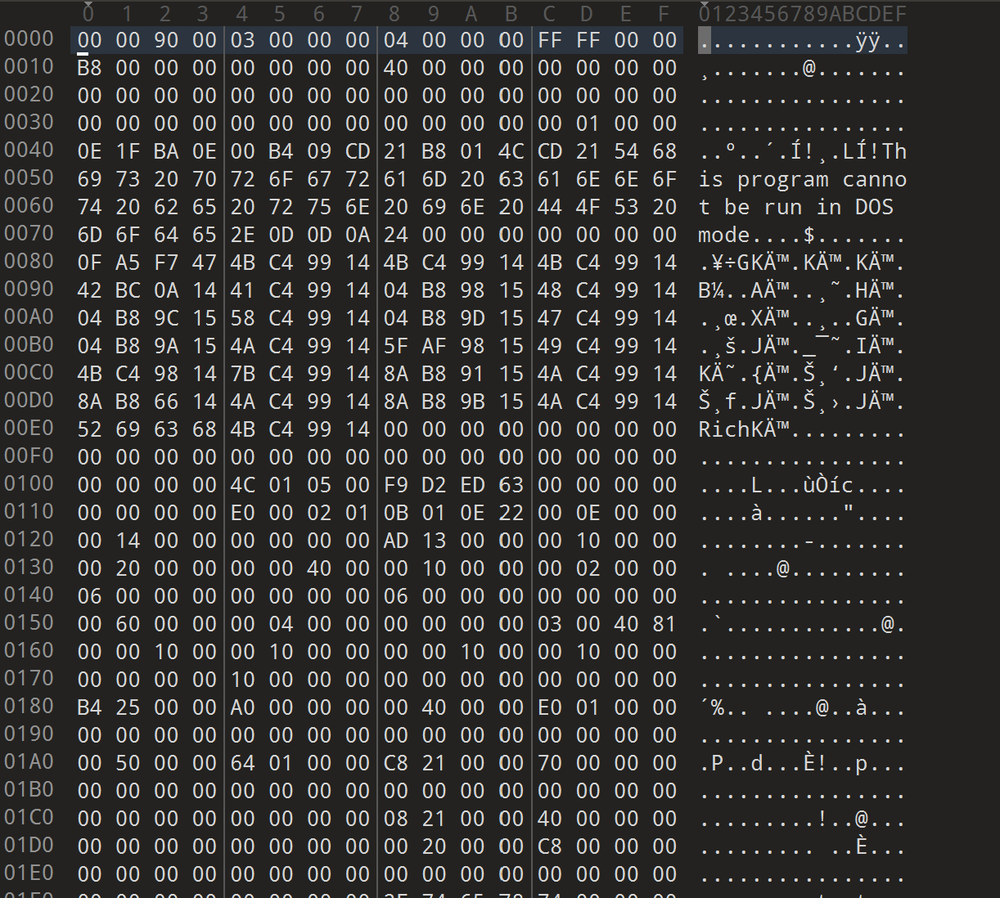

들어가 보니까 핵심적인 부분들을 발견할 수 있었는데 첫 2바이트에 PE 구조라고 명시를 해야하는 MZ와 NT Header 부분에 PE구조라고 명시하지 않은 것을 찾을 수 있었다.

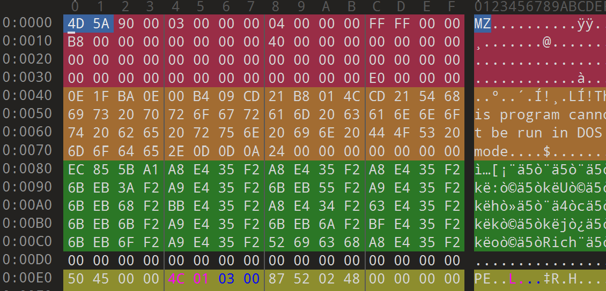

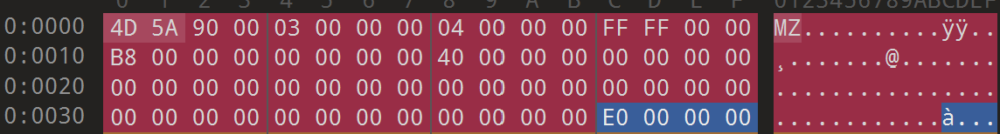

이게 정상적인 파일의 모습이다.

(DOS Header 부분 첫 2바이트를 MZ로 만들어서 PE구조라고 명시를 해두고 마지막 부분에 NT Header가 어디에 있는지 명시를 해두게 된다.)

이 파일은 리틀 엔디언 구조로서 거꾸로 파악을 해보면 NT Header 의 위치는 E0 00 00 00 → 00 00 00 E0(0xE0) 이 되겠다.

\<Signature 문제 파일 내용>

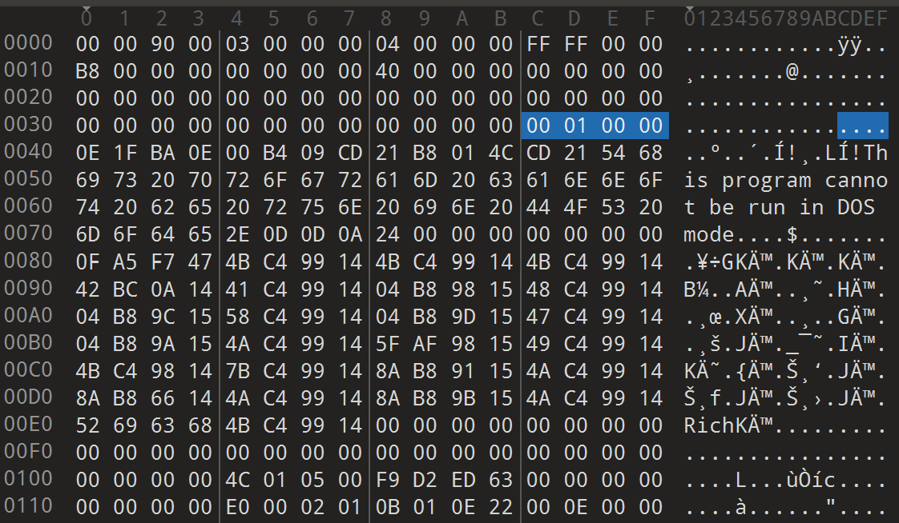

하지만 Signature 문제 파일은 이렇게 0x10부분이 NT Header 위치여서 가 보았더니

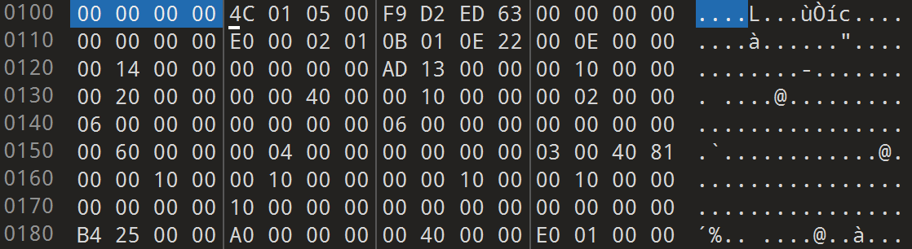

이렇게 PE 구조라고 명시를 하지 않고 0 값으로 들어있는 모습을 볼 수 있다.

그러면 이것을 간단하게 수정만 하면 문제가 풀릴 것이라고 생각 하였다.

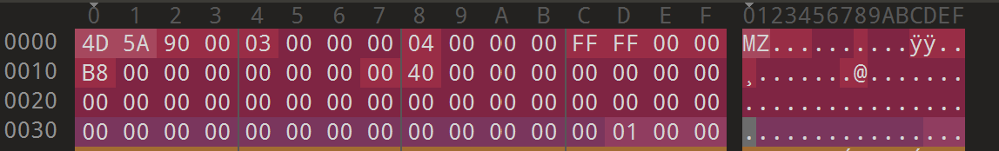

이렇게 00 00 이였던 첫 2바이트에 4D 5A (MZ) 문자를 넣어 명시를 해주고 NT Header 부분인 0x10 주소 부분에 가서 아무것도 없는 값 (0x00)을 PE 구조로 명시를 해준다.

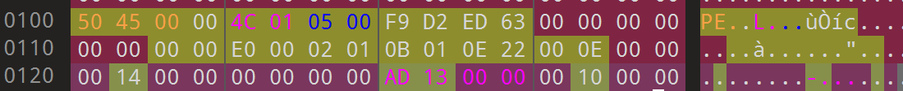

이렇게 다 바꾸었으면 Ctrl + S로 저장을 하고 exe 파일을 눌러보면 문제가 해결된다.

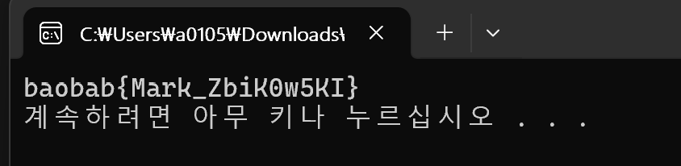

flag : baobab\{Mark\_ZbiK0w5KI\}

---

