
**UPX와 Upack으로 패킹된 실행 파일**을 살펴보고 원본과 달라진 구조를 비교했다. 압축 해제 흐름을 따라 OEP를 찾은 과정과 인라인 패치 실습을 정리했다.

## 손실 압축, 비손실 압축, 실행 압축, 패커가 무엇인지 설명

### 손실 압축(Lossy Compression)이란?

- 원본 데이터의 일부를 손실시켜 압축하는 방식<br />(다시 복구 못함)
- 사람이 잘 못 느끼는 부분을 골라서 버리기 때문에 크게 문제가 안됨

종류 : 이미지, 오디오, 비디오(JPEG, MP3, MP4)

#### 왜 손실압축이 필요한가?

사진, 음악, 영상을 원본 그대로 저장하면 데이터가 너무 커진다.

손실압축은 사람이 못 느끼는 정보(고주파, 색상)등을 버려서 데이터를 최대한 효율적으로 저장되게 도와준다.

#### 손실압축의 장단점

장점

1. 저장 공간 절약 : 여러 데이터를 압축해주기 때에 공간 절약에 탁월하다.
2. 전송 대역폭 절감 : 영상을 로딩이 걸리지 않고 쾌적하게 볼 수 있다.
3. 품질 조절 가능 : 용량과 화질을 상황에 맞게 필요하게 조정이 가능하다.

단점

1. 비가역성 : 버린 정보는 영원히 못 살린다.<br />(압축을 풀어도 안됨)
2. 품질 저하 : 압축을 세게 할수록 화질/음질이 떨어진다.(너무 강하게 하면 다 깨짐)
3. 용도 제한 : 정확성이 중요한 부분에서는 사용하지 못한다.

#### 손실 압축의 원리

1. 양자화

   - 값을 더 적은 단계로 근사하면서 세부 정보를 줄이는 방식이다.

2. 지각 정보 버리기

   - 사람이 못 느끼는 정보(고주파, 미세질감 등)을 골라서 지우게 된다.

#### 실제로 실습하기

먼저 손실을 시키지 않았을 때의 사진을 만들기 위해 chat gpt에게 사진을 하나 만들어 달라고 하였다.

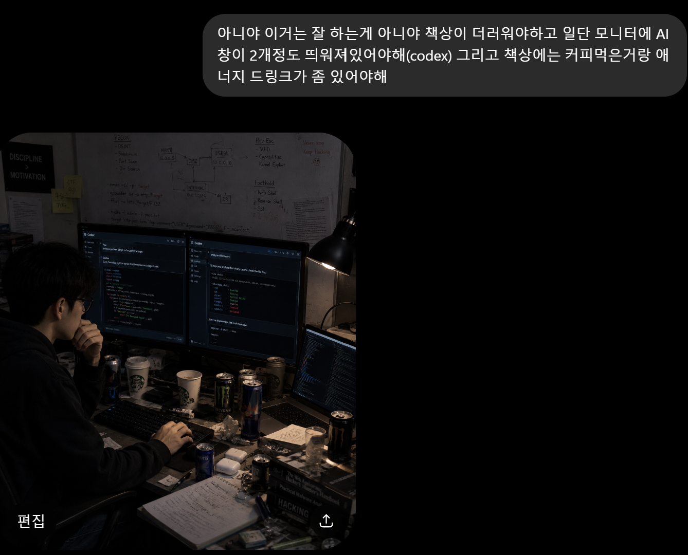

아무것도 건들지 않았을 때의 파일 용량

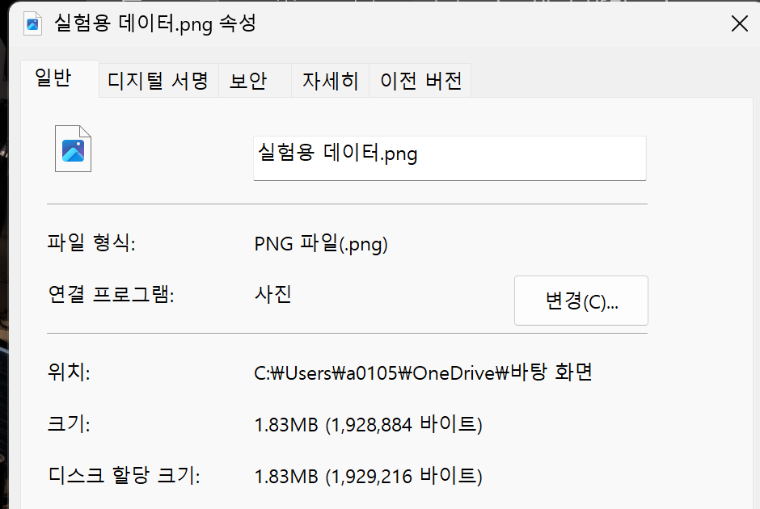

[https://www.photopea.com/](https://www.photopea.com/) 이 사이트를 이용해 양자화를 사용해보기로 하였다.

이 사이트는 간단하게 포토샵 기능을 작게 넣어둔 무료 사이트인데 기능이 생각보다 다양하다.

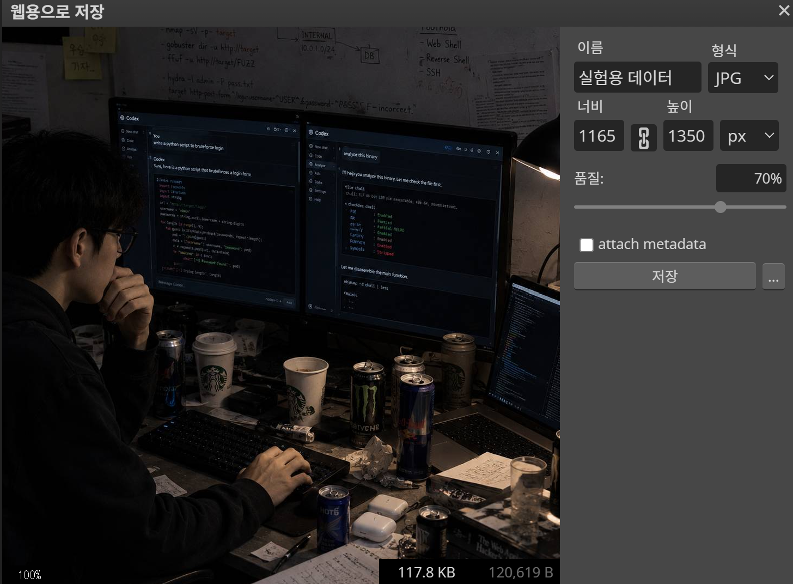

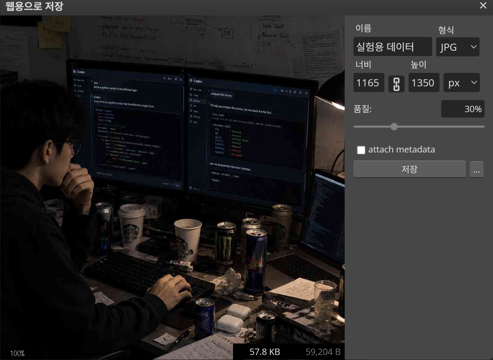

위 사진을 보면 png(비손실 압축)에서 JPG(손실 압축)로만 바뀌기만 해도 데이터가 줄어드는 모습을 볼 수 있다.

무손실 : png(1.83MB)

손실 : jpg(117.8KB)

품질 70% → 30% 양자화 : 57.8KB

### 비손실 압축(<strong>Lossless Compression)</strong>

- 데이터를 하나도 버리지 않고 압축하는 방식<br />(압축을 풀면 원본과 100% 똑같이 복원됨)
- 손실 압축과 달리 "버리는" 과정이 없고, 중복만 줄인다
- 종류 : 원본이 조금도 훼손되면 안 되는 곳 (ZIP, PNG, GIF, 텍스트·문서, 실행파일)

#### 왜 비손실 압축이 필요한가?

코드·문서·실행파일은 1비트만 틀려도 망가진다.

그래서 사람이 못 느끼는 정보를 버리는 손실 압축을 쓸 수 없고, 정보를 하나도 안 버리면서 용량만 줄이는 비손실 압축이 필요하다.

#### 비손실 압축의 장단점

장점

1. 완벽한 복원 : 압축을 풀면 원본과 똑같이 완벽하게 복원된다.
2. 안전함 : 코드, 문서처럼 정확성이 중요한 곳에 쓸 수 있다.
3. 재압축 해도 망가지지 않음 : 여러번 압축해도 손상이 없다.

단점

1. 낮은 압축률 : 중복만 제거해서 손실 압축보다 훨씬 덜 줄어든다.

2. 데이터 의존성 : 반복, 중복이 적은 데이터(사진 등)은 거의 용량이 줄어들지 않는다.

#### 비손실 압축의 원리

1. 통계적 중복 제거

   - 자주 나오는 값에 짧은 코드를 주는 방식
   - Huffman, Arithmetic으로 인코딩해서 표현

2. 패턴, 반복 제거

   - 이미 나온 데이터를 참조로 대체
   - RLE(AAAABBB → A4B3)
   - LZ77(앞에 나온 문자열을 거리, 길이로 참조)
   - LZW(사전에 등록 후 인덱스로 참조)

### 실행 압축

- 실행파일을 대상으로 압축을 한 후, 실행하는 순간 스스로 메모리에서 압축을 풀어서 실행되게 만드는 기술

```bash
일반 ZIP 파일 -> (반디집, 알집 같은 외부 도구가 필요)
실행 압축 -> (외부 도구가 불필요, 파일 자체가 실행되면서 스스로 압축이 해제됨)
```

종류 : UPX, ASPack 등이 존재(실행파일 대상)

#### UPX

실행 파일을 압축하여 용량을 줄이고 원본 구조를 숨기는 실행 압축도구

#### 실행 압축이 왜 필요한가?

- 실행 파일도 배포, 저장할 때 용량을 줄이면 좋다.
- 하지만 코드는 1비트만 틀려도 실행이 되지 않아 손실 압축 방법을 사용할 수 없다.
- 그래서 무손실 압축을 실행파일에 적용하고, 실행 시 스스로 풀리게 만든 것
- 추가로 정적 분석 시 원본 코드가 압축되어 은닉하는 효과도 존재한다

#### 실행 압축의 장단점

장점

1. 파일 크기 감소 : 배포, 다운로드 용량이 줄어든다.
2. 코드 은닉 효과 : 압축 되어 디버거로 열어도 원본 어셈블리가 보이지 않는다.
3. 여러 파일 묶기 가능 : DLL, 리소스를 하나로 패킹이 가능하다

단점

1. 실행 지연 : 매 실행마다 압축 해제 시간이 든다.
2. 메모리 효율 저하 : 여러 번 실행 시 따로 압축을 풀어서 RAM 사용량을 늘리게 된다

#### 실행 압축의 원리

1. 압축할 때 원본 코드를 압축한 뒤, 그 앞에 압축 해제 코드(스텁)을 / 를 넣는다.
2. 프로그램 시작 지점(Entry Point)를 스텁으로 바꾼다.
3. 실행되면 스텁이 먼저 시작하여 원본 코드를 메모리해서 압축 해제를 한다.
4. IAT를 재구성 하게 된다.
5. 원래 시작 지점(OEP)로 점프 하고 원본이 정상으로 실행된다.

```bash
한줄 요약
스텁 실행 -> 압축 해제 -> IAT 재구성 -> OEP 점프 -> 원본 실행
```

#### 실행 압축 실습

```powershell
# ① UPX 폴더로 이동 (upx.exe가 있는 곳)
cd C:\Users\a0105\Downloads\upx-4.0.2-win64\upx-4.0.2-win64

# ② 실습 대상 notepad.exe 복사본 가져오기
copy C:\Windows\System32\notepad.exe .\notepad.exe

# ③ 비교를 위한 원본 백업
copy .\notepad.exe .\notepad_original.exe

# ④ 압축 전 크기 확인  →  360448 바이트
ls notepad.exe

# ⑤ UPX로 실행 압축
.\upx.exe --force notepad.exe

# ⑥ 압축 후 크기 확인  →  211456 바이트
ls notepad.exe
```

전

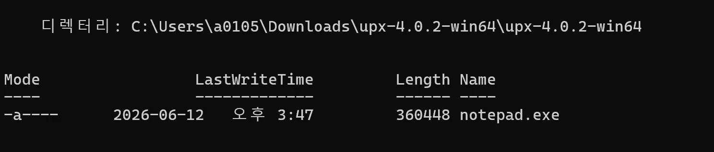

후


#### 패커(Packer)란?

- 실행 압축을 실제로 수행해주는 프로그램(도구)
- 실행 압축이 개념, 기술 → 패커는 그 개념을 적용하는 도구다
- exe를 넣으면 → 실행 압축된 exe로 만들어준다

#### 왜 패커가 필요한가?

- 실행압축은 개념일 뿐, 손으로 직접 코드를 압축하는 것은 어렵다.
- 패커는 이 행동을 명령어 형태로 간단하게 입력하면 편하게 해줘서 유용성이 좋다

#### 패커의 장단점

장점

1. 자동화 : 복잡한 과정들을 명령어 한 줄로 처리한다.
2. 크기 감소 : 파일 용량이 줄어든다.
3. 복원 가능 : 다시 원본 파일로 압축을 풀 수 있다.

단점

1. 쉽게 탐지됨 : 섹션 이름이 그대로 들어가서 패킹된 사실이 바로 드러난다.
2. 변형에 약하다 : 섹션 명을 수정하면 명령어가 먹히지 않아 수동 언패킹이 필요하다.

#### 패커의 원리(UPX 기준)

1. 원본 코드, 데이터를 무손실 압축을 진행
2. 압축 해제 코드(스텁)을 파일 앞에 넣음
3. Entry Point를 원본이 아닌 스텁으로 바꾼다
4. 섹션을 UPX0, UPX1로 재구성한다.<br />→ 실행하면 스텁이 먼저 돌며 압축을 풀고 OEP로 점프한다.

### OEP(Original Entry Point)

- 압축이 다 풀린 뒤 진짜 원본 코드가 시작되는 주소
- 리버싱에서 언패킹을 사용할 때 찾아야하는 목표 지점

## Notepad.exe를 UPX 패킹 하고 원본과의 차이점 설명

먼저 UPX 패킹을 하고 난 후 원본과의 다른점을 나열하고 하나하나 실습 해보도록 하겠다.

1. 용량 감소
2. 섹션 이름·개수     .text/.data/.rdata → UPX0/UPX1/UPX2
3. 섹션 크기 (RAW vs Virtual)  UPX0: Raw=0, Virtual=큼
4. Entry Point       원본 코드 → 스텁(UPX1)으로 이동
5. Import Table(IAT)  수십 개 → 몇 개로 확 줄어듦

### 용량감소 실습

```powershell
# ① UPX 폴더로 이동 (upx.exe가 있는 곳)
cd C:\Users\a0105\Downloads\upx-4.0.2-win64\upx-4.0.2-win64

# ② 실습 대상 notepad.exe 복사본 가져오기
copy C:\Windows\System32\notepad.exe .\notepad.exe

# ③ 비교를 위한 원본 백업
copy .\notepad.exe .\notepad_original.exe

# ④ 압축 전 크기 확인  →  360448 바이트
ls notepad.exe

# ⑤ UPX로 실행 압축
.\upx.exe --force notepad.exe

# ⑥ 압축 후 크기 확인  →  211456 바이트
ls notepad.exe
```

전


후

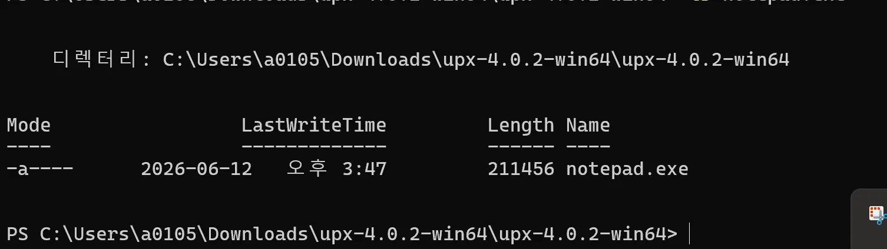

### 섹션 이름 개수 비교 / 섹션 크기 실습

원본의 섹션 헤더

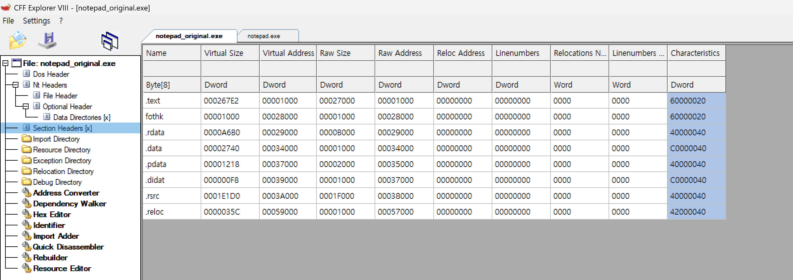

UPX 패킹을 한 후 섹션 헤더

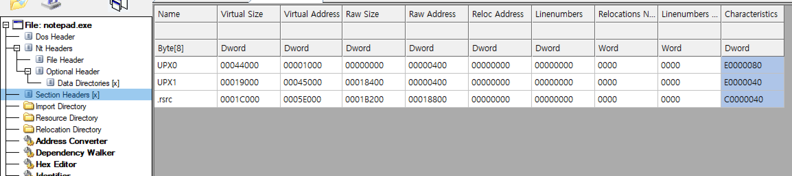

사진에서 알 수 있는점

1. 섹션 개수가 현저히 줄게 되었다. (8개 → 3개)
2. UPX0의 Raw size가 0인데  Virtual Size는 0x44000이 들어간다.<br />(실행되면 압축 풀린 코드로 채워질 빈 공간이라는 뜻이다.)
3. UPX 패킹이 된 뒤에도 .rsrc 섹션은 여전히 남아 있는 모습을 볼 수 있다. <br />.rsrc 섹션은 아이콘, 버전 정보 등을 알려주는 섹션인데 windows 프로그램을 실행하기 전에 리소스에 접근하기 때문에 일부러 .rsrc 섹션을 압축하지 않고 남겨둔 것이다.

추가 정리 <br />Raw Size : 디스크(파일)에서 이 섹션이 차지하는 크기<br />VIrtual Size : 메모리에 로드 되었을 때 이 섹션이 차지하는 크기

### Entry Point 스텁 이동 실습

원본

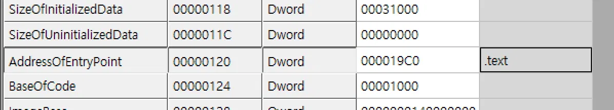

UPX 패킹 후

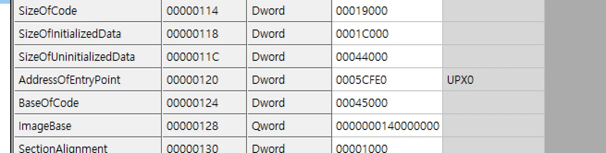

AddressOfEntryPoint 값을 보면 원본 데이터에서는 .text 값을 참조하고 있으나,

UPX 패킹을 한 후에는 EntryPoint 값이 UPX0을 참조하고 있는 모습이 나오게 된다.

### IAT 개수 비교 실습

#### 개념

IAT(Import Address Table) : 이 프로그램이 다른 DLL 에서 빌려 쓰는 함수들의 주소표

UPX가 이걸 건드리는 이유

- IAT가 불러오는 Import 정보도 UPX의 압축 대상이기 때문이다.
- 원본 IAT를 압축해서 숨기고 실행하면 복원 시킨다.

#### 원본 데이터

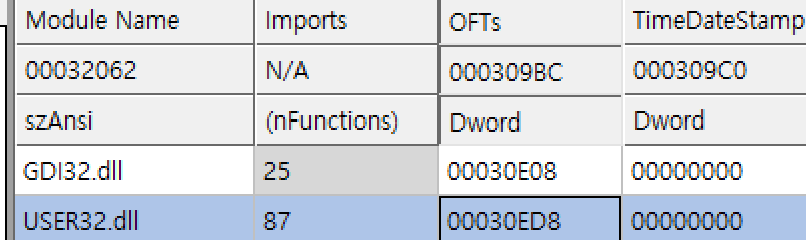

user32.dll 기준 87개 함수 존재

#### UPX 패킹 후 데이터

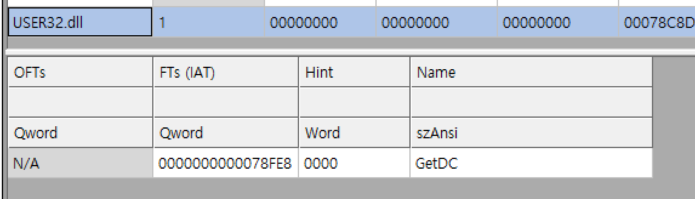

user32.dll 기준 1개 함수 존재

## UPX패킹 후 디버깅을 통해 OEP를 찾아주세요(트레이싱)hello.exe

트레이싱(Tracing) : 디버거가 명령어를 한 개씩 실행하면서 그 흐름을 따라가는 것

OEP(Original Entry Point) : 패킹되기 <strong>전</strong> 원본 프로그램이 처음 실행되던 진입점 주소.

먼저 디버거로 main부분을 찾아 주었다.

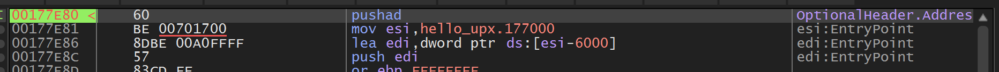

```asm
00177E80  | 60                  | pushad                             |
pushad : 모든 32비트 범용 레지스터의 값을 스택(Stack)에 한 번에 저장
00177E81  | BE 0x177000         | mov esi,hello_upx.177000           | esi:EntryPoint
esi 주소 값을 177000로 넣어버림(UPX1의 시작 주소)
00177E86  | 8DBE 00A0FFFF       | lea edi,dword ptr ds:[esi-6000]    | edi:EntryPoint
edi 주소는 esi에서 6000 뺀 주소 값을 넣게됨
00177E8C  | 57                  | push edi                           |
edi 값을 push 명령어로 스택에 저장한다
00177E8D  | 83CD FF             | or ebp,FFFFFFFF                    |
ebp의 값을 FFFFFFFF로 셋팅함
```

패킹을 복원하는 루프는 굉장히 오래 걸리기 때문에 간단하게 명령어를 사용해서 스킵하며 루프문 위주로 분석을 해보았다.

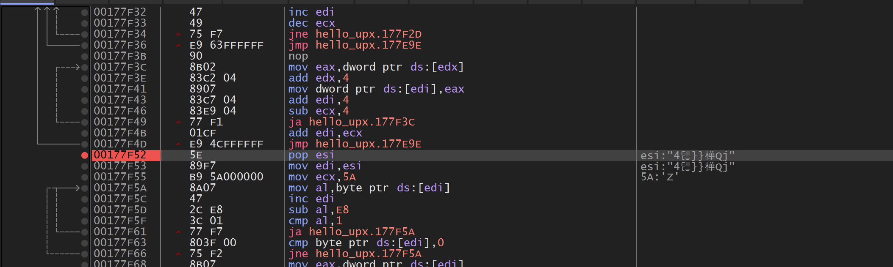

가장 큰 루프문이자 본격적인 디코딩(압축 해제) 루프이다.

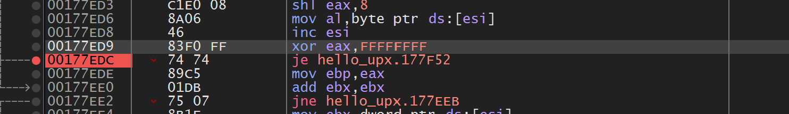

 그리고 이 문장으로 오기 위해서 작동하는 조건 점프문의 모습이다.

xor 연산으로 eax와 FFFFFFFF를 비교해서 ZF를 세우고 그걸로 je가 판단하여 점프하게 된다.

xor 연산으로 ZF를 나오게 하기 위해서는<br />eax값이 똑같이 FFFFFFFF가 된채로 xor 문을 지나 ZF 값이 1로 올라가야 한다.

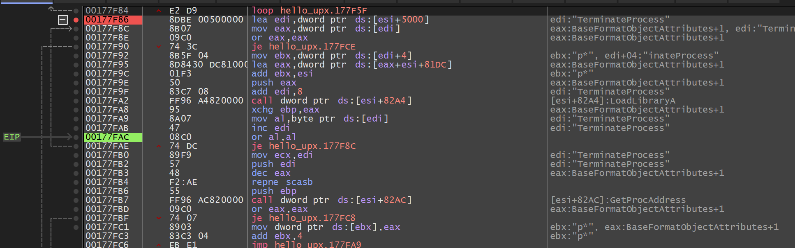

```asm
00177F86  | 8DBE 00500000     | lea edi,dword ptr ds:[esi+5000]                     | edi:"TerminateProcess"
00177F8C  | 8B07              | mov eax,dword ptr ds:[edi]                          | eax:BaseFormatObjectAttributes+1, edi:"TerminateProcess"
00177F8E  | 09C0              | or eax,eax                                          | eax:BaseFormatObjectAttributes+1
00177F90  | 74 3C             | je hello_upx.177FCE                                 |
00177F92  | 8B5F 04           | mov ebx,dword ptr ds:[edi+4]                        | ebx:"p*", edi+04:"inateProcess"
00177F95  | 8D8430 DC810000   | lea eax,dword ptr ds:[eax+esi+81DC]                 | eax:BaseFormatObjectAttributes+1
00177F9C  | 01F3              | add ebx,esi                                         | ebx:"p*"
00177F9E  | 50                | push eax                                            | eax:BaseFormatObjectAttributes+1
00177F9F  | 83C7 08           | add edi,8                                           | edi:"TerminateProcess"
00177FA2  | FF96 A4820000     | call dword ptr ds:[esi+82A4]                        | [esi+82A4]:LoadLibraryA
00177FA8  | 95                | xchg ebp,eax                                        | eax:BaseFormatObjectAttributes+1
00177FA9  | 8A07              | mov al,byte ptr ds:[edi]                            | edi:"TerminateProcess"
00177FAB  | 47                | inc edi                                             | edi:"TerminateProcess"
00177FAC  | 08C0              | or al,al                                            |
00177FAE  | 74 DC             | je hello_upx.177F8C                                 |
00177FB0  | 89F9              | mov ecx,edi                                         | edi:"TerminateProcess"
00177FB2  | 57                | push edi                                            | edi:"TerminateProcess"
00177FB3  | 48                | dec eax                                             | eax:BaseFormatObjectAttributes+1
00177FB4  | F2:AE             | repne scasb                                         |
00177FB6  | 55                | push ebp                                            |
00177FB7  | FF96 AC820000     | call dword ptr ds:[esi+82AC]                        | [esi+82AC]:GetProcAddress
00177FBD  | 09C0              | or eax,eax                                          | eax:BaseFormatObjectAttributes+1
00177FBF  | 74 07             | je hello_upx.177FC8                                 |
00177FC1  | 8903              | mov dword ptr ds:[ebx],eax                          | ebx:"p*", eax:BaseFormatObjectAttributes+1
00177FC3  | 83C3 04           | add ebx,4                                           | ebx:"p*"
00177FC6  | EB E1             | jmp hello_upx.177FA9                                |
```

pop 부분을 지나 좀 더 내려가면 새로운 루프문이 나온다.

역할 : IAT 세팅

```asm
00177F86  | 8DBE 00500000     | lea edi,dword ptr ds:[esi+5000]
처음에 루프문이 시작할 때 edi는 esi(UPX1-6000)값에 5000을 더한 176000 주소값이 들어간다.

```

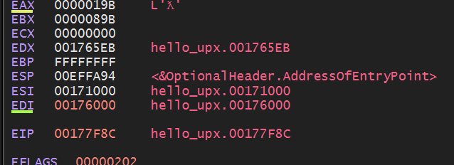

EDI에 적혀있는 0x176000부분에 Hex로 가보면

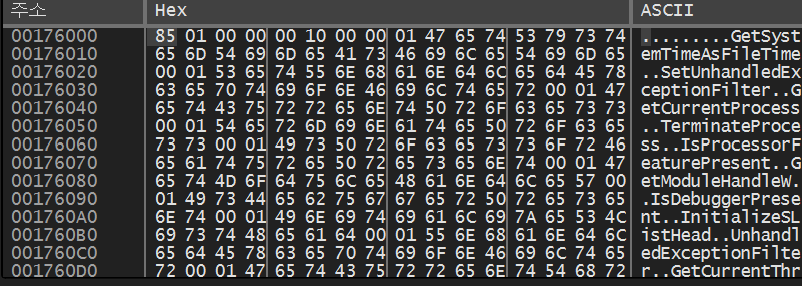

이러한 문자들을 볼 수 있다.

이 문자들을 UPX가 hello.exe를 패킹 할 때 원본의 IAT 값을 분석해 프로그램에 사용되는 API 이름들을 넣은 곳이다.

그리고

```asm
00177FC1  | 8903              | mov dword ptr ds:[ebx],eax

이 문장을 통해 ebx는 위 Hex 값에 있는 api의 주소들을 가져와서 저장한다.
루프를 돌 때마다 ebx의 주소값은 달라지며 그 달라진 자리마다 ebx가 api 함수들을 넣어주는 역할을 한다.

모든 api의 주소들을 다 담았으면 다음 DLL로 이동해서 또 함수들을 넣는 것을 반복한다.

그렇게 모든 DLL의 함수들을 넣었으면 루프가 종료되고 다음 문장으로 넘어간다.
```

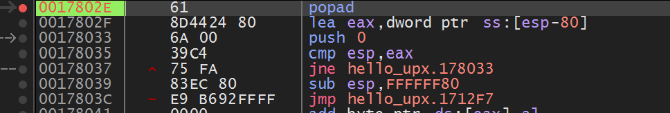

```asm
0017802E | 61                | popad                                               |
0017802F | 8D4424 80         | lea eax,dword ptr ss:[esp-80]                       |
00178033 | 6A 00             | push 0                                              |
00178035 | 39C4              | cmp esp,eax                                         |
00178037 | 75 FA             | jne hello_upx.178033                                |
00178039 | 83EC 80           | sub esp,FFFFFF80                                    |
0017803C | E9 B692FFFF       | jmp hello_upx.1712F7                                |
```

이제 마지막 루프문이다.

역할 : OEP 점프 코드문

popad : UPX 처음 시작할 때 pushad와 대응되는 명령어로 레지스터를 원래대로 복원시키는 명령어이다.

복원이 다 실행된 뒤에 <code>jmp hello_upx.1712F7(</code>OEP)로 가며 복원이 정상적으로 완료된다.

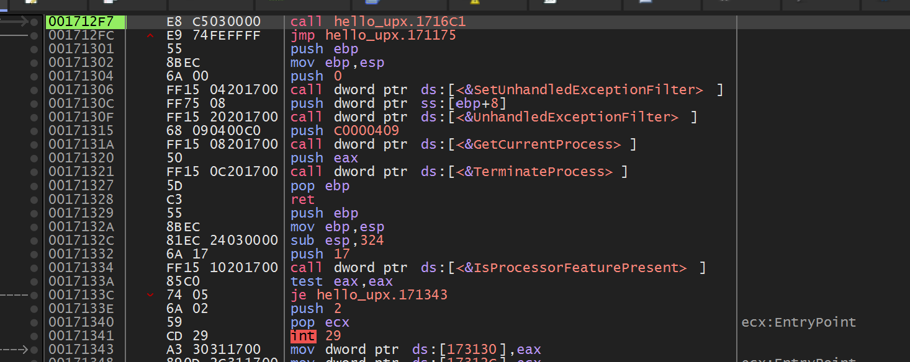

## Notepad.exe를 Upack 패킹하고 원본과의 차이점을 설명하세요.(upack으로 패킹된 파일 구조 분석)

#### Upack 이란?

- Upack은 중국에서 만든  PE 패커이다.

- 실행 압축기의 일종으로 PE 파일을 LZMA 형태로 압축한다.

#### Upack이 하는일(작동 흐름)

1. 원본의 PE 코드 / 데이터 / 테이블 / 리소스를 LZMA 형태로 압축함
2. 압축 데이터 앞에 작은 스텁을 넣어 용량 최소화함
3. PE 헤더를 극단적으로 겹쳐 재구성한다.

#### Upack의 장단점

장점

1. 뛰어난 압축률을 자랑한다
2. 헤더 공간까지 활용하여 파일을 극소화한다.

단점

1. 공식적인 언패커가 없다.
2. 도구를 깨트리는 경우가 존재한다.
3. 현재 유지보수 및 개발이 종료되었다(2005년)

#### upack 사용법

upack의 사용법은 간단하다.

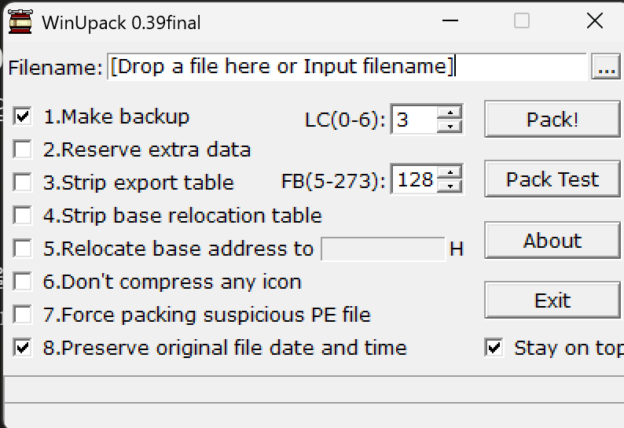

Upack.exe를 들어가면 이렇게 메시지 박스가 하나 나온다.<br />(윈도우가 악성코드로 오해해서 윈도우 방화벽을 꺼야 정상적으로 실행된다)

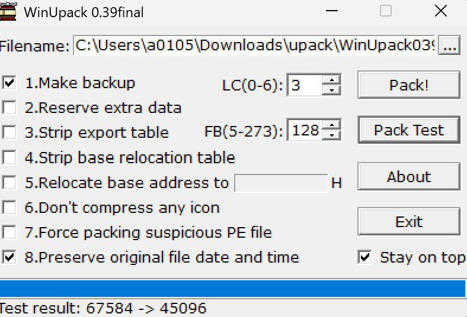

이렇게 드래그 앤 드롭 방식으로 패킹하고 싶은 파일을 드래그 한 다음 <br />1번을 꼭 활성화 시킨다(원본 백업 방식)

그리고 Pack Test를 누르면 아래 얼마나 줄어드는지 눈으로 확인이 가능하다.

#### 원본과 달라진 점

### 1. Hex 구조

Hex 구조에서 원본의 e\_lfanew 멤버의 값은 0xE0이였다. 하지만 패킹 후 MZ 시그니처와 PE시그니처가 바로 붙으면서 e\_lfanew의 값도 0x10이 된 모습을 볼 수 있다.

#### 원리

Upack은 불필요한 부분들을 삭제해버리는 특성을 가지고 있는데, MZ와 PE 사이를 차지하는 DOS Stub 부분을 통째로 삭제해서 앞으로 밀리게 된다. 그래서 공간낭비가 없게 만들어 파일 크기를 줄이게 된다.

PE 헤더의 허술함을 이용하여 Dos Stub 부분을 지우고 Dos Header 부분에 NT Header 부분을 끼워넣어 메모리 용량이 현저히 줄어들게 된다.

전

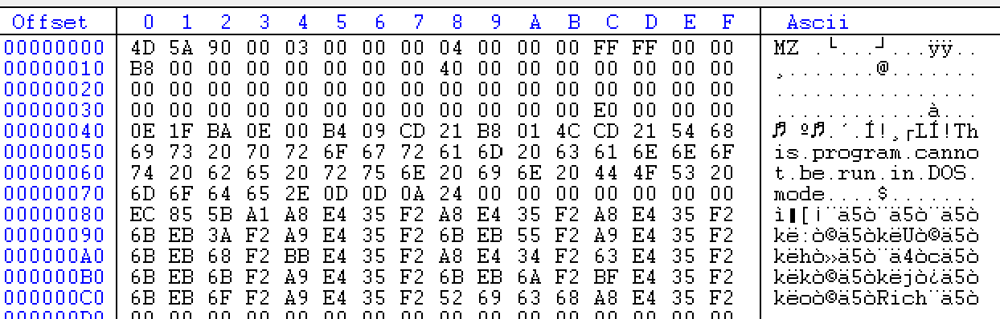

후

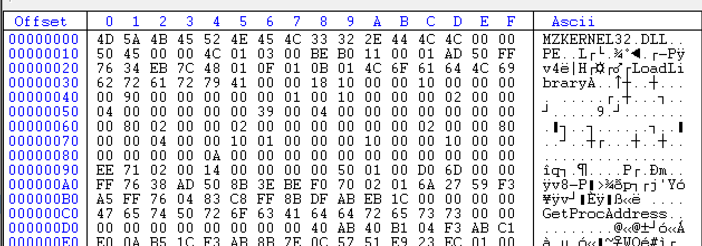

### 2. import directory에서 DLL 부분

#### 원리

Upack이 원본 import table 전체를 LZMA 방식 압축을 해서 안에 집어넣게 되었다. 그래서 겉으로는 이렇게 눈에 보이지 않는 것이다.

전

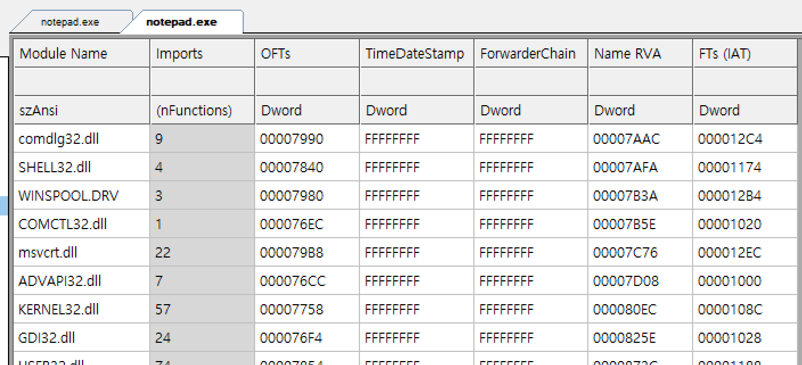

후

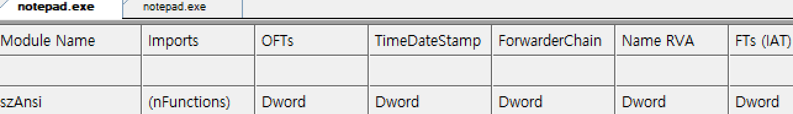

### 3. Section Header 차이

Section Header 에서 패킹 전의 데이터는 3개의 섹션을 이루고 있었지만 Upack 후의 데이터는 문자가 깨져 있었다.

그리고 Upack으로 패킹 된 헤더를 보면 Raw Size가 0x1F0으로 동일하고 Raw Address 도 0x10으로 동일하게 된다. → 첫 번째 섹션이랑 두 번쩨 섹션헤더는 영역을 공유하고 겹쳐서 쓰이고 있다는 의미이다.

원리

메모리 두 번째 섹션 영역에 패킹된 notepad가 있고, 패킹이 풀리면 첫 번째 섹션 영역에 기록된다.

이 때 notepad 원본 파일의 메모리 이미지가 통째로 풀려 프로그램이 정상적으로 실행될 수 있다.

전

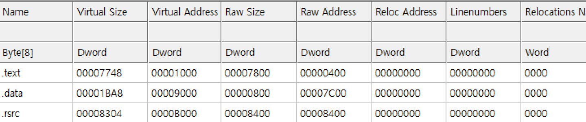

후

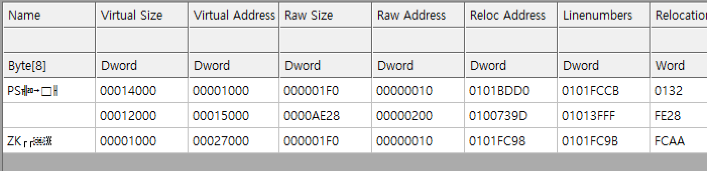

### 4. Entry Point 위치

Section Header 부분에서 .text, .data 같은 부분들이 제대로 나와있지 않는것을 확인 하였다. 그러면 EntryPoint를 참조하는 텍스트도 같이 꺠져있는 것을 볼 수 있었다.

전

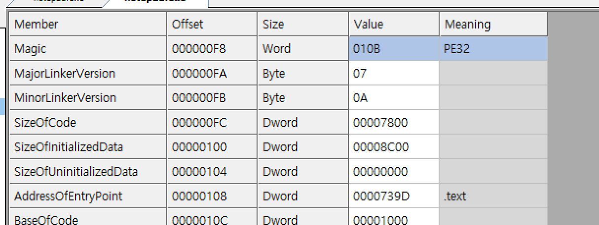

Upack 후

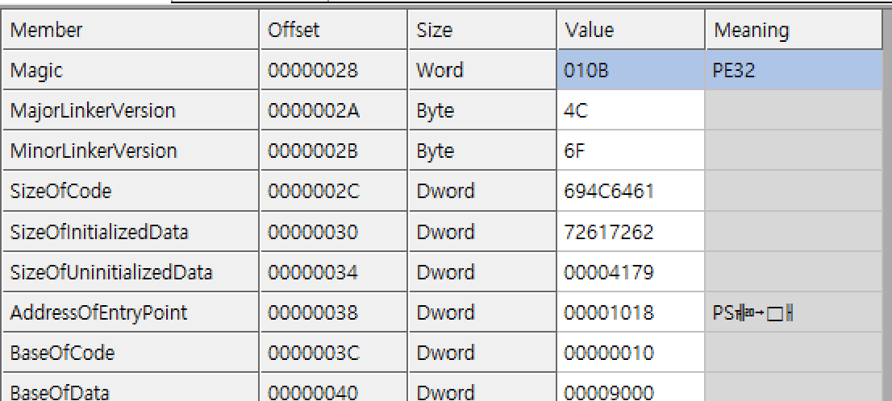

이렇게 위 사진처럼 둘이 달라진 모습을 볼 수 있다.

## Upack 패킹 후 디버깅을 통해 OEP를 찾아주세요 (찾을 때 트레이싱)

먼저 Upack한 notepad를 x32dbg로 열어서 EP에 BP를 걸어준다.<code> EP : 01001018</code>

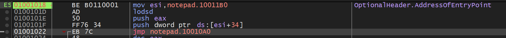

```asm
01001018 | BE B0110001       | mov esi,notepad.10011B0                             | esi:EntryPoint
0100101D | AD                | lodsd                                               |
0100101E | 50                | push eax                                            |
0100101F | FF76 34           | push dword ptr ds:[esi+34]                          |
01001022 | EB 7C             | jmp notepad.10010A0                                 |
```

이 코드는 간단하게 10011B0주소에서 4바이트를 읽어서 EAX에 주소값을 저장하는 명령어이다.

이때 EAX의 주소값에는 0100739D라는 주소값이 들어간다.(notepad의 OEP)

루프문

```asm
0101FD13 | 58                | pop eax                                             |
0101FD14 | 8D5483 58         | lea edx,dword ptr ds:[ebx+eax*4+58]                 |
0101FD18 | FF16              | call dword ptr ds:[esi]                             |
0101FD1A | 72 4F             | jb notepad.101FD6B                                  |
0101FD1C | 04 FD             | add al,FD                                           |
0101FD1E | 1AD2              | sbb dl,dl                                           |
0101FD20 | 22C2              | and al,dl                                           |
0101FD22 | 3C 07             | cmp al,7                                            |
0101FD24 | 73 F6             | jae notepad.101FD1C                                 |
```

<code>0101FD13 ~ 0101FD24</code>는 압축 데이터를 비트 단위로 판별하는 루프이다.

call \[esi\]가 반환한 CF를 기준으로.<br /> <code>jb 0101FD6B </code>분기를 만나면 반복 데이터 복사 경로로 이동하고, 그렇지 않으면 복원 경로를 계속 실행한다.

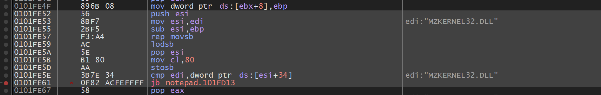

```asm
0101FE52 | 56                | push esi                                            |
0101FE53 | 8BF7              | mov esi,edi                                         | edi:"MZKERNEL32.DLL"
0101FE55 | 2BF5              | sub esi,ebp                                         |
0101FE57 | F3:A4             | rep movsb                                           |
0101FE59 | AC                | lodsb                                               |
0101FE5A | 5E                | pop esi                                             |
0101FE5B | B1 80             | mov cl,80                                           |
0101FE5D | AA                | stosb                                               |
0101FE5E | 3B7E 34           | cmp edi,dword ptr ds:[esi+34]                       | edi:"MZKERNEL32.DLL"
0101FE61 | 0F82 ACFEFFFF     | jb notepad.101FD13                                  |
```

<code>0101FD13 ~ 0101FE61</code>는 실제 Upack으로 압축된 원본 데이터를 복원하는 핵심 구간 중 하나이다 (반복되는 데이터 복원 영역 복사)

여기에서 cmp가 비교하는 위치가 복원이 끝났는지 검사를 하고<br /><code>jb 101FD13</code> 부분이 복원이 끝나지 않았으면,<br /><code>101FD13</code> 부분으로 다시 이동해서 복원 데이터를 옮기고 ,복사 한 뒤에 이렇게 검사하기를 반복한다

복원할 데이터가 더 이상 없어 cmp의 조건이 만족하면<code> jb</code>가 실행되지 않고 다음 줄로 넘어간다.

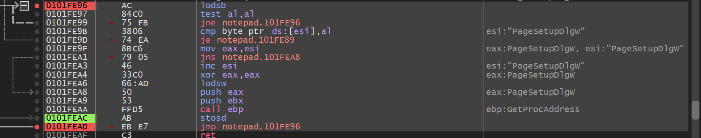

```asm
0101FE93 | FFD1              | call ecx                                            |
0101FE95 | 93                | xchg ebx,eax                                        | eax:PrintDlgExA+34
0101FE96 | AC                | lodsb                                               |
0101FE97 | 84C0              | test al,al                                          |
0101FE99 | 75 FB             | jne notepad.101FE96                                 |
0101FE9B | 3806              | cmp byte ptr ds:[esi],al                            | esi:"lgExW"
0101FE9D | 74 EA             | je notepad.101FE89                                  |
0101FE9F | 8BC6              | mov eax,esi                                         | eax:PrintDlgExA+34, esi:"lgExW"
0101FEA1 | 79 05             | jns notepad.101FEA8                                 |
0101FEA3 | 46                | inc esi                                             | esi:"lgExW"
0101FEA4 | 33C0              | xor eax,eax                                         | eax:PrintDlgExA+34
0101FEA6 | 66:AD             | lodsw                                               |
0101FEA8 | 50                | push eax                                            | eax:PrintDlgExA+34
0101FEA9 | 53                | push ebx                                            |
0101FEAA | FFD5              | call ebp                                            | ebp:GetProcAddress
0101FEAC | AB                | stosd                                               |
0101FEAD | EB E7             | jmp notepad.101FE96                                 |
```

이 부분은 UPX 부분에서도 봤던 Upack의 IAT 세팅 부분이다.

Upack 이 불러오는 2개의 함수(<code>LoadLibraryA, GetProcAddress</code>)<br />이용해서 루프를 돌면서 원본 notepad의 IAT를 구성해서 OEP로 진입한다.

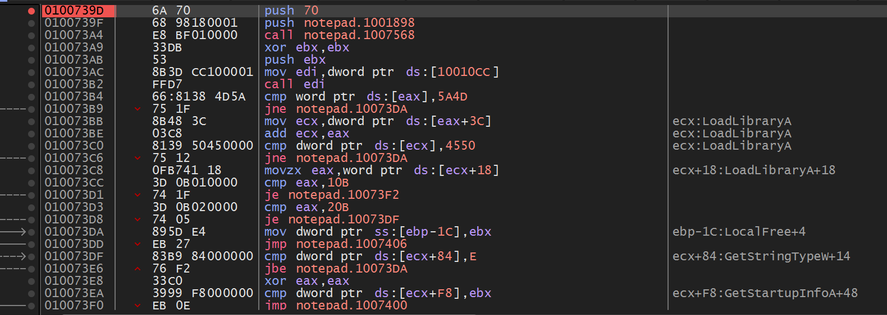

OEP 진입 완료

## 인라인 패치 개념과 실습

### 이론 & 트레이싱

#### 인라인 패치란?

- 원하는 코드를 직접 수정하기 어려울 때 간단히 코드 케이브라고 하는 패치 코드를 삽입한 후 실행하여 프로그램을 패치하는 기법이다.

코드  케이브 : 프로그램의 메모리 공간에서 사용되지 않거나 비어 있는 바이트 영역

EP : 암호화된 OEP 코드를 복호화 한 후 OEP 코드로 점프하는 것

EP가 되어 있다면 위치를 안다고 하더라도 그냥 패치 시키기가 되게 어렵다.

그렇기 때문에 코드 케이브를 별도의 패치 코드를 설치하여, EP 코드의 복호화 과정 이후 JMP 명령어를 수정하여 코드 케이브가 실행되게 변경하는 방식이다.(그 후 OEP로 가는게 일반적이다.)

매번 프로세스 메모리의 코드를 패치하기 때문에 이러한 패치 기법을 인라인 패치라고 부른다.

#### 실습

먼저 다운로드 파일을 받고 exe 파일을 누르니 아래 모양이 떴다.

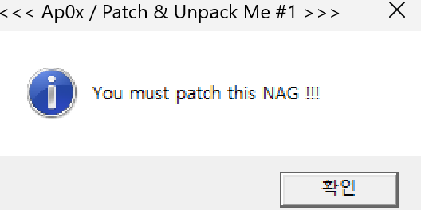

번역하면 문자를 바꿔달라는 간단한 문장이다.

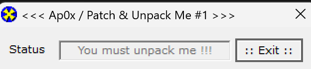

확인을 누르면 이렇게 글씨를 바꿔야 하는데 글씨가 보호되어 있어서, 건드리지 못하는 상태이다.

그러면 x32dbg로 한 번 들어가 보도록 하겠다.

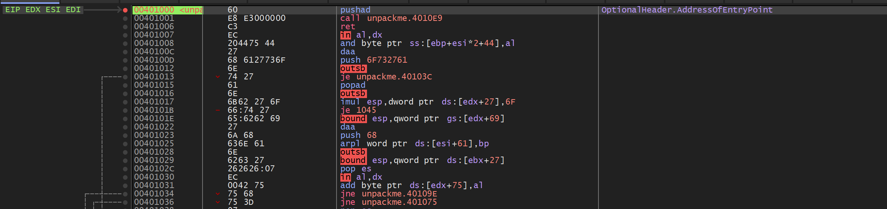

exe 파일에 들어간 뒤에 코드를 진행하면서 따라가다 보면 이러한 문장이 나온다.

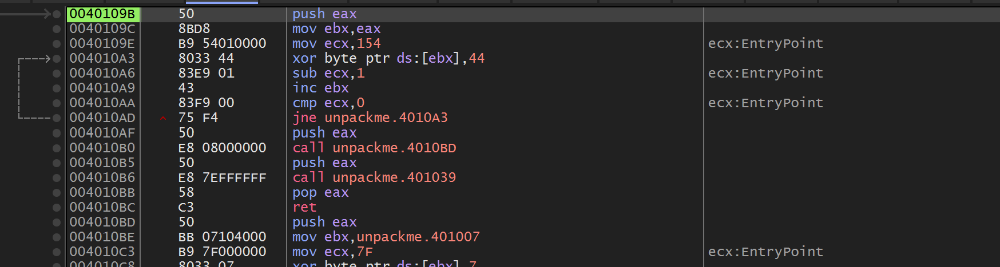

```asm
0040109B | 50                | push eax                                            |
0040109C | 8BD8              | mov ebx,eax                                         |
0040109E | B9 54010000       | mov ecx,154                                         | ecx:EntryPoint
004010A3 | 8033 44           | xor byte ptr ds:[ebx],44                            |
004010A6 | 83E9 01           | sub ecx,1                                           | ecx:EntryPoint
004010A9 | 43                | inc ebx                                             |
004010AA | 83F9 00           | cmp ecx,0                                           | ecx:EntryPoint
004010AD | 75 F4             | jne unpackme.4010A3                                 |
004010AF | 50                | push eax                                            |
004010B0 | E8 08000000       | call unpackme.4010BD                                |
004010B5 | 50                | push eax                                            |
004010B6 | E8 7EFFFFFF       | call unpackme.401039                                |
004010BB | 58                | pop eax                                             |
004010BC | C3                | ret                                                 |
```

루프문의 역할 : 복호화를 진행하는 루프이다.

```asm
004010A3 | 8033 44           | xor byte ptr ds:[ebx],44                            |

이 문장이 특히 복호화 진행 루프의 핵심이다.
EBX에 4010F5~401248을 xor 연산으로 복호화를 진행하는 루프이다.
(401248까지 루프를하고 401249에 루프를 빠져나옴)
```

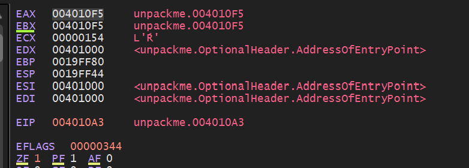

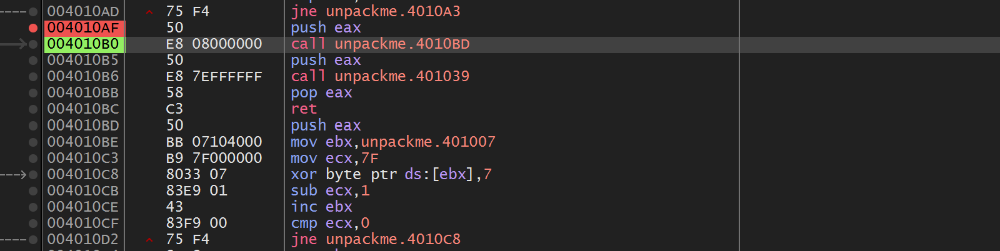

<code>jne</code>가 실행되지 않고 다음줄(<code>004010AF</code>)로 정상적으로 내려오면 바로 call문이 있는 것을 볼 수 있다.

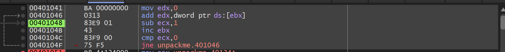

```asm
00401039 | 50                | push eax                                            |
0040103A | 8BD8              | mov ebx,eax                                         |
0040103C | B9 54010000       | mov ecx,154                                         |
00401041 | BA 00000000       | mov edx,0                                           |
00401046 | 0313              | add edx,dword ptr ds:[ebx]                          |
00401048 | 83E9 01           | sub ecx,1                                           |
0040104B | 43                | inc ebx                                             |
0040104C | 83F9 00           | cmp ecx,0                                           |
0040104F | 75 F5             | jne unpackme.401046                                 |
```

그렇게 이동하면 이러한 문장이 <code>call</code>문으로 <code>401039</code>를 불러오는 명령어가 있는데 들어가면 핵심적인 부분을 볼 수 있다.

<code>abx</code>랑 <code>eax</code>랑 값을 같게 만들고 <code>edx</code>를 초기화한다.

그리고 add 문으로 4바이트 단위로 값을 넣어 EDX 레지스터에 누적을 시킨다.

반복문이 종료되었을 때 <code>edx</code>는 <code>32591B5</code>라는 값을 가지게 되는데 이 값이<br />Checksum이 된다.

Checksum : 데이터나 파일이 전송, 저장되는 과정에서 손상되거나 변조되지 않았는지 확인하기 위해 사용되는 데이터 무결성 검증 값이다.

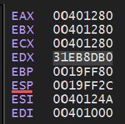

결과적으로 Checksum(<code>EDX</code>) 값이 <code>31EB8DB0</code>이라면<code> jmp</code> 되어 OEP 영역으로 가고 아니면 에러 메시지가 나타나며 프로그램이 종료된다.

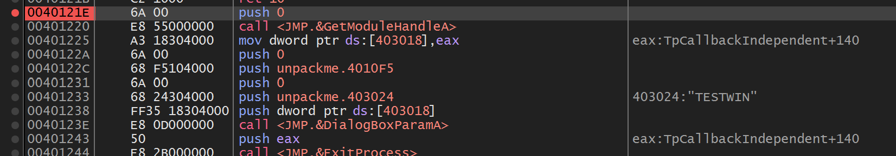

위 사진은 OEP 영역이다.

```asm
004011A5 | 68 0A114000       | push unpackme.40110A           | 40110A:"You must unpack me !!!"
004011AA | 6A 64             | push 64                        |
004011AC | FF75 08           | push dword ptr ss:[ebp+8]      |
004011AF | E8 BA000000       | call <JMP.&SetDlgItemTextA>    |
004011B4 | 6A 40             | push 40                        |
004011B6 | 68 41114000       | push unpackme.401141           | 401141:"<<< Ap0x / Patch & Unpack Me #1 >>>"
004011BB | 68 23114000       | push unpackme.401123           | 401123:"You must patch this NAG !!!"

위 메세지는 우리가 패치해야할 문자들이다.
```

### 인라인 패치

인라인 패치는 빈 공간에 코드를 삽입하여 하는 실습이기 때문에 저번 시간에 배웠던 PE구조에서 <br />Null Padding이라는 빈 공간에 인라인 패치를 해서 실습을 해보겠다.

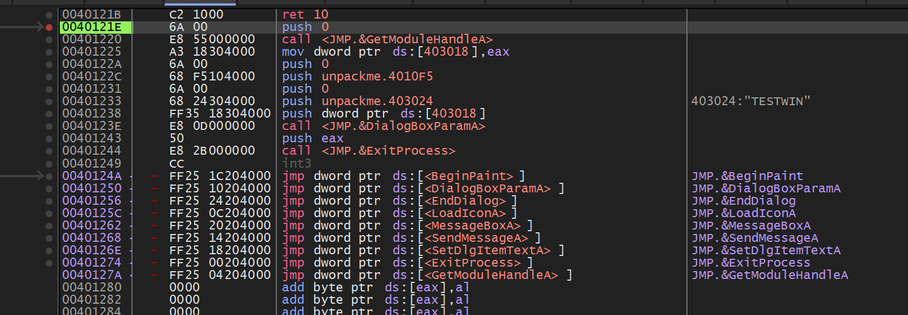

OEP에 간 상태에서 아래로 조금만 내려보면<code> 0x401280</code> 부터 Null-Padding 구간이라는 것을 확인할 수 있다.

Null Padding 구간에 간단한 코드케이브를 작성

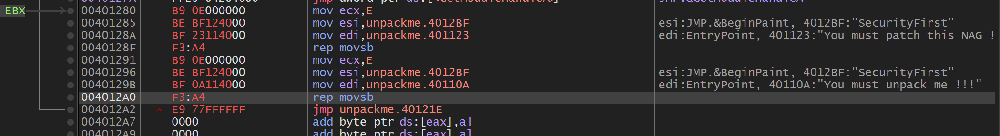

```asm
00401280 | B9 0E000000              | mov ecx,E                |
00401285 | BE BF124000              | mov esi,unpackme.4012BF  | esi:JMP.&BeginPaint, 4012BF:"SecurityFirst"
0040128A | BF 23114000              | mov edi,unpackme.401123  | edi:EntryPoint, 401123:"You must patch this NAG !!!"
0040128F | F3:A4                    | rep movsb                |
00401291 | B9 0E000000              | mov ecx,E                |
00401296 | BE BF124000              | mov esi,unpackme.4012BF  | esi:JMP.&BeginPaint, 4012BF:"SecurityFirst"
0040129B | BF 0A114000              | mov edi,unpackme.40110A  | edi:EntryPoint, 40110A:"You must unpack me !!!"
004012A0 | F3:A4                    | rep movsb                |
004012A2 | E9 77FFFFFF              | jmp unpackme.40121E      |
```

코드 구상 모습이다.

-코드 설명-

이제 마지막으로 OEP jmp 부분을 코드 케이브를 작성한 부분<br />(401280)으로 점프하라고 수정하면 끝이다.

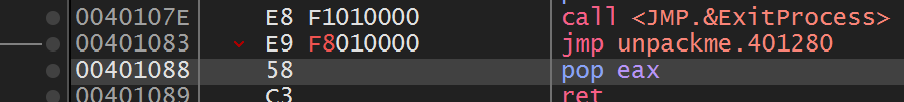

OEP 진입 점프문을 코드케이브 부분으로 변경한 모습

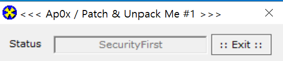

실행하면 이렇게 문자가 바뀌면서 인라인 패치가 정상적으로 해결된다.

