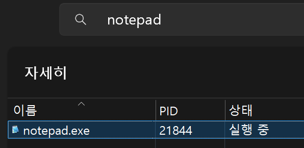
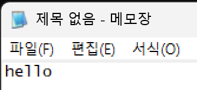
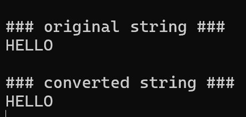
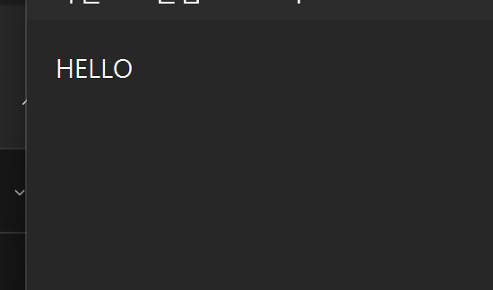


**API Hooking의 방식과 적용 위치**를 정리했다. 메모장의 WriteFile 호출을 관찰하는 예제로 저장되는 문자열이 달라지는 과정을 확인했다.

## API Hooking

#### API Hooking

후킹 : 정보를 가로채고, 실행 흐름을 변경하고 원래와 다른 기능을 제공하게 하는 기술

API Hooking : Win32 API 호출을 중간에서 가로채서 제어권을 얻어내는 방식

#### API Hooking의 이점

- API 호출 전/후에 사용자의 훅코드를 실행시킬 수 있다.
- API에 넘어온 파라미터 혹은 API 함수의 리턴값을 엿보거나 조작 가능
- API 호출 자체를 취소시키거나 사용자 코드로 흐름 변경 가능

```c
정상적인 API 호출 흐름

<notepad.exe> CreateFile api 호출 <--> <kernel32.dll> CreateFile api 실행

API Hooking 흐름

<notepad.exe> CreateFile api 호출 <--> <hook.dll> MyCreateFile() 실행 <--> <kernel32.dll> CreateFile api 실행

공격자는 DLL 인젝션, API 후킹을 사용하여, 다른 API를 중간에 호출시킨다.

(후킹 함수와 원본 함수의 호출 순서는 경우에 따라 달라짐)
입력된 파라미터 조작 = 후킹 함수 먼저
API 리턴값 조작 = 원본 함수 실행 후 후킹 함수
```

#### API Hooking의 한계(단점)

1. 후킹되지 않는 경로가 존재
   - <code>CreateFileW()</code>를 후킹해도 프로그램이 더 낮은 단계의 <code>NtCreateFile()</code>을 직접 호출하면 탐지하지 못할 수 있다.
2. 우회가 가능
   - 악성코드나 보호 프로그램은 후킹 여부를 검사하고 다른 방식으로 API를 호출 할 수 있다.

## API Hooking 방식

API 후킹의 방식은 Object에 따라서 크게 달라진다.

크게 static방식, dynamic방식으로 나뉜다.

| Static | Dynamic |
| --- | --- |
| 파일 대상 | 프로세스 대상 |
| 프로그램 실행 전 후킹 | 프로그램 실행 후 후킹 |
| 최초 한 번만 후킹 | 일반적인 후킹 |

우리가 말하는 대부분의 API 후킹은 모두 Dynamic 방식이다. Static 방식이 사용될 때도 가끔 있는데,<br />사용될 때는 아래와 같다.

- <strong>PE 파일의 Import Table 수정</strong>
  - 프로그램이 특정 API 대신 다른 함수나 DLL을 호출하도록 미리 변경
- <strong>Binary Patching</strong>
  - 실행 파일의 명령어나 함수 호출 부분을 직접 수정
- <strong>지속적인 동작 변경이 필요한 경우</strong>
  - 프로그램을 실행할 때마다 후킹 코드를 다시 주입할 필요 없이 수정된 파일 자체가 계속 사용됨

<strong>Dynamic Hooking</strong>은 실행 중인 프로세스 메모리에서 IAT Hooking, Inline Hooking 등의 방법으로 API 호출 흐름을 변경하는 방식이라 우리가 일반적으로 말하는 API Hooking은 대부분 이쪽에 해당

#### Location 구성(어디를 후킹할지)

### IAT(Import Address Table)

IAT에 있는 API의 주소를 후킹 함수 주소로 변경하는 방법이다.

가장 단순하고, 구현 방법이 가장 쉽다(변경만 해주면 되기 때문)

하지만 IAT에 없지만 프로그램에서 사용되는 API들에 관해서는 후킹할 수 없다는 한계가 존재한다(DLL을 동적으로 로딩해서 사용하는 경우)

### Code

프로세스 메모리에 매핑된 DLL에서 API 함수의 실제 주소를 찾아 코드를 수정하는 방식이다.

이 방법이 가장 대표적으로 사용되는 방법이다.

- 시작 코드를 JMP로 패치함
- 함수 일부를 덮어쓰는 방법
- 필요한 부분만 일부 변경함

하지만 코드를 잘못 수정하면 아예 작동이 안 될 수도 있다.

### EAT(Export Address Table)

EAT에 기록된 API의 시작 주소를 후킹 함수 주소로 변경하는 방법

개념은 간단하지만, 코드 구현 관련해서는 Code 방법이 더 간단하고 좋아서 많이 사용되지 않는다.

#### 후킹 하려는 프로세스 메모리에 후킹 함수를 넣는 방법

### Debug

후킹 대상을 디버깅하며, API 후킹을 하는 방법

(여기서 디버거는 일반적인 디버거가 아닌 후킹을 위한 사용자가 직접 제작한 프로그램이다)

프로그램에서 Debug에서 API를 이용해, 대상 프로세스에 후킹 함수를 설치한다<br />(프로그램 멈춘 상태에서)

설치한 후 프로그램을 재개하면 API 후킹이 성공적으로 완료된다.

## API Hooking코드 작성, 실습

메모장 파일 저장 동작을 대상으로 실습했다.

간단한 개념 정리

- 디버거 : 디버깅 프로그램
- 디버기 : 디버기 당하는 프로그램

### 메모장 WriteFile() 후킹

파일이 저장될 때 입력된 파라미터를 조작하여 소문자로 입력된 내용을 전부 대문자로 변경을 시도 해보겠다.



먼저 notepad의 PID를 확인 한다(21844)

PID를 확인 한 후 hookdbg.exe 프로그램이랑 notepad랑 같은 파일에 둔 뒤, <br /><code>hookdbg.exe 21844</code>(PID) 를 입력하주면 완료된다.



그리고 메모장에 아무 글자나 입력 한 뒤에 다른이름으로 저장을 누른다.



그러면 cmd 창에서 이러한 메시지가 출력되고 다른 이름으로 저장된 파일을 들어가보니, hello(소문자)가 아닌 HELLO(대문자)가 들어가 있는 것을 확인할 수 있었다.



### 동작 원리

```cs
BOOL WriteFile(
  HANDLE       hFile,
  LPCVOID      lpBuffer, ; 쓰기 버퍼
  DWORD        nNumberOfBytesToWrite, ; 써야할 크기
  LPDWORD      lpNumberOfBytesWritten,
  LPOVERLAPPED lpOverlapped
);

** 함수의 파라미터는 스택에 역순으로 저장 **
```

