
**Lena 튜토리얼 01~05와 Dreamhack 문제**를 풀며 문자열, 파일 검사, 조건부 분기와 DLL 로딩을 분석했다. 실습 중 확인한 화면과 코드 해석을 순서대로 정리했다.

## <strong>lena tutorial 01 \~ 02</strong>

<strong>keyfile.dat의 파일 검사와 내용 검증 조건을 분석한다.</strong>

reverseMe.exe의 풀이를 작성 해보도록 하겠다.

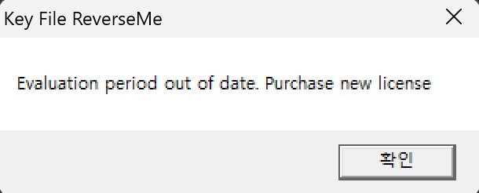

번역을 해보면 평가판 사용 기간이 만료되었습니다. 새 라이선스를 구매하세요. 라는 메시지가 나오게 된다.

x32dbg를 통해 확인 해보도록 하겠다.

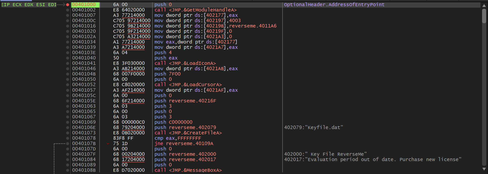

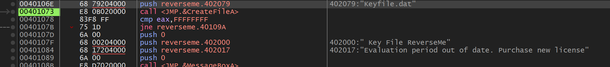

EP에서 F8을 누르며 조금 내려오면 이렇게 핵심적인 문장을 발견할 수 있었다.

```c++
0040106E  | 68 79204000       | push reverseme.402079                        | 402079:"Keyfile.dat"
00401073  | E8 0B020000       | call <JMP.&CreateFileA>                      |
00401078  | 83F8 FF           | cmp eax,FFFFFFFF                             |
0040107B  | 75 1D             | jne reverseme.40109A                         |
0040107D  | 6A 00             | push 0                                       |
0040107F  | 68 00204000       | push reverseme.402000                        | 402000:" Key File ReverseMe"
00401084  | 68 17204000       | push reverseme.402017                        | 402017:"Evaluation period out of date. Purchase new license"
00401089  | 6A 00             | push 0                                       |
0040108B  | E8 D7020000       | call <JMP.&MessageBoxA>                      |
00401090  | E8 24020000       | call <JMP.&ExitProcess>                      |
00401095  | E9 83010000       | jmp reverseme.40121D                         |
```

해석

```c++
1. keyfile.dat이라는 문자를 CreateFileA에 전달한다.
CreateFileA 함수 : 윈도우 운영체제에서 파일이나 입출력 장치를 새로 만들거나 열 때 사용하는 Win32 API 함수이다.

2. 프로그램이 call 명령어로 CreateFileA 함수를 연다.

3. CreateFileA 함수의 결과가 EAX에 들어와서 cmp 비교를 하게 된다.

4. EAX == FFFFFFFF인지 확인
(FFFFFFFF = INVALID_HANDLE_VALUE -> 즉 파일 열기에 실패했다는 뜻)
성공했다면 jne 40109A로 이동

5. 파일열기 실패하면 라이센스 구매 문장이 뜨며 종료됨
```

그러면 라이센스 구매 문장이 뜨지 않고 jne로 이동하기 위해서는 keyfile.dat 이라는 문자를 CreateFileA에 전달해서 cmp 명령문 조건에서 FFFFFFFF가 뜨지 않게 해야한다.

그러기 위해서 간단하게 메모장에 아무 문자를 넣고 다른 이름으로 저장을 통해 이름을 keyfile.dat으로 만들어서 진행을 하였다.

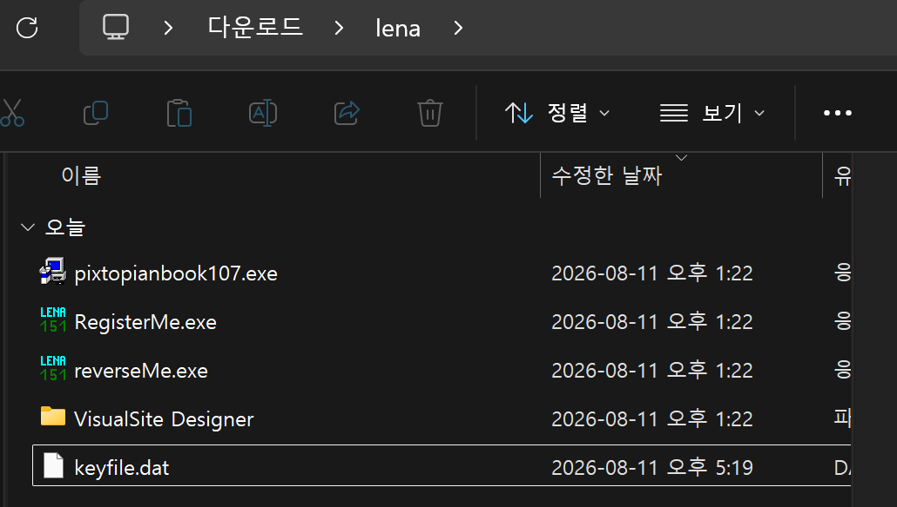

이렇게 만들고 exe 파일이 들어있는 같은 공간에 넣어주고 다시 실행을 해주면 FFFFFFFF가 뜨지 않고 jne 문장으로 넘어가게 된다.

이렇게 문제가 해결되는 줄 알았으나, 아래와 같은 메시지박스가 뜨게 된다.

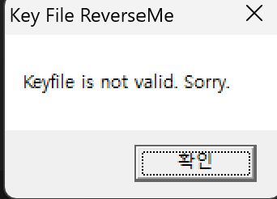

이 문장을 해석 해보면 <code>keyfile.dat은 찾았는데, 안에 들어있는 값이 올바르지 않다.</code> 라고 말을 하는 안내문이 나온다.

안내문을 보면 keyfile.dat 안에 있는 내용도 알맞게 변경해야 정상적으로 출력되는 것 같다.

```c++
0040109A  | 6A 00             | push 0                                       |
0040109C  | 68 73214000       | push reverseme.402173                        |
004010A1  | 6A 46             | push 46                                      |
004010A3  | 68 1A214000       | push reverseme.40211A                        |
004010A8  | 50                | push eax                                     |
004010A9  | E8 2F020000       | call <JMP.&ReadFile>                         |
004010AE  | 85C0              | test eax,eax                                 |
004010B0  | 75 02             | jne reverseme.4010B4                         |
004010B2  | EB 43             | jmp reverseme.4010F7                         |
```

jne 문장으로 넘어오면 핵심적인 부분을 볼 수 있는데 이 부분이 바로 keyfile.dat 내용을 검사하는 부분이다.

ReadFile api 역할 : 지정된 파일이나 입출력 장치에서 데이터를 읽어오는 역할을 수행

push 되어 스택에 저장되는 데이터가 많은데 스택은 아래에서 위로 저장되기 때문에 반대로 생각하면

```c++
BOOL ReadFile(
    HANDLE       hFile,
    LPVOID       lpBuffer,
    DWORD        nNumberOfBytesToRead,
    LPDWORD      lpNumberOfBytesRead,
    LPOVERLAPPED lpOverlapped
);

ReadFile(
    eax,        // hFile
    0x40211A,   // lpBuffer
    0x46,       // 최대 읽을 크기
    0x402173,   // 실제 읽은 크기를 저장할 주소
    0           // lpOverlapped
);

stdcall 함수 호출 규약 떄문에 push가 역순으로 쌓여서 이렇게 보인다.
```

이렇게 된다.

```c++
004010B8  | 833D 73214000 10 | cmp dword ptr ds:[402173],10   |
004010BF  | 7C 36            | jl reverseme.4010F7            |
004010C1  | 8A83 1A214000    | mov al,byte ptr ds:[ebx+40211A]|
004010C7  | 3C 00            | cmp al,0                       |
004010C9  | 74 08            | je reverseme.4010D3            |
004010CB  | 3C 47            | cmp al,47                      | 47:'G'
004010CD  | 75 01            | jne reverseme.4010D0           |
004010CF  | 46               | inc esi                        | esi:EntryPoint
004010D0  | 43               | inc ebx                        |
004010D1  | EB EE            | jmp reverseme.4010C1           |
004010D3  | 83FE 08          | cmp esi,8                      | esi:EntryPoint
004010D6  | 7C 1F            | jl reverseme.4010F7            |
004010D8  | E9 28010000      | jmp reverseme.401205           |
```

그리고 이 문장을 보면 핵심적인 부분을 볼 수 있었다.

```c++
cmp dword ptr ds:[402173],10
실제 읽은 바이트 수가 0x10 = 16 이상인지 검사한다.

mov al,[ebx+40211A]
cmp al,47
inc esi

파일 내용을 한 글자씩 읽어서 cmp비교문으로 47(아스키 코드 G) 랑 비교해서 맞으면 esi 값이 증가한다.

cmp esi,8
그래서 최종적으로 esi가 8인지 검사를 한다.
```

그래서 최종적인 keyfile.dat의 조건은

1. 16바이트 이상일 것
2. 47(G)가 8개 일 것

총 이 2개의 조건이 생기게 된다.

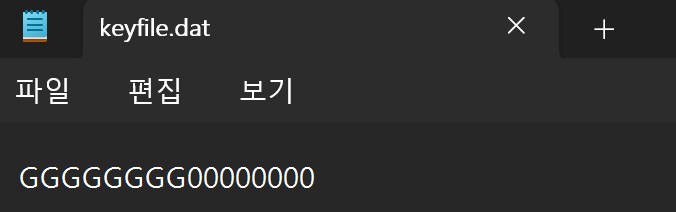

그러면 조건대로 글을 수정 해주고 실행을 눌렀다.

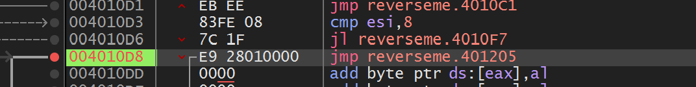

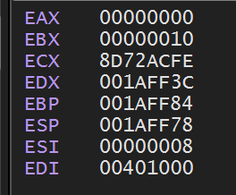

esi 값이 8이 되어서 cmp 비교 조건을 성공적이게 수행해서 jl 조건 점프문이 실행되지 않고 다음 문장으로 바로 이동된다.

그리고 jmp 문으로 0x401205로 이동하여, 성공 루프로 이동하게 된다.

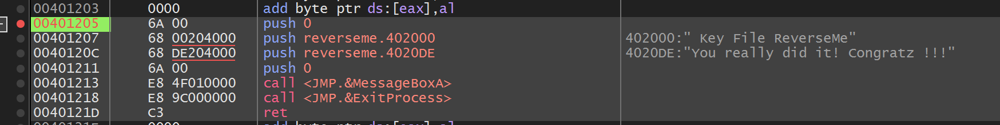

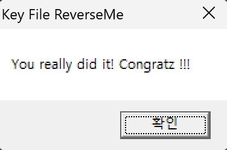

문제 해결!

## <strong>lena tutorial 03</strong>

<strong><code>nag 제거하기</code></strong>

<code>3개 창 중에서 첫번째, 세번째 Nag창 없애주세요</code>

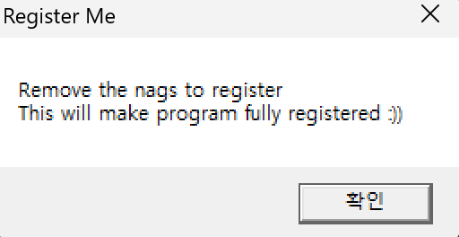

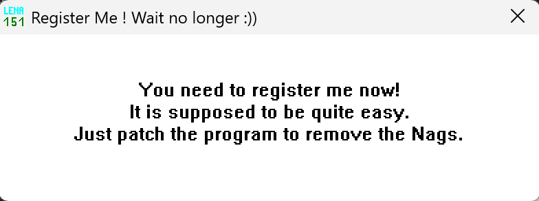

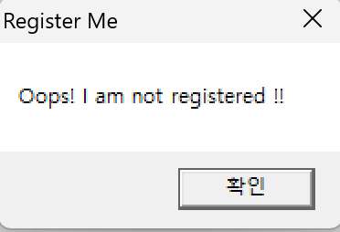

RegisterMe.exe를 누르면 이렇게 3개의 창이 나오게 된다.

이 중 1, 3번째 nag 창을 지우는 문제이다.

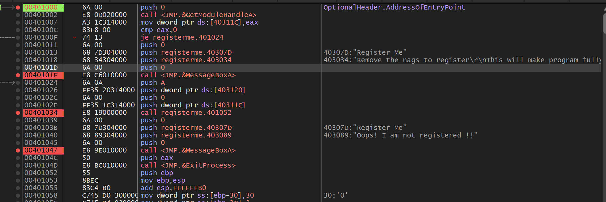

x32dbg로 들어가보니 핵심적인 문장들을 확인 할 수 있었다.<br />(bp건 부분이 nag창이 나오는 부분이다.)

먼저 첫 번째 nag창을 없애기 위해 je문을 jmp로 수정해서  messageBox를 넘어보겠다.

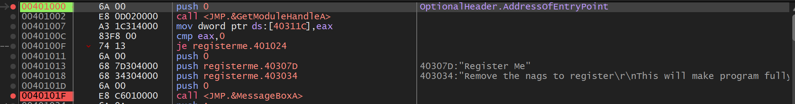

*전*

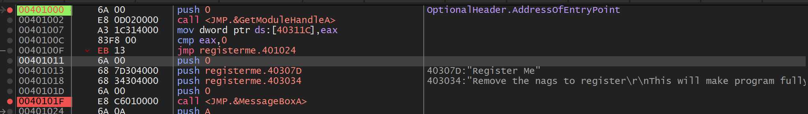

*후*

2번째 창은 그대로 두고 3번째 nag창을 없앨 차례이다.

이 문장은 오히려 1번째 nag 창을 지우는 것과 다른 방법으로 없애기 위해 nop 문을 사용하기로 하였다.

nop : 그냥 아무 명령도 수행하지 않고 다음 줄로 이동하라는 명령이다.

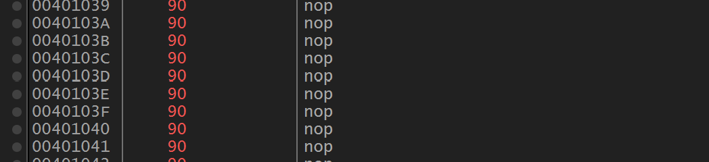

이렇게 간단하게 nop으로 수정을 해준 다음 파일 패치로 저장을 완료 해준다.


그 다음 실행을 해주면 정상적으로 1, 3번째 nag 창이 나타나지 않고 두 번째 nag 창만 나오게 된다.

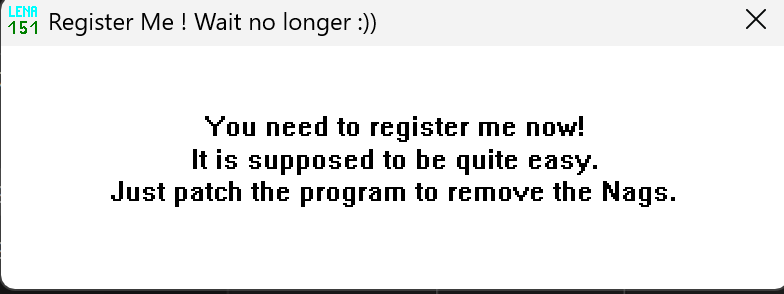

문제 해결!

## <strong>lena tutorial 04</strong>

<code>빨간 네모칸으로 되어 있는 부분을 정품인증 된것 처럼 바꾸어 주면됩니다.
1.1 PixtopianBook (UNRESISTERED VERSION) ← 해당 문자열을 → PixtopianBook로 바꾸어 주세요
1.2 This is an unregistered version of PixtopianBook... 문자열을 -&gt; This is an Registered Version of PixtopianBook 로 바꾸어 주세요
1.3 옵션에 Help → About PixtopiaBook 부분에 있는 문자열 Unregistered version v1.07 → Resistered version v1.07로 바꾸어 주세요</code>

<code>04.2 체험판 기능 우회(디버거에 있는 Execute User Mode 옵션 사용하여 풀이)</code>

---

### (UNREGISTERED VERSION) 문구 제거

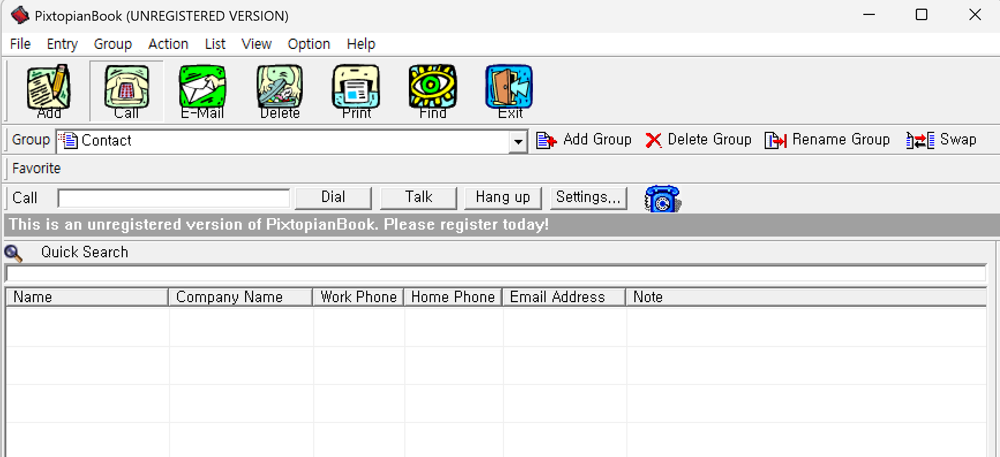

프로그램을 다운로드 받고 처음 들어오게 되면 이러한 화면이 나오게 된다.

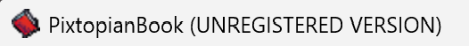

우선 먼저 이 좌측 상단에 먼저 뜨는 UNREGISTERED VERSION 이라는 문구부터 없애 보도록 하겠다.

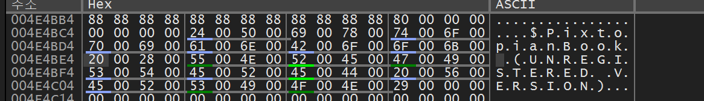

문자열 참조 기능을 통해 (UNREGISTERED VERSION) 문구를 찾을 수 있었다.

먼저 이 부분들의 HEX를 0으로 바꾸어 문자를 없애 보겠다.

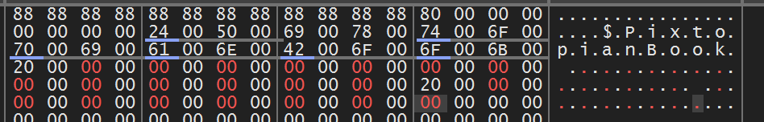

이렇게 바꿔준 다음 패치를 완료해보면


이렇게 완벽하게 사라진 모습을 볼 수 있다.

### This is an unregistered version of PixtopianBook… 문자열 변경

This is an unregistered version of PixtopianBook. Please register today! 문자를 변경해주어야 한다.

변경하기 위해서 x32dbg에서 이 문자가 있는 부분을 찾아준다,

문자열 참조로 들어가서 검색을 해보면

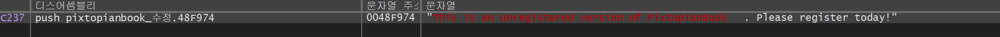

이렇게 나오는 것을 확인할 수 있다,

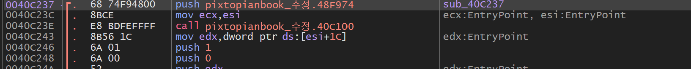

이렇게 들어가보면 48F974 주소의 내용을 참조하고 있어서 hex 값 덤프로 48F974를 따라가니 정상적으로 HEX dump에 문자가 나오게 되었다.

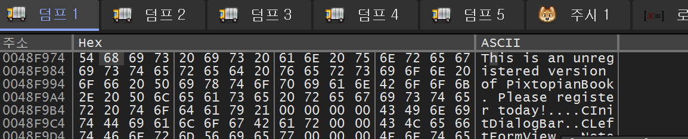

문자를 This is an Registered Version of PixtopianBook 으로 바꾸어야 하니 아스키 코드에 맞추어서 바꿔주면 된다.

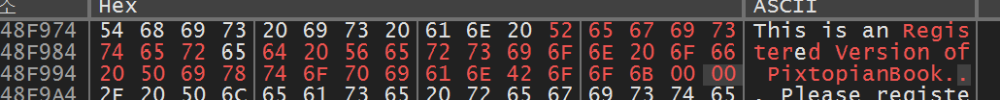

이제 패치를 하고 실행을 해주면 문자가 정상적으로 바뀌는데 성공한다.

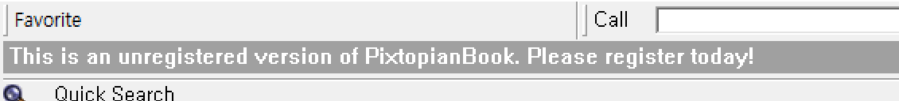

*전*

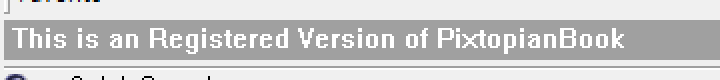

*후*

### 옵션에 Help → About PixtopiaBook 부분에 있는 문자열 Unregistered version v1.07 문자열 변경

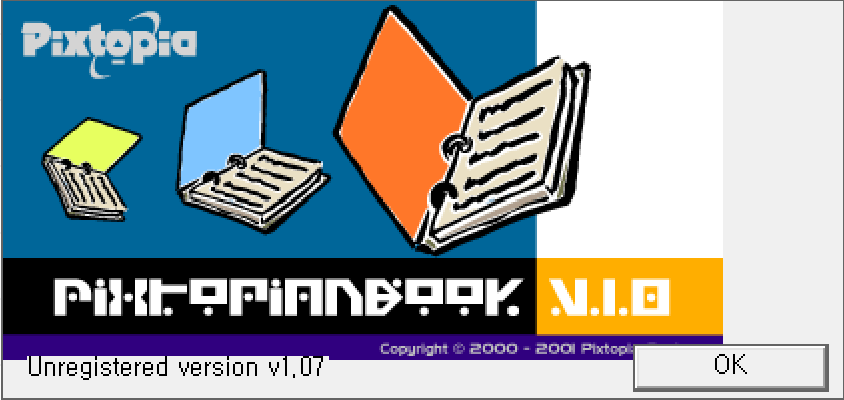

이렇게 help에서 About PixtopiaBook에 들어가면 이렇게 뜨는데 이 문자를

Resistered version v1.07 로 변경하라는 문제이다.

해당 문자열이 코드에서 직접 참조되는 일반 ASCII 문자열이 아니라, PE 파일의 <code>.rsrc</code> 영역에 UTF-16LE(Unicode) 형식으로 저장된 문자열이여서 문자열 참조로 정상적으로 찾을 수 없었다.

.rsrc : PE 파일 구조 중 프로그램이 쓰는 아이콘, 이미지, 문자열, 대화상자 등을 저장하는 공간

그래서 찾기 위해서 메모리 맵에 들어가서 .rsrc 영역을 눌러준 뒤 덤프에서 따라가서 패턴 찾기 기능으로 찾아 주었다.

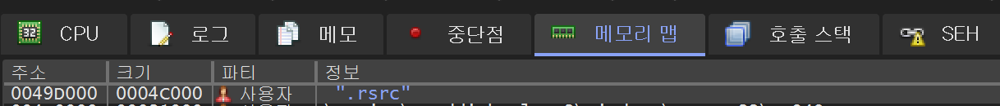

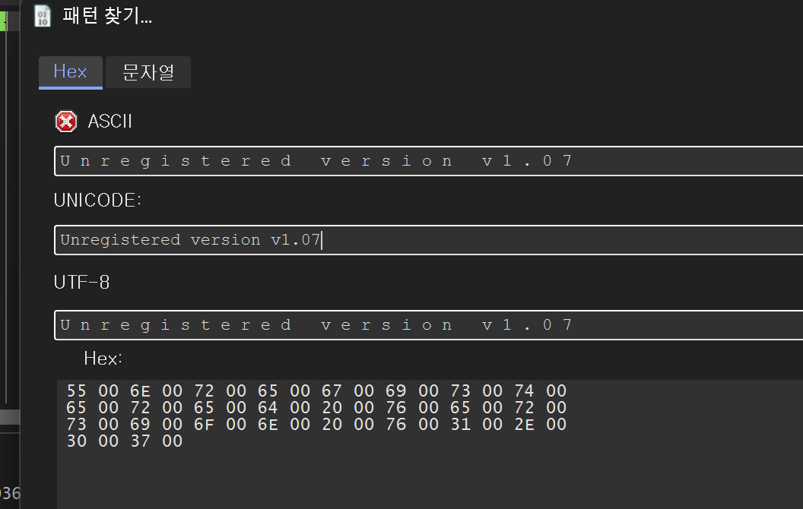

이렇게 해서 찾기를 누르면 하나의 데이터가 뜨게 된다.

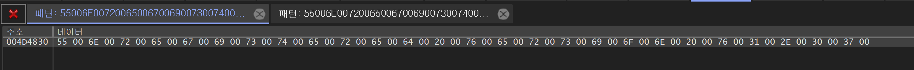

눌러보면 정상적으로 문자가 들어있는 공간을 찾을 수 있었다.

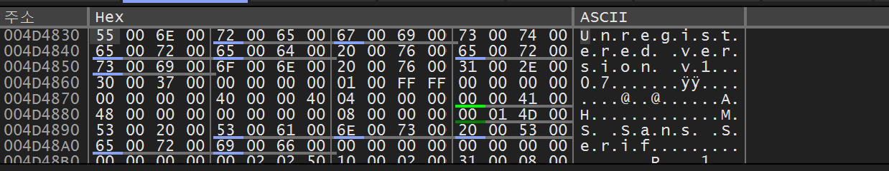

여기서 문자를 수정해주면 된다.

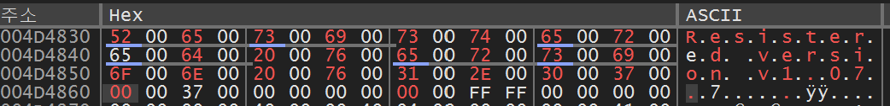

이렇게 문자를 변경해주고 파일 패치를 해주면 된다.

그리고 실행해보면 아래 사진처럼 성공적으로 변경이 완료된다.

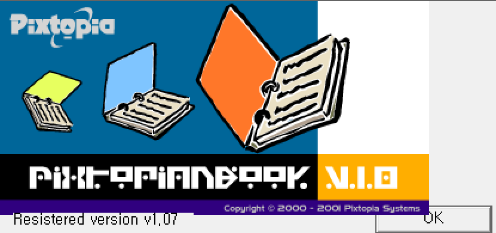

체험판 기능 우회 (디버거에 있는 Execute User Mode 옵션 사용하여 풀이)

### Execute User Mode 옵션

디버거에서 Execute User Mode 옵션을 사용하는 조건이 있어, Execute User Mode 옵션이 무엇인지 간단하게 살펴보고 가는게 좋을 거 같아 추가로 작성하게 되었다.

Execute User Mode(사용자 코드로 실행 기능)

- 디버거가 시스템 코드에서 멈춰 있을 때, 분석 대상 프로그램의 코드까지 한 번에 실행해주는 기능이다.
- 처음 디버거를 실행하면 Windows 시스템 DLL 내부에서 멈추는 경우가 있는데, Execute User Mode를 사용하면 시스템 코드를 건너뛰고 분석 대상 프로그램의 사용자 코드가 실행되는 지점까지 진행할 수 있다.

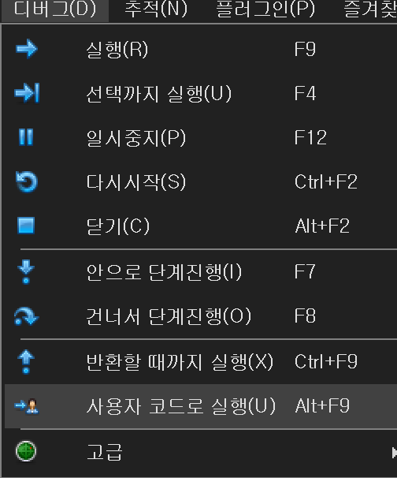

좌측 상단 디버그에 사용자 코드로 실행 ( 단축키 alt + F9) 로 작동하며 매우 간편하다는 장점이 존재한다.

아래에 있는 Group추가, 사용자 추가 실습은 이 사용자 코드로 실행 후 실습을 진행 하였다.

### Group 추가

먼저 이 프로그램은 그룹을 최대 3명으로 받는다.

3명에서 더 추가하려고 하면 아래와 같이 오류가 뜨게 된다.

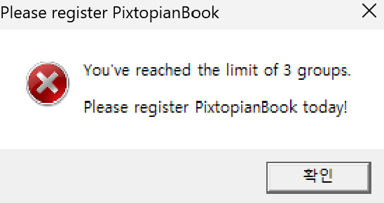

하지만 디버거를 통해 이 그룹 문제를 해결해 보도록 하겠다.

우선 일단 이 메시지가 나오는 메시지 박스 함수 위치를 찾아서 근처로 이동해야 겠다고 생각 하였다.

그래서 문자열 참조에서 메시지 박스 문자를 입력을 하니 우리가 찾는 메시지가 나오게 되었다.

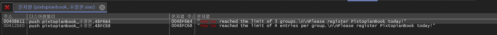

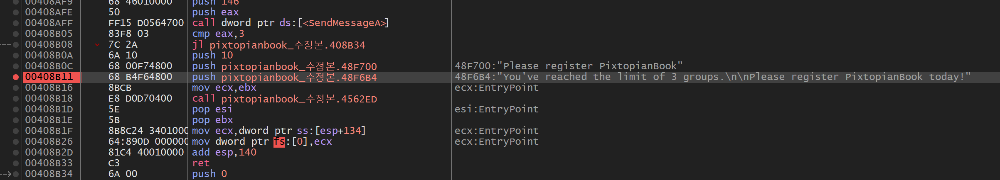

```c++
00408AFF  | FF15 D0564700     | call dword ptr ds:[<SendMessageA>]           |
00408B05  | 83F8 03           | cmp eax,3                                    |
00408B08  | 7C 2A             | jl pixtopianbook_수정본.408B34                  |
00408B0A  | 6A 10             | push 10                                      |
00408B0C  | 68 00F74800       | push pixtopianbook_수정본.48F700                | 48F700:"Please register PixtopianBook"
00408B11  | 68 B4F64800       | push pixtopianbook_수정본.48F6B4                | 48F6B4:"You've reached the limit of 3 groups.\n\nPlease register PixtopianBook today!"
00408B16  | 8BCB              | mov ecx,ebx                                  | ecx:EntryPoint
00408B18  | E8 D0D70400       | call pixtopianbook_수정본.4562ED                |

간단하게 흐름을 설명하면 SendMessageA 함수를 받아 cmp 비교문으로 eax 값이랑 3이랑 비교 수행을 한다.
그래서 EAX가 3보다 작을 경우 00408B34로 Jump를 하고
3과 같거나 클 경우 Jump를 하지 않고 순차적으로 실행되는 코드이다.

**
SendMessageA : 윈도우 API에서 윈도우에 메시지를 직접 전달하고, 그 처리가 끝날 때까지 기다리는 역할
```

우리가 그러면 해야 할 일은 간단하다.

jl 점프문을 jmp로 무조건 적으로 점프하게 변경하면 그룹이 3개 이상을 넘기게 되어도, 무시하고 진행 할 것이라고 판단하고 패치를 하였다.

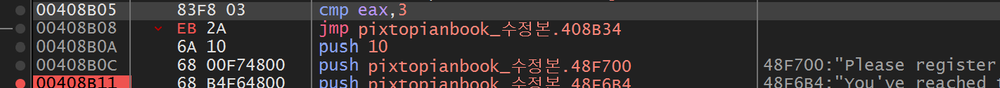

*jl을 jmp로 변경*

패치 저장을 한 후 프로그램을 실행 하였다.

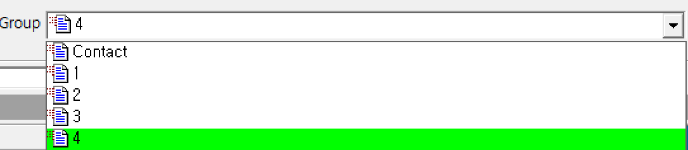

최대 3개 밖에 쓸 수 없었던 그룹 기능이 여러 번 추가를 눌러도 메시지박스가 뜨지 않고, 정상적으로 패치 된 모습을 볼 수 있다.

### 사용자 추가

프로그램은 원래 사용자를 최대 4명으로 잡혀 있다.

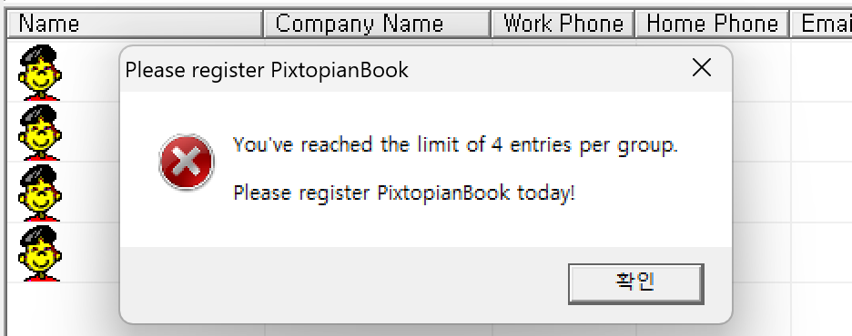

이렇게 4명에서 조금 더 추가를 하려고 하면 안된다고 메시지 박스가 나오게 된다. 이것을 한 번 수정해서 4명 이상이여도 정상적으로 사용자를 추가 해보는 실습을 해보도록 하겠다.

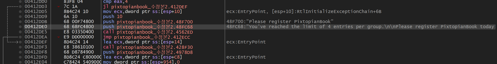

Group 추가와 같은 방법을 사용해서 문자열 참조 필터로 사용자 추가 부분을 찾을 수 있었다.

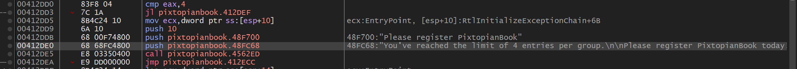

이 부분도 사진을 보면 cmp로 eax 값을 4(최대 인원 수)를 비교한 다음 EAX가 4보다 작을 경우 00412DEF로 Jump를 하고 4와 같거나 클 경우 순차적으로 실행하게 되는 코드이다.

그러면 이것도 Group 과 같이 jl 조건 점프 명령어를 jmp로 수정해주면 cmp로 조건을 봤어도 상관 없어 점프 명령을 수행해서 사용자가 늘어날 것이라 판단 하였고, 패치 하게 되었다.

패치를 한 후 프로그램을 실행 해보면 아래 사진처럼 사용자를 4명을 넘겨도 정상적으로 사용자가 늘어나는 것을 볼 수 있었다.

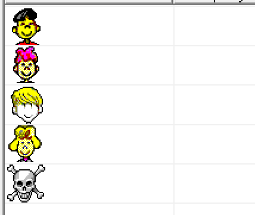

*사용자가 5명이 된 모습*

결과

전

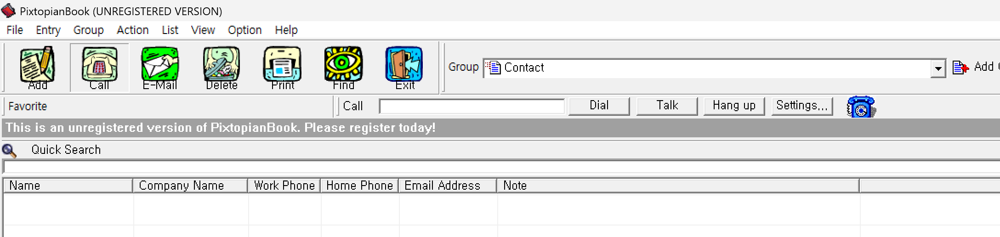

후

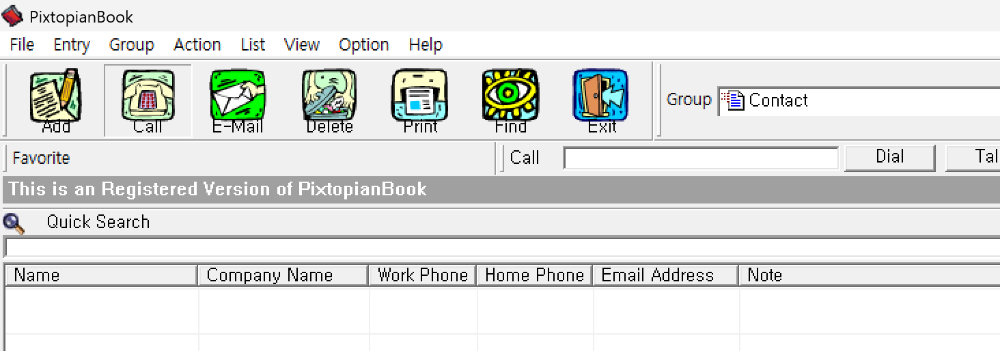

## <strong>lena tutorial 05</strong>

VisualSite Designer.exe 프로그램에서 실습을 진행한다.

### 창 제거,  Number of trials left 사용 횟수 제한 우회 실습


프로그램을 들어가면 이러한 창이 뜨면서 왼 쪽에 Number of trials 가 10인 모습을 볼 수 있는데

이 횟수 제한을 우회 하는 방법과 이 창이 뜨지 않게 설정 해보도록 하겠다.

먼저  Number of trials가 정확히 무엇인지 몰라 번역 해보니 체험판에서 허용된 사용 횟수? 그런 느낌인 것 같다.

그러면 아마 코드 흐름이<code> cmp eax, 10 </code>이런 느낌으로 10번 조건 검사가 진행되는 흐름일 것 같다고 생각을 하였고, 한 번 실제 디버거로 들어가서 찾아보겠다.

x32dbg에 들어가서 F8을 누르면 서 확인해보니 bp가 걸려있는 부분에서 이 창이 나오는 것을 확인 할 수 있었다.

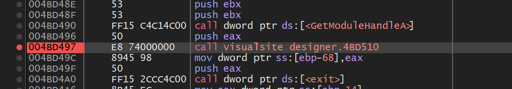

이 call 명령어 안에 들어가서 정확하게 어느 부분에서 나오는지 확인 해보겠다

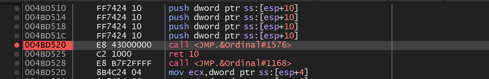

F7을 눌러 call 명령어 내부 안으로 들어오고 조금만 흐름을 따라가니 4BD520 주소에 있는 call 문에서 정확히 프로그램 창이 나오는 것을 확인 할 수 있었다!

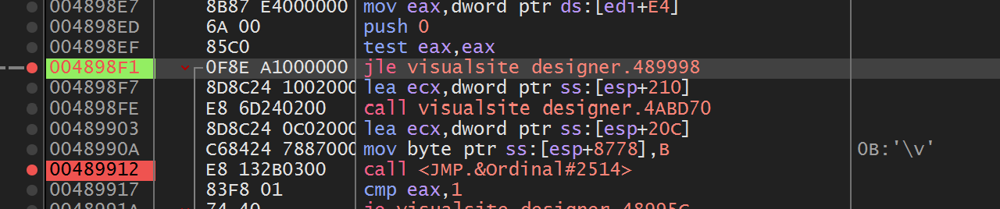

이 부분이 바로 실행 프로그램의 핵심 부분이라고 할 수 있다.

test 명령어로 eax, eax를 수행해서 ZF를 반환하게 되는데 이 반환에 따라서 jle 조건 점프 명령어를 수행하면 넘어가서 다른 nag 창이 나오는 것을 확인할 수 있었다.

그래서 jle 조건 점프 명령어를 jmp로 무조건적으로 점프할 수 있게 변경을 수행해 주었다


이 jmp로 바꾼 뒤 또 하나 봐야 할게 있는데


지금 멈춰있는 이 부분이 바로 Number of trials 가 10이라고 횟수 제한을 명시하는 부분이다.

이 검증 부분을 우회하기 위해서도 조건에 있으니 test al, al 다음에 있는 jne 조건 점프문도 jmp로 바꿔주면, 정상적으로 Number of trials 가 10인 횟수 제한 부분을 점프해서 우회할 수 있을 것이다.

패치 저장을 한 후 프로그램을 실행하면 성공적으로 횟수 제한을 우회 하고, 창도 없이 바로 실행 창으로 뜨게 된다


### Nag창 안나오게 하기

VisualSite Designer.exe 프로그램을 닫으면 아래 사진의 창이 하나 나온다.

이 창을 안 나오게 패치를 진행 해보겠다.


먼저 이 창을 없애기 위해서는 이 창이 뜨는 부분이 어디인지 정확하게 알 필요가 있다.

이 창은 일단 프로그램을 종료할 때 나오는 문장이기 때문에 그걸 고려해서 찾으면 될 것 같다.

찾기 위해 call stack 기능을 활용해서 찾기로 하였다

call stack?

- 지금 함수가 어디서 어디로 호출되어 왔는지 보여주는 호출 기록이다.


- 위 사진처럼 주소 / 도착 / 출발 / 크기 / 파티 / 주석 등으로 나누어져 사용자에게 정보를 제공 해준다.

하지만 프로그램 시작 전에 한 것이니 제대로 파악되지 않아 F9를 눌러 코드를 끝까지 간 후 다시 Call Stack을 눌러 보았다.


그러니 전보다 확실히 무언가 많아진 것을 볼 수 있었다.


이 중에 Visualsite designer라는 문구를 발견하여서 더블클릭을 눌러 들어가게 되었다.


bp를 걸고 다시 F2와 F9를 누르면서 반복을 해보니 바로 위에 있는 480C24 부분에 존재하는 call 문이 바로 우리가 삭제해야 하는 nag 창인 것을 알아낼 수 있었다.

그러면 이 nag 창을 안 나오게 수정하기 위해 다른 lana 에서도 사용했던 nop 문으로 변경을 수행해서 없애기로 하였다.


이렇게 nop으로 변경을 한 후 파일 패치를 눌러 패치 한 후 프로그램을 실행 하였다.

프로그램을 실행해서 닫았더니 정상적으로 nag창이 나오지 않고 없어진 모습을 확인할 수 있었다


## 드림핵 문제풀이

### <strong>Inject ME!!!</strong>

```cs
문제 설명
드림이가 수상한 DLL 파일을 획득하였습니다.

DLL 파일과 함께 있던 TXT 파일에는 조건을 맞춰서 DLL을 로드시키면 플래그를 얻을 수 있다고만 쓰여 있었습니다.

어떻게 해야 DLL 파일을 로드할 수 있을까요?
```


먼저 문제파일을 다운로드 받으니 dll 파일이 존재하여, CFF explorer로 살펴 보았다.

먼저 32 / 64 비트인지 확인 해준다.


AMD64(64비트)

그리고 Import Directory를 들어가서 확인 해보니 참조하는 DLL 목록들을 볼 수 있었다.


이 DLL 들의 핵심적인 api들을 찾아보면 다음과 같다.

```cs
GetModuleFileNameA() 윈도우 운영체제에서 실행 중인 프로그램이나 모듈의 전체 파일 경로와 이름을 가져오는 함수
PathFindFileNameA() 파일 이름만 가리키는 포인터를 찾아 반환하는 함수
strncmp() 두 문자열이 같은지 확인, 사전 순서 비교 함수
MessageBoxA() 메세지 박스가 나오는 함수

결과 : 원도우 파일 이름을 가리켜 strcmp() 함수로 비교해서 맞으면 MessageBox()가 출력되는 방식으로 추측하게 되었다.
```

이 추측이 맞다면<code>strncmp()</code> 함수가 무엇이랑 비교하는지 알아내는 것이 핵심일 것이다.

<code>strncmp()</code> 함수는<code> strncmp(비교 1, 비교 2, 비교할 길이) </code>로 작동하게 된다. <br />그리고 AMD64 bit 값을 가진 프로그램이라는 것까지 알기 때문에, x64의 호출규약을 살펴보면 된다.

64비트 Windows에서는

```txt
RCX = 첫 번째 문자열 주소
RDX = 두 번째 문자열 주소

(반환값은 EAX에 들어간다.)
EAX = 0     두 문자열이 같음
EAX ≠ 0     두 문자열이 다름
```

따라서 <code>strncmp()</code> 호출 직전에서 RCX와 RDX가 어디서 왔는지 보면 된다.

어디서 왔는지 알기 위해 ida 프로그램을 활용하여 풀어보도록 하겠다.

ida?

- ida는 <strong>Hex-Rays SA</strong>에서 개발하여 판매 중인 상용 디스 어셈블러, 주로 리버스 엔지니어링을 위한 디버거로 이용된다.
- 매우 강력한 디스어셈블러로 평가받는데, 그 이유는 현존 디스어셈블러 중 손에 꼽을 만큼 매우 다양한 프로세서 및 파일 유형을 지원함은 물론, 사용자. 즉 리버서가 주도적으로 편하게 리버싱을 진행할 수 있다는 점에서 이름 그대로 사용자와 상호작용이 가능한 디스어셈블러이기 때문이다.


이렇게 ida에 문제 파일을 넣었더니 이러한 화면으로 나오게 되었다.

오른 쪽에 나오는 call 문 안으로 들어가서 정확한 코드 흐름을 살펴 보도록 하겠다.


들어오면 핵심적인 문장들을 볼 수 있다.

먼저 함수들 부터 살펴 보도록 하겠다.

1. GetModuleFileNameA
   - 현재 실행 중인 프로그램이나 모듈의 전체 경로를 가져오는 함수
2. PathFindFileNameA
   - 전체 경로에서 파일 이름 부분만 잘라내는 함수
3. strncmp
   - 두 문자열을 지정한 길이만큼 비교하는 함수

이 코드의 전체 흐름

```c++
GetModuleFileNameA
→ 현재 컴퓨터에서 EXE 전체 경로를 획득함

PathFindFileNameA
→ EXE 이름만 추출함

strncmp
→ "dreamhack.exe"와 비교를 수행하고 반환을 함

strncmp의 반환값을 EAX로 받은 후 test eax, eax를 통해 반환값이 0인지 아닌지 검사한다.
두 문자열이 같으면 strncmp가 0을 반환하므로 jz 조건 점프가 실행되어 다음 코드로 이동한다.

```

코드의 흐름을 파악하면 여기서 핵심적인 조건 하나를 알 수 있다.

바로 DLL을 로드하는 exe 실행파일의 이름이 dreamhack.exe여야 한다는 것이다.

그리고 실제로 작동되는 PE 파일의 형식을 가지고 있어야 한다는 것이다.

이 문제의 핵심은 DLL 로더 프로그램을 코드로 간단하게 짜야 한다는 것 이였다!

그러면 비쥬얼 스튜디오를 통해서 간단하게 코드를 만들어 보겠다.

```c
#include <stdio.h>
#include <windows.h>

int main()
{
    LoadLibraryA("prob_rev.dll");
    return 0;
}

코드 설명
#include <windows.h>
-> LoadLibrary() api를 사용하기 위해 헤더파일을 넣었다.
win32 api를 사용할 수 있게 설정 하였다

LoadLibraryA("prob_rev.dll");
-> LoadLibraryA는 윈도우 환경에서 지정한 DLL 파일을 실행 중인
프로세스의 메모리 공간에 동적으로 불러오는 역할을 수행한다.

그래서 이 api를 넣는게 좋을 것 같아 api를 넣고 안에 dll 파일 이름을 넣어,
정상적으로 로드할 수 있게 코드를 작성 하였다.
```

진짜 간단하게 이런 코드를 만들어 주었다.

이제 빌드를 하면 exe 파일이 나오는데, 이것을 dreamhack.exe로 바꿔주면 된다.


이렇게 바꿔주고 dreamhack.exe를 실행해주면


이렇게 정상적으로 flag가 나오는 것을 확인할 수 있다.

flag : DH\{reng@r\_is\_cute\}

### <strong>Recover</strong>

```c
문제 설명

본 문제에서는 chall 바이너리와 encrypted 파일이 제공됩니다.

chall 바이너리는 플래그가 담긴 flag.png 파일을 정해진 방식으로 암호화하여 encrypted 파일로 저장합니다.

flag.png 파일을 복구하여 플래그를 획득하세요.

플래그 형식은 DH{...} 입니다.
```

문제 설명을 들으면 간단하게 파일을 복구해서 flag를 얻는 방식의 문제인 것 같다.

chall 프로그램은 암호화 프로그램

encrypted chall이 만들어낸 암호화된 결과 파일이다.

그러면 chall 프로그램을 먼저 분석해서 어떤 방식으로 암호화가 되어 있는지 확인을 하고 복구해야한다.

chall 파일을 ida에 넣어 분석을 진행 해보겠다.


chall 파일을 ida에 넣었고 이제 분석을 시작 해보겠다.

먼저 왼쪽에서 main을 눌러서 main 부분부터 보기로 하였다.

main에 도착해서 F5를 눌러 코드로 보면 이렇게 된다.

```c
__int64 __fastcall main(int a1, char **a2, char **a3)
{
  char ptr; // [rsp+Bh] [rbp-25h] BYREF
  int v5; // [rsp+Ch] [rbp-24h]
  _BYTE *v6; // [rsp+10h] [rbp-20h]
  FILE *stream; // [rsp+18h] [rbp-18h]
  FILE *s; // [rsp+20h] [rbp-10h]
  unsigned __int64 v9; // [rsp+28h] [rbp-8h]

  v9 = __readfsqword(0x28u);
  v6 = &unk_2004;
  stream = fopen(filename: "flag.png", modes: "rb");
  if ( stream == nullptr )
  {
    puts(s: "fopen() error");
    exit(status: 1);
  }
  s = fopen(filename: "encrypted", modes: "wb");
  if ( s == nullptr )
  {
    puts(s: "fopen() error");
    fclose(stream);
    exit(status: 1);
  }
  v5 = 0;
  while ( fread(&ptr, size: 1u, n: 1u, stream) == 1 )
  {
    ptr ^= v6[v5 % 4];
    ptr += 19;
    fwrite(&ptr, size: 1u, n: 1u, s);
    ++v5;
  }
  fclose(stream);
  fclose(stream: s);
  return 0;
}
```

이 코드에서 가장 중요한 부분은 while문이라고 할 수 있다.

```c
while (fread(&ptr, 1, 1, stream) == 1)
{
    ptr ^= v6[v5 % 4];
    ptr += 19;
    fwrite(&ptr, 1, 1, s);
    ++v5;
}
stream = fopen(filename: "flag.png", modes: "rb");
s = fopen("encrypted", "wb");

이 while 문의 코드 흐름을 간단하게 정리하면,

1. flag.png에서 1바이트를 가져온다.
2. xor연산과 +19 까지 수행해 암호화 한다.
3. 암호화 한 수(ptr 값)를 s(encrypted) 파일에 넘겨준다.
4. while 문이 계속 반복 되다가 flag.png에서 더 이상 1바이트를 읽을 수 없을 때
   while 문이 정상적으로 종료된다.
```

이 코드에서 핵심적으로 알 수 있는 것은 <code>flag.png</code>의 각 바이트에 XOR 연산을 수행한 뒤 19(0x13)를 더해 암호화한다는 것이다.

또한 XOR에 사용되는 값은 <code>v6[v5 % 4]</code>이며, <code>v5 % 4</code>에 의해 <code>v6[0]</code>, <code>v6[1]</code>, <code>v6[2]</code>, <code>v6[3]</code>이 반복적으로 사용된다는 것을 알 수 있다.

그러면 이제 핵심은<code>v6</code>가 뭐냐를 알아내는 것이 핵심일 것이다.

위 전체 코드를 살펴보면  <code> v6 = &amp;unk_2004; </code>이러한 문장이 존재한다.

결과론적으로 본다면 v6은 &unk\_2004; 을 참조 한다는 뜻이니, 코드에서 &unk\_2004 부분을 더블클릭 하여 들어가 보겠다.


더블 클릭해서 누르니 v6의 값을 알 수 있었다.

<br /><br />



