SecurityFirst 리버싱 정규팀 2주차에는 **악성코드 분석의 기본 흐름**을 정리하고, `Lab01-01`, `Lab01-02`, `Lab01-04`, `Lab03-01`, `Lab03-02`를 실습했다. 발표 자료에 담은 화면과 함께 어떤 단서를 확인했고 어디까지 판단할 수 있었는지 기록한다.

> 사진을 누르면 원본 크기로 볼 수 있다. 실습 파일은 격리된 분석 환경에서 다뤘다.

## 1. 악성코드 분석의 흐름

악성코드 분석은 의심 파일이 무엇을 하는지, 시스템에 어떤 변화를 남기는지 확인하는 과정이다. 발표에서는 **기초 정적 → 기초 동적 → 고급 정적 → 고급 동적 분석** 순서로 접근했다.

| 단계 | 확인하는 내용 | 이번 실습에서 사용한 도구 |
| --- | --- | --- |
| 기초 정적 | 파일을 실행하지 않고 탐지 결과, PE 구조, 문자열, Import 확인 | VirusTotal, Strings, CFF Explorer, Detect It Easy, Resource Hacker |
| 기초 동적 | 격리 환경에서 실행한 뒤 파일·레지스트리·프로세스·통신 변화 확인 | ProcMon, Process Explorer, Wireshark, INetSim |
| 고급 정적 | 디스어셈블된 코드를 따라가며 함수와 분기 분석 | IDA, Ghidra 등 |
| 고급 동적 | 디버거에서 레지스터와 메모리, 실제 실행 경로 확인 | x64dbg, OllyDbg, WinDbg 등 |

이번 주 실습에서는 앞의 두 단계를 중심으로 진행했다. Import나 문자열은 **가능한 기능을 알려주는 단서**이고, 실제 실행 여부는 동적 분석이나 코드 흐름으로 확인해야 한다.

## 2. Lab01-01.exe와 Lab01-01.dll

두 파일을 VirusTotal에서 확인했을 때 발표 자료에는 둘 다 절반 이상의 엔진이 탐지한 것으로 기록되어 있다. CFF Explorer에서 확인한 PE 헤더의 `TimeDateStamp`는 EXE가 `0x4D0E2FD3`, DLL이 `0x4D0E2FE6`이었다. 각각 2010년 12월 19일 16:16:19 UTC와 16:16:38 UTC로 변환되어 **19초 차이**가 났다. 이 값은 파일 내부의 기록이므로 실제 제작 시각을 보증하지는 않는다.

[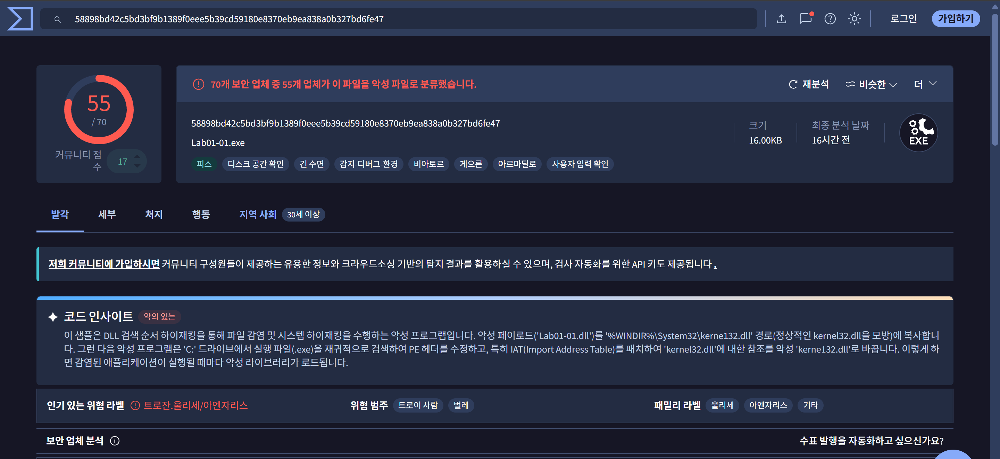](/assets/images/sf-week2/slide-032.png)
*Lab01-01.exe와 DLL의 탐지 결과 · 발표 자료 32쪽*

[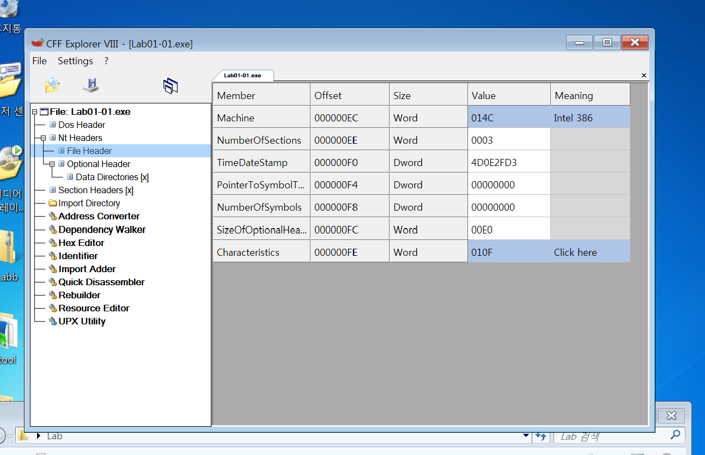](/assets/images/sf-week2/slide-035.png)
*EXE의 PE 헤더와 TimeDateStamp · 발표 자료 35쪽*

Detect It Easy와 CFF Explorer에서 전형적인 패커 섹션이나 비정상적인 PE 구조는 보이지 않았다. EXE의 Import에는 파일 검색·접근·복사 및 메모리 매핑 관련 API가, DLL에는 프로세스·뮤텍스·소켓 관련 기능이 있었다. 이 단계에서는 EXE가 파일을 배치하고 DLL이 통신할 **가능성**을 세웠다.

Strings에서는 EXE의 `kerne132.dll` 문자열과 DLL의 `127.26.152.13`, `exec`, `sleep` 등을 확인했다. `kerne132.dll`은 정상 DLL 이름 `kernel32.dll`과 비슷하다. `127.26.152.13`은 루프백 대역의 주소이며, 문자열로 발견했다는 사실만으로 실제 통신을 확인한 것은 아니다.

[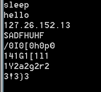](/assets/images/sf-week2/slide-052.png)
*Lab01-01.dll에서 추출한 문자열 · 발표 자료 52쪽*

## 3. Lab01-02.exe

발표 자료의 VirusTotal 결과는 **67개 엔진 중 47개 탐지**였다. Detect It Easy와 CFF Explorer에서는 UPX 패킹 흔적을 확인했고, 실습 환경에서 UPX로 언패킹한 뒤 Import를 다시 살펴보았다.

[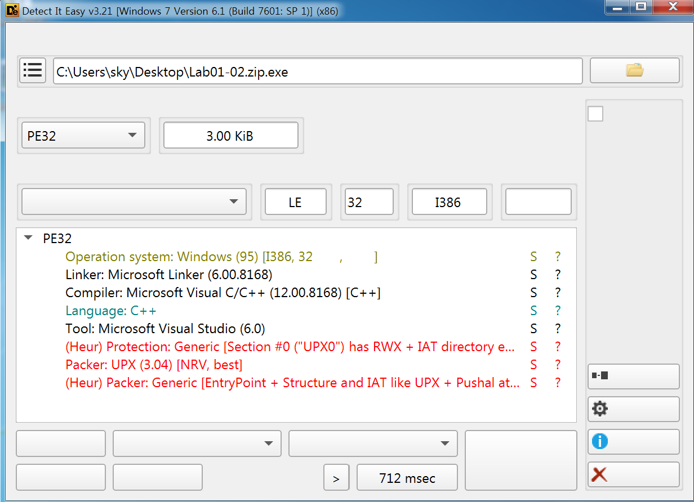](/assets/images/sf-week2/slide-059.png)
*Detect It Easy에서 확인한 UPX 패킹 · 발표 자료 59쪽*

[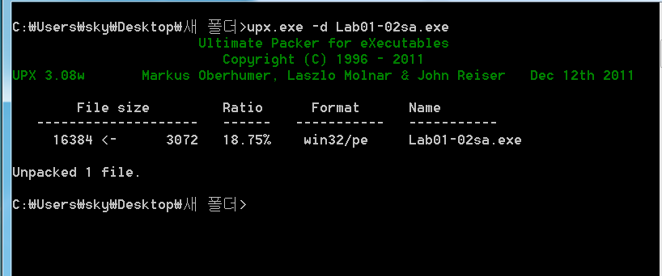](/assets/images/sf-week2/slide-061.png)
*UPX 언패킹 결과 · 발표 자료 61쪽*

언패킹 후 `CreateMutexA`, `OpenMutexA`, `CreateThread` 같은 실행 제어 API와 `OpenSCManagerA`, `CreateServiceA` 같은 서비스 관련 API를 확인했다. `WININET.dll`의 함수는 네트워크 접속 기능의 단서였다.

문자열에는 `MalService`, `HGL345`, `malwareanalysisbook.com`, `Internet Explorer 8.0`이 있었다. 앞의 두 값은 서비스·뮤텍스 이름 후보이고, 뒤의 두 값은 접속 대상·User-Agent 후보로 정리했다. 어느 함수에 실제로 전달되는지는 추가 분석이 필요하다.

[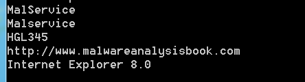](/assets/images/sf-week2/slide-070.png)
*서비스 및 통신 관련 문자열 · 발표 자료 70쪽*

## 4. Lab01-04.exe

VirusTotal에서는 발표 당시 **71개 엔진 중 64개가 탐지**했다. Detect It Easy에서 특정 패커가 확인되지는 않았지만, 리소스 영역에 다른 PE 파일이 있다는 단서가 나왔다.

[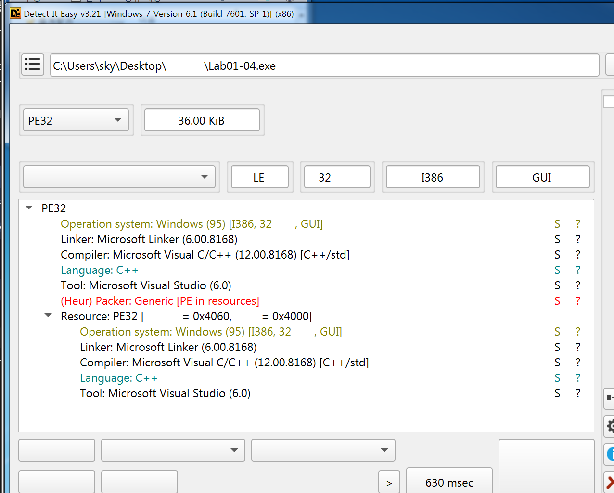](/assets/images/sf-week2/slide-077.png)
*리소스 안의 PE 파일 탐지 · 발표 자료 77쪽*

CFF Explorer에서는 `TimeDateStamp` 값 `0x5D69A2B3`을 확인했다. Import에는 리소스를 읽는 `FindResourceA`, `LoadResource`, 파일을 쓰는 `CreateFileA`, `WriteFile`, 다른 프로세스에 접근하는 `OpenProcess`, `CreateRemoteThread` 등이 있었다. 이 조합으로 내부 파일을 꺼내고 다른 프로세스에서 실행할 가능성을 생각했지만, API 목록만으로 실행 사실을 단정하지 않았다.

리소스의 바이트를 확인하니 PE 시그니처가 하나 더 있었다. Resource Hacker로 분리한 파일을 Detect It Easy에 넣어 **별도 PE 파일**로 인식되는 것을 확인했다.

[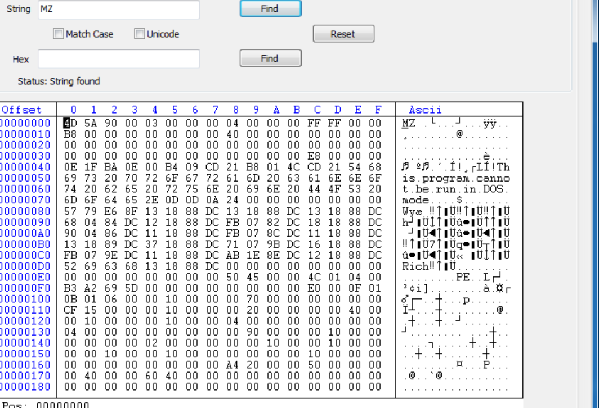](/assets/images/sf-week2/slide-091.png)
*리소스 안에서 확인한 두 번째 PE 시그니처 · 발표 자료 91쪽*

[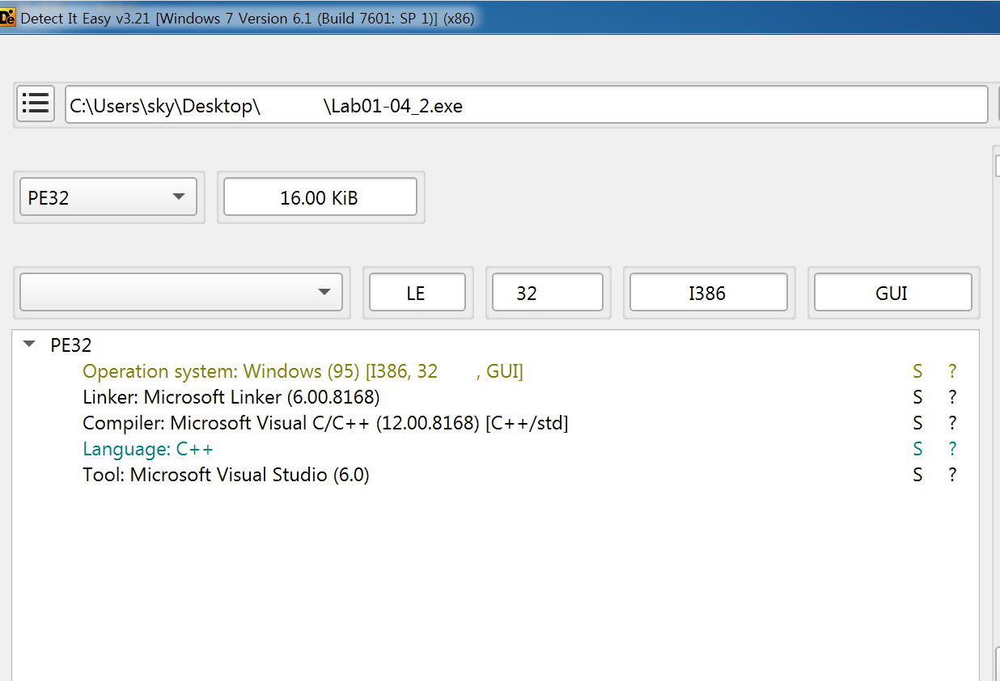](/assets/images/sf-week2/slide-093.png)
*추출한 파일을 Detect It Easy로 확인 · 발표 자료 93쪽*

문자열에서는 `winup.exe`, `wupdmgrd.exe`, `practicalmalwareanalysis.com/updater.exe`를 발견했다. 호스트 파일과 통신 기록을 살펴볼 때 참고할 수 있는 후보로 정리했다.

## 5. Lab03-01.exe

이 파일의 Import Table에는 `ExitProcess`만 눈에 띄었지만, 문자열에는 `ws2_32`와 `CONNECT %s:%i HTTP/1.0`이 있었다. 정적 정보만으로 기능을 다 알기 어려워 Windows XP 분석 환경에서 실행 기록을 확인했다.

ProcMon에서는 `C:\WINDOWS\system32\vmx32to64.exe` 접근과 `Run` 레지스트리 등록을 관찰했다. 시작할 때 자동 실행되도록 등록하려는 정황으로 해석했다.

[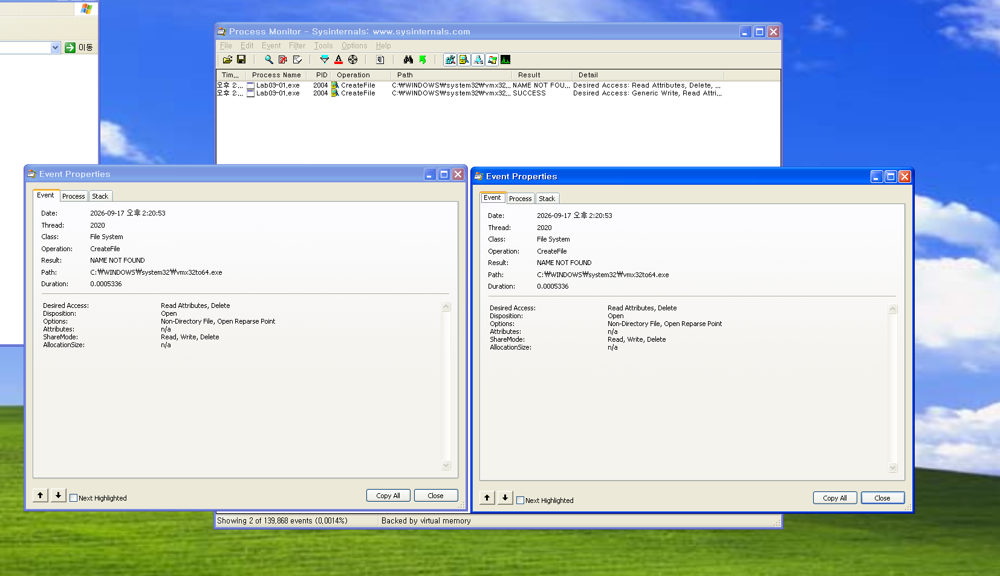](/assets/images/sf-week2/slide-108.png)
*실행 후 확인한 호스트 기록 · 발표 자료 108쪽*

Wireshark에서는 실습 VM `192.168.77.10`에서 분석 서버 `192.168.77.20`의 TCP 443 포트로 **약 30초마다 256바이트를 보내는 기록**을 확인했다. 처음 관찰할 때는 예상했던 DNS 요청을 보지 못했다. 이후 hosts 파일로 도메인을 INetSim 서버에 연결한 뒤에는 HTTP 요청과 가짜 서버의 `200 OK` 응답도 확인했다.

[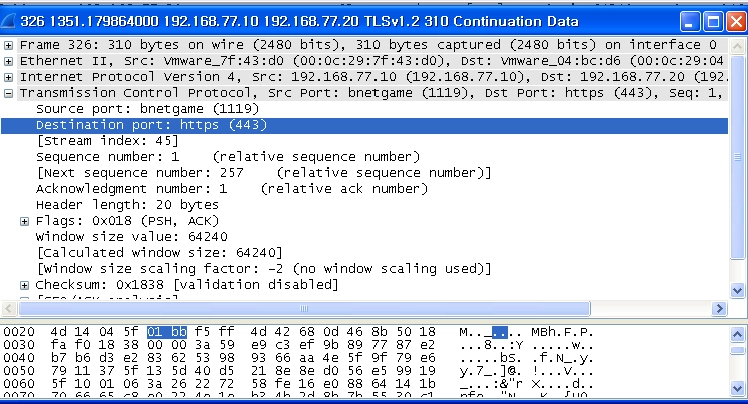](/assets/images/sf-week2/slide-115.png)
*분석 환경에서 관찰한 패킷 · 발표 자료 115쪽*

## 6. Lab03-02.dll

Export Table에서 `Install`, `installA`, `ServiceMain`, `UninstallService` 등을 확인했다. Strings에서도 `CreateServiceA`, `ServiceDll`, `IPRIP`, `svchost.exe -k netsvcs` 같은 서비스 관련 문자열이 나왔다.

[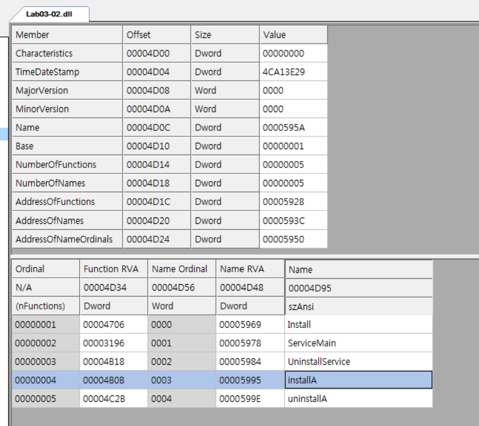](/assets/images/sf-week2/slide-120.png)
*DLL의 Export 함수 목록 · 발표 자료 120쪽*

실습 환경에서 `installA`를 호출한 뒤 `sc query IPRIP`으로 서비스 생성을 확인했다. `Process Explorer`에서는 `svchost.exe`에 `Lab03-02.dll`이 로드된 것을 찾았고, 레지스트리의 IPRIP 서비스 아래 `ServiceDll` 값이 DLL 경로를 가리키는 것도 확인했다.

[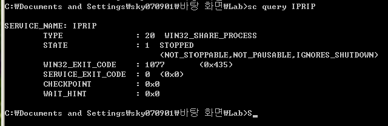](/assets/images/sf-week2/slide-128.png)
*IPRIP 서비스 확인 · 발표 자료 128쪽*

[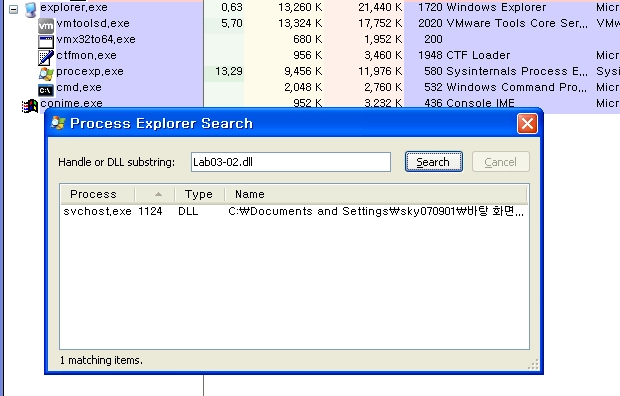](/assets/images/sf-week2/slide-135.png)
*프로세스에서 Lab03-02.dll 확인 · 발표 자료 135쪽*

[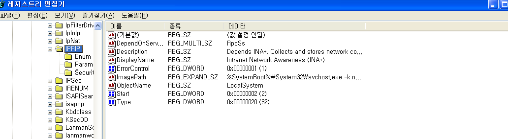](/assets/images/sf-week2/slide-144.png)
*IPRIP 서비스의 레지스트리 기록 · 발표 자료 144쪽*

Wireshark에서는 `practicalmalwareanalysis.com/serve.html`에 대한 HTTP 요청을 확인했다. 이 실습에서는 hosts 파일을 이용해 해당 도메인을 INetSim 서버로 보내고 응답을 관찰했다. 서비스 설치·실행과 HTTP 통신까지 확인했지만, 고급 코드 분석을 하지 않았으므로 정확한 기능 전체는 확정하지 않았다.

[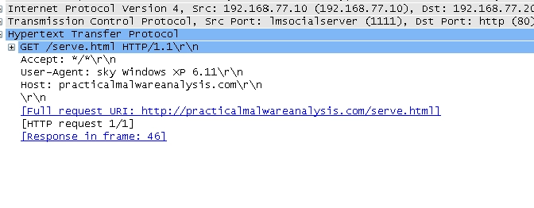](/assets/images/sf-week2/slide-150.png)
*HTTP 요청과 분석 서버 응답 · 발표 자료 150쪽*

## 7. 정리

이번 주에는 도구마다 얻을 수 있는 근거가 다르다는 것을 배웠다. VirusTotal 결과, Import, 문자열은 분석 방향을 잡는 데 도움이 되었고, ProcMon·Process Explorer·Wireshark에서는 서비스 생성과 통신처럼 실제 관찰한 동작을 확인할 수 있었다. 특히 Lab03-01을 분석할 때는 처음 환경에서 원하는 기록이 나오지 않아 Windows XP와 INetSim 설정을 다시 확인해야 했다.
