SecurityFirst 리버싱 정규팀 3주차에는 `SimpleBackdoor.exe`를 분석했다. 먼저 PEStudio에서 문자열과 Import를 살펴보고, 격리된 Windows XP 환경에서 실제 통신과 프로세스 생성을 확인했다. 마지막으로 IDA에서 받은 명령이 `cmd.exe`로 전달되고 결과가 돌아오는 흐름을 따라갔다.

> 분석 화면을 누르면 원본 크기로 볼 수 있다.

## 1. 기초 정적 분석

PEStudio의 Indicators에는 통신과 프로세스 간 상호작용을 의심할 만한 항목이 있었다. 문자열에서는 `cmd.exe` 관련 값이 보였고, Import에는 `wsock32.dll`과 프로세스·파이프 관련 API가 있었다.

[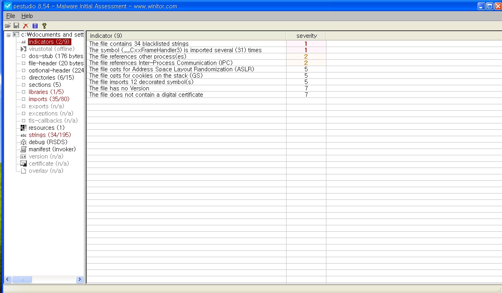](/assets/images/sf-week3/slide-010.png)
*PEStudio의 기초 정보 · 발표 자료 10쪽*

[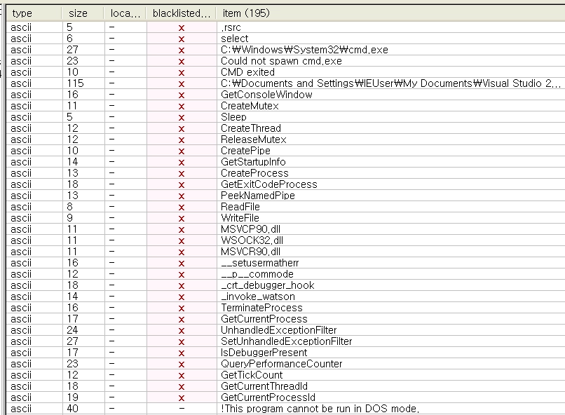](/assets/images/sf-week3/slide-011.png)
*명령 프롬프트 관련 문자열 · 발표 자료 11쪽*

`CreatePipe`, `CreateProcessA`, `ReadFile`, `WriteFile` 등의 조합은 자식 프로세스의 입출력을 파이프로 주고받을 가능성을 보여줬다. `wsock32.dll`에서는 함수 이름 대신 ordinal 번호로 Import된 항목도 있었는데, Dependency Walker에서 번호를 확인하니 `socket`, `bind`, `listen`, `accept`, `recv`, `send`와 연결되었다. 외부 연결을 기다리는 **서버형 백도어**를 예상할 수 있었지만, 이때까지는 정적 단서였다.

[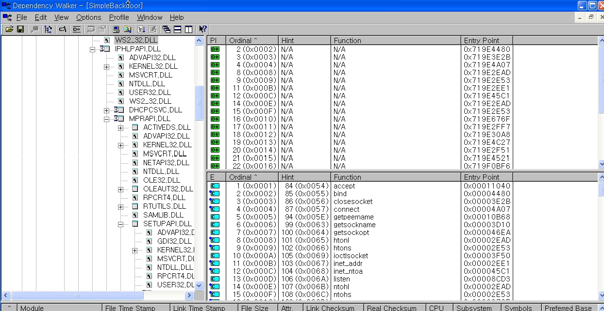](/assets/images/sf-week3/slide-016.png)
*Dependency Walker로 확인한 소켓 함수 · 발표 자료 16쪽*

섹션 이름과 엔트로피에서는 강한 패킹이나 난독화 흔적이 눈에 띄지 않았다. 이것만으로 패킹이 전혀 없다고 단정하지는 않았다.

## 2. 기초 동적 분석

SysAnalyzer로 실행 직후를 관찰했을 때는 자식 프로세스가 바로 보이지 않았다. 대신 API 기록에서 IPv4 TCP 소켓 생성, **로컬 1337번 포트에 bind**, `listen` 호출을 확인했다. Process Explorer에서도 `SimpleBackdoor.exe`가 해당 포트에서 연결을 기다리고 있었다.

[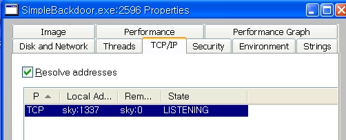](/assets/images/sf-week3/slide-032.png)
*TCP 1337 포트 대기 상태 · 발표 자료 32쪽*

분석용 Kali VM에서 1337번 포트에 접속하자 상황이 달라졌다. 접속이 성립했고, Process Explorer에서 `SimpleBackdoor.exe`를 부모로 둔 `cmd.exe`가 나타났다. Kali에서 보낸 명령에 대해 Windows XP 명령 프롬프트의 응답이 돌아오는 것도 확인했다. 처음에는 자식 프로세스가 없었지만 **클라이언트가 연결된 뒤 생성된 것**이다.

[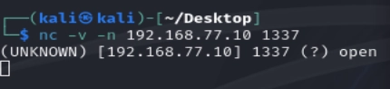](/assets/images/sf-week3/slide-033.png)
*분석용 VM의 연결 시도 · 발표 자료 33쪽*

[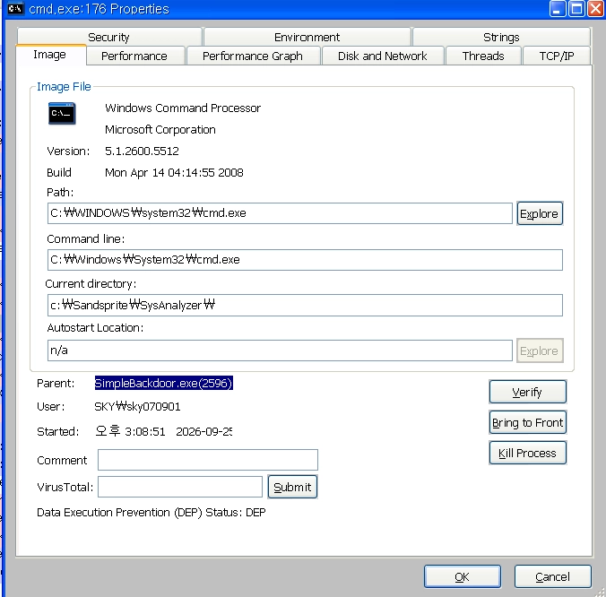](/assets/images/sf-week3/slide-036.png)
*연결 뒤 생성된 cmd.exe · 발표 자료 36쪽*

## 3. IDA에서 확인한 명령 처리 흐름

IDA에서 `cmd.exe` 문자열을 참조하는 코드부터 따라갔다. 프로그램은 `CreatePipe`로 자식 프로세스의 입출력 통로를 만들고, `STARTUPINFO`의 표준 입력·출력 핸들에 연결한다. 이어서 핸들 상속을 허용하고 `CreateProcessA`로 `cmd.exe`를 실행한다.

[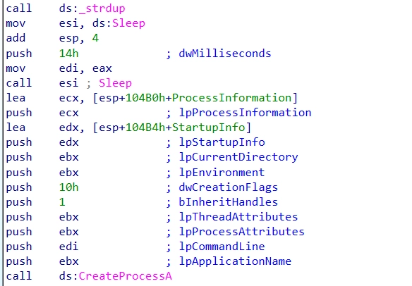](/assets/images/sf-week3/slide-045.png)
*cmd.exe를 생성하는 코드 흐름 · 발표 자료 45쪽*

출력 방향에서는 `PeekNamedPipe`로 읽을 데이터가 있는지 확인하고, `ReadFile`로 명령 결과를 읽는다. 이후 `send`를 호출해 그 결과를 연결된 클라이언트로 돌려준다.

[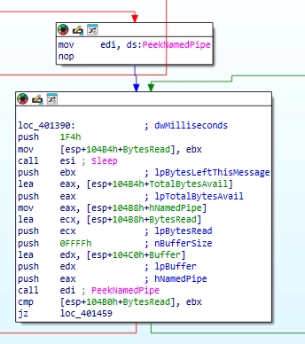](/assets/images/sf-week3/slide-047.png)
*파이프의 출력 확인 · 발표 자료 47쪽*

[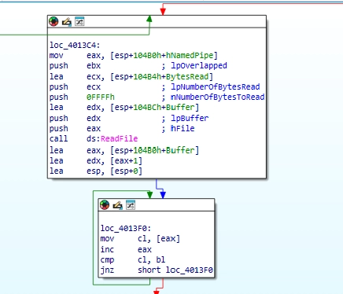](/assets/images/sf-week3/slide-048.png)
*cmd 출력 읽기 · 발표 자료 48쪽*

입력 방향은 반대다. `recv`가 네트워크에서 명령을 받아 버퍼에 저장하고, `WriteFile`이 이를 `cmd.exe`의 입력 파이프에 전달한다. 종료할 때는 `CloseHandle`, `closesocket`으로 사용한 자원을 정리한다.

[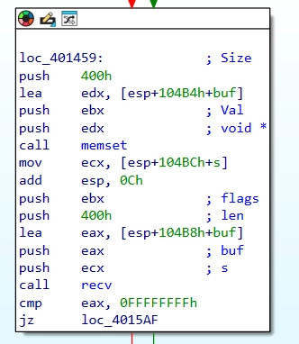](/assets/images/sf-week3/slide-051.png)
*네트워크 명령 수신 · 발표 자료 51쪽*

[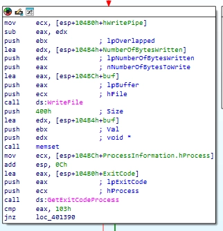](/assets/images/sf-week3/slide-052.png)
*받은 명령을 cmd.exe에 전달 · 발표 자료 52쪽*

정리하면 **클라이언트 연결 → cmd.exe 생성 → 명령 수신 → 파이프에 입력 → 실행 결과 읽기 → 네트워크로 전송**하는 구조다. 정적 분석에서 예상한 소켓·파이프 API의 역할이 동적 분석과 IDA 코드에서 이어졌다.

[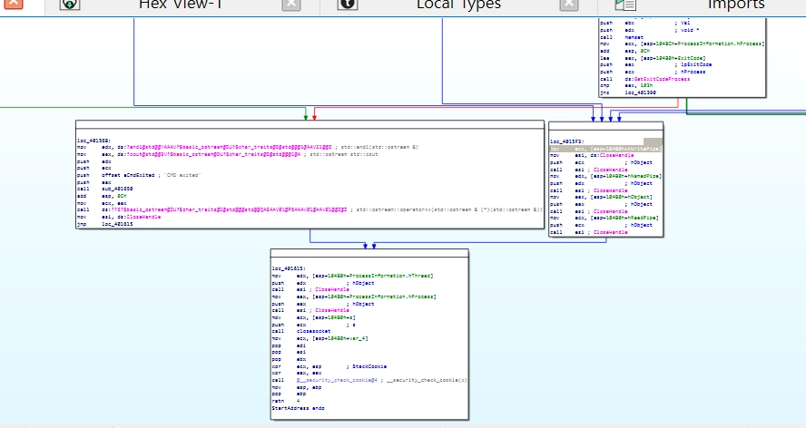](/assets/images/sf-week3/slide-053.png)
*명령 처리와 종료 흐름 · 발표 자료 53쪽*

3주차 발표 후반에 다룬 다른 샘플의 기초 분석은 이어진 **[NPKI 인증정보 탈취 악성코드 분석](/posts/first-post/)** 글에서 정적·동적 분석과 함께 정리했다.
