> 플랫폼: [CryptoHack](https://cryptohack.org/)

CryptoHack 입문 문제 1~10번을 풀며 사용한 코드와 핵심 개념을 정리했다. 1~2번은 플랫폼 사용법, 3~6번은 인코딩, 7~10번은 XOR을 다룬다. 플래그 값은 이 글에 적지 않았다.

## 1. Finding Flags

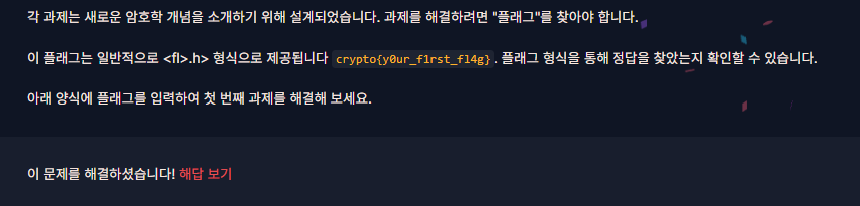

플래그 형식을 확인하고 제출하는 연습이다. 플래그는 일반적으로 `crypto{...}` 형태다. 문제 화면에 제시된 값을 입력해 제출했다.

## 2. Great Snakes

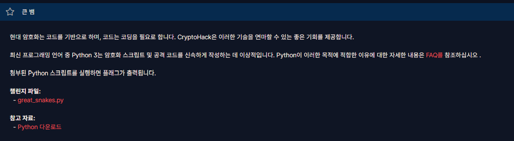

제공된 파이썬 스크립트를 내려받아 실행하면 플래그가 출력된다. 이후 문제에서도 파이썬으로 데이터를 변환하고 결과를 확인했다.

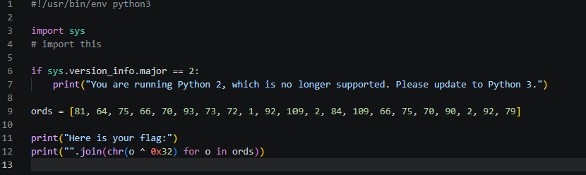

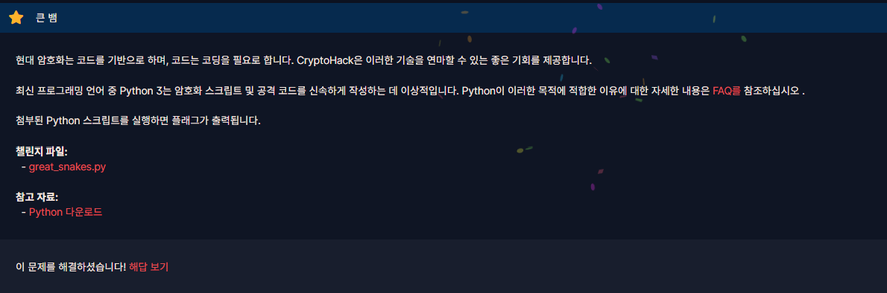

## 3. ASCII

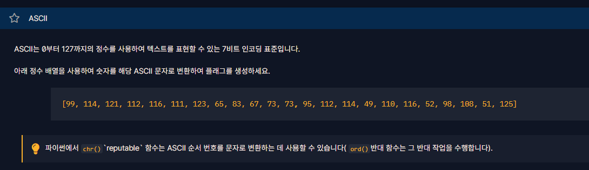

주어진 정수 목록을 ASCII 문자로 바꾼다. `chr()`은 정수 하나를 문자 하나로 변환하므로 각 숫자에 적용한 뒤 `join()`으로 이어 붙였다. `ord()`는 반대 방향의 함수다.

```python
numbers = [99, 114, 121, 112, 116, 111, 123, 65, 83, 67, 73, 73, 95, 112, 114, 49, 110, 116, 52, 98, 108, 51, 125]
print(''.join(chr(n) for n in numbers))
```

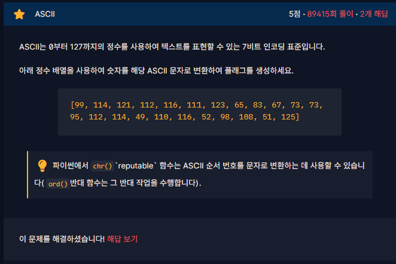

## 4. Hex

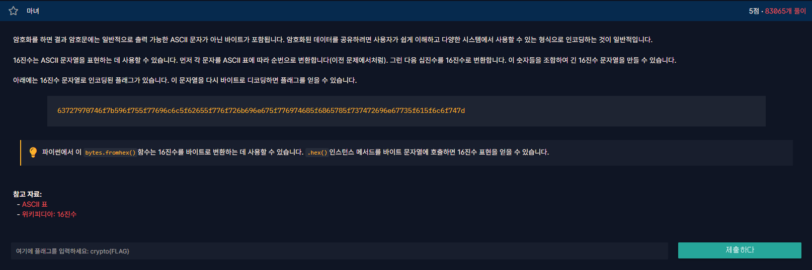

`bytes.fromhex()`로 16진수 문자열을 바이트로 변환하고, `.decode()`로 읽을 수 있는 문자로 바꿨다.

```python
hex_text = "63727970746f7b596f755f77696c6c5f62655f776f726b696e675f776974685f6865785f737472696e67735f615f6c6f747d"
print(bytes.fromhex(hex_text).decode())
```

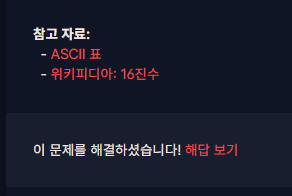

## 5. Base64

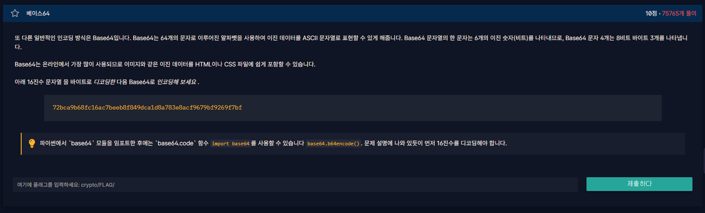

주어진 16진수를 먼저 바이트로 디코딩한다. 그 바이트를 Base64로 인코딩하고 결과를 문자로 표시했다.

```python
import base64

hex_text = "72bca9b68fc16ac7beeb8f849dca1d8a783e8acf9679bf9269f7bf"
print(base64.b64encode(bytes.fromhex(hex_text)).decode())
```

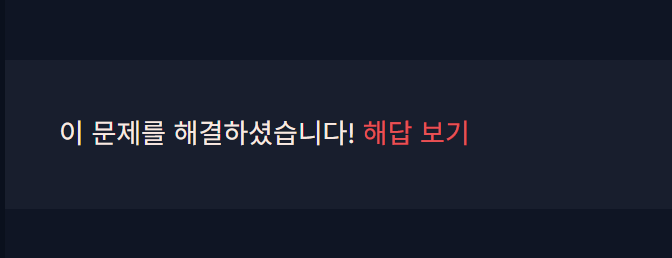

## 6. Bytes and Big Integers

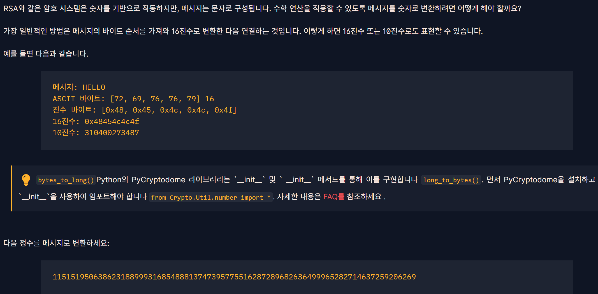

정수로 표현된 메시지를 `long_to_bytes()`로 바이트로 되돌렸다.

```python
from Crypto.Util.number import long_to_bytes

n = 11515195063862318899931685488813747395775516287289682636499965282714637259206269
message = long_to_bytes(n)
print(message.decode())
```

`Crypto` 모듈이 없다면 `python -m pip install pycryptodome`로 설치할 수 있다.

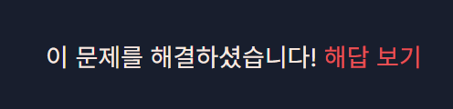

## 7. XOR Starter

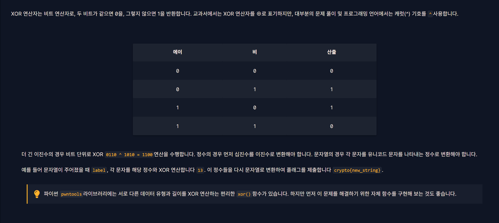

XOR(`^`)은 두 비트가 다르면 1, 같으면 0을 반환한다. `ord()`로 각 문자를 숫자로 바꾸고 13과 XOR한 다음 `chr()`로 다시 문자로 바꿨다.

```python
text = "label"
result = ""

for letter in text:
    result += chr(ord(letter) ^ 13)

print("crypto{" + result + "}")
```

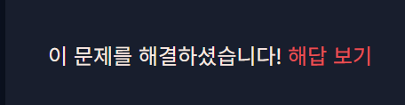

## 8. XOR Properties

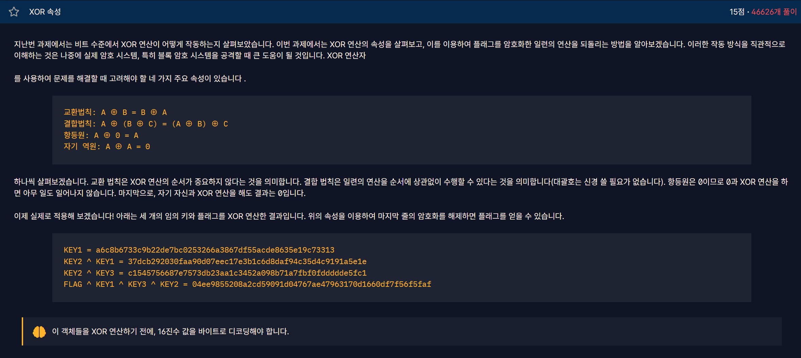

같은 값을 두 번 XOR하면 사라진다. `A ^ A = 0`, `A ^ 0 = A`이므로 마지막 식에 `KEY1`과 `(KEY2 ^ KEY3)`을 다시 XOR하면 키가 모두 지워진다.

```text
(FLAG ^ KEY1 ^ KEY3 ^ KEY2) ^ KEY1 ^ (KEY2 ^ KEY3) = FLAG
```

```python
from Crypto.Util.number import long_to_bytes

key1 = int("a6c8b6733c9b22de7bc0253266a3867df55acde8635e19c73313", 16)
key2_xor_key3 = int("c1545756687e7573db23aa1c3452a098b71a7fbf0fddddde5fc1", 16)
encrypted = int("04ee9855208a2cd59091d04767ae47963170d1660df7f56f5faf", 16)

flag = encrypted ^ key1 ^ key2_xor_key3
print(long_to_bytes(flag).decode())
```


## 9. Favourite byte

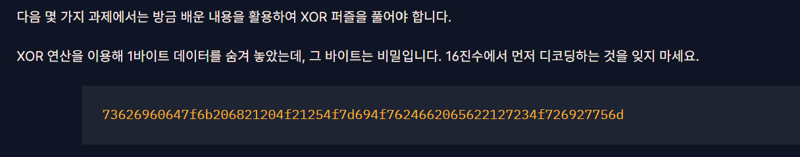

모든 바이트가 동일한 1바이트 키로 XOR되었다. 가능한 키 0~255를 모두 시험하고 플래그 형식으로 시작하는 결과를 골랐다.

```python
hex_text = "73626960647f6b206821204f21254f7d694f7624662065622127234f726927756d"
data = bytes.fromhex(hex_text)

for key in range(256):
    result = bytes(byte ^ key for byte in data)
    if result.startswith(b"crypto{"):
        print(result.decode())
```

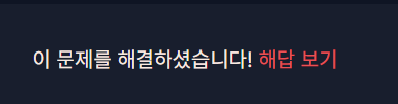

## 10. You either know, XOR you don't

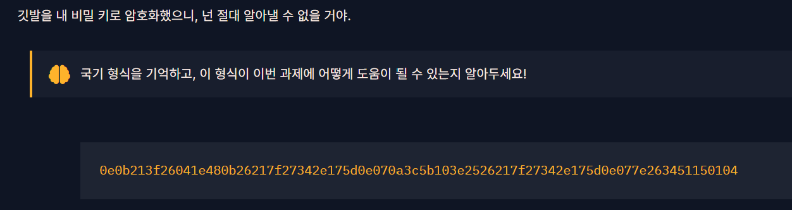

플래그가 `crypto{`로 시작한다는 점을 이용해 암호문의 첫 7바이트와 XOR하면 키의 앞부분 `myXORke`를 얻는다. 마지막 글자를 `y`로 추측해 `myXORkey`를 반복 적용했고, 출력이 읽을 수 있는 플래그인지 확인했다. 마지막 글자와 키 길이는 앞 7바이트만으로 확정되는 것은 아니다.

```python
cipher = bytes.fromhex(
    "0e0b213f26041e480b26217f27342e175d0e070a3c5b"
    "103e2526217f27342e175d0e077e263451150104"
)

known = b"crypto{"
key_start = bytes(cipher[i] ^ known[i] for i in range(len(known)))
print(key_start)

key = key_start + b"y"
result = bytes(cipher[i] ^ key[i % len(key)] for i in range(len(cipher)))
print(result.decode())
```

`i % len(key)`로 키를 처음부터 반복한다. 같은 키로 XOR을 한 번 더 적용하면 원래 값으로 돌아오는 성질을 이용했다.

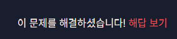


