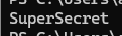
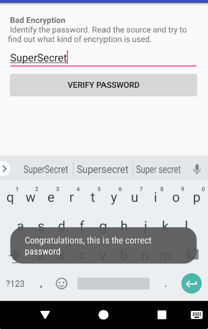

MASTG Hacking Playground 안드로이드 앱의 24개 테스트 케이스를 에뮬레이터에서 직접 발화·익스플로잇하고, 각 취약점을 실측 증거와 함께 라이트업으로 정리한다

### 1번 : 비밀번호를 찾아라. 소스를 읽고 어떤 종류의 암호화가 사용됐는지 알아내라.

```java
packagesg.vp.owasp_mobile.OMTG_Android;

importandroid.os.Bundle;
importandroid.support.v7.app.AppCompatActivity;
importandroid.support.v7.widget.Toolbar;
importandroid.util.Base64;
importandroid.view.View;
importandroid.widget.Button;
importandroid.widget.EditText;
importandroid.widget.Toast;
importcom.google.common.base.Ascii;

/* JADX INFO: loaded from: classes.dex */
publicclassOMTG_DATAST_001_BadEncryptionextendsAppCompatActivity{
ButtonbtnVerify;
EditTextpasswordEditText;

@Override// android.support.v7.app.AppCompatActivity, android.support.v4.app.FragmentActivity, android.support.v4.app.BaseFragmentActivityDonut, android.app.Activity
protectedvoidonCreate(BundlesavedInstanceState){
super.onCreate(savedInstanceState);
setContentView(sg.vp.owasp_mobile.p000omtg_android.R.layout.activity_omtg__datast_001__bad_encryption);
Toolbartoolbar=(Toolbar)findViewById(sg.vp.owasp_mobile.p000omtg_android.R.id.toolbar);
setSupportActionBar(toolbar);
getSupportActionBar().setDisplayHomeAsUpEnabled(true);
this.passwordEditText=(EditText)findViewById(sg.vp.owasp_mobile.p000omtg_android.R.id.BadEnryptionPassword);
this.btnVerify=(Button)findViewById(sg.vp.owasp_mobile.p000omtg_android.R.id.BadEnryptionButton);
View.OnClickListeneroclbtnVerify=newView.OnClickListener(){// from class: sg.vp.owasp_mobile.OMTG_Android.OMTG_DATAST_001_BadEncryption.1
@Override// android.view.View.OnClickListener
publicvoidonClick(Viewv){
OMTG_DATAST_001_BadEncryption.verify(OMTG_DATAST_001_BadEncryption.this.passwordEditText.getText().toString());
Booleanresult=Boolean.valueOf(OMTG_DATAST_001_BadEncryption.verify(OMTG_DATAST_001_BadEncryption.this.passwordEditText.getText().toString()));
OMTG_DATAST_001_BadEncryption.this.result(result);
}
};
this.btnVerify.setOnClickListener(oclbtnVerify);
}

/* JADX INFO: Access modifiers changed from: private */
publicvoidresult(Booleanresult){
if(result.booleanValue()){
Toast.makeText(this,"Congratulations, this is the correct password",1).show();
}else{
Toast.makeText(this,"Try again!",1).show();
}
}

/* JADX INFO: Access modifiers changed from: private */
publicstaticbooleanverify(Stringstr){
byte[]encryptedDecoded=Base64.decode("vJqfip28ioydips=",0);
byte[]userPass=encrypt(str);
if(userPass.length!=encryptedDecoded.length){
returnfalse;
}
for(inti=0;i<userPass.length;i++){
if(userPass[i]!=encryptedDecoded[i]){
returnfalse;
}
}
returntrue;
}

privatestaticbyte[]encrypt(Stringstr){
byte[]bytes=str.getBytes();
for(inti=0;i<bytes.length;i++){
bytes[i]=(byte)(bytes[i]^Ascii.DLE);
intcurr=(bytes[i]^(-1))&255;
bytes[i]=(byte)curr;
}
returnbytes;
}
}
```

1번의 전체 코드이다. 이 부분에서 어떤 종류의 암호화가 사용되었고, 비밀번호를 알아내면 된다.

```java
publicvoidonClick(Viewv){
OMTG_DATAST_001_BadEncryption.verify(OMTG_DATAST_001_BadEncryption.this.passwordEditText.getText().toString());
Booleanresult=Boolean.valueOf(OMTG_DATAST_001_BadEncryption.verify(OMTG_DATAST_001_BadEncryption.this.passwordEditText.getText().toString()));
OMTG_DATAST_001_BadEncryption.this.result(result);
}
```

코드를 전체적으로 분석 해본 결과 이 부분이 사용자가 입력한 비밀번호를 <code>verify</code>라는 정답 검사 함수에 전달하는 코드다.

핵심 순서는 다음과 같다.

1. 사용자가 입력칸에 비밀번호를 입력한다.
2. Verify Password를 누른다.
3. getText()로 입력 내용을 가져온다.
4. toString() 으로 문자열을 만든다.
5. verify()로 정답인지 검사한다.
6. 맞으면 성공, 틀리면 실패 메세지를 반환한다.

그래서 핵심은 실제로 비밀번호가 담기는 곳 verify() 함수와 encrypt() 함수의 값을 살펴봐야 한다는 것이다.

```java
private static boolean verify(String str) {
    String encrypted = "vJqfip28ioydips=";

    byte[] encryptedDecoded =
        Base64.decode(encrypted, Base64.DEFAULT);

    byte[] userPass = encrypt(str);

    if (userPass.length != encryptedDecoded.length) {
        return false;
    }

    for (int i = 0; i < userPass.length; i++) {
        if (userPass[i] != encryptedDecoded[i]) {
            return false;
        }
    }

    return true;
}

private static byte[] encrypt(String str) {
    byte[] bytes = str.getBytes();

    for (int i = 0; i < bytes.length; i++) {
        bytes[i] = (byte) (bytes[i] ^ 16);
        bytes[i] = (byte) (~bytes[i] & 0xff);
    }

    return bytes;
}
```

이 부분이 핵심적으로 비밀번호를 검사하는 문장이다.

```java
String encrypted = "vJqfip28ioydips=";
```

이 부분에서 vJqfip28ioydips= 라는 값을 검사하고 있다.

```java
byte[] encryptedDecoded =
    Base64.decode(encrypted, Base64.DEFAULT);
```

Base64 문자열을 비교 가능한 숫자 배열로 바꾸고 있는 코드이다.

```java
byte[] userPass = encrypt(str);
```

str에는 사용자가 입력한 비밀번호가 담기고 비교를 해서 같으면 return true 를 반환한다.

```java
전체 암호화 방식
- 원본 → XOR 16 → 비트 반전 → Base64
역연산 순서
- Base64 해제 → 비트 반전 → XOR 16 → 원본
```

위와 같은 방식으로 역연산 코드를 짜주고 실행을 하면 된다.



그러면 이렇게 SuperSecret 이라는 문자열이 노출된다.



이렇게 애뮬레이터에서 실행 해보면 Congratulations, this is the correct password라는 문자열이 나오며 성공하게 된다.

