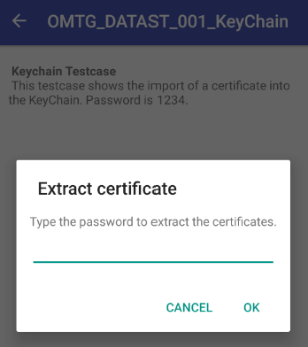
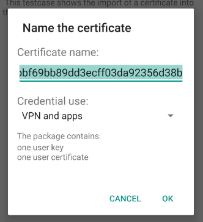
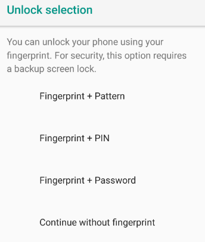
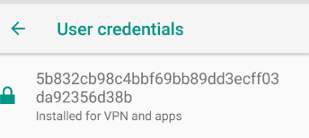

문제 설명 : 인증서를 Android KeyChain으로 가져오는 과정을 보여준다. <br />인증서 비밀번호는 <code>1234</code>이다.

```java
package sg.vp.owasp_mobile.OMTG_Android;

import android.content.Intent;
import android.os.Bundle;
import android.security.KeyChain;
import android.support.v7.app.AppCompatActivity;
import android.support.v7.widget.Toolbar;
import android.util.Log;
import java.io.BufferedInputStream;
import java.io.FileNotFoundException;
import java.io.IOException;

/* JADX INFO: loaded from: classes.dex */
public class OMTG_DATAST_001_KeyChain extends AppCompatActivity {
    public static final String PKCS12_FILENAME = "server.p12";

    @Override // android.support.v7.app.AppCompatActivity, android.support.v4.app.FragmentActivity, android.support.v4.app.BaseFragmentActivityDonut, android.app.Activity
    protected void onCreate(Bundle savedInstanceState) {
        super.onCreate(savedInstanceState);
        setContentView(sg.vp.owasp_mobile.p000omtg_android.R.layout.activity_omtg__datast_001__key_chain);
        Toolbar toolbar = (Toolbar) findViewById(sg.vp.owasp_mobile.p000omtg_android.R.id.toolbar);
        setSupportActionBar(toolbar);
        getSupportActionBar().setDisplayHomeAsUpEnabled(true);
        installPkcs12();
    }

    private void installPkcs12() {
        try {
            String[] f = getAssets().list("");
            for (String f1 : f) {
                Log.v("names", f1);
            }
            BufferedInputStream bis = new BufferedInputStream(getAssets().open(PKCS12_FILENAME));
            byte[] keychain = new byte[bis.available()];
            bis.read(keychain);
            Intent installIntent = KeyChain.createInstallIntent();
            installIntent.putExtra("PKCS12", keychain);
            startActivity(installIntent);
        } catch (FileNotFoundException e) {
            e.printStackTrace();
        } catch (IOException e2) {
            e2.printStackTrace();
        }
    }
}
```

전체 코드는 위에 나와있는 것과 같다.

근데 솔직히 이상하게 된 것 같긴한데 한 번 풀어본 방법을 설명 해보겠다.



여기에 들어왔을 때 비밀번호 1234가 보여서 1234를 누른 후 OK를 눌렀다.



이렇게 제대로 들어와진 것을 볼 수 있는데 계속 OK를 누른다.



Continue without fingerprint가 지문(인식) 없이 계속하기라는 뜻이여서 눌렀다.

그리고 PIN을 입력해야 하는데 그냥 임의번호로 2480을 눌렀다.


그러니 이렇게 문자가 나왔는데 찾아 보니까 인증서 설치 완료 알림이였다.



그렇게 설정을 들어가서 인증서 화면을 보니까 이렇게 인증서가 정상적으로 설치된 모습을 볼 수 있었다.

이로서 2번은 좀 이상한 방법으로..? 성공한 것 같다. 원래 다른 정석 방법이 존재 하는 듯,,,

