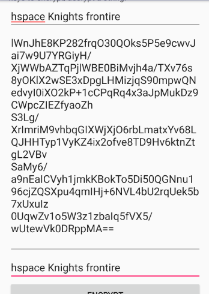
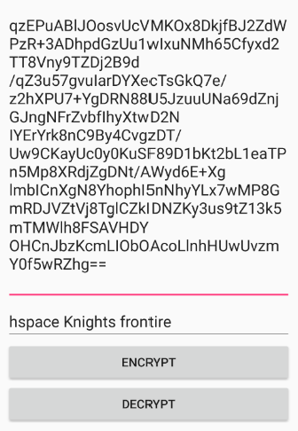
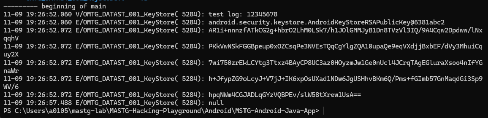

설명 : AndroidKeyStore에 키 쌍을 안전하게 생성하고, 그 키로 문자열을 암호화·복호화하는 방법을 보여준다.

```java
package sg.vp.owasp_mobile.OMTG_Android;

import android.os.Build;
import android.os.Bundle;
import android.security.KeyPairGeneratorSpec;
import android.support.v7.app.AppCompatActivity;
import android.support.v7.widget.Toolbar;
import android.util.Base64;
import android.util.Log;
import android.view.View;
import android.widget.Button;
import android.widget.EditText;
import android.widget.Toast;
import java.io.ByteArrayInputStream;
import java.io.ByteArrayOutputStream;
import java.io.IOException;
import java.math.BigInteger;
import java.security.KeyPairGenerator;
import java.security.KeyStore;
import java.security.KeyStoreException;
import java.security.NoSuchAlgorithmException;
import java.security.cert.CertificateException;
import java.security.interfaces.RSAPublicKey;
import java.util.ArrayList;
import java.util.Calendar;
import javax.crypto.Cipher;
import javax.crypto.CipherInputStream;
import javax.crypto.CipherOutputStream;
import javax.security.auth.x500.X500Principal;
import org.apache.commons.codec.net.StringEncodings;

/* JADX INFO: loaded from: classes.dex */
public class OMTG_DATAST_001_KeyStore extends AppCompatActivity {
    String TAG = "OMTG_DATAST_001_KeyStore";
    EditText decryptedText;
    EditText encryptedText;
    KeyStore keyStore;
    EditText startText;

    @Override // android.support.v7.app.AppCompatActivity, android.support.v4.app.FragmentActivity, android.support.v4.app.BaseFragmentActivityDonut, android.app.Activity
    protected void onCreate(Bundle savedInstanceState) {
        super.onCreate(savedInstanceState);
        try {
            this.keyStore = KeyStore.getInstance("AndroidKeyStore");
            this.keyStore.load(null);
        } catch (IOException e) {
            e.printStackTrace();
        } catch (KeyStoreException e2) {
            e2.printStackTrace();
        } catch (NoSuchAlgorithmException e3) {
            e3.printStackTrace();
        } catch (CertificateException e4) {
            e4.printStackTrace();
        }
        setContentView(sg.vp.owasp_mobile.p000omtg_android.R.layout.activity_omtg__datast_001__key_store);
        Toolbar toolbar = (Toolbar) findViewById(sg.vp.owasp_mobile.p000omtg_android.R.id.toolbar);
        setSupportActionBar(toolbar);
        this.encryptedText = (EditText) findViewById(sg.vp.owasp_mobile.p000omtg_android.R.id.encryptedText);
        this.decryptedText = (EditText) findViewById(sg.vp.owasp_mobile.p000omtg_android.R.id.decryptedText);
        this.startText = (EditText) findViewById(sg.vp.owasp_mobile.p000omtg_android.R.id.startText);
        Button btnDecrypt = (Button) findViewById(sg.vp.owasp_mobile.p000omtg_android.R.id.KeyStoreDecrypt);
        Button btnEncrypt = (Button) findViewById(sg.vp.owasp_mobile.p000omtg_android.R.id.KeyStoreEncrypt);
        View.OnClickListener oclbtnEncrypt = new View.OnClickListener() { // from class: sg.vp.owasp_mobile.OMTG_Android.OMTG_DATAST_001_KeyStore.1
            @Override // android.view.View.OnClickListener
            public void onClick(View v) {
                OMTG_DATAST_001_KeyStore.this.encryptString("Dummy");
            }
        };
        btnEncrypt.setOnClickListener(oclbtnEncrypt);
        View.OnClickListener oclbtnDecrypt = new View.OnClickListener() { // from class: sg.vp.owasp_mobile.OMTG_Android.OMTG_DATAST_001_KeyStore.2
            @Override // android.view.View.OnClickListener
            public void onClick(View v) {
                OMTG_DATAST_001_KeyStore.this.decryptString("Dummy");
            }
        };
        btnDecrypt.setOnClickListener(oclbtnDecrypt);
        getSupportActionBar().setDisplayHomeAsUpEnabled(true);
        createNewKeys();
    }

    public void createNewKeys() {
        try {
            if (!this.keyStore.containsAlias("Dummy")) {
                Calendar start = Calendar.getInstance();
                Calendar end = Calendar.getInstance();
                end.add(1, 1);
                KeyPairGeneratorSpec spec = null;
                if (Build.VERSION.SDK_INT >= 18) {
                    spec = new KeyPairGeneratorSpec.Builder(this).setAlias("Dummy").setSubject(new X500Principal("CN=Sample Name, O=Android Authority")).setSerialNumber(BigInteger.ONE).setStartDate(start.getTime()).setEndDate(end.getTime()).build();
                }
                KeyPairGenerator generator = KeyPairGenerator.getInstance("RSA", "AndroidKeyStore");
                generator.initialize(spec);
                generator.generateKeyPair();
                Toast.makeText(getApplicationContext(), "Key Pair \"Dummy\" created.", 1).show();
                return;
            }
            Toast.makeText(getApplicationContext(), "Key Pair \"Dummy\" already created.", 1).show();
        } catch (Exception e) {
            Toast.makeText(this, "Exception " + e.getMessage() + " occured", 1).show();
            Log.e(this.TAG, Log.getStackTraceString(e));
        }
    }

    public void encryptString(String alias) {
        try {
            KeyStore.PrivateKeyEntry privateKeyEntry = (KeyStore.PrivateKeyEntry) this.keyStore.getEntry(alias, null);
            RSAPublicKey publicKey = (RSAPublicKey) privateKeyEntry.getCertificate().getPublicKey();
            Log.v(this.TAG, "test log: 12345678");
            Log.e(this.TAG, String.valueOf(publicKey));
            String initialText = this.startText.getText().toString();
            if (initialText.isEmpty()) {
                Toast.makeText(this, "Enter text in the 'Initial Text' widget", 1).show();
            } else {
                Cipher inCipher = Cipher.getInstance("RSA/ECB/PKCS1Padding", "AndroidOpenSSL");
                inCipher.init(1, publicKey);
                ByteArrayOutputStream outputStream = new ByteArrayOutputStream();
                CipherOutputStream cipherOutputStream = new CipherOutputStream(outputStream, inCipher);
                cipherOutputStream.write(initialText.getBytes(StringEncodings.UTF8));
                cipherOutputStream.close();
                byte[] vals = outputStream.toByteArray();
                this.encryptedText.setText(Base64.encodeToString(vals, 0));
                Log.e(this.TAG, Base64.encodeToString(vals, 0));
            }
        } catch (Exception e) {
            Toast.makeText(this, "Exception " + e.getMessage() + " occured", 1).show();
            Log.e(this.TAG, Log.getStackTraceString(e));
        }
    }

    public void decryptString(String alias) {
        try {
            KeyStore.PrivateKeyEntry privateKeyEntry = (KeyStore.PrivateKeyEntry) this.keyStore.getEntry(alias, null);
            Log.e(this.TAG, String.valueOf(privateKeyEntry.getPrivateKey().getEncoded()));
            Cipher output = Cipher.getInstance("RSA/ECB/PKCS1Padding");
            output.init(2, privateKeyEntry.getPrivateKey());
            String cipherText = this.encryptedText.getText().toString();
            CipherInputStream cipherInputStream = new CipherInputStream(new ByteArrayInputStream(Base64.decode(cipherText, 0)), output);
            ArrayList<Byte> values = new ArrayList<>();
            while (true) {
                int nextByte = cipherInputStream.read();
                if (nextByte == -1) {
                    break;
                } else {
                    values.add(Byte.valueOf((byte) nextByte));
                }
            }
            byte[] bytes = new byte[values.size()];
            for (int i = 0; i < bytes.length; i++) {
                bytes[i] = values.get(i).byteValue();
            }
            String finalText = new String(bytes, 0, bytes.length, StringEncodings.UTF8);
            this.decryptedText.setText(finalText);
        } catch (Exception e) {
            Toast.makeText(this, "Exception " + e.getMessage() + " occured", 1).show();
            Log.e(this.TAG, Log.getStackTraceString(e));
        }
    }
}
```

전체 코드이다. 간략하게 핵심만 설명해보면 다음과 같다.

```java
String alias = "Dummy";

KeyPairGenerator generator =
    KeyPairGenerator.getInstance("RSA", "AndroidKeyStore");

KeyPair keyPair = generator.generateKeyPair();
```

화면을 여는 순간 Dummy라는 이름의 RSA 키가 생성된다.

- 키 이름: <code>Dummy</code>
- 공개키와 개인키로 구성된 RSA 키 쌍
- 개인키는 <code>AndroidKeyStore</code> 내부에 생성
- 개인키 원본은 앱 밖으로 꺼낼 수 없어야 함





이렇게 문자열을 입력하고 아래의 <code>ENCRYPT</code>를 누르면 중간처럼 우리가 볼 수 없는 Base64 문자열이 나온다.

그리고 그 바로 아랫 부분 DECRYPT를 누르면 다시 제대로 된 문자열이 그대로 출력된다.

이 부분은 결과적으로 내부 개인키로 암호화하고 복호화하는 과정까지 들어있는 화면이다.

이제 이 정보를 토대로 아래 명령어를 실행 해주었다.

```powershell
& $Adb logcat -d -v time `
  'OMTG_DATAST_001_KeyStore:V' '*:S'
```



로그를 보니까 PID 5284에서 test log : 12345678로 문자열이 로그에 기록된 결과가 보이고 있다.

```powershell
null
```

위 코드부분에서는 개인키를 꺼내려고 privateKeyEntry.getPrivateKey().getEncoded() 명령을 실행했다.

하지만 결과가 null이라는 결과가 나온 것은 AndroidKeyStore가 개인키의 원본 형태 바이트 추출을 허용하지 않는다는 중요한 정황이 관찰 되었다.

### 요약

- 입력한 글자를 공개키로 암호화했습니다.
- AndroidKeyStore 안의 개인키로 다시 복호화했습니다.
- 원래 글자가 나왔으므로 암호화·복호화가 정상 작동했습니다.
- 개인키 파일을 밖으로 꺼내려고 했지만 결과가 <code>null</code>이었습니다.
- 따라서 <strong>개인키 추출은 실패했고, 취약점도 발견되지 않았습니다.</strong>

