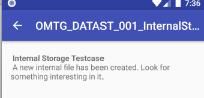
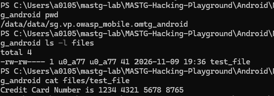

문제 설명 : 앱 내부 저장소에 새로운 파일이 생성됐다. 그 파일에서 중요한 정보를 찾아라.

전체 코드

```java
package sg.vp.owasp_mobile.OMTG_Android;

import android.os.Bundle;
import android.support.v7.app.AppCompatActivity;
import android.support.v7.widget.Toolbar;
import java.io.FileNotFoundException;
import java.io.FileOutputStream;
import java.io.IOException;

/* JADX INFO: loaded from: classes.dex */
public class OMTG_DATAST_001_InternalStorage extends AppCompatActivity {
    @Override // android.support.v7.app.AppCompatActivity, android.support.v4.app.FragmentActivity, android.support.v4.app.BaseFragmentActivityDonut, android.app.Activity
    protected void onCreate(Bundle savedInstanceState) {
        super.onCreate(savedInstanceState);
        setContentView(sg.vp.owasp_mobile.p000omtg_android.R.layout.activity_omtg__datast_001__internal_storage);
        Toolbar toolbar = (Toolbar) findViewById(sg.vp.owasp_mobile.p000omtg_android.R.id.toolbar);
        setSupportActionBar(toolbar);
        getSupportActionBar().setDisplayHomeAsUpEnabled(true);
        try {
            writeFile();
        } catch (IOException e) {
            e.printStackTrace();
        }
    }

    private void writeFile() throws IOException {
        FileOutputStream fos = null;
        try {
            fos = openFileOutput("test_file", 0);
        } catch (FileNotFoundException e) {
            e.printStackTrace();
        }
        fos.write("Credit Card Number is 1234 4321 5678 8765".getBytes());
        fos.close();
    }
}
```



이렇게 문제를 열면 어떤 본문들이 나오는데 번역해보면 다음과 같다.

<strong>앱 내부 저장소에 새로운 파일이 생성됐다. 그 파일에서 중요한 정보를 찾아라.<br /></strong>앱 내부에 새로운 파일이 생성되었다고 한다.

코드를 분석해보니 다음과 같은 결과가 나왔다.

```java
protected void onCreate(Bundle savedInstanceState)
```

사용자가 이 문제를 누르면 <code>onCreate</code>함수가 호출이 되며 실행된다.

```java
WhiteFile();
fos = openFileOutput("test_file", 0);
```

화면에 버튼이 없어도 자동으로 생성되고, 파일 명은 <code>test_file</code>이라는 이름으로 생성 되었다고 한다.



어느 경로에 생성되어 있는지 파악하지 못해서 명령어를 사용했더니 다음과 같은 경로에 존재하는 것을 확인할 수 있었다.

```java
/data/data/sg.vp.owasp_mobile.omtg_android/files/test_file
```

심지어 cat 명령어로 파일을 읽으니까 파일 번호가 암호화되지 않고 그대로 평문으로 노출되는 대사고까지 일어나있는 것을 볼 수 있다. <code>(1234 4321 5678 8765)</code>

결과로는 <strong>앱이 민감한 카드 번호를 내부 저장소 test\_file이 생성되고 이 파일 안에는 그냥 카드 번호가 그냥 평문으로 노출되어 있는 점을 확인할 수 있었다.</strong>
