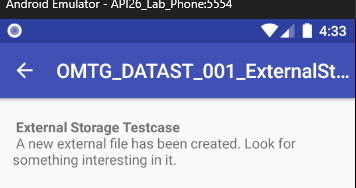
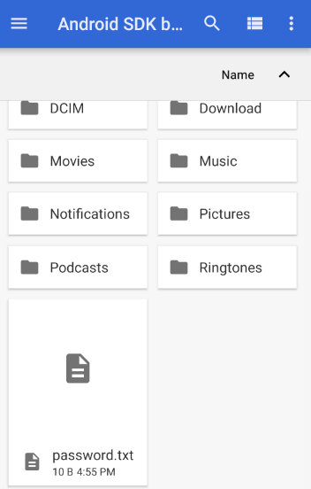
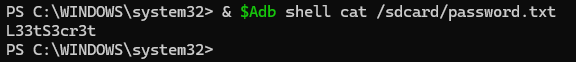

문제 설명 : 외부 저장소에 새 파일이 생성되었습니다. 그 파일에서 중요한 정보를 찾아보세요.



실제로 들어가보면 이렇게 메세지가 나오게 된다.

```java
외부 저장소란?
- Android가 여러 앱과 사용자가 같이 사용하는 공유 저장 공간
```

여기서 말하는 외부 저장소는 api 26 애뮬레이터에서 아래 2개의 경로를 가리킨다

```java
/sdcard
/storage/emulated/0

/sdcard 경로는 2번째 /storage/emulated/0 경로에서 어느정도 앱과 사용자가 편하게 접근하도록 만든
호환성을 챙긴 짧은 형태로 변환된 경로이다.
```

```java
package sg.vp.owasp_mobile.OMTG_Android;

import android.os.Bundle;
import android.os.Environment;
import android.support.v7.app.AppCompatActivity;
import android.support.v7.widget.Toolbar;
import java.io.File;
import java.io.FileNotFoundException;
import java.io.FileOutputStream;
import java.io.IOException;

/* JADX INFO: loaded from: classes.dex */
public class OMTG_DATAST_001_ExternalStorage extends AppCompatActivity {
    @Override // android.support.v7.app.AppCompatActivity, android.support.v4.app.FragmentActivity, android.support.v4.app.BaseFragmentActivityDonut, android.app.Activity
    protected void onCreate(Bundle savedInstanceState) {
        super.onCreate(savedInstanceState);
        setContentView(sg.vp.owasp_mobile.p000omtg_android.R.layout.activity_omtg__datast_001__external_storage);
        Toolbar toolbar = (Toolbar) findViewById(sg.vp.owasp_mobile.p000omtg_android.R.id.toolbar);
        setSupportActionBar(toolbar);
        getSupportActionBar().setDisplayHomeAsUpEnabled(true);
        if (isExternalStorageWritable()) {
            File file = new File(Environment.getExternalStorageDirectory(), "password.txt");
            try {
                FileOutputStream fos = new FileOutputStream(file);
                fos.write("L33tS3cr3t".getBytes());
                fos.close();
            } catch (FileNotFoundException e) {
                e.printStackTrace();
            } catch (IOException e2) {
                e2.printStackTrace();
            }
        }
    }

    public boolean isExternalStorageWritable() {
        String state = Environment.getExternalStorageState();
        return "mounted".equals(state);
    }

    public boolean isExternalStorageReadable() {
        String state = Environment.getExternalStorageState();
        return "mounted".equals(state) || "mounted_ro".equals(state);
    }
}
```

전체 소스코드는 위와 같다.<br />위 코드들을 보면서 외부 저장소에 어떤 이름의 파일이 생성 되었는지 살펴 보도록 하겠다.

```java
File file = new File(Environment.getExternalStorageDirectory(), "password.txt");
            try {
                FileOutputStream fos = new FileOutputStream(file);
                fos.write("L33tS3cr3t".getBytes());
                fos.close();
            } catch (FileNotFoundException e) {
                e.printStackTrace();
            } catch (IOException e2) {
                e2.printStackTrace();
            }
```

이 문제의 핵심 부분은 바로 여기이다.

```java
File file = new File(Environment.getExternalStorageDirectory(), "password.txt");
```

외부 저장소를 호출하는 <code>Environment.getExternalStorageDirectory()</code> 함수를 사용하고,<br />파일 명은 <code>password.txt</code>로 지정된다.

```java
FileOutputStream fos = new FileOutputStream(file);
fos.write("L33tS3cr3t".getBytes());
fos.close();
```

파일(password.txt)를 연 후 write로 <code>L33tS3cr3t</code>를 그냥 평문으로 쓴 후 닫는다.

이렇게 되면 사용자의 password가 파일에 그대로 평문에 노출되는 위험이 생기게 된다.



이렇게 외부 저장소에 가보니 password.txt라는 파일이 존재하는 것을 확인 하였고 들어가보니



이렇게 cat으로 내부를 보면 L33tS3cr3t도 정상적으로 데이터가 들어있는 것을 확인 하였다.
