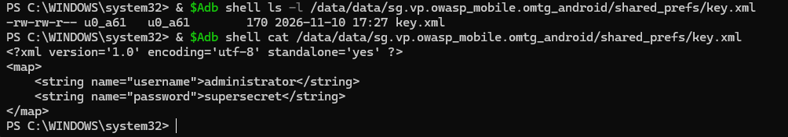

문제 설명 : 새로운 SharedPreferences 파일이 생성되었습니다. 그 안에서 중요한 정보를 찾아보세요.

```java
SharedPreferences
- 앱이 설정 값을 이름 = 값으로 그냥 저장을 하는 기능이다.
- 즉 간단하게 평문으로 문자를 저장 한다는 것이다.
```

```java
package sg.vp.owasp_mobile.OMTG_Android;

import android.content.SharedPreferences;
import android.os.Bundle;
import android.support.v7.app.AppCompatActivity;
import android.support.v7.widget.Toolbar;

/* JADX INFO: loaded from: classes.dex */
public class OMTG_DATAST_001_SharedPreferences extends AppCompatActivity {
    @Override // android.support.v7.app.AppCompatActivity, android.support.v4.app.FragmentActivity, android.support.v4.app.BaseFragmentActivityDonut, android.app.Activity
    protected void onCreate(Bundle savedInstanceState) {
        super.onCreate(savedInstanceState);
        setContentView(sg.vp.owasp_mobile.p000omtg_android.R.layout.activity_omtg__datast_001__shared_preference);
        Toolbar toolbar = (Toolbar) findViewById(sg.vp.owasp_mobile.p000omtg_android.R.id.toolbar);
        setSupportActionBar(toolbar);
        getSupportActionBar().setDisplayHomeAsUpEnabled(true);
        SharedPreferences sharedPref = getSharedPreferences("key", 1);
        SharedPreferences.Editor editor = sharedPref.edit();
        editor.putString("username", "administrator");
        editor.putString("password", "supersecret");
        editor.commit();
    }
}
```

전체 코드는 되게 짧고 심플하다.

핵심은 다음과 같다.

```java
SharedPreferences sharedPref = getSharedPreferences("key", MODE_PRIVATE);
SharedPreferences.Editor editor = sharedPref.edit();
editor.putString("username", "administrator");
editor.putString("password", "supersecret");
editor.commit();
```

이 부분이 파일(key.xml), 저장 방식, 저장되는 계정의 정보가 전부 보여지고 있다.

```java
.xml 확장자 파일이란?
- 데이터를 저장하고 전송하기 위해 설계된 마크업 언어이다.
- 설정 값들을 저장을 하고 있는데 각 설정 값들에 이름을 붙여 보관한다는 특징이 있다.
```

그래서 확인 해보려고 하는데 api 26으로는 충돌이 일어나서 api 23 버전을 다운로드 받아서 진행 하였다.

```java
SecurityException: MODE_WORLD_READABLE no longer supported

간단하게 api26이랑 출동하는거라고 이해하면 편하다.
```

```java

-rw-rw-r-- u0_a61   u0_a61        170 2026-11-10 17:27 key.xml
그래서 명령어를 사용해서 이렇게 key.xml이라는 파일이 생성된 것을 확인 할 수 있었고

<?xml version='1.0' encoding='utf-8' standalone='yes' ?>
<map>
    <string name="username">administrator</string>
    <string name="password">supersecret</string>
</map>

명령어를 사용해서 name 값이 administrator, supersecret 등 평문으로 저장된 것을 확인 할 수 있었다.
```



