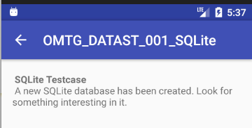
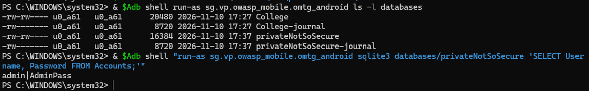

문제 설명 : 새 SQLite 데이터베이스가 만들어졌습니다. 그 안에서 중요한 정보를 찾아보세요.

```java
package sg.vp.owasp_mobile.OMTG_Android;

import android.database.sqlite.SQLiteDatabase;
import android.os.Bundle;
import android.support.v7.app.AppCompatActivity;
import android.support.v7.widget.Toolbar;

/* JADX INFO: loaded from: classes.dex */
public class OMTG_DATAST_001_SQLite_Not_Encrypted extends AppCompatActivity {
    @Override // android.support.v7.app.AppCompatActivity, android.support.v4.app.FragmentActivity, android.support.v4.app.BaseFragmentActivityDonut, android.app.Activity
    protected void onCreate(Bundle savedInstanceState) {
        super.onCreate(savedInstanceState);
        setContentView(sg.vp.owasp_mobile.p000omtg_android.R.layout.activity_omtg__datast_001__sqlite);
        Toolbar toolbar = (Toolbar) findViewById(sg.vp.owasp_mobile.p000omtg_android.R.id.toolbar);
        setSupportActionBar(toolbar);
        getSupportActionBar().setDisplayHomeAsUpEnabled(true);
        SQLiteUnsafe();
    }

    private void SQLiteUnsafe() {
        SQLiteDatabase notSoSecure = openOrCreateDatabase("privateNotSoSecure", 0, null);
        notSoSecure.execSQL("CREATE TABLE IF NOT EXISTS Accounts(Username VARCHAR,Password VARCHAR);");
        notSoSecure.execSQL("INSERT INTO Accounts VALUES('admin','AdminPass');");
        notSoSecure.close();
    }
}
```

```java
SQLite란?
- 앱이 표 형태로 데이터를 저장하는 파일입니다.
- 이 실습의 목표는 앱에서 OMTG_DATAST_001_SQLITE 화면을 연 뒤, 
  생성된 데이터베이스를 찾아 계정 정보가 평문으로 저장됐는지 확인하는 것이다.
```

즉 SQLite로 새로운 데이터베이스가 만들어졌고, 우리는 그 데이터베이스를 열어서 무슨 정보가 있는지 확인을 해보는 것이다.

```java
private void SQLiteUnsafe() {
        SQLiteDatabase notSoSecure = openOrCreateDatabase("privateNotSoSecure", 0, null);
        notSoSecure.execSQL("CREATE TABLE IF NOT EXISTS Accounts(Username VARCHAR,Password VARCHAR);");
        notSoSecure.execSQL("INSERT INTO Accounts VALUES('admin','AdminPass');");
        notSoSecure.close();
    }
```

위 코드를 보면 <code>privateNotSoSecure</code>라는 이름의 데이터베이스 파일을 열고, 없다면 새롭게 만든다.

<code>Accounts</code>라는 표를 만들고, <code>Username</code>과 <code>Password</code> 칸을 준비한 후 사용자 이름 admin / 비밀번호 AdminPass를 그대로 저장시킨다.

그 후 close로 데이터베이스를 닫는 간단한 코드이다.

```java
-rw-rw---- u0_a61   u0_a61      20480 2026-11-10 17:27 College
-rw------- u0_a61   u0_a61       8720 2026-11-10 17:27 College-journal
-rw-rw---- u0_a61   u0_a61      16384 2026-11-10 17:37 privateNotSoSecure
-rw------- u0_a61   u0_a61       8720 2026-11-10 17:37 privateNotSoSecure-journal
이렇게 명령어를 쳐서 본 결과 privateNotSoSecure라는 데이터 베이스가 생성된 모습을 볼 수 있다.

admin|AdminPass
안에 들어있는 내용까지 확인해본 결과 admin|AdminPass가 그대로 데이터베이스 내부에 저장되어있는 것을 확인할 수 있었다.
```



