> 플랫폼: [CryptoHack](https://cryptohack.org/)

## 1. 최대공약수와 유클리드 알고리즘

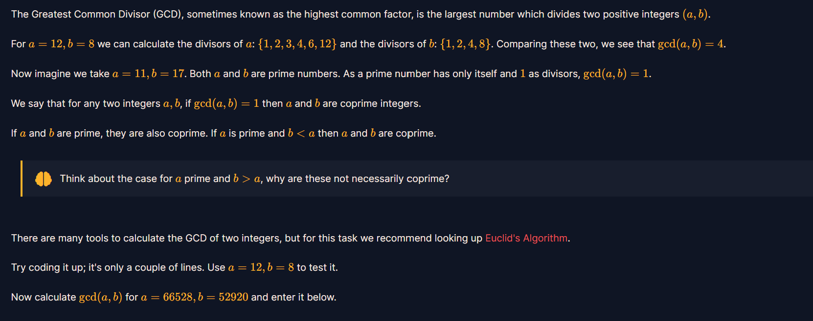

이제 모듈러 산술로 수학 개념들이 여럿 나올 것이다.

```python
최대공약수(GCD)는 두 양의 정수를 모두 나누어떨어지게 하는 가장 큰 수입니다.

예를 들어 12의 약수는 1, 2, 3, 4, 6, 12이고, 8의 약수는 1, 2, 4, 8입니다. 공통 약수 중 가장 큰 수는 4이므로 12와 8의 최대공약수는 4입니다.

11과 17은 서로 다른 소수입니다. 두 수의 공통 약수가 1뿐이므로 최대공약수는 1입니다. 이처럼 최대공약수가 1인 두 정수를 ‘서로소’라고 합니다.

생각해 볼 점: a가 소수이고 b가 a보다 클 때, 왜 두 수가 반드시 서로소인 것은 아닐까요?

이 문제에서는 유클리드 알고리즘을 코드로 구현해 최대공약수를 구해 보라고 합니다. 먼저 12와 8로 시험한 뒤, 66528과 52920의 최대공약수를 계산해 입력하면 됩니다.
```

문제를 번역한 것은 위와 같다.

문제를 보았을 때 이걸 어떻게 python으로 구현해야 하는지 찾아봤는데 유클리드 알고리즘을 사용한다.

```python
큰 수를 작은 수로 나눈 나머지를 구하고, 나머지가 0이 될 때까지 반복한다.
그래서 마지막으로 남은 수가 최대 공약수가 된다.
```

```python
a = 12
b = 8

while b != 0:
    a, b = b, a % b

print(a)
```

python에서는 이러한 방식으로 구현해서 최대 공약수를 찾아야 한다. (12와 8의 최대 공약수를 찾는 예제)

1번 문제에서는 단순히 최대 공약수를 구하는 것이기 때문에 12, 8을 숫자 66528과 52920으로 만들어준다.

```python
a = 66528
b = 52920

while b != 0:
    a, b = b, a % b

print(a)
```


## 2. 확장 유클리드 알고리즘

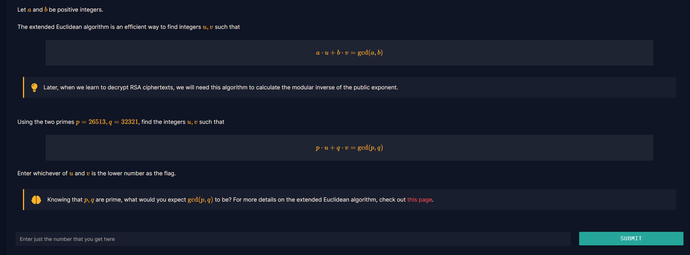

이번에는 확장 유클리드 알고리즘을 사용하는 문제이다.

저번에는 일반적인 유클리드 알고리즘을 사용해서 최대 공약수만 구했다면, 지금은 최대공약수를 식으로 표현하는 정수 u, v까지 찾아야 한다.

여기서 볼 수 있는 것은 26513과 32321은 서로 다른 소수여서 오른쪽의 최대 공약수는 1로 맞춰진다는 것이다.

```python
p = 26513
q = 32321

old_r, r = p, q
old_u, u = 1, 0
old_v, v = 0, 1

while r != 0:
    quotient = old_r // r
    old_r, r = r, old_r - quotient * r
    old_u, u = u, old_u - quotient * u
    old_v, v = v, old_v - quotient * v

print("u =", old_u, "v =", old_v)
print("검산:", p * old_u + q * old_v)
print("제출할 값:", min(old_u, old_v))
```

전체 코드를 짠 이유를 설명 해보겠다.

위 코드의 핵심은 나머지를 구하는 과정에 u, v도 같이 기록하는 것이다.

```python
26513 = 26513 × 1 + 32321 × 0
32321 = 26513 × 0 + 32321 × 1
old_u, u = 1, 0, old_v, v = 0, 1로 시작
```

반복문에서는 앞 문제와 똑같이 나머지를 구하는 코드를 짰다.

그래서 결과적으로 r이 0이 되면 old\_r이 최대 공약수가 되고 그 때 old\_u, old\_v가 실행된다.

그래서 검산하는 줄을 보면 `26513 * u + 32321 * v = 1`이 되는 것이다.

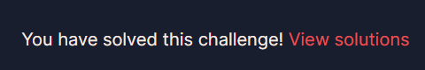

## 3. 나머지 연산

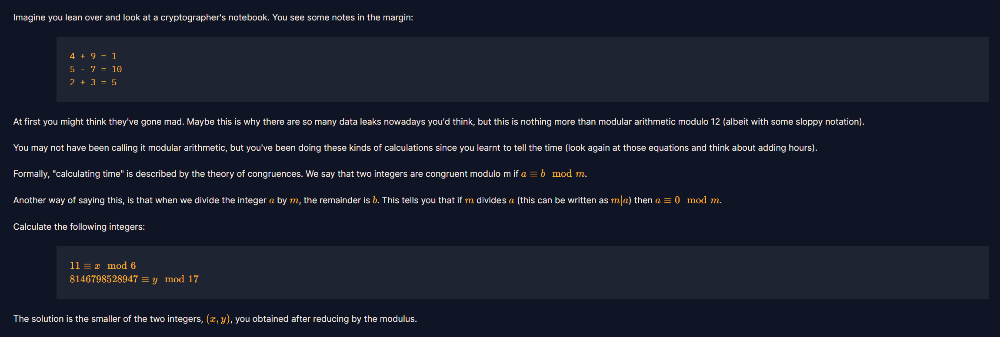

이번 문제는 나머지 연산(mod) 문제이다.

```python
예시를 들어서 설명 해보겠다.

4 + 9 = 13이지만 13을 12로 나눈 나머지는 1이여서 문제에서는 4 + 9 = 1이라고 나와있다.
이 문제는 같은 방식으로8146798528947을 17로 나눈 나머지가 y값이 된다.
그리고 이 두 값중 더 작은 값을 flag칸에 제출하면 된다.
```

```python
x = 11 % 6
y = 8146798528947 % 17

print("x =", x)
print("y =", y)
print("제출할 값 =", min(x, y))
```

그래서 나머지를 얻는 연산자인 %를 사용해서 이렇게 mod를 구현 해주었다.


## 4. 페르마의 소정리

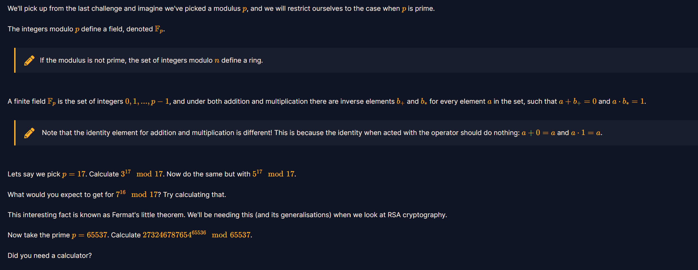

이 문제는 페르마의 소정리를 사용해서 해결해보는 문제이다.

페르마의 소정리는 17과 같은 소수로 나머지를 계산할 때 17의 배수가 아닌 수 a는 아래와 같은 성질을 가지게 된다.

```python
a의 16제곱을 17로 나눈 나머지 = 1
```

그래서 문제에서는 먼저 `3^17 mod 17`, `5^17 mod 17`, `7^16 mod 17 이 3개를 계산 해보라고 한다.`

그래서 마지막에는 같은 원리를 소수 65537에 적용해서 mod를 구한다.

python에서는 큰 수를 전부 계산할 필요 없이 pow(밑, 지수, 나누는 수)를 사용 할 수 있다.

```python
print("3^17 mod 17 =", pow(3, 17, 17))
print("5^17 mod 17 =", pow(5, 17, 17))
print("7^16 mod 17 =", pow(7, 16, 17))

answer = pow(273246787654, 65536, 65537)
print("제출할 값 =", answer)
```

그래서 이렇게 코드를 짰고 실행하면 정답이 나오게 된다.

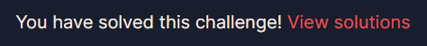

## 5. 곱셈의 역원

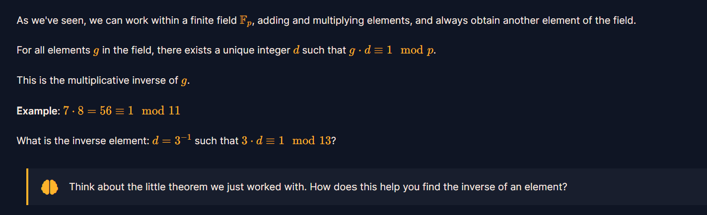

위 문제는 곱셈의 역원을 구하는 문제이다.

```python
곱셈의 역원
- 어떤 수 x와 곱했을 때 곱셈의 항등원인 1이 되게 만드는 수를 뜻한다.

3 * d를 13으로 나눴을 때 나머지가 1이 되는 숫자 d를 찾으면 된다.
예시에서는 7 * 8 = 56이고 11로 나눈 나머지가 1이라서 8이 7의 역원이 된다.
```

여기서 힌트를 보면 앞 문제의 페르마 소정리를 활용해서 문제를 풀라는 뜻이다.

13은 소수여서 3\^12 mod 13 = 1이고 이 수를 3 \* 3\^11 로 해석할 수 있다.

따라서 3\^11 mod 13을 계산하고 나온 값이 3을 곱하고 나머지가 1인지 확인을 해보면 된다.

```python
d = pow(3, 11, 13)

print("역원 =", d)
print("검산 =", (3 * d) % 13)
```

이렇게 코드를 만들고 검사해보면 다음과 같은 결과가 나온다.

```python
역원 = 9
검산 = 1
```

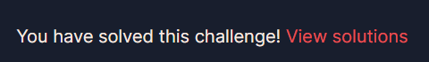

## 6. 이차잉여와 모듈러 제곱근

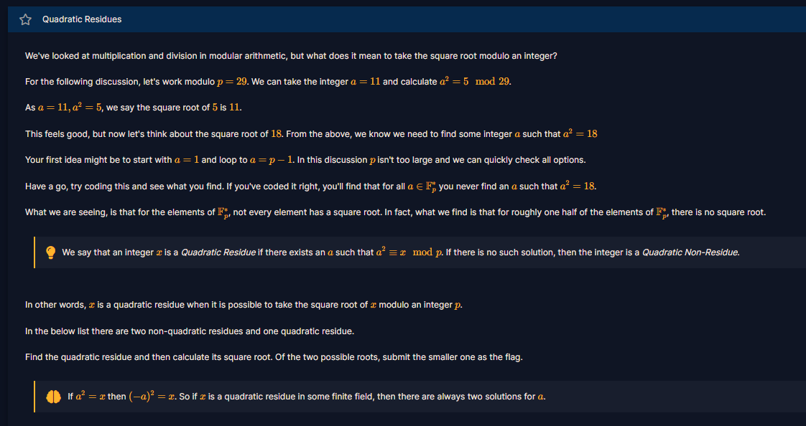

이번 문제는 제곱을 했을 시 특정 나머지가 되는 수를 찾는 것이다.

위 문제 풀이의 핵심은 어떤 수를 제곱한 뒤 29로 나눴을 시, 주어진 숫자가 무엇이 나오는가를 확인하는 문제이다.

```python
p = 29
candidates = [14, 6, 11]

for x in candidates:
    roots = []

    for a in range(1, p):
        if (a * a) % p == x:
            roots.append(a)

    if roots:
        print("제출할 값:", min(roots))
```

그래서 코드는 이렇게 된다.

문제에서 나온 숫자 14, 6, 11을 넣고 세 개의 숫자 중에 어떤 수를 제곱한 나머지가 될 수 있는 값을 찾는 것이 핵심이다.


## 7. 큰 소수에서의 모듈러 제곱근

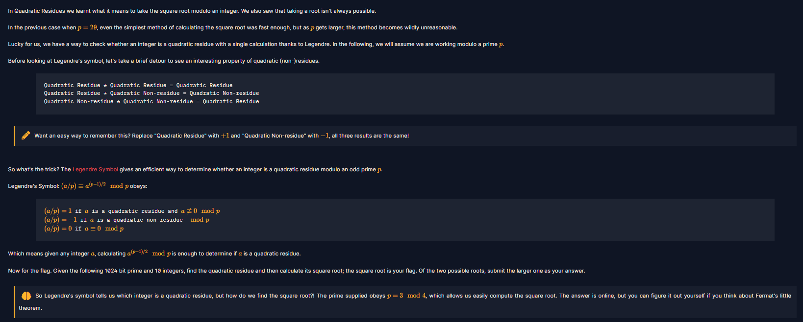

위 문제는 아까 전에 6번에서 풀었던 제곱근 문제를 큰 소수로 확장시켜서 해결하는 방식이다.

1부터 끝까지 시험하기에 너무 커서 두 개의 단계를 사용하여 해결한다

1번 째

- 주어진 숫자에서 10개 중 어느 것이 제곱근을 가지고 있는지 확인한다.
- 제곱근이 없다면 파이썬에서 p - 1이 나오게 된다.

2번 째

- 문제의 소수는 4로 나눈 나머지가 3이 된다.

제곱근이 있는 숫자 a를 찾는다면 p - 그 제곱근이 된다.

코드로 구현한다면 아래와 같다.

```python
import ast
from pathlib import Path

lines = [
    line for line in Path(__file__).with_name("output.txt").read_text().splitlines()
    if line.strip()
]
p = int(lines[0].split("=", 1)[1])
numbers = ast.literal_eval(lines[1].split("=", 1)[1].strip())

for a in numbers:
    if pow(a, (p - 1) // 2, p) == 1:
        root = pow(a, (p + 1) // 4, p)
        other_root = p - root

        print("제출할 값:", max(root, other_root))
```

첫 `pow()`는 제곱근이 있는 숫자를 찾고, 두 번째 `pow()`는 제곱근 하나를 계산하게 된다.

문제에서는 가능한 두 제곱근 중 큰 값을 제출하라고 해서 `max()`를 사용해서 구했다.


## 8. Tonelli–Shanks 알고리즘

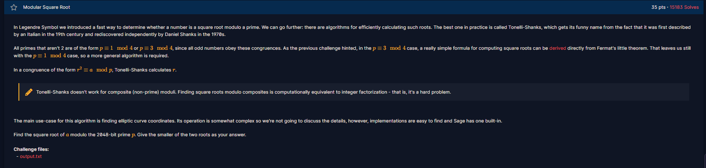

이번 문제는 전 7번과 이어지는 문제이다.

저번에는 소수가 4로 나눈 나머지가 3이라 간단한 거듭제곱 공식을 사용해서 제곱근을 구했다

하지만 이번에는 그 공식이 통하지 않는 **`Tonelli-Shanks 알고리즘`**을 사용한다.

```python
Tonelli-Shanks 알고리즘
- 소수 p로 나눈 나머지가 a가 되도록 제곱할 수 있는 수를 찾는 알고리즘이다.
- 주로 a를 만족하는 r을 구할 때 사용한다.

```

앞 문제에서는 간단하게 p % 4 == 3 이라서 간단한 공식으로 구할 수 있었다.

Tonelli-Shanks는 이런 공식이 통하지 않는 알고리즘 이여서, a에 제곱근이 있는지 확인하고, 있으면 제곱과 나머지 계산을 반복해 근을 찾아가는 방식이다.

```python
from pathlib import Path

values = {}
for line in Path(__file__).with_name("output.txt").read_text().splitlines():
    if line.strip():
        name, number = line.split("=", 1)
        values[name.strip()] = int(number.strip())

a = values["a"]
p = values["p"]

def tonelli_shanks(a, p):
    a %= p

    if a == 0:
        return 0

    q = p - 1
    s = 0
    while q % 2 == 0:
        q //= 2
        s += 1

    z = 2
    while pow(z, (p - 1) // 2, p) != p - 1:
        z += 1

    c = pow(z, q, p)
    x = pow(a, (q + 1) // 2, p)
    t = pow(a, q, p)
    m = s

    while t != 1:
        i = 1
        temp = (t * t) % p
        while temp != 1:
            temp = (temp * temp) % p
            i += 1

        b = pow(c, 1 << (m - i - 1), p)
        x = (x * b) % p
        t = (t * b * b) % p
        c = (b * b) % p
        m = i

    return x

root = tonelli_shanks(a, p)
answer = min(root, p - root)
print("제출할 값:", answer)
```

문제는 `tonelli_shanks()`가 제곱근 하나를 구한 후,` p - root`가 다른 제곱근이다.

그리고 이번 문제는 작은 값을 제출 하는 것이므로 `min()`을 사용해서 제출을 하였다.

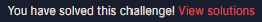

## 9. 중국인의 나머지 정리

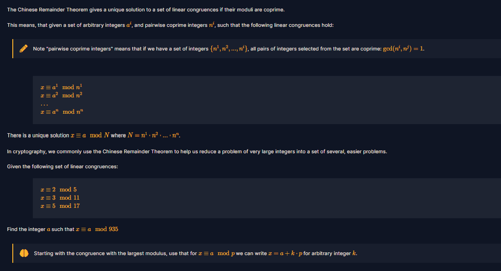

이번 문제는 중국인의 나머지 정리를 활용해서 세 조건을 만족하는 수 x를 찾아서 제출하는 문제이다.

1. x를 5로 나눈 나머지 = 2
2. x를 11로 나눈 나머지 = 3
3. x를 17로 나눈 나머지 = 5

5, 11, 17 세개의 수는 서로소이고 곱하면 935가 된다.

즉, 0부터 934 사이에 답이 존재한다는 뜻이다.

힌트를 보면 가장 큰 17부터 시작한다면 x = 5 = 17 \* k 를 사용할 수 있다. 

이렇게 k 수를 바꾸면서 나머지의 조건들도 맞는 것을 확인한다.

```python
for k in range(55):
    x = 5 + 17 * k

    if x % 11 == 3 and x % 5 == 2:
        print("제출할 값:", x)
        break
```

x = 5 + 17 \* k로 만들면 17로 나눈 나머지는 항상 5가 된다.

if에서 두 개의 조건을 확인하고, 모두 맞는 숫자를 출력하는 코드를 작성 하였다.


## 10. 르장드르 기호를 이용한 비트 복원

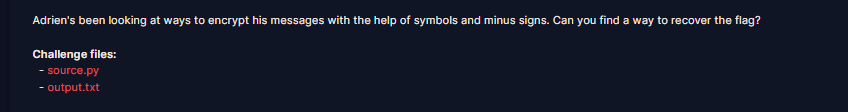

이번 문제는 제곱잉여인지 아닌지 비트별로 구분하는 문제이다.

문제와 같이 주는 python 코드를 살펴보면 flag를 문자마다 8비트로 바꾼 뒤에, 각 비트를 숫자 하나로 암호화 하게 된다.

- 비트가 1이면 a의 거듭제곱을 그대로 저장
- 비트가 0이면 그 값에 -를 붙여 p로 나눈 나머지를 저장한다.

이 문제의 a는 제곱잉여이고, 마이너스를 붙인 값은 비 제곱잉여가 된다.

그래서 앞에 배운 르장드르 판정을 output.txt의 숫자마다 적용하면 0과 1을 복원할 수 있다.

복원한 비트를 8개씩 묶어서 문자로 바꾸는 것이 핵심이다.

```python
from random import randint

a = 288260533169915
p = 1007621497415251

FLAG = b'crypto{????????????????????}'

def encrypt_flag(flag):
    ciphertext = []
    plaintext = ''.join([bin(i)[2:].zfill(8) for i in flag])
    for b in plaintext:
        e = randint(1, p)
        n = pow(a, e, p)
        if b == '1':
            ciphertext.append(n)
        else:
            n = -n % p
            ciphertext.append(n)
    return ciphertext

print(encrypt_flag(FLAG))

```

(문제에 주어진 python 코드)

```python
import ast
from pathlib import Path

p = 1007621497415251
text = Path(__file__).with_name("output.txt").read_text()
numbers = ast.literal_eval(text)

bits = ""
for n in numbers:
    if pow(n, (p - 1) // 2, p) == 1:
        bits += "1"
    else:
        bits += "0"

message = bytes(
    int(bits[i:i + 8], 2)
    for i in range(0, len(bits), 8)
)

print(message.decode())
```

`pow(n, (p - 1) // 2, p)`로 숫자가 제곱잉여인지 검사해 비트를 복원하게 된다.

그리고 비트를 8개씩 묶어서 문자로 바꿔 출력하는 코드를 짰다.


## 11. Modular Binomials

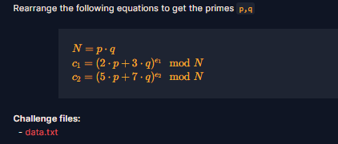

드디어 모듈러 산술의 마지막 문제이다.

이번 문제는 Modular Binomials를 활용하는 문제이다.

N은 두 소스 p \* q의 곱이 되고, 주어진 c1, c2는 p와 q를 섞어 만든 값을 거듭제곱 한 뒤 N으로 나눈 나머지가 된다.

목표는 식을 이용해서 p와 q를 찾아내는 것이다.

```python
N = 14905562257842714057932724129575002825405393502650869767115942606408600343380327866258982402447992564988466588305174271674657844352454543958847568190372446723549627752274442789184236490768272313187410077124234699854724907039770193680822495470532218905083459730998003622926152590597710213127952141056029516116785229504645179830037937222022291571738973603920664929150436463632305664687903244972880062028301085749434688159905768052041207513149370212313943117665914802379158613359049957688563885391972151218676545972118494969247440489763431359679770422939441710783575668679693678435669541781490217731619224470152467768073
e1 = 12886657667389660800780796462970504910193928992888518978200029826975978624718627799215564700096007849924866627154987365059524315097631111242449314835868137
e2 = 12110586673991788415780355139635579057920926864887110308343229256046868242179445444897790171351302575188607117081580121488253540215781625598048021161675697
c1 = 14010729418703228234352465883041270611113735889838753433295478495763409056136734155612156934673988344882629541204985909650433819205298939877837314145082403528055884752079219150739849992921393509593620449489882380176216648401057401569934043087087362272303101549800941212057354903559653373299153430753882035233354304783275982332995766778499425529570008008029401325668301144188970480975565215953953985078281395545902102245755862663621187438677596628109967066418993851632543137353041712721919291521767262678140115188735994447949166616101182806820741928292882642234238450207472914232596747755261325098225968268926580993051
c2 = 14386997138637978860748278986945098648507142864584111124202580365103793165811666987664851210230009375267398957979494066880296418013345006977654742303441030008490816239306394492168516278328851513359596253775965916326353050138738183351643338294802012193721879700283088378587949921991198231956871429805847767716137817313612304833733918657887480468724409753522369325138502059408241232155633806496752350562284794715321835226991147547651155287812485862794935695241612676255374480132722940682140395725089329445356434489384831036205387293760789976615210310436732813848937666608611803196199865435145094486231635966885932646519

```

이렇게 data.txt를 들어가면 값들이 다 들어가 있는 모습을 볼 수 있다.

이제 이 값을 기반으로 python 코드를 짜면 해결 된다.


```python
from math import gcd
from pathlib import Path

values = {}
for line in Path(__file__).with_name("data.txt").read_text().splitlines():
    if line.strip():
        name, number = line.split("=", 1)
        values[name.strip()] = int(number.strip())

N = values["N"]
e1, e2 = values["e1"], values["e2"]
c1, c2 = values["c1"], values["c2"]

power = e1 * e2
left = pow(c1, e2, N) * pow(7, power, N)
right = pow(c2, e1, N) * pow(3, power, N)

p = gcd(left - right, N)
q = N // p

assert 1 < p < N and p * q == N
assert pow(2 * p + 3 * q, e1, N) == c1
assert pow(5 * p + 7 * q, e2, N) == c2

print("p =", p)
print("q =", q)
print(f"crypto{{{p},{q}}}")
```


핵심은 두 암호문을 각각 e2, e1번 거듭제곱 해서 지수를 같게 만드는 것이 핵심이다.

그 다음 7과 3을 곱해서 식을 맞춰서 빼면, 그 차이가 p로 나누어 떨어지게 된다.

모듈러 산술을 성공적으로 클리어 했다.

<figure class="completion-proof">
  
  <figcaption>CryptoHack 모듈러 산술 1~11 완료 인증</figcaption>
</figure>

