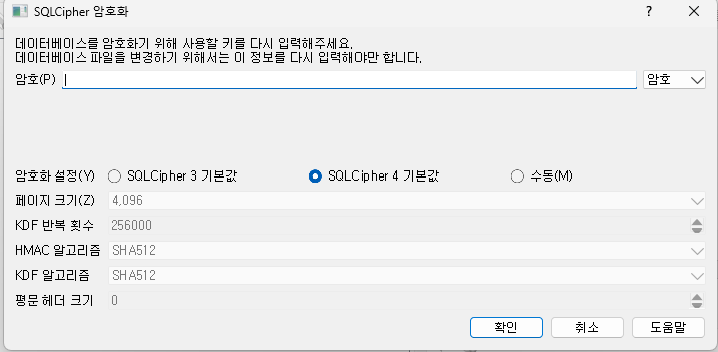
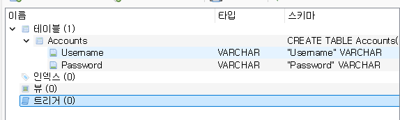


> 테스트 항목: `OMTG_DATAST_001_SQLite_Encrypted`

먼저 문제 들어가기 앞서서 이거는 api26, api23 두 버전 다 오류가 나서 좀 찾아봤는데, 문제는 아래와 같다(보는 3기생이 있을지 모르겠지만 공유 일단 해본다)

API 26의 logcat에서는 SQLCipher에 필요한 `libstlport_shared.so`를 찾지 못해 데이터베이스 생성 전에 종료된 것이 확인됐다.

```java
SQLCipher는 SQLite데이터베이스 파일을 암호화해서 저장하는 라이브러리이다.
원본 x86 APK에는 SQLCipher 실행에 필요한 libstlport_shared.so가 없어 초기화 중 앱이 종료된다.
```

위 문제를 해결하려면 OWASP 공식 릴리스 1.1의 `MSTG-Android-Java.apk를 다운로드 하면된다.`

SQLite문제 수정이 명시가 되어 있고, x86용의 SQLCipher 라이브러리도 포함되어 있다.

---

---

이제 문제를 보도록 하겠다.

문제 설명 : 앱이 암호화된 SQLite 데이터베이스를 생성한다. 데이터베이스 파일을 찾아 암호화에 사용된 키가 어떻게 정해지는지 분석하고, 그 키로 데이터베이스를 열어 저장된 계정 정보를 확인하는 것이 목표다.

```java
package sg.vp.owasp_mobile.OMTG_Android;

import android.annotation.TargetApi;
import android.os.Bundle;
import android.support.v7.app.AppCompatActivity;
import android.support.v7.widget.Toolbar;
import java.io.File;
import net.sqlcipher.database.SQLiteDatabase;

/* JADX INFO: loaded from: classes.dex */
public class OMTG_DATAST_001_SQLite_Encrypted extends AppCompatActivity {
    public native String stringFromJNI();

    @Override // android.support.v7.app.AppCompatActivity, android.support.v4.app.FragmentActivity, android.support.v4.app.BaseFragmentActivityDonut, android.app.Activity
    @TargetApi(23)
    protected void onCreate(Bundle savedInstanceState) {
        super.onCreate(savedInstanceState);
        setContentView(sg.vp.owasp_mobile.p000omtg_android.R.layout.activity_omtg__datast_001__sqlite__secure);
        Toolbar toolbar = (Toolbar) findViewById(sg.vp.owasp_mobile.p000omtg_android.R.id.toolbar);
        setSupportActionBar(toolbar);
        getSupportActionBar().setDisplayHomeAsUpEnabled(true);
        SQLiteEnc();
    }

    static {
        System.loadLibrary("native");
    }

    private void SQLiteEnc() {
        SQLiteDatabase.loadLibs(this);
        File database = getDatabasePath("encrypted");
        database.mkdirs();
        database.delete();
        SQLiteDatabase secureDB = SQLiteDatabase.openOrCreateDatabase(database, stringFromJNI(), (SQLiteDatabase.CursorFactory) null);
        secureDB.execSQL("CREATE TABLE IF NOT EXISTS Accounts(Username VARCHAR,Password VARCHAR);");
        secureDB.execSQL("INSERT INTO Accounts VALUES('admin','AdminPassEnc');");
        secureDB.close();
    }
}
```

위 Java 코드는 원본 app-x86-debug.apk 기준이다. 아래 키 추출과 DB 열기는 공식 1.1 APK 기준으로 진행했다.

파일이 암호화 되어있다고 문제에 나오는데 그러면 암호화된 부분을 먼저 찾아 보도록 하겠다.

```java
SQLiteDatabase secureDB = SQLiteDatabase.openOrCreateDatabase(database, stringFromJNI(), (SQLiteDatabase.CursorFactory) null);
```

이 부분을 보면 두 번째 값에 stringFromJNI() 함수가 존재하는데 이 부분이 데이터베이스를 여는 암호이다.

하지만 암호부분은 Java 코드에서 그대로 적혀있지 않고, [libnative.so](http://libnative.so)라는 네이티브 라이브러리에서 돌아오게 된다.

```java
libnative.so
- 간단하게 C/C++로 만든 코드들을 담은 Android 파일이다.
```

```java
static {
        System.loadLibrary("native");
}
```

여기서 native 함수가 붙은 stringFromJNI는 Java 파일에 함수 내용을 볼 수 없다.

그래서 libnative.so파일로 찾아야한다.

PowerShell로 공식 1.1 APK의 lib/x86/[libnative-lib.so](http://libnative-lib.so) 파일에서 읽을 수 있는 문자열을 추출하면 아래와 같이 나온다.

```java
Java_sg_vp_owas_mobile_OMTG_Android_OMTG_1DATAST_1001_1SQLite_1Encrypted_stringFromJNI
Java_sg_vp_owasp_1mobile_OMTG_1Android_OMTG_1DATAST_1001_1SQLite_1Encrypted_stringFromJNI
pthread_key_create
S3cr3tString!!!
cannot create thread specific key for __cxa_get_globals()
std::basic_string
std::basic_string<char, std::char_traits<char>, std::allocator<char> >
basic_string
string literal
std::string
string
```

이렇게 문자열들이 추출되고



그 후 암호화 DB를 PC로 추출하고 DB Browser for SQLCipher에서 열었다. 추출한 문자열 후보를 암호로 입력해 확인했다.

그 결과 S3cr3tString!!! 문자열을 입력 했을 때 암호가 통과되고 정상적으로 들어 가진 것을 확인할 수 있었다.



암호화 DB 열기 성공. Accounts 표의 실제 행을 확인한 화면을 추가하면 저장된 계정 값까지 실증된다.

