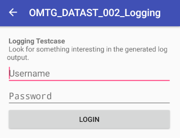
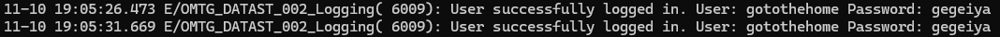


> 테스트 항목: `OMTG_DATAST_002_Logging`

문제 설명 : 생성된 로그에서 중요한 정보를 찾아보세요.

```java
package sg.vp.owasp_mobile.OMTG_Android;

import android.os.Bundle;
import android.support.v7.app.AppCompatActivity;
import android.support.v7.widget.Toolbar;
import android.util.Log;
import android.view.View;
import android.widget.Button;
import android.widget.EditText;
import android.widget.Toast;

/* JADX INFO: loaded from: classes.dex */
public class OMTG_DATAST_002_Logging extends AppCompatActivity {
    String TAG = "OMTG_DATAST_002_Logging";
    EditText passwordText;
    EditText usernameText;

    @Override // android.support.v7.app.AppCompatActivity, android.support.v4.app.FragmentActivity, android.support.v4.app.BaseFragmentActivityDonut, android.app.Activity
    protected void onCreate(Bundle savedInstanceState) {
        super.onCreate(savedInstanceState);
        setContentView(sg.vp.owasp_mobile.p000omtg_android.R.layout.activity_omtg__datast_002__logging);
        Toolbar toolbar = (Toolbar) findViewById(sg.vp.owasp_mobile.p000omtg_android.R.id.toolbar);
        setSupportActionBar(toolbar);
        this.usernameText = (EditText) findViewById(sg.vp.owasp_mobile.p000omtg_android.R.id.loggingUsername);
        this.passwordText = (EditText) findViewById(sg.vp.owasp_mobile.p000omtg_android.R.id.loggingPassword);
        Button btnLogin = (Button) findViewById(sg.vp.owasp_mobile.p000omtg_android.R.id.loginButton);
        View.OnClickListener oclbtnLogin = new View.OnClickListener() { // from class: sg.vp.owasp_mobile.OMTG_Android.OMTG_DATAST_002_Logging.1
            @Override // android.view.View.OnClickListener
            public void onClick(View v) {
                OMTG_DATAST_002_Logging.this.CreateLogs(OMTG_DATAST_002_Logging.this.usernameText.getText().toString(), OMTG_DATAST_002_Logging.this.passwordText.getText().toString());
            }
        };
        btnLogin.setOnClickListener(oclbtnLogin);
        getSupportActionBar().setDisplayHomeAsUpEnabled(true);
    }

    /* JADX INFO: Access modifiers changed from: private */
    public void CreateLogs(String username, String password) {
        Log.e(this.TAG, "User successfully logged in. User: " + username + " Password: " + password);
        System.out.println("WTF, Logging Class should be used instead.");
        Toast.makeText(this, "Log output has been created", 1).show();
    }
}
```

전체 코드는 위와 같다.



들어가보면 이렇게 아이디와 비밀번호를 입력하는 화면이 있다.

내가 입력한 번호는 아래와 같다.

```java
id : gotothehome
pw : jejeiya
```

```java
Log.e(TAG, "User successfully logged in. User: "
    + username + " Password: " + password);
```

코드에서 이 부분을 보면 login을 누르게 되면 코드가 입력 값을 기반으로 로그에 기록하는 코드가 존재한다.



그래서 명령어로 확인해본 결과 이렇게 사진과 같이 pw가 그대로 노출되어 있는 것을 확인할 수 있다.

이 뜻은 입력한 id, pw가 그대로 평문으로 기록되어 발생된다는 뜻이다.

