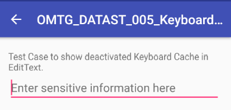
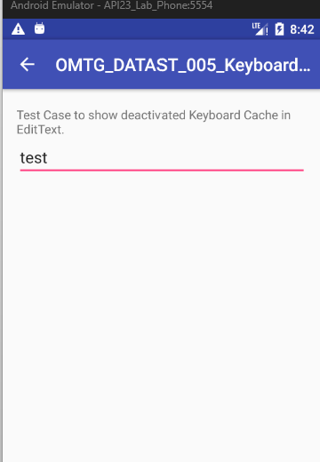


> 테스트 항목: `OMTG_DATAST_005_Keyboard_Cache`

문제 설명 : 입력칸에서 키보드의 단어 추천, 학습 기능을 비활성화한 사례



```java
package sg.vp.owasp_mobile.OMTG_Android;

import android.os.Bundle;
import android.support.design.widget.FloatingActionButton;
import android.support.design.widget.Snackbar;
import android.support.v7.app.AppCompatActivity;
import android.support.v7.widget.Toolbar;
import android.view.View;

/* JADX INFO: loaded from: classes.dex */
public class OMTG_DATAST_005_Keyboard_Cache extends AppCompatActivity {
    @Override // android.support.v7.app.AppCompatActivity, android.support.v4.app.FragmentActivity, android.support.v4.app.BaseFragmentActivityDonut, android.app.Activity
    protected void onCreate(Bundle savedInstanceState) {
        super.onCreate(savedInstanceState);
        setContentView(sg.vp.owasp_mobile.p000omtg_android.R.layout.activity_omtg__datast_005__keyboard__cache);
        Toolbar toolbar = (Toolbar) findViewById(sg.vp.owasp_mobile.p000omtg_android.R.id.toolbar);
        setSupportActionBar(toolbar);
        FloatingActionButton fab = (FloatingActionButton) findViewById(sg.vp.owasp_mobile.p000omtg_android.R.id.fab);
        fab.setOnClickListener(new View.OnClickListener() { // from class: sg.vp.owasp_mobile.OMTG_Android.OMTG_DATAST_005_Keyboard_Cache.1
            @Override // android.view.View.OnClickListener
            public void onClick(View view) {
                Snackbar.make(view, "Replace with your own action", 0).setAction("Action", (View.OnClickListener) null).show();
            }
        });
        getSupportActionBar().setDisplayHomeAsUpEnabled(true);
    }
}
```

비밀번호 같은 내용을 입력할 때 키보드가 입력 단어를 추천하거나 학습하지 않도록 요청하는 설정이 존재한다.

```java
setContentView(R.layout.activity_omtg__datast_005__keyboard__cache);
```

키보드의 설정은 화면 XML안의 입력칸에 존재한다.

```java
<EditText
    android:id="@+id/KeyBoardCache"
    android:inputType="textNoSuggestions" />
```

핵심은 XML 파일에 있는 `android:inputType="textNoSuggestions"`이다.

1. 사용자가 입력칸을 누르면 앱이 그 입력칸의 `inputType` 설정을 키보드 앱에 전달
2. 일반 입력 칸에서는 키보드 앱이 입력한 단어를 추천하거나, 나중에 추천하려고 학습할 수 있다.

민감한 값을 입력했다면 다른 입력칸의 추천에 나타날 위험이 생기게 된다.
3. 이 앱의 입력칸에는 `android:inputType="textNoSuggestions"`가 존재한다.

뜻을 간단하게 설명하면 사전 기반 추천을 표시하지 말라고 키보드에 요청하는 설정을 뜻한다.

그래서 이 문제의 핵심 방법은 jadx에서 `content_omtg__datast_005__keyboard__cache.xml`을 열고 `<EditText>`에 존재하는 `android:inputType="textNoSuggestions"`를 확인하면 핵심 설정을 찾게 된다. 앱에서는 입력 칸을 눌러 추천 단어가 표시되는지 관찰하면 해결된다.

```java
<?xml version="1.0" encoding="utf-8"?>
<RelativeLayout xmlns:android="http://schemas.android.com/apk/res/android" xmlns:app="http://schemas.android.com/apk/res-auto"
    android:paddingLeft="@dimen/activity_horizontal_margin"
    android:paddingTop="@dimen/activity_vertical_margin"
    android:paddingRight="@dimen/activity_horizontal_margin"
    android:paddingBottom="@dimen/activity_vertical_margin"
    android:layout_width="match_parent"
    android:layout_height="match_parent"
    app:layout_behavior="@string/appbar_scrolling_view_behavior">
    <TextView
        android:id="@+id/KeyBoardCacheTextView"
        android:paddingTop="10px"
        android:layout_width="wrap_content"
        android:layout_height="wrap_content"
        android:text="@string/textview_OMTG_DATAST_005_Keyboard_Cache"/>
    <EditText
        android:id="@+id/KeyBoardCache"
        android:layout_width="match_parent"
        android:layout_height="wrap_content"
        android:hint="@string/title_activity_omtg__datast_052__keyboard_cache"
        android:layout_below="@+id/KeyBoardCacheTextView"
        android:layout_centerHorizontal="true"
        android:inputType="textNoSuggestions"/>
</RelativeLayout>
```

위 코드는 XML을 들어갔을 때 나오는 코드들이다.

```java
android:inputType="textNoSuggestions"
```

마지막 줄을 보면 `textNoSuggestions`는 키보드에 이 칸의 입력 내용을 단어로 추천하지 말라고 요청하는 역할을 담당한다.

그래서 종합적인 평가를 보면 민감한 정보의 입력칸에 키보드 추천을 끄는 설정이 적용되어 있다.



이렇게 test를 누르고 확인을 눌러도 키보드 관련 추천을 끄는 설정이 적용되어 있다.

