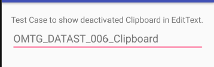
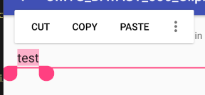
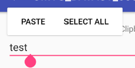
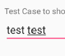


> 테스트 항목: `OMTG_DATAST_006_Clipboard`



문제 설명 : 입력칸의 내용을 복사해서 전역 클립보드에 넣을 수 있는지 확인하는 실습

```java
package sg.vp.owasp_mobile.OMTG_Android;

import android.os.Bundle;
import android.support.design.widget.FloatingActionButton;
import android.support.design.widget.Snackbar;
import android.support.v7.app.AppCompatActivity;
import android.support.v7.widget.Toolbar;
import android.view.View;
import android.widget.EditText;

/* JADX INFO: loaded from: classes.dex */
public class OMTG_DATAST_006_Clipboard extends AppCompatActivity {
    EditText sensitiveInformation;

    @Override // android.support.v7.app.AppCompatActivity, android.support.v4.app.FragmentActivity, android.support.v4.app.BaseFragmentActivityDonut, android.app.Activity
    protected void onCreate(Bundle savedInstanceState) {
        super.onCreate(savedInstanceState);
        setContentView(sg.vp.owasp_mobile.p000omtg_android.R.layout.activity_omtg__datast_006__clipboard);
        Toolbar toolbar = (Toolbar) findViewById(sg.vp.owasp_mobile.p000omtg_android.R.id.toolbar);
        setSupportActionBar(toolbar);
        FloatingActionButton fab = (FloatingActionButton) findViewById(sg.vp.owasp_mobile.p000omtg_android.R.id.fab);
        fab.setOnClickListener(new View.OnClickListener() { // from class: sg.vp.owasp_mobile.OMTG_Android.OMTG_DATAST_006_Clipboard.1
            @Override // android.view.View.OnClickListener
            public void onClick(View view) {
                Snackbar.make(view, "Replace with your own action", 0).setAction("Action", (View.OnClickListener) null).show();
            }
        });
        getSupportActionBar().setDisplayHomeAsUpEnabled(true);
        this.sensitiveInformation = (EditText) findViewById(sg.vp.owasp_mobile.p000omtg_android.R.id.ClipboardEditText);
    }
}
```

문제 들어가서 설명을 보면 클립보드 복사 붙여넣기가 막혀있다고 설명이 되어 있다.

하지만 코드를 보면 어떤 부분도 딱히 막혀있게 설정하는 부분이 존재하지 않는다.



test를 적은 후 COPY를 누르고



PASTE를 누르면 아래 사진과 같이 잘 복사 붙여넣기가 가능한 것으로 판단할 수 있다.



