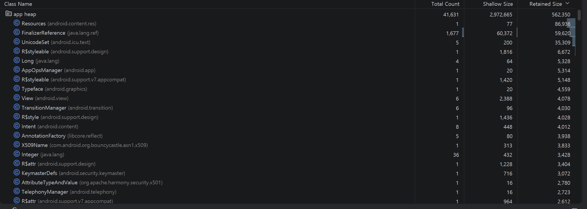
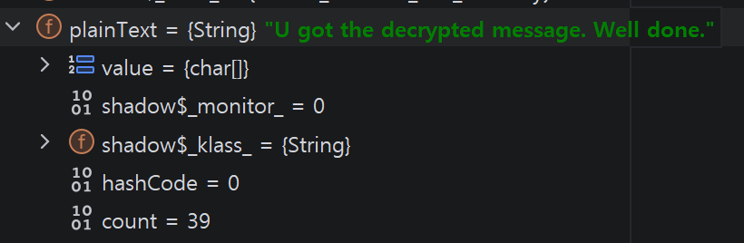


> 테스트 항목: `OMTG_DATAST_011_Memory`

문제 설명 : 앱의 메모리를 덤프해서, 이 화면을 열 때 호출되는 함수를 찾고, 복호화된 문자열을 알아내라.

```java
package sg.vp.owasp_mobile.OMTG_Android;

import android.os.Bundle;
import android.support.v7.app.AppCompatActivity;
import android.support.v7.widget.Toolbar;
import com.tozny.crypto.android.AesCbcWithIntegrity;
import java.io.UnsupportedEncodingException;
import java.security.GeneralSecurityException;
import java.security.InvalidKeyException;

/* JADX INFO: loaded from: classes.dex */
public class OMTG_DATAST_011_Memory extends AppCompatActivity {
    String TAG = "OMTG_DATAST_011_Memory";
    String plainText;

    @Override // android.support.v7.app.AppCompatActivity, android.support.v4.app.FragmentActivity, android.support.v4.app.BaseFragmentActivityDonut, android.app.Activity
    protected void onCreate(Bundle savedInstanceState) {
        super.onCreate(savedInstanceState);
        setContentView(sg.vp.owasp_mobile.p000omtg_android.R.layout.activity_omtg__datast_011__memory);
        Toolbar toolbar = (Toolbar) findViewById(sg.vp.owasp_mobile.p000omtg_android.R.id.toolbar);
        setSupportActionBar(toolbar);
        getSupportActionBar().setDisplayHomeAsUpEnabled(true);
        decryptString();
    }

    public void decryptString() {
        AesCbcWithIntegrity.SecretKeys privateKey = null;
        try {
            privateKey = AesCbcWithIntegrity.keys("4zInk+d4jlQ3m1B1ELctxg==:4aZtzwpbniebvM7yC4/GIa2ZmJpSzqrAFtVk91Rm+Q4=");
        } catch (InvalidKeyException e) {
            e.printStackTrace();
        }
        AesCbcWithIntegrity.CipherTextIvMac cipherTextIvMac = new AesCbcWithIntegrity.CipherTextIvMac("6WpfZkgKMJsPhHNhWoSpVg==:6/TgUCXrAuAa2lUMPWhx8hHOWjWEHFp3VIsz3Ws37ZU=:C0mWyNQjcf6n7eBSFzmkXqxdu55CjUOIc5qFw02aVIfQ1CI8axsHijTJ9ZW6ZfEE");
        try {
            this.plainText = AesCbcWithIntegrity.decryptString(cipherTextIvMac, privateKey);
        } catch (UnsupportedEncodingException e2) {
            e2.printStackTrace();
        } catch (GeneralSecurityException e3) {
            e3.printStackTrace();
        }
    }
}
```

목표는 복호화된 문자열을 알아내는 것이다.

코드를 살펴보면 MEMORY 화면이 열릴 때 onCreate()가 decryptString()을 호출한다.

그러면 이 함수가 암호문을 풀어 결과를 plainText라는 변수에 저장을 한다.

하지만 화면에는 그 결과를 표시하지 않는다.

그래서 나는 powershell 명령어를 사용해서 메모리 덤프를 저장해서 보기로 하였다.

```java
1 file pulled, 0 skipped. 52.4 MB/s (15582229 bytes in 0.283s)
```

powershell이 답한 명령어이다.

요약을 하면 15MB 가량의 바이트를 덤프로 만들고 가져왔다는 뜻이다.

이제 이걸 Android Studio에서 확인을 하면 된다.



이렇게 Android Studio에 import한 모습이다.

여기에서 클래스 목록 검색 창에 `OMTG_DATAST_011_Memory`를 입력해주면 된다.



여기 값을 보면 **U got the decrypted message. Well done.** 이라는 글자가 적혀있는 것을 확인할 수 있다.

