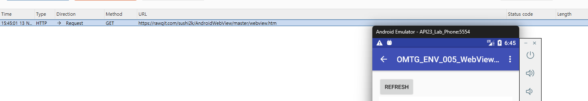
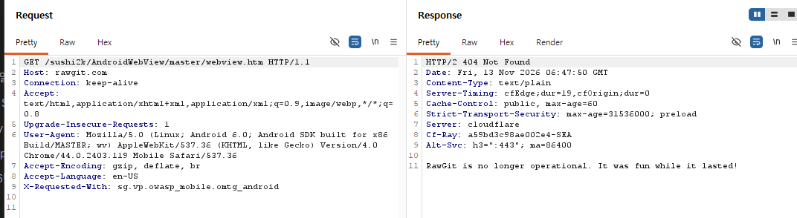
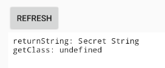


> 테스트 항목: `OMTG_ENV_005_WebView_Remote`

문제 설명 : 앱 안의 WebView가 외부 웹페이지에 Java 기능을 열어 주는지 확인하는 실습

```java
package sg.vp.owasp_mobile.OMTG_Android;

import android.os.Bundle;
import android.support.v7.app.AppCompatActivity;
import android.support.v7.widget.Toolbar;
import android.view.Menu;
import android.view.View;
import android.webkit.WebChromeClient;
import android.webkit.WebSettings;
import android.webkit.WebView;
import android.widget.Button;

/* JADX INFO: loaded from: classes.dex */
public class OMTG_ENV_005_WebView_Remote extends AppCompatActivity {
    @Override // android.support.v7.app.AppCompatActivity, android.support.v4.app.FragmentActivity, android.support.v4.app.BaseFragmentActivityDonut, android.app.Activity
    protected void onCreate(Bundle savedInstanceState) {
        super.onCreate(savedInstanceState);
        setContentView(sg.vp.owasp_mobile.p000omtg_android.R.layout.activity_omtg__env_005__web_view);
        Toolbar toolbar = (Toolbar) findViewById(sg.vp.owasp_mobile.p000omtg_android.R.id.toolbar);
        setSupportActionBar(toolbar);
        getSupportActionBar().setDisplayHomeAsUpEnabled(true);
        Button button = (Button) findViewById(sg.vp.owasp_mobile.p000omtg_android.R.id.button1);
        button.setOnClickListener(new View.OnClickListener() { // from class: sg.vp.owasp_mobile.OMTG_Android.OMTG_ENV_005_WebView_Remote.1
            @Override // android.view.View.OnClickListener
            public void onClick(View v) {
                WebView myWebView = (WebView) OMTG_ENV_005_WebView_Remote.this.findViewById(sg.vp.owasp_mobile.p000omtg_android.R.id.webView1);
                myWebView.reload();
            }
        });
        WebView myWebView = (WebView) findViewById(sg.vp.owasp_mobile.p000omtg_android.R.id.webView1);
        myWebView.setWebChromeClient(new WebChromeClient());
        WebSettings webSettings = myWebView.getSettings();
        webSettings.setJavaScriptEnabled(true);
        OMTG_ENV_005_JS_Interface jsInterface = new OMTG_ENV_005_JS_Interface(this);
        myWebView.addJavascriptInterface(jsInterface, "Android");
        myWebView.loadUrl("https://rawgit.com/sushi2k/AndroidWebView/master/webview.htm");
    }

    @Override // android.app.Activity
    public boolean onCreateOptionsMenu(Menu menu) {
        getMenuInflater().inflate(sg.vp.owasp_mobile.p000omtg_android.R.menu.menu_my, menu);
        return true;
    }
}
```

코드를 보면 WebView에서 JavaScript를 켜고, Java 객체를 Android라는 이름으로 등록한다.

그래서 그 WebView 안의 웹페이지는 Android.returnString()을 호출해 앱의 문자열을 받을 수 있다.

반면 getClass()까지 호출해 Java 코드를 실행할 수 있는지도 확인해야 한다.

확인 방법은 다음과 같다.

1. 두 클래스를 열어 addJavascriptInterface(..., "Android")와 @JavascriptInterface가 붙은 returnString()을 확인한다.
2. API 23 에뮬레이터에서 Webview Remote를 열고, Burp HTTP history에서 rawgit.com 요청을 확인해야 한다.
3. 원격 주소는 현재 404를 반환하고 있어서, 실습에서는 Burp로 그 웹페이지의 응답을 시험용 HTML로 바꿔 JavaScript를 실행해야 한다.

```java
webSettings.setJavaScriptEnabled(true);
OMTG_ENV_005_JS_Interface jsInterface = new OMTG_ENV_005_JS_Interface(this);
myWebView.addJavascriptInterface(jsInterface, "Android");
myWebView.loadUrl("https://rawgit.com/sushi2k/AndroidWebView/master/webview.htm");
```

이 부분이 코드에 있는 핵심 부분이다.

간단히 요약하면, JavaScript 실행을 허용하고, **OMTG\_ENV\_005\_JS\_Interface** 객체를 생성한다.

그리고 그 객체를 웹 페이지에서 Android라는 이름으로 사용하게 만든다.

마지막으로 외부 웹 페이지를 WebView에 연다.



이렇게 burp에 Proxy를 켜고, OMTG\_ENV\_005\_Webview\_Remote를 열어주면 이렇게 GET 요청이 하나 잡힌다.



이 부분이 정확한 요청이다.

여기 Response 에서 현재 있는 응답을 지우고 아래 명령어를 넣어보면 된다.

```java
HTTP/2 200 OK
Content-Type: text/html; charset=utf-8

<html><body><pre id="result"></pre><script>
document.getElementById("result").textContent =
  "returnString: " + Android.returnString() +
  "\ngetClass: " + typeof Android.getClass;
</script></body></html>
```

그리고 forward로 보내면 된다.



그러면 이렇게 안드로이드에서 보낸 요청을 중간에 수정할 수 있다는 것이 증명된다.

