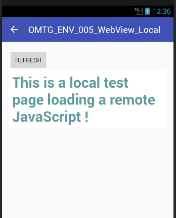
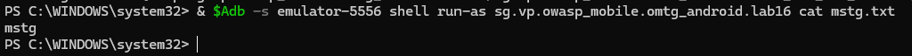


> 테스트 항목: `OMTG_ENV_005_WebView_Local`

설명 : ** **앱 안에 저장된 HTML 파일의 JavaScript가 안드로이드 앱 기능을 어디까지 호출할 수 있는지 확인하는 실습이다.

```java
packagesg.vp.owasp_mobile.OMTG_Android;

importandroid.os.Bundle;
importandroid.support.v7.app.AppCompatActivity;
importandroid.support.v7.widget.Toolbar;
importandroid.view.View;
importandroid.webkit.JavascriptInterface;
importandroid.webkit.WebChromeClient;
importandroid.webkit.WebView;
importandroid.widget.Button;

/* JADX INFO: loaded from: classes.dex */
publicclassOMTG_ENV_005_WebView_LocalextendsAppCompatActivity{
@Override// android.support.v7.app.AppCompatActivity, android.support.v4.app.FragmentActivity, android.support.v4.app.BaseFragmentActivityDonut, android.app.Activity
protectedvoidonCreate(BundlesavedInstanceState){
super.onCreate(savedInstanceState);
setContentView(sg.vp.owasp_mobile.p000omtg_android.R.layout.activity_omtg__env_005__web_view__local);
Toolbartoolbar=(Toolbar)findViewById(sg.vp.owasp_mobile.p000omtg_android.R.id.toolbar);
setSupportActionBar(toolbar);
getSupportActionBar().setDisplayHomeAsUpEnabled(true);
Buttonbutton=(Button)findViewById(sg.vp.owasp_mobile.p000omtg_android.R.id.button2);
button.setOnClickListener(newView.OnClickListener(){// from class: sg.vp.owasp_mobile.OMTG_Android.OMTG_ENV_005_WebView_Local.1
@Override// android.view.View.OnClickListener
publicvoidonClick(Viewv){
WebViewmyWebView=(WebView)OMTG_ENV_005_WebView_Local.this.findViewById(sg.vp.owasp_mobile.p000omtg_android.R.id.webView2);
myWebView.reload();
}
});
WebViewmyWebView=(WebView)findViewById(sg.vp.owasp_mobile.p000omtg_android.R.id.webView2);
myWebView.getSettings().setJavaScriptEnabled(true);
myWebView.getSettings().setAllowFileAccessFromFileURLs(true);
myWebView.setWebChromeClient(newWebChromeClient());
myWebView.addJavascriptInterface(newJavaScriptInterface(),"jsinterface");
myWebView.loadUrl("file:///android_asset/local.htm");
}

finalclassJavaScriptInterface{
JavaScriptInterface(){
}

@JavascriptInterface
publicStringgetSomeString(){
return"string";
}
}
}
```

코드를 보면 HTML을 WebView에 띄우면서 jsinterface라는 연결 통로를 만들게 된다.

HTML은 이 통로로 getSomeString()을 호출해 string을 받아 팝업으로 보여주게 된다.

이건 **JavaScript가 앱에 노출된 메서드를 호출했다**는 뜻을 나타낸다.

HTML에는 이어서 getClass()로 앱의 명령 실행 기능에 접근해 mstg.txt 파일을 만들려는 코드도 존재한다.

하지만 현재 APK와 API 23 환경에서는 getClass()가 JavaScript에 노출되지 않아 **그 시도는 실패하는 것이 정상이다.**

따라서 이 실습에서 확인할 핵심은 **팝업은 뜨지만 파일 생성은 되지 않는다는 차이를 나타낸다**. Android는 이 환경에서 @JavascriptInterface가 붙은 메서드만 JavaScript에 노출하게 된다.

별도로 코드의 setAllowFileAccessFromFileURLs(true)는 로컬 HTML의 JavaScript가 다른 로컬 파일에 접근할 수 있게 하는 위험한 설정이다.

이제 풀어보려고 했는데 현재 있는 api23 버전은 이 실습을 하기에 이슈가 있어서 api 16버전을 다운로드 받아서 실습을 진행 하기로 하였다.



여기 들어가면 string 창이 나오는데 ok를 누르고 파일을 찾아보면

```java
PS C:\WINDOWS\system32> & $Adb -s emulator-5556 shell run-as sg.vp.owasp_mobile.omtg_android.lab16 cat mstg.txt
mstg
```

이렇게 mstg라는 파일이 실제로 존재하는 것을 확인할 수 있다.

api 16에서는 JavaScript 인터페이스의 상속 메서드까지 노출시킬 수 있고, api16으로 그걸 실습한 문제였다.



