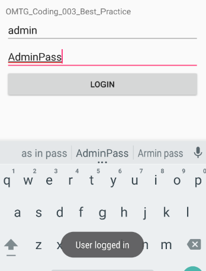
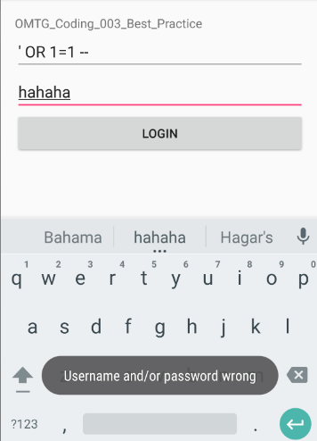


> 테스트 항목: `OMTG_CODING_003_Best_Practice`

문제 설명 : 이 실습은 SQL 인젝션이 가능한 로그인 화면과 이를 막은 로그인 화면을 비교하는 것이다.

```java
package sg.vp.owasp_mobile.OMTG_Android;

import android.content.Context;
import android.database.Cursor;
import android.database.sqlite.SQLiteDatabase;
import android.os.Bundle;
import android.support.v7.app.AppCompatActivity;
import android.support.v7.widget.Toolbar;
import android.view.View;
import android.widget.Button;
import android.widget.EditText;
import android.widget.Toast;
import java.io.File;

/* JADX INFO: loaded from: classes.dex */
public class OMTG_CODING_003_Best_Practice extends AppCompatActivity {
    Boolean login = false;
    EditText passwordText;
    EditText usernameText;

    @Override // android.support.v7.app.AppCompatActivity, android.support.v4.app.FragmentActivity, android.support.v4.app.BaseFragmentActivityDonut, android.app.Activity
    protected void onCreate(Bundle savedInstanceState) {
        initializeDB(getApplicationContext());
        super.onCreate(savedInstanceState);
        setContentView(sg.vp.owasp_mobile.p000omtg_android.R.layout.activity_omtg__coding_003__best__practice);
        Toolbar toolbar = (Toolbar) findViewById(sg.vp.owasp_mobile.p000omtg_android.R.id.toolbar);
        setSupportActionBar(toolbar);
        getSupportActionBar().setDisplayHomeAsUpEnabled(true);
        this.usernameText = (EditText) findViewById(sg.vp.owasp_mobile.p000omtg_android.R.id.sqlInjectionBestPracticeUsername);
        this.passwordText = (EditText) findViewById(sg.vp.owasp_mobile.p000omtg_android.R.id.sqlInjectionBestPracticePassword);
        Button btnLogin = (Button) findViewById(sg.vp.owasp_mobile.p000omtg_android.R.id.sqlInjectionBestPracticeButton);
        View.OnClickListener oclbtnLogin = new View.OnClickListener() { // from class: sg.vp.owasp_mobile.OMTG_Android.OMTG_CODING_003_Best_Practice.1
            @Override // android.view.View.OnClickListener
            public void onClick(View v) {
                OMTG_CODING_003_Best_Practice.this.login = Boolean.valueOf(OMTG_CODING_003_Best_Practice.this.checkLogin(OMTG_CODING_003_Best_Practice.this.usernameText.getText().toString(), OMTG_CODING_003_Best_Practice.this.passwordText.getText().toString()));
                OMTG_CODING_003_Best_Practice.this.toastOutput(OMTG_CODING_003_Best_Practice.this.login);
            }
        };
        btnLogin.setOnClickListener(oclbtnLogin);
    }

    /* JADX INFO: Access modifiers changed from: private */
    public void toastOutput(Boolean login) {
        if (login.booleanValue()) {
            Toast.makeText(this, "User logged in", 1).show();
        } else {
            Toast.makeText(this, "Username and/or password wrong", 1).show();
        }
    }

    private void initializeDB(Context applicationContext) {
        File dbAvailable = applicationContext.getDatabasePath("authentication-best-practice");
        if (!dbAvailable.exists()) {
            SQLiteDatabase authentication = openOrCreateDatabase("authentication-best-practice", 0, null);
            authentication.execSQL("CREATE TABLE IF NOT EXISTS Accounts(Username VARCHAR,Password VARCHAR);");
            authentication.execSQL("INSERT INTO Accounts VALUES('admin','AdminPass');");
            authentication.close();
        }
    }

    /* JADX INFO: Access modifiers changed from: private */
    /* JADX WARN: Code duplicated, block: B:11:0x0027 A[DONT_INVERT] */
    /* JADX WARN: Code duplicated, block: B:19:0x0037 A[Catch: Exception -> 0x0032, TRY_ENTER, TRY_LEAVE, TryCatch #5 {Exception -> 0x0032, blocks: (B:3:0x0009, B:12:0x0029, B:19:0x0037, B:15:0x002e, B:27:0x0045, B:31:0x004e, B:30:0x004a, B:28:0x0048), top: B:41:0x0009, inners: #1, #4 }] */
    /* JADX WARN: Code duplicated, block: B:26:0x0043 A[DONT_INVERT] */
    /* JADX WARN: Code duplicated, block: B:31:0x004e A[Catch: Exception -> 0x0032, TRY_LEAVE, TryCatch #5 {Exception -> 0x0032, blocks: (B:3:0x0009, B:12:0x0029, B:19:0x0037, B:15:0x002e, B:27:0x0045, B:31:0x004e, B:30:0x004a, B:28:0x0048), top: B:41:0x0009, inners: #1, #4 }] */
    /* JADX WARN: Code duplicated, block: B:35:0x0029 A[EXC_TOP_SPLITTER, SYNTHETIC] */
    /* JADX WARN: Code duplicated, block: B:39:0x0045 A[EXC_TOP_SPLITTER, SYNTHETIC] */
    public boolean checkLogin(String username, String password) throws Throwable {
        Throwable th;
        Throwable th2 = null;
        boolean bool = false;
        SQLiteDatabase authentication = openOrCreateDatabase("authentication-best-practice", 0, null);
        try {
            Cursor cursor = authentication.rawQuery("SELECT * FROM Accounts WHERE Username=? and Password=?", new String[]{username, password});
            Throwable th3 = null;
            if (cursor != null) {
                try {
                    bool = cursor.moveToFirst();
                    cursor.close();
                    if (cursor != null) {
                        if (0 != 0) {
                            try {
                                cursor.close();
                            } catch (Throwable th4) {
                                th3.addSuppressed(th4);
                            }
                        } else {
                            cursor.close();
                        }
                    }
                } catch (Throwable th5) {
                    try {
                        throw th5;
                    } catch (Throwable th6) {
                        th2 = th5;
                        th = th6;
                        if (cursor != null) {
                            if (th2 != null) {
                                cursor.close();
                            } else {
                                cursor.close();
                            }
                        }
                        throw th;
                    }
                }
            } else if (cursor != null) {
                if (0 != 0) {
                    cursor.close();
                } else {
                    cursor.close();
                }
            }
        } catch (Exception e) {
            e.printStackTrace();
        }
        return bool;
    }
}
```

위 코드는 전체 문제 코드이다.

```java
Cursor cursor = authentication.rawQuery(
    "SELECT * FROM Accounts WHERE Username=? and Password=?",
    new String[]{username, password}
);
boolean login = cursor.moveToFirst();
```

이 부분이 핵심 코드인데, 설명을 조금 해보면 아래와 같다.

? 두 자리에 사용자 이름과 비밀번호를 **값으로 바인딩한다.**

반면 코드는 입력값을 문자열로 연결해서, moveToFirst()가 행을 찾으면 로그인 성공으로 처리한다.

코드에서는 admin, AdminPass로 로그인을 받고 있다.

```java
authentication.execSQL(
    "INSERT INTO Accounts VALUES('admin','AdminPass');"
);
```



그래서 위 사진처럼 로그인을 하면 이렇게 성공 문장이 뜨게 된다.



이렇게 인젝션이 제대로 방어가 된 것을 확인할 수 있다.

