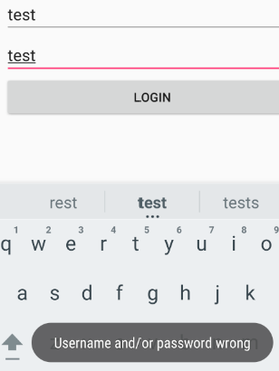
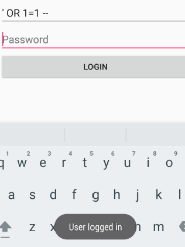


> 테스트 항목: `OMTG_CODING_003_SQL_Injection`

문제 설명 : SQL Injection을 성공 하는 것이다.

```java
package sg.vp.owasp_mobile.OMTG_Android;

import android.content.Context;
import android.database.Cursor;
import android.database.sqlite.SQLiteDatabase;
import android.os.Bundle;
import android.support.v7.app.AppCompatActivity;
import android.support.v7.widget.Toolbar;
import android.view.View;
import android.widget.Button;
import android.widget.EditText;
import android.widget.Toast;
import java.io.File;

/* JADX INFO: loaded from: classes.dex */
public class OMTG_CODING_003_SQL_Injection extends AppCompatActivity {
    Boolean login = false;
    EditText passwordText;
    EditText usernameText;

    @Override // android.support.v7.app.AppCompatActivity, android.support.v4.app.FragmentActivity, android.support.v4.app.BaseFragmentActivityDonut, android.app.Activity
    protected void onCreate(Bundle savedInstanceState) {
        initializeDB(getApplicationContext());
        super.onCreate(savedInstanceState);
        setContentView(sg.vp.owasp_mobile.p000omtg_android.R.layout.activity_omtg__coding_003__sql__injection);
        Toolbar toolbar = (Toolbar) findViewById(sg.vp.owasp_mobile.p000omtg_android.R.id.toolbar);
        setSupportActionBar(toolbar);
        getSupportActionBar().setDisplayHomeAsUpEnabled(true);
        this.usernameText = (EditText) findViewById(sg.vp.owasp_mobile.p000omtg_android.R.id.sqlInjectionUsername);
        this.passwordText = (EditText) findViewById(sg.vp.owasp_mobile.p000omtg_android.R.id.sqlInjectionPassword);
        Button btnLogin = (Button) findViewById(sg.vp.owasp_mobile.p000omtg_android.R.id.sqlInjectionButton);
        View.OnClickListener oclbtnLogin = new View.OnClickListener() { // from class: sg.vp.owasp_mobile.OMTG_Android.OMTG_CODING_003_SQL_Injection.1
            @Override // android.view.View.OnClickListener
            public void onClick(View v) {
                OMTG_CODING_003_SQL_Injection.this.login = Boolean.valueOf(OMTG_CODING_003_SQL_Injection.this.checkLogin(OMTG_CODING_003_SQL_Injection.this.usernameText.getText().toString(), OMTG_CODING_003_SQL_Injection.this.passwordText.getText().toString()));
                OMTG_CODING_003_SQL_Injection.this.toastOutput(OMTG_CODING_003_SQL_Injection.this.login);
            }
        };
        btnLogin.setOnClickListener(oclbtnLogin);
    }

    /* JADX INFO: Access modifiers changed from: private */
    public void toastOutput(Boolean login) {
        if (login.booleanValue()) {
            Toast.makeText(this, "User logged in", 1).show();
        } else {
            Toast.makeText(this, "Username and/or password wrong", 1).show();
        }
    }

    private void initializeDB(Context applicationContext) {
        File dbAvailable = applicationContext.getDatabasePath("authentication");
        if (!dbAvailable.exists()) {
            SQLiteDatabase authentication = openOrCreateDatabase("authentication", 0, null);
            authentication.execSQL("CREATE TABLE IF NOT EXISTS Accounts(Username VARCHAR,Password VARCHAR);");
            authentication.execSQL("INSERT INTO Accounts VALUES('admin','AdminPass');");
            authentication.close();
        }
    }

    /* JADX INFO: Access modifiers changed from: private */
    /* JADX WARN: Code duplicated, block: B:11:0x0040 A[DONT_INVERT] */
    /* JADX WARN: Code duplicated, block: B:19:0x0050 A[Catch: Exception -> 0x004b, TRY_ENTER, TRY_LEAVE, TryCatch #0 {Exception -> 0x004b, blocks: (B:3:0x0009, B:12:0x0042, B:19:0x0050, B:15:0x0047, B:27:0x005e, B:31:0x0067, B:30:0x0063, B:28:0x0061), top: B:35:0x0009, inners: #2, #5 }] */
    /* JADX WARN: Code duplicated, block: B:26:0x005c A[DONT_INVERT] */
    /* JADX WARN: Code duplicated, block: B:31:0x0067 A[Catch: Exception -> 0x004b, TRY_LEAVE, TryCatch #0 {Exception -> 0x004b, blocks: (B:3:0x0009, B:12:0x0042, B:19:0x0050, B:15:0x0047, B:27:0x005e, B:31:0x0067, B:30:0x0063, B:28:0x0061), top: B:35:0x0009, inners: #2, #5 }] */
    /* JADX WARN: Code duplicated, block: B:38:0x005e A[EXC_TOP_SPLITTER, SYNTHETIC] */
    /* JADX WARN: Code duplicated, block: B:40:0x0042 A[EXC_TOP_SPLITTER, SYNTHETIC] */
    public boolean checkLogin(String username, String password) throws Throwable {
        Throwable th = null;
        boolean bool = false;
        SQLiteDatabase authentication = openOrCreateDatabase("authentication", 0, null);
        try {
            Cursor cursor = authentication.rawQuery("SELECT * FROM Accounts WHERE Username = '" + username + "' and Password = '" + password + "';", null);
            Throwable th2 = null;
            if (cursor != null) {
                try {
                    bool = cursor.moveToFirst();
                    cursor.close();
                    if (cursor != null) {
                        if (0 != 0) {
                            try {
                                cursor.close();
                            } catch (Throwable th3) {
                                th2.addSuppressed(th3);
                            }
                        } else {
                            cursor.close();
                        }
                    }
                } catch (Throwable th4) {
                    th = th4;
                    if (cursor != null) {
                        if (th != null) {
                            cursor.close();
                        } else {
                            cursor.close();
                        }
                    }
                    throw th;
                }
            } else if (cursor != null) {
                if (0 != 0) {
                    cursor.close();
                } else {
                    cursor.close();
                }
            }
        } catch (Exception e) {
            e.printStackTrace();
        }
        return bool;
    }
}
```

전체 코드는 위와 같다.

```java
SQL Injection이란?

웹 애플리케이션의 입력값 검증이 미흡한 점을 악용하여,
공격자가 악의적인 SQL 쿼리를 삽입해 데이터베이스가 의도치 않은
비정상적 동작을 하도록 조작하는 공격 기법이다.
```

그래서 간단하게 이 문제에서 실습을 해보겠다.

```java
"SELECT * FROM Accounts WHERE Username = '" + username
    + "' and Password = '" + password + "';"
```

실제 코드를 보면 입력 값을 SQL에 이어 붙이는 코드가 존재한다.



이렇게 시험용으로 명령어를 치면 실패하지만



SQL Injection 문을 사용하면 이렇게 성공적으로 SQL Injection이 성공한 모습을 볼 수 있다.

