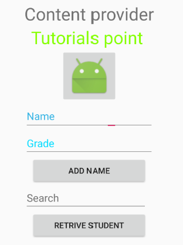
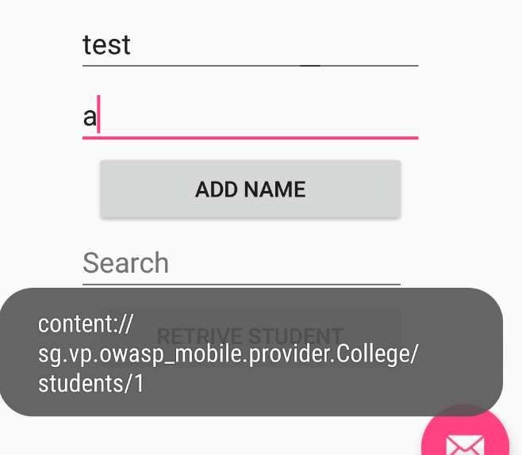
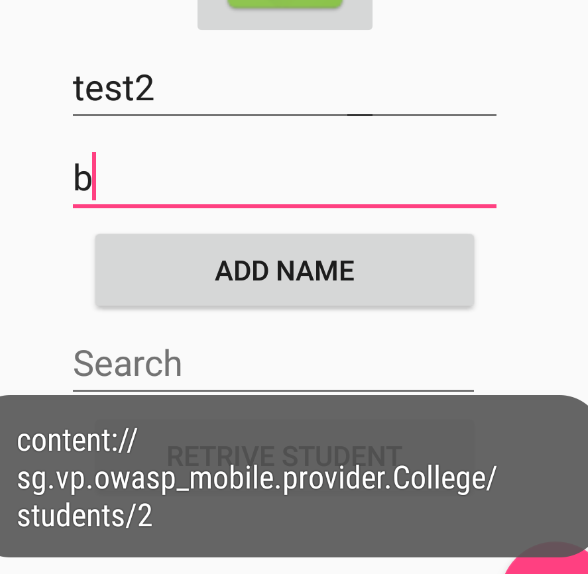
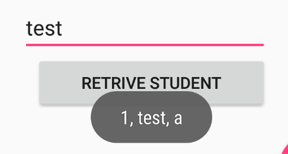
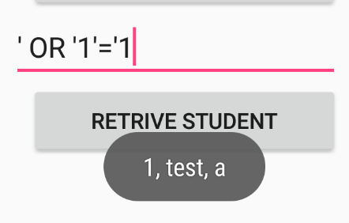
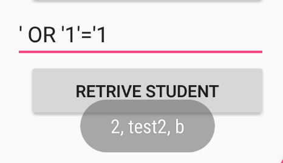


> 테스트 항목: `OMTG_CODING_003_SQL_Injection_Content_Provider`

문제 설명 : 특정 이름을 검색하는 칸에 SQL을 넣어 다른 학생들의 행까지 조회하는 것

```java
package sg.vp.owasp_mobile.OMTG_Android;

import android.content.ContentValues;
import android.database.Cursor;
import android.net.Uri;
import android.os.Bundle;
import android.support.v7.app.AppCompatActivity;
import android.support.v7.widget.Toolbar;
import android.util.Log;
import android.view.Menu;
import android.view.View;
import android.widget.EditText;
import android.widget.Toast;

/* JADX INFO: loaded from: classes.dex */
public class OMTG_CODING_003_SQL_Injection_Content_Provider extends AppCompatActivity {
    @Override // android.support.v7.app.AppCompatActivity, android.support.v4.app.FragmentActivity, android.support.v4.app.BaseFragmentActivityDonut, android.app.Activity
    protected void onCreate(Bundle savedInstanceState) {
        super.onCreate(savedInstanceState);
        setContentView(sg.vp.owasp_mobile.p000omtg_android.R.layout.activity_omtg__coding_003__sql__injection__content__provider);
        Toolbar toolbar = (Toolbar) findViewById(sg.vp.owasp_mobile.p000omtg_android.R.id.toolbar);
        setSupportActionBar(toolbar);
        getSupportActionBar().setDisplayHomeAsUpEnabled(true);
    }

    @Override // android.app.Activity
    public boolean onCreateOptionsMenu(Menu menu) {
        getMenuInflater().inflate(sg.vp.owasp_mobile.p000omtg_android.R.menu.menu_my, menu);
        return true;
    }

    public void onClickAddName(View view) {
        ContentValues values = new ContentValues();
        values.put("name", ((EditText) findViewById(sg.vp.owasp_mobile.p000omtg_android.R.id.editText2)).getText().toString());
        values.put("grade", ((EditText) findViewById(sg.vp.owasp_mobile.p000omtg_android.R.id.editText3)).getText().toString());
        Uri uri = getContentResolver().insert(OMTG_CODING_003_SQL_Injection_Content_Provider_Implementation.CONTENT_URI, values);
        Toast.makeText(getBaseContext(), uri.toString(), 1).show();
    }

    public void onClickRetrieveStudents(View view) {
        EditText searchPattern = (EditText) findViewById(sg.vp.owasp_mobile.p000omtg_android.R.id.searchPattern);
        Log.e("searchPattern", searchPattern.getText().toString());
        String WHERE = null;
        if (searchPattern.getText().toString() != null && !searchPattern.getText().toString().isEmpty()) {
            WHERE = "name='" + searchPattern.getText().toString() + "'";
        }
        Uri students = Uri.parse("content://sg.vp.owasp_mobile.provider.College/students");
        Cursor c = managedQuery(students, null, WHERE, null, "name");
        if (c.moveToFirst()) {
            do {
                Toast.makeText(this, c.getString(c.getColumnIndex("_id")) + ", " + c.getString(c.getColumnIndex("name")) + ", " + c.getString(c.getColumnIndex("grade")), 0).show();
            } while (c.moveToNext());
        }
    }
}
```

전체 소스코드는 위와 같다.



들어가면 사진은 이렇게 나온다.

문제의 핵심 부분은 학생의 Name·Grade를 ContentProvider를 통해 SQLite에 저장하고 검색합니다. 문제는 Search 입력값을 SQL 검색 조건에 직접 이어 붙이는 것이다.

```java
WHERE = "name='" + searchPattern.getText().toString() + "'";
Cursor c = managedQuery(students, null, WHERE, null, "name");
```

이 코드는 그 조건을 SQLiteQueryBuilder.query()에 전달한다.

입력값을 따로 바인딩하지 않아 SQL 문법이 검색 조건에 섞이게 된다.





총 이렇게 test, test2 총 2개를 생성 해준다.



일반 test도 치면 이렇게 검색이 정상적으로 되지만, SQL Injection을 입력하면?





이렇게 총 2개가 둘 다 보이는 모습을 볼 수 있다.

