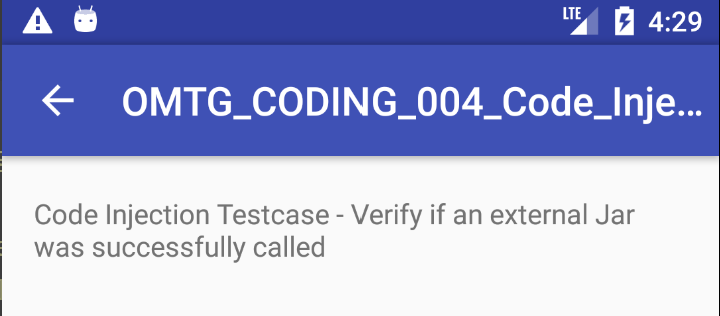
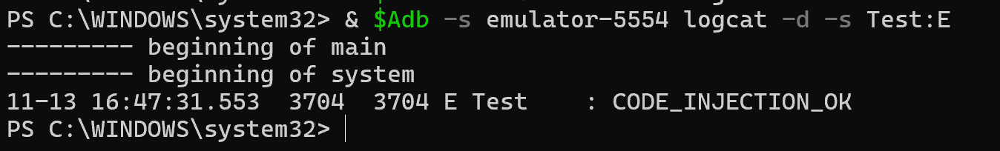


> 테스트 항목: `OMTG_CODING_004_Code_Injection`

문제 설명 : 외부 저장소의 JAR 파일을 코드로 불러와 실행하는지 확인하는 실습

```java
package sg.vp.owasp_mobile.OMTG_Android;

import android.os.Bundle;
import android.os.Environment;
import android.support.v7.app.AppCompatActivity;
import android.support.v7.widget.Toolbar;
import android.util.Log;
import dalvik.system.DexClassLoader;
import java.io.File;
import java.lang.reflect.Method;

/* JADX INFO: loaded from: classes.dex */
public class OMTG_CODING_004_Code_Injection extends AppCompatActivity {
    @Override // android.support.v7.app.AppCompatActivity, android.support.v4.app.FragmentActivity, android.support.v4.app.BaseFragmentActivityDonut, android.app.Activity
    protected void onCreate(Bundle savedInstanceState) {
        super.onCreate(savedInstanceState);
        setContentView(sg.vp.owasp_mobile.p000omtg_android.R.layout.activity_omtg__coding_004__code__injection);
        Toolbar toolbar = (Toolbar) findViewById(sg.vp.owasp_mobile.p000omtg_android.R.id.toolbar);
        setSupportActionBar(toolbar);
        getSupportActionBar().setDisplayHomeAsUpEnabled(true);
        try {
            String libPath = Environment.getExternalStorageDirectory() + "/libcodeinjection.jar";
            File tmpDir = getDir("dex", 0);
            DexClassLoader classloader = new DexClassLoader(libPath, tmpDir.getAbsolutePath(), null, getClass().getClassLoader());
            Class<Object> classToLoad = classloader.loadClass("com.example.CodeInjection");
            Object myInstance = classToLoad.newInstance();
            Method returnString = classToLoad.getMethod("returnString", new Class[0]);
            String result = (String) returnString.invoke(myInstance, new Object[0]);
            Log.e("Test", result);
        } catch (Exception e) {
            e.printStackTrace();
        }
    }
}
```



실제로 들어가면 이런 화면이 나온다.

```java
String libPath = Environment.getExternalStorageDirectory() + "/libcodeinjection.jar";
DexClassLoader classloader = new DexClassLoader(libPath, ...);
Class<?> classToLoad = classloader.loadClass("com.example.CodeInjection");
Object myInstance = classToLoad.newInstance();
Method returnString = classToLoad.getMethod("returnString");
String result = (String) returnString.invoke(myInstance);
Log.e("Test", result);
```

핵심 부분은 위와 같다.

이 화면에는 입력창이나 실행 버튼이 없다.

화면을 열 때 자동으로 실행되고, 결과는 **Logcat**에 남는다.

즉 /sdcard/libcodeinjection.jar 안의 com.example.CodeInjection.returnString()을 실행한다.

외부 저장소의 파일을 교체할 수 있는 주체가 앱에서 실행할 코드를 바꿀 수 있다는 점이 문제이다.



그래서 이렇게 powershell 명령어로 E Test : CODE\_INJECTION\_OK는 앱이 /sdcard/libcodeinjection.jar를 불러와 returnString()을 실행하고, 그 반환값을 기록했다는 증거를 남기게 작성을 하였다.

최종적으로 이 실습에서 확인한 문제는 외부 저장소의 JAR을 앱 코드로 실행한다는 점이다.

