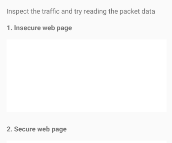
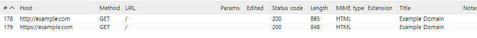
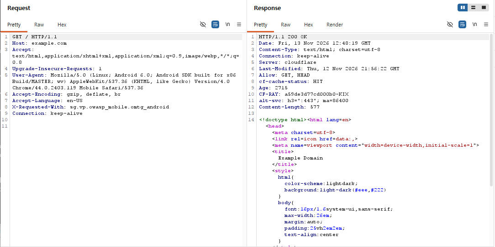
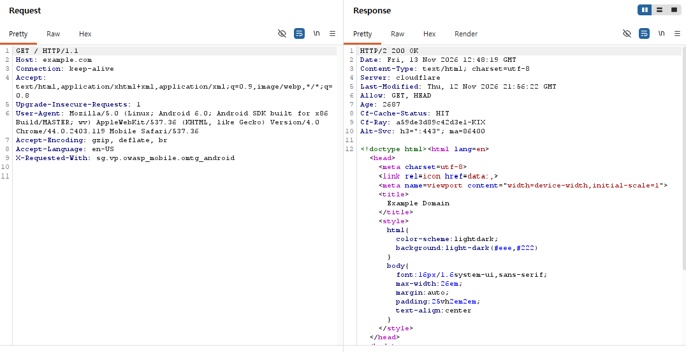


> 테스트 항목: `OMTG_NETW_001_Secure_Channel`

문제 : **앱이 같은 페이지를 HTTP와 HTTPS로 각각 여는 것을 확인하는 것이다.**



들어가보면 이렇게 1, 2가 있는데

Insecure web page는 HTTP이고,

Secure web page는 HTTPS를 나타낸다.

HTTP 요청은 전송 중 내용을 읽거나 바꿀 수 있고, HTTPS는 TLS로 보호한다.

이번 실습에서는 비밀번호 입력이 따로 없어 유출을 확인하는 문제는 아니다.

```java
package sg.vp.owasp_mobile.OMTG_Android;

import android.os.Bundle;
import android.support.v7.app.AppCompatActivity;
import android.support.v7.widget.Toolbar;
import android.webkit.WebView;

/* JADX INFO: loaded from: classes.dex */
public class OMTG_NETW_001_Secure_Channel extends AppCompatActivity {
    @Override // android.support.v7.app.AppCompatActivity, android.support.v4.app.FragmentActivity, android.support.v4.app.BaseFragmentActivityDonut, android.app.Activity
    protected void onCreate(Bundle savedInstanceState) {
        super.onCreate(savedInstanceState);
        setContentView(sg.vp.owasp_mobile.p000omtg_android.R.layout.activity_omtg__netw_001__secure__channel);
        Toolbar toolbar = (Toolbar) findViewById(sg.vp.owasp_mobile.p000omtg_android.R.id.toolbar);
        setSupportActionBar(toolbar);
        getSupportActionBar().setDisplayHomeAsUpEnabled(true);
        WebView insecure = (WebView) findViewById(sg.vp.owasp_mobile.p000omtg_android.R.id.webView1);
        WebView secure = (WebView) findViewById(sg.vp.owasp_mobile.p000omtg_android.R.id.webView2);
        insecure.loadUrl(getResources().getString(sg.vp.owasp_mobile.p000omtg_android.R.string.url_example));
        secure.loadUrl(getResources().getString(sg.vp.owasp_mobile.p000omtg_android.R.string.url_example_ssl));
    }
}
```

위의 코드가 전체 코드이고,

```java
insecure.loadUrl(getString(R.string.url_example));
secure.loadUrl(getString(R.string.url_example_ssl));
```

이 부분이 핵심 코드이다.

실제 코드를 보면 두 WebView에 서로 다른 주소를 넣는다.

문자열 설정을 보면 각각 http://example.com, https://example.com 이다.



burp에서 검색 필터 해보면 이렇게 총 2개가 나온다.



HTTP 내용



HTTPS 내용

딱히 별 다를게 없어 보이지만 HTTPS는 중간에 우리에게 응답이 오면서 복호화가 진행 되었기 때문에 이렇게 평문으로 읽을 수 있는 것이다.

