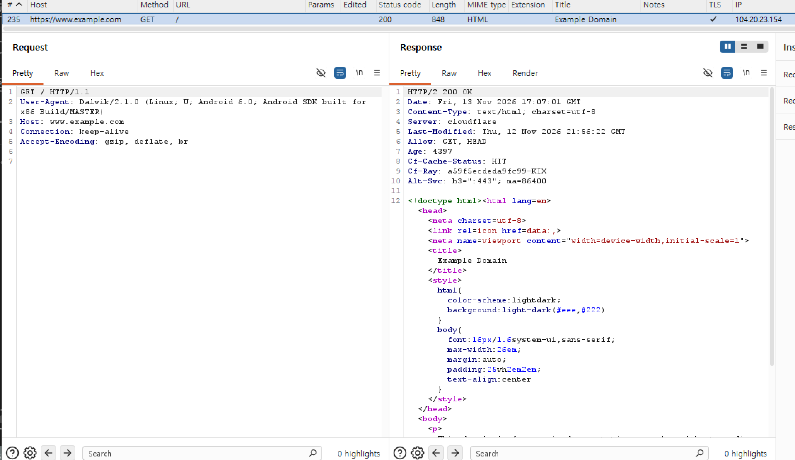


> 테스트 항목: `OMTG_NETW_004_SSL_Pinning`

문제 설명 : HTTPS 통신을 Burp에서 읽을 수 있는가를 확인하는 문제

```java
package sg.vp.owasp_mobile.OMTG_Android;

import android.os.Bundle;
import android.support.design.widget.FloatingActionButton;
import android.support.design.widget.Snackbar;
import android.support.v7.app.AppCompatActivity;
import android.support.v7.widget.Toolbar;
import android.view.View;
import java.io.BufferedReader;
import java.io.InputStream;
import java.io.InputStreamReader;
import java.net.URL;
import javax.net.ssl.HttpsURLConnection;

/* JADX INFO: loaded from: classes.dex */
public class OMTG_NETW_004_SSL_Pinning extends AppCompatActivity {
    @Override // android.support.v7.app.AppCompatActivity, android.support.v4.app.FragmentActivity, android.support.v4.app.BaseFragmentActivityDonut, android.app.Activity
    protected void onCreate(Bundle savedInstanceState) {
        super.onCreate(savedInstanceState);
        setContentView(sg.vp.owasp_mobile.p000omtg_android.R.layout.activity_omtg__netw_004__ssl__pinning);
        Toolbar toolbar = (Toolbar) findViewById(sg.vp.owasp_mobile.p000omtg_android.R.id.toolbar);
        setSupportActionBar(toolbar);
        FloatingActionButton fab = (FloatingActionButton) findViewById(sg.vp.owasp_mobile.p000omtg_android.R.id.fab);
        fab.setOnClickListener(new View.OnClickListener() { // from class: sg.vp.owasp_mobile.OMTG_Android.OMTG_NETW_004_SSL_Pinning.1
            @Override // android.view.View.OnClickListener
            public void onClick(View view) {
                Snackbar.make(view, "Replace with your own action", 0).setAction("Action", (View.OnClickListener) null).show();
            }
        });
        Thread thread = new Thread(new Runnable() { // from class: sg.vp.owasp_mobile.OMTG_Android.OMTG_NETW_004_SSL_Pinning.2
            @Override // java.lang.Runnable
            public void run() {
                try {
                    SSLPinning sslPinning = new SSLPinning();
                    sslPinning.onCreate();
                    URL myurl = new URL("https://www.example.com");
                    HttpsURLConnection con = (HttpsURLConnection) myurl.openConnection();
                    InputStream ins = con.getInputStream();
                    InputStreamReader isr = new InputStreamReader(ins);
                    BufferedReader in = new BufferedReader(isr);
                    while (true) {
                        String inputLine = in.readLine();
                        if (inputLine != null) {
                            System.out.println(inputLine);
                        } else {
                            in.close();
                            return;
                        }
                    }
                } catch (Exception e) {
                    e.printStackTrace();
                }
            }
        });
        thread.start();
    }
}
```

보통 HTTPS는 기기가 신뢰하는 인증서인지 검사한다.

SSL 피닝은 여기에 앱이 기대하는 인증서인지 확인하는 검사를 추가해서, Burp 같은 프록시의 인증서로 바뀌면 연결을 거부하도록 하는 방식이다.

그런데 이 앱의 검사 코드는 인증서 자체를 고정하지 않고, 발급자 이름에 O=PortSwigger가 있는지 확인한다.

PortSwigger는 Burp 인증서의 발급자 이름에 들어간다.

따라서 이 실습의 핵심은 피닝이라고 표시된 구현이 실제로 Burp의 HTTPS 가로채기를 막는지 확인하는 것이다.

```java
standardTrustManager.checkServerTrusted(certificates, authType);

String issuer_name = cert.getIssuerDN().getName();
if (issuer_name.indexOf(",O=PortSwigger,") == -1) {
    throw new CertificateException();
}
```

이게 이 부분의 핵심 코드이다.

먼저 일반 인증서 검증을 하고, 이어서 발급자 이름에 O=PortSwigger가 없으면 연결을 거부한다.

따라서 Burp 인증서를 이미 신뢰하도록 설정한 현재 환경에서 이 검사가 가로채기를 막는지 시험하는 것이다.



실제로 HTTP history를 누르면 이렇게 Response에 정상적으로 나와있는 모습을 볼 수 있다.

