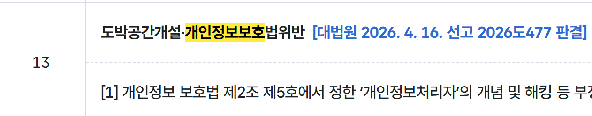

**불법으로 취득한 개인정보를 이용한 사람도 개인정보처리자일까?**

**목차**

- [1. 사건명과 선정이유](#1-사건명과-선정이유)
- [2. 양측의 입장과 원하는 결과](#2-양측의-입장과-원하는-결과)
- [3. 법원의 판단](#3-법원의-판단)
- [4. 나의 생각](#4-나의-생각)
- [+ 참고](#참고)

## 1. 사건명과 선정이유

- 사건명: 도박공간개설·개인정보보호법위반
- 대법원 판례: **대법원 2026.04.16. 선고 2026도477 판결**
- 제1심: 의정부지방법원 남양주지원 2025.08.27. 선고 2025고단1185 판결
- 제2심: 의정부지방법원 2025.12.19. 선고 2025노2686 판결
- 최종 결과: 피고인 상고기각, 징역 1년 확정
- [대법원 판결문 원문](https://www.law.go.kr/LSW/precInfoP.do?precSeq=619455)
- [제1심 판결문](https://www.law.go.kr/LSW/precInfoP.do?precSeq=619545)
- [제2심 판결문](https://www.law.go.kr/LSW/precInfoP.do?precSeq=619543)

**선정 이유**

- **개인정보 관련 판례를 찾아보다가 아래 사진과 같이 제목이 약간 끌리는 글을 발견 하였다.**
- **그래서 호기심에 한 번 들어가서 얕게 한 번 읽어봤는데 내용이 꽤 괜찮은거 같아서 이걸로 분석 하기로 하였다.**

---

## 2. 양측의 입장과 원하는 결과

**사건의 배경**

피고인은 공범과 함께 카지노와 슬롯게임 등을 제공하는 인터넷 도박사이트를 개설하기로 했다. 공범은 서버 등록과 통장 및 회원 모집 등을 맡고, 피고인은 사이트 관리와 회원 모집, 사이트 구매자 물색 등을 담당했다.

이들은 2024년 11월 28일부터 12월 25일까지 입출금·회원관리·정산 기능을 갖춘 도박사이트를 만들었다. 그런데 사이트의 기능을 점검하는 과정에서 다른 도박사이트 회원 **796명의 성명, 계좌번호, 휴대전화번호 등**을 취득했다. 이후 당사자들의 동의 없이 이들을 새 도박사이트 회원으로 등록하고, 실제 회원이 게임하는 것처럼 설정해 사이트의 기능을 시험했다.

문제가 된 개인정보는 다음과 같다.

- 다른 도박사이트 회원 796명의 성명
- 계좌번호
- 휴대전화번호
- 그 밖에 범죄일람표에 기록된 회원정보

**검사의 입장**

검사는 피고인이 공범과 함께 개인정보를 이용했다고 주장했다.

개인정보를 실제 도박사이트의 회원정보로 등록하고 사이트 기능 점검에 사용했으므로, 단순히 정보를 가지고 있었던 것을 넘어 개인정보를 적극적으로 처리·이용한 행위라는 것으로 주장을 하였다.

또한 개인정보가 해킹 등 부정한 방법으로 취득 되었거나 불법적으로 유통되고 있었다고 하더라도, 피고인이 이를 업무 목적으로 체계적으로 관리하고 이용했다면 개인정보 보호법상 개인정보처리자에 해당한다고 보았다.

검사가 적용한 주요 규정은 다음과 같다.

<table header-row="true">
<colgroup>
<col />
<col width="473.99998474121094" />
</colgroup>
<tr>
<td>
적용 조항
</td>
<td>
주요 내용
</td>
</tr>
<tr>
<td>
개인정보 보호법 제2조 제5호
</td>
<td>
업무 목적으로 개인정보파일을 운용하며 개인정보를 처리하는 자를 개인정보처리자로 정의
</td>
</tr>
<tr>
<td>
제18조 제1항
</td>
<td>
개인정보처리자의 목적 범위 초과 이용·제공 금지
</td>
</tr>
<tr>
<td>
제59조 제3호
</td>
<td>
정당한 권한 없이 다른 사람의 개인정보를 이용하는 행위 금지
</td>
</tr>
<tr>
<td>
제71조 제2호·제10호
</td>
<td>
위 행위에 대한 형사처벌 규정
</td>
</tr>
</table>

검사가 원한 결과는 피고인이 개인정보처리자에 해당한다는 점과 개인정보의 목적 외 이용 및 권한 없는 이용이 모두 인정되어 처벌받는 것이었다.

**피고인의 입장**

피고인은 다음과 같이 주장했다.

첫째, 도박사이트는 완성되지 않았으며 제작 도중 포기한 것이므로 도박공간개설죄가 성립하지 않는다고 주장했다. 실제로 사이트에 접속해 도박을 한 이용자도 없었다고 강조했다.

둘째, 796명의 개인정보는 공범이 독단적으로 가져와 사용한 것이며, 자신은 개인정보 이용에 공모하지 않았다고 주장했다.

셋째, 해당 개인정보가 적법하게 수집된 것이 아니므로 자신을 개인정보 보호법상 개인정보처리자로 볼 수 없다는 취지의 주장도 했다. 자신이 적법한 개인정보처리자가 아니라면 개인정보처리자에게 적용되는 제18조 제1항 위반죄도 성립하지 않는다는 논리였다.

마지막으로 제1심이 선고한 징역 1년은 지나치게 무겁다며 형을 줄여 달라고 요청했다.

**피고인이 원한 결과는 원심판결의 파기와 무죄 또는 형량 감경이었다.**

---

## 3. 법원의 판단

**제1심의 판단**

제1심은 피고인이 공범과 함께 도박사이트를 개설하고, 796명의 개인정보를 무단으로 이용했다고 인정했다.

개인정보 보호법 제59조 제3호는 정당한 권한 없이 다른 사람의 개인정보를 이용하는 행위를 금지한다. 제1심은 피고인이 이에 해당한다고 보고 제71조 제10호를 적용해 유죄로 판단했다.

법원은 특히 피고인이 도박사이트 개설을 주도했고, 사이트 운영을 위해 많은 사람의 개인정보를 이용했다는 점에서 죄질이 좋지 않다고 보았다. 다만 실제 도박사이트 운영에는 이르지 못했고 동종 범죄전력이 없다는 점도 함께 고려했다.

그 결과 제1심은 피고인에게 **징역 1년**을 선고했다. 다만 검사가 함께 기소한 개인정보 보호법 제18조 제1항 위반 부분을 별도로 판단하지 않았다는 문제가 있었다.

**제2심의 판단**

제2심은 제1심이 공소사실 일부를 판단하지 않은 잘못이 있다고 보고 제1심판결을 직권으로 파기했다.

제2심은 피고인이 개인정보 이용 사실을 알고 있었다고 판단했다. 피고인도 수사 과정에서 사이트를 쉽게 시험하기 위해 해당 정보를 사용했고, 개인정보를 이용해 실제 회원이 도박하는 것처럼 설정했다는 취지로 진술했다. 이러한 사정을 보면 개인정보를 공범이 독단적으로 사용했다는 주장은 받아들일 수 없다는 것이다.

또한 도박사이트에 일부 오류가 있었더라도 게임·입출금·회원관리 기능이 실제로 작동했다. 외부에서도 사이트에 접속할 수 있었으므로 실제 이용자가 도박하지 않았다는 이유만으로 도박공간개설죄의 성립을 부정할 수 없다고 판단했다.

개인정보 보호법과 관련해서는 피고인이 개인정보파일을 업무상 운용한 ‘개인정보처리자’에 해당한다고 보았다. 이에 따라 제18조 제1항과 제71조 제2호를 적용해 유죄로 인정했다.

다만 제2심은 피고인에게 제18조 제1항 위반죄가 성립하면 제59조 제3호 위반죄는 별도로 성립하지 않는다고 보았다. 결국 제1심을 파기했지만 형량은 동일하게 **징역 1년**으로 정했다.

**대법원의 판단**

대법원은 피고인의 상고를 기각했다.

**불법 취득자도 개인정보처리자인가?**

대법원은 개인정보처리자에 해당하는지를 판단할 때 개인정보의 취득 경위보다 실제로 개인정보파일을 업무 목적으로 운용했는지를 살펴야 한다고 판단했다.

개인정보 보호법 제2조 제5호는 개인정보처리자가 개인정보파일을 어떤 경위와 방법으로 취득해야 하는지 별도로 제한하고 있지 않다. 따라서 해킹 등 부정한 방법으로 개인정보를 직접 취득하거나 불법적으로 유통되던 개인정보를 취득했더라도, 이를 업무상 개인정보파일로 운용했다면 개인정보처리자에 해당할 수 있다.

대법원은 판결문에서 다음과 같이 설명했다.

> 개인정보파일을 어떠한 경위와 방법으로 취득하였는지에 대하여는 아무런 제한을 두고 있지 않다.

불법적으로 개인정보를 취득한 사람을 개인정보처리자에서 제외하면 오히려 더 큰 문제가 생긴다.

불법 취득자가 개인정보처리자의 의무와 책임을 면하게 되어 개인정보자기결정권 보호에 공백이 발생하기 때문이다.

따라서 대법원은 피고인이 개인정보처리자에 해당한다고 본 제2심 판단이 정당하다고 보았다.

**두 개인정보 보호법 위반죄의 관계**

이 부분에서는 대법원과 제2심의 판단이 달랐다.

제2심은 제18조 제1항 위반죄가 성립하면 제59조 제3호 위반죄는 별도로 성립하지 않는다고 보았다.

그러나 대법원은 두 조항의 의무주체와 금지행위 등 구체적인 구성요건이 서로 다르다고 판단했다.

- 제18조 제1항은 ‘개인정보처리자’의 목적 외 이용·제공을 금지한다.
- 제59조 제3호는 개인정보를 처리하거나 처리했던 사람의 권한 없는 이용·훼손·유출 등을 금지한다.

따라서 두 죄는 어느 한쪽이 다른 쪽에 포함되는 특별관계가 아니라 각각 독립된 범죄이다. 하나의 개인정보 이용행위가 두 범죄의 요건을 모두 충족하면 형법 제40조의 **상상적 경합** 관계가 된다.

대법원은 이를 다음과 같이 밝혔다.

> 상상적 경합의 관계에 있다고 보아야 한다.

다만 이 사건에서는 두 죄를 상상적 경합으로 판단하더라도 적용되는 처단형의 범위와 실제 형량에 차이가 없었다.

따라서 제2심의 법리오해가 최종 판결 결과에는 영향을 주지 않았다고 보아 피고인의 상고를 기각했다.

결국 피고인에 대한 **징역 1년이 확정**되었다. [대법원 판결문](https://www.law.go.kr/LSW/precInfoP.do?precSeq=619455)

---

## 4. 나의 생각

이번 판결을 읽으면서 개인정보를 불법적인 경로로 취득해도, 엄무 상의 목적으로 관리하고 이용하면 개인정보처리자가 될 수 있다는 것을 처음 알게 되었다.

특히 이 사건에서 나온 피고인은 당사자의 동의 없이 도박사이트에 회원 정보로 등록을 하였다. 피해 규모가 한 두 명도 아닌 몇 백명의 개인 정보를 다뤘다는 점에서 다소 형량이 낮다고는 생각된다.

1년 징역 판정을 받았으면 2027년 쯤 다시 사회에 나올텐데 재범을 하지는 않을까? 라는 생각도 개인적으로는 조금 든다.

실무적으로는 서비스나 프로그래을 시험하는 과정에서 실제 개인정보를 함부로 사용해서는 안된다는 점을 항상 기본으로 알아두어야 한다고 생각한다. 외부에서 받은 개인정보라면 그 출처를 명확히 밝히는 등 해야 한다고 생각하고, 실제로 그게 법으로 나와있다.

평소에는 판례 같은 경우를(유명한 것들만) 기사나 뉴스로 간단하게 봤지만 이번에는 판결문과 원문을 보면서 더 상세하게 사건과 피고인의 입장까지 들으며 보니 느낌이 색다른 것 같다.

개인정보 보호의 중요성과 법 적용 과정을 같이 알아본 좋은 사례라고 생각든다.

## + 참고

- [대법원 2026.04.16. 선고 2026도477 판결](https://www.law.go.kr/LSW/precInfoP.do?precSeq=619455)
- [의정부지방법원 2025.12.19. 선고 2025노2686 판결](https://www.law.go.kr/LSW/precInfoP.do?precSeq=619543)
- [의정부지방법원 남양주지원 2025.08.27. 선고 2025고단1185 판결](https://www.law.go.kr/LSW/precInfoP.do?precSeq=619545)
- [대법원 주요판결 설명 및 판결문 PDF](https://scourt.go.kr/supreme/news/NewsViewAction2.work?gubun=4&seqnum=11052)
